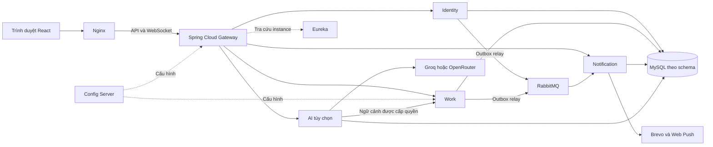

# Cẩm nang bảo vệ TaskNest

Mã nguồn đã đối chiếu với `origin/main` tại `7208bc5` ngày 24/11/2026. Mỗi dẫn chứng mở tại một dòng cụ thể trong workspace. Số dòng và phiên bản dựa trên commit này.

## Cách dùng

Đọc phần Kiến trúc trước, rồi theo một luồng xuyên suốt ở phần Nghiệp vụ Work. Tự trả lời câu hỏi trước khi xem đáp án. Ba căn cứ cần phân biệt là mã chạy, cấu hình và dependency khai báo.

## Sơ đồ cần vẽ khi bảo vệ

## Kiến trúc

### Bản đồ TaskNest

TaskNest kết nối khách hàng, đội phát triển và thành viên. Luồng xuyên suốt đi từ đăng yêu cầu, gửi đề xuất, chọn đội, triển khai, nghiệm thu đến đánh giá.

- React SPA gọi API cùng origin. Nginx phục vụ web và chuyển API/WebSocket đến Gateway. Gateway định tuyến theo cấu hình; Identity xử lý tài khoản, Work sở hữu nghiệp vụ, Notification xử lý thông báo, AI hỗ trợ đọc/tóm tắt. Config Server và Eureka là hai thành phần nền tảng.
- Nền tảng gồm 7 ứng dụng JVM trong Maven reactor. Docker Compose điều phối chúng cùng MySQL, RabbitMQ và frontend. Work chia theo module nghiệp vụ trong cùng service; không gọi từng tính năng như Task hoặc Timesheet là microservice độc lập.

**Dẫn chứng trong mã nguồn**

- [README.md:9](</Users/anlinh/.codex/worktrees/submission-history-review/Project OJT4/README.md:9>) · ## Cấu trúc · [commit cố định](https://github.com/KHANHAN007/TaskNest---OJT4/blob/7208bc53a1e21fd436a1af985763bde5c62c83c9/README.md#L9)
- [pom.xml:12](</Users/anlinh/.codex/worktrees/submission-history-review/Project OJT4/pom.xml:12>) · &lt;modules&gt; · [commit cố định](https://github.com/KHANHAN007/TaskNest---OJT4/blob/7208bc53a1e21fd436a1af985763bde5c62c83c9/pom.xml#L12)
- [infra/compose/compose.yml:25](</Users/anlinh/.codex/worktrees/submission-history-review/Project OJT4/infra/compose/compose.yml:25>) · services: · [commit cố định](https://github.com/KHANHAN007/TaskNest---OJT4/blob/7208bc53a1e21fd436a1af985763bde5c62c83c9/infra/compose/compose.yml#L25)

**Câu hỏi mở rộng**

- **Vì sao tách theo miền nghiệp vụ?** Tách trách nhiệm và vòng đời triển khai. Đổi lại phải xử lý lỗi mạng, phiên liên dịch vụ, tính nhất quán sự kiện và giám sát. Một VPS hoặc một MySQL vật lý vẫn là một miền lỗi chung.

### Java, Spring và Maven

Java 21, Spring Boot 4.1.2 và Spring Cloud BOM 2025.1.2 là phiên bản khai báo tại parent POM.

- Parent POM quản lý module, Java và phiên bản phụ thuộc; Maven Wrapper chạy Maven theo cấu hình repo. Spring Boot khởi tạo các bean, auto-configuration và đóng gói executable JAR. Controller nhận HTTP, service xử lý quy tắc, repository/JdbcTemplate truy cập dữ liệu.
- Bean Validation kiểm tra hình dạng dữ liệu ở ranh giới HTTP; quy tắc liên nhiều thực thể nằm ở service. @Transactional gom thao tác DB, không tự làm cho lời gọi HTTP hay gửi mail trở thành giao dịch phân tán.

**Dẫn chứng trong mã nguồn**

- [pom.xml:9](</Users/anlinh/.codex/worktrees/submission-history-review/Project OJT4/pom.xml:9>) · &lt;properties&gt;&lt;java.version&gt;21&lt;/java.version&gt; · [commit cố định](https://github.com/KHANHAN007/TaskNest---OJT4/blob/7208bc53a1e21fd436a1af985763bde5c62c83c9/pom.xml#L9)
- [services/work-service/pom.xml:14](</Users/anlinh/.codex/worktrees/submission-history-review/Project OJT4/services/work-service/pom.xml:14>) · &lt;dependency&gt;&lt;groupId&gt;org.springframework.boot&lt;/groupId&gt;&lt;artifactId&gt;spring-boot-starter-webmvc&lt;/artifactId&gt;&lt;/dependency&gt; · [commit cố định](https://github.com/KHANHAN007/TaskNest---OJT4/blob/7208bc53a1e21fd436a1af985763bde5c62c83c9/services/work-service/pom.xml#L14)
- [platform/api-gateway/pom.xml:12](</Users/anlinh/.codex/worktrees/submission-history-review/Project OJT4/platform/api-gateway/pom.xml:12>) · &lt;dependency&gt;&lt;groupId&gt;org.springframework.cloud&lt;/groupId&gt;&lt;artifactId&gt;spring-cloud-starter-gateway-server-webflux&lt;/artifactId&gt;&lt;/dependency&gt; · [commit cố định](https://github.com/KHANHAN007/TaskNest---OJT4/blob/7208bc53a1e21fd436a1af985763bde5c62c83c9/platform/api-gateway/pom.xml#L12)
- [services/work-service/src/main/java/vn/tasknest/workservice/api/community/CommunityController.java:66](</Users/anlinh/.codex/worktrees/submission-history-review/Project OJT4/services/work-service/src/main/java/vn/tasknest/workservice/api/community/CommunityController.java:66>) · public WorkResponse&lt;Long&gt; create(@AuthenticationPrincipal WorkActor actor, @Valid @RequestBody TeamInput input) { · [commit cố định](https://github.com/KHANHAN007/TaskNest---OJT4/blob/7208bc53a1e21fd436a1af985763bde5c62c83c9/services/work-service/src/main/java/vn/tasknest/workservice/api/community/CommunityController.java#L66)

**Câu hỏi mở rộng**

- **MVC và WebFlux khác nhau ra sao?** MVC của các API nghiệp vụ chạy theo mô hình servlet. Gateway dùng WebFlux với Mono và xử lý I/O bất đồng bộ. I/O chặn bên trong event loop sẽ làm giảm khả năng xử lý đồng thời.

### API Gateway WebFlux

Một điểm định tuyến API và WebSocket. Trong TaskNest, Gateway nhận request đã đi qua Nginx.

- Spring Cloud Gateway route gồm ID, URI đích, predicate và cấu hình/filter. Route file chat/upload theo Path + Method được đặt trước route Work tổng quát và có timeout riêng. Ảnh luồng để vẽ: Nginx → Gateway → route predicates → security/filter → lb://work-service → Work controller. Security WebFilter thuộc chuỗi WebFlux, không phải route predicate.
- /api/identity/** và /api/v1/auth/** đến Identity, /api/work/** đến Work, /api/notifications/** đến Notification, /api/ai/** đến AI; /ws/work đi Work, /ws đi Notification. Discovery locator tự sinh route bị tắt; cấu hình cho phép các tiền tố rõ ràng.
- Gateway có correlation ID, xử lý địa chỉ client theo proxy tin cậy và kiểm tra phiên cho tuyến Work project được bảo vệ. Work vẫn tự kiểm tra actor và quyền theo dự án. Connect timeout là thời gian thiết lập kết nối; response timeout là chờ phản hồi upstream theo cấu hình.

**Dẫn chứng trong mã nguồn**

- [infra/config-repo/api-gateway.yml:10](</Users/anlinh/.codex/worktrees/submission-history-review/Project OJT4/infra/config-repo/api-gateway.yml:10>) · connect-timeout: 3000 · [commit cố định](https://github.com/KHANHAN007/TaskNest---OJT4/blob/7208bc53a1e21fd436a1af985763bde5c62c83c9/infra/config-repo/api-gateway.yml#L10)
- [infra/config-repo/api-gateway.yml:23](</Users/anlinh/.codex/worktrees/submission-history-review/Project OJT4/infra/config-repo/api-gateway.yml:23>) · - id: work-file-upload · [commit cố định](https://github.com/KHANHAN007/TaskNest---OJT4/blob/7208bc53a1e21fd436a1af985763bde5c62c83c9/infra/config-repo/api-gateway.yml#L23)
- [infra/config-repo/api-gateway.yml:45](</Users/anlinh/.codex/worktrees/submission-history-review/Project OJT4/infra/config-repo/api-gateway.yml:45>) · - id: work-websocket · [commit cố định](https://github.com/KHANHAN007/TaskNest---OJT4/blob/7208bc53a1e21fd436a1af985763bde5c62c83c9/infra/config-repo/api-gateway.yml#L45)
- [platform/api-gateway/src/main/java/vn/tasknest/apigateway/config/SecurityConfiguration.java:21](</Users/anlinh/.codex/worktrees/submission-history-review/Project OJT4/platform/api-gateway/src/main/java/vn/tasknest/apigateway/config/SecurityConfiguration.java:21>) · return http.authorizeExchange(auth -&gt; auth · [commit cố định](https://github.com/KHANHAN007/TaskNest---OJT4/blob/7208bc53a1e21fd436a1af985763bde5c62c83c9/platform/api-gateway/src/main/java/vn/tasknest/apigateway/config/SecurityConfiguration.java#L21)
- [platform/api-gateway/src/main/java/vn/tasknest/apigateway/config/WorkProjectAuthorization.java:35](</Users/anlinh/.codex/worktrees/submission-history-review/Project OJT4/platform/api-gateway/src/main/java/vn/tasknest/apigateway/config/WorkProjectAuthorization.java:35>) · .exchangeToMono(response -&gt; { · [commit cố định](https://github.com/KHANHAN007/TaskNest---OJT4/blob/7208bc53a1e21fd436a1af985763bde5c62c83c9/platform/api-gateway/src/main/java/vn/tasknest/apigateway/config/WorkProjectAuthorization.java#L35)
- [platform/api-gateway/src/main/java/vn/tasknest/apigateway/config/CorrelationFilter.java:14](</Users/anlinh/.codex/worktrees/submission-history-review/Project OJT4/platform/api-gateway/src/main/java/vn/tasknest/apigateway/config/CorrelationFilter.java:14>) · @Override public Mono&lt;Void&gt; filter(ServerWebExchange exchange, WebFilterChain chain) { · [commit cố định](https://github.com/KHANHAN007/TaskNest---OJT4/blob/7208bc53a1e21fd436a1af985763bde5c62c83c9/platform/api-gateway/src/main/java/vn/tasknest/apigateway/config/CorrelationFilter.java#L14)
- [platform/api-gateway/src/main/java/vn/tasknest/apigateway/config/ClientAddressFilter.java:13](</Users/anlinh/.codex/worktrees/submission-history-review/Project OJT4/platform/api-gateway/src/main/java/vn/tasknest/apigateway/config/ClientAddressFilter.java:13>) · public class ClientAddressFilter implements WebFilter, Ordered { · [commit cố định](https://github.com/KHANHAN007/TaskNest---OJT4/blob/7208bc53a1e21fd436a1af985763bde5c62c83c9/platform/api-gateway/src/main/java/vn/tasknest/apigateway/config/ClientAddressFilter.java#L13)

**Câu hỏi mở rộng**

- **Gateway, reverse proxy, load balancer khác gì?** Nginx phục vụ SPA, proxy HTTP/upgrade WS. Gateway định tuyến theo API và áp chính sách. LoadBalancer chọn instance theo tên service. Một instance vẫn dùng lb:// và chưa tạo HA. Với 502/503/504, xem lớp trả lỗi, health, Eureka và log theo correlation ID, không suy luận căn nguyên chỉ từ status.

- **Route khai báo dependency Resilience4j thì có breaker cho mọi route không?** Không thể kết luận từ POM. Cần thấy filter CircuitBreaker và cấu hình tương ứng trên route hoặc wiring trong code. Route YAML TaskNest minh chứng routing và timeout.

Kiến thức nền đọc thêm. [Spring Cloud Gateway](https://docs.spring.io/spring-cloud-gateway/reference/spring-cloud-gateway-server-webflux/how-it-works.html)

### Eureka, Config Server và DNS

Eureka trả lời instance service ở đâu; Config Server cung cấp cấu hình; Docker DNS phân giải tên container trong mạng.

- Service import cấu hình từ Config Server, Compose mount config-repo chỉ đọc; Config Server dùng native backend. Eureka Server đăng ký/tra cứu service; Gateway định tuyến URI lb:// qua load balancer. Nginx dùng DNS nội bộ Docker để tìm Gateway khi container đổi IP.
- Khi demo Gateway, trình bày một route YAML, tên service trong cấu hình Spring rồi tới controller thực hiện. Không cần trình chiếu thông tin bí mật môi trường.

**Dẫn chứng trong mã nguồn**

- [platform/config-server/src/main/java/vn/tasknest/configserver/ConfigServerApplication.java:6](</Users/anlinh/.codex/worktrees/submission-history-review/Project OJT4/platform/config-server/src/main/java/vn/tasknest/configserver/ConfigServerApplication.java:6>) · @EnableConfigServer · [commit cố định](https://github.com/KHANHAN007/TaskNest---OJT4/blob/7208bc53a1e21fd436a1af985763bde5c62c83c9/platform/config-server/src/main/java/vn/tasknest/configserver/ConfigServerApplication.java#L6)
- [platform/config-server/src/main/resources/application.yml:5](</Users/anlinh/.codex/worktrees/submission-history-review/Project OJT4/platform/config-server/src/main/resources/application.yml:5>) · active: native · [commit cố định](https://github.com/KHANHAN007/TaskNest---OJT4/blob/7208bc53a1e21fd436a1af985763bde5c62c83c9/platform/config-server/src/main/resources/application.yml#L5)
- [platform/discovery-server/src/main/java/vn/tasknest/discoveryserver/DiscoveryServerApplication.java:6](</Users/anlinh/.codex/worktrees/submission-history-review/Project OJT4/platform/discovery-server/src/main/java/vn/tasknest/discoveryserver/DiscoveryServerApplication.java:6>) · @EnableEurekaServer · [commit cố định](https://github.com/KHANHAN007/TaskNest---OJT4/blob/7208bc53a1e21fd436a1af985763bde5c62c83c9/platform/discovery-server/src/main/java/vn/tasknest/discoveryserver/DiscoveryServerApplication.java#L6)
- [services/work-service/src/main/resources/application.yml:5](</Users/anlinh/.codex/worktrees/submission-history-review/Project OJT4/services/work-service/src/main/resources/application.yml:5>) · import: configserver:${CONFIG_SERVER_URL:http://localhost:8888} · [commit cố định](https://github.com/KHANHAN007/TaskNest---OJT4/blob/7208bc53a1e21fd436a1af985763bde5c62c83c9/services/work-service/src/main/resources/application.yml#L5)
- [infra/reverse-proxy/default.conf:14](</Users/anlinh/.codex/worktrees/submission-history-review/Project OJT4/infra/reverse-proxy/default.conf:14>) · resolver 127.0.0.11 valid=10s ipv6=off; · [commit cố định](https://github.com/KHANHAN007/TaskNest---OJT4/blob/7208bc53a1e21fd436a1af985763bde5c62c83c9/infra/reverse-proxy/default.conf#L14)

**Câu hỏi mở rộng**

- **Nếu Eureka hoặc Config lỗi thì sao?** Discovery mất dữ liệu hoặc còn cache có thể làm tuyến tìm instance thất bại. Config startup phụ thuộc import và cấu hình; cần xem log và health từng ứng dụng. Readiness của một container không đảm bảo toàn bộ luồng đã chạy.

Kiến thức nền đọc thêm. [Eureka](https://docs.spring.io/spring-cloud-netflix/reference/spring-cloud-netflix.html)

### REST, HTTP và hợp đồng dữ liệu

Trình duyệt gọi API qua fetch wrapper. Controller ánh xạ URL và HTTP method, service giữ quy tắc.

- GET đọc, POST tạo hoặc gửi lệnh, PUT cập nhật hoặc chuyển trạng thái theo hợp đồng từng endpoint. DTO/record phân tách input khách gửi khỏi entity. Query params chuyển tìm kiếm, page, bộ lọc. Multipart cho tải tệp; JSON cho phần lớn nghiệp vụ.
- Kiểm tra ở frontend cải thiện phản hồi; backend vẫn xác thực input và quyền. Version bảo vệ cập nhật đồng thời; requestId trên một số thao tác tạo chống lặp do retry.

**Dẫn chứng trong mã nguồn**

- [frontend/src/shared/api/client.ts:8](</Users/anlinh/.codex/worktrees/submission-history-review/Project OJT4/frontend/src/shared/api/client.ts:8>) · const response = await fetch(path, { · [commit cố định](https://github.com/KHANHAN007/TaskNest---OJT4/blob/7208bc53a1e21fd436a1af985763bde5c62c83c9/frontend/src/shared/api/client.ts#L8)
- [services/work-service/src/main/java/vn/tasknest/workservice/api/WorkResponse.java:5](</Users/anlinh/.codex/worktrees/submission-history-review/Project OJT4/services/work-service/src/main/java/vn/tasknest/workservice/api/WorkResponse.java:5>) · public record WorkResponse&lt;T&gt;(boolean success, String message, T data, Object errors, String code, · [commit cố định](https://github.com/KHANHAN007/TaskNest---OJT4/blob/7208bc53a1e21fd436a1af985763bde5c62c83c9/services/work-service/src/main/java/vn/tasknest/workservice/api/WorkResponse.java#L5)
- [services/work-service/src/main/java/vn/tasknest/workservice/api/WorkExceptionHandler.java:16](</Users/anlinh/.codex/worktrees/submission-history-review/Project OJT4/services/work-service/src/main/java/vn/tasknest/workservice/api/WorkExceptionHandler.java:16>) · @ExceptionHandler(WorkException.class) · [commit cố định](https://github.com/KHANHAN007/TaskNest---OJT4/blob/7208bc53a1e21fd436a1af985763bde5c62c83c9/services/work-service/src/main/java/vn/tasknest/workservice/api/WorkExceptionHandler.java#L16)
- [services/work-service/src/main/java/vn/tasknest/workservice/api/community/MarketplaceController.java:65](</Users/anlinh/.codex/worktrees/submission-history-review/Project OJT4/services/work-service/src/main/java/vn/tasknest/workservice/api/community/MarketplaceController.java:65>) · @PutMapping("/requests/{id}") · [commit cố định](https://github.com/KHANHAN007/TaskNest---OJT4/blob/7208bc53a1e21fd436a1af985763bde5c62c83c9/services/work-service/src/main/java/vn/tasknest/workservice/api/community/MarketplaceController.java#L65)

**Câu hỏi mở rộng**

- **401, 403, 404, 409, 429 nói gì?** 401 thiếu/không hợp lệ phiên; 403 có danh tính nhưng thiếu quyền; 404 tài nguyên không có hoặc không được công bố; 409 xung đột trạng thái/phiên bản; 429 chạm giới hạn. Hãy đối chiếu từng endpoint vì API có thể chủ động trả 404 cho tài nguyên riêng tư.

### Phân biệt công nghệ chạy thực tế và dependency khai báo

Dùng POM và package.json để trả lời “đã đưa vào dự án chưa”; dò đến file sử dụng và đường gọi để trả lời “chạy ở đâu”.

- Project này có JPA lẫn JDBC, Servlet MVC lẫn Gateway WebFlux, HTTP lẫn WebSocket lẫn AMQP. Chọn ví dụ theo từng lớp cụ thể thay vì gán một công nghệ cho toàn hệ thống.
- Thư viện Resilience4j xuất hiện trong POM, nhưng không suy ra mỗi route Gateway đã có breaker. H2 được khai báo cho AI trong phạm vi test. Lombok giảm boilerplate ở nơi có annotation; SLF4J/Logback và Jackson thường theo starter, tra import và dependency tree khi bị hỏi.
- Công cụ phụ theo repo gồm Python script, shell, Docker Compose, GitHub Actions, Maven Wrapper, npm, ESLint, Vitest, JUnit, Mockito/Spring test, đây là các phần công cụ phát triển/vận hành.

**Dẫn chứng trong mã nguồn**

- [services/ai-service/pom.xml:20](</Users/anlinh/.codex/worktrees/submission-history-review/Project OJT4/services/ai-service/pom.xml:20>) · &lt;dependency&gt;&lt;groupId&gt;com.h2database&lt;/groupId&gt;&lt;artifactId&gt;h2&lt;/artifactId&gt;&lt;scope&gt;test&lt;/scope&gt;&lt;/dependency&gt; · [commit cố định](https://github.com/KHANHAN007/TaskNest---OJT4/blob/7208bc53a1e21fd436a1af985763bde5c62c83c9/services/ai-service/pom.xml#L20)
- [platform/api-gateway/pom.xml:13](</Users/anlinh/.codex/worktrees/submission-history-review/Project OJT4/platform/api-gateway/pom.xml:13>) · &lt;dependency&gt;&lt;groupId&gt;org.springframework.cloud&lt;/groupId&gt;&lt;artifactId&gt;spring-cloud-starter-circuitbreaker-reactor-resilience4j&lt;/artifactId&gt;&lt;/dependency&gt; · [commit cố định](https://github.com/KHANHAN007/TaskNest---OJT4/blob/7208bc53a1e21fd436a1af985763bde5c62c83c9/platform/api-gateway/pom.xml#L13)
- [services/work-service/pom.xml:25](</Users/anlinh/.codex/worktrees/submission-history-review/Project OJT4/services/work-service/pom.xml:25>) · &lt;dependency&gt;&lt;groupId&gt;org.projectlombok&lt;/groupId&gt;&lt;artifactId&gt;lombok&lt;/artifactId&gt;&lt;optional&gt;true&lt;/optional&gt;&lt;/dependency&gt; · [commit cố định](https://github.com/KHANHAN007/TaskNest---OJT4/blob/7208bc53a1e21fd436a1af985763bde5c62c83c9/services/work-service/pom.xml#L25)
- [.github/workflows/ci.yml:43](</Users/anlinh/.codex/worktrees/submission-history-review/Project OJT4/.github/workflows/ci.yml:43>) · run: python3 scripts/check-java-dependencies.py · [commit cố định](https://github.com/KHANHAN007/TaskNest---OJT4/blob/7208bc53a1e21fd436a1af985763bde5c62c83c9/.github/workflows/ci.yml#L43)

**Câu hỏi mở rộng**

- **Làm thế nào kiểm Maven transitive dependencies?** Dùng ./mvnw dependency:tree -pl services/work-service. Parent BOM quản phiên bản; direct dependency nằm trong POM; transitive do starter kéo vào. Scope test không được xem là DB production.

### Phân tích một request Gateway đến từng tầng

Ví dụ GET /api/work/projects/{projectId}/tasks/{taskId}/submissions, dùng khi thầy yêu cầu chỉ code cụ thể.

- Nginx khớp location /api/ và proxy vào Gateway cổng 8080. Policy Gateway khớp /api/work/projects/** và gọi Identity bằng WebClient có @LoadBalanced để đọc phiên. Khi phiên hợp lệ, Gateway chuyển request nguyên tiền tố qua route work-api; Work dùng đúng tiền tố trong controller.
- TaskSubmissionHistoryController truyền projectId/taskId, actor và tham số trang đến TaskSubmissionHistoryService. Service kiểm phạm vi đọc; file của lần nộp có endpoint /{submissionId}/file. Dữ liệu trả về tiếp tục đi ngược qua Gateway và Nginx.
- GET công khai như danh sách yêu cầu là nhánh allowlist khác. Default cuối Gateway là denyAll. Khi upload file, ngưỡng đọc proxy dành cho /api/work/projects/*/files và timeout route Gateway đều được khai riêng, trong khi reverse proxy HTTPS phía trước có thể áp giới hạn riêng.

**Dẫn chứng trong mã nguồn**

- [infra/reverse-proxy/default.conf:41](</Users/anlinh/.codex/worktrees/submission-history-review/Project OJT4/infra/reverse-proxy/default.conf:41>) · location /api/ { · [commit cố định](https://github.com/KHANHAN007/TaskNest---OJT4/blob/7208bc53a1e21fd436a1af985763bde5c62c83c9/infra/reverse-proxy/default.conf#L41)
- [platform/api-gateway/src/main/java/vn/tasknest/apigateway/config/SecurityConfiguration.java:22](</Users/anlinh/.codex/worktrees/submission-history-review/Project OJT4/platform/api-gateway/src/main/java/vn/tasknest/apigateway/config/SecurityConfiguration.java:22>) · .pathMatchers(org.springframework.http.HttpMethod.GET, · [commit cố định](https://github.com/KHANHAN007/TaskNest---OJT4/blob/7208bc53a1e21fd436a1af985763bde5c62c83c9/platform/api-gateway/src/main/java/vn/tasknest/apigateway/config/SecurityConfiguration.java#L22)
- [platform/api-gateway/src/main/java/vn/tasknest/apigateway/config/SecurityConfiguration.java:58](</Users/anlinh/.codex/worktrees/submission-history-review/Project OJT4/platform/api-gateway/src/main/java/vn/tasknest/apigateway/config/SecurityConfiguration.java:58>) · .anyExchange().denyAll()) · [commit cố định](https://github.com/KHANHAN007/TaskNest---OJT4/blob/7208bc53a1e21fd436a1af985763bde5c62c83c9/platform/api-gateway/src/main/java/vn/tasknest/apigateway/config/SecurityConfiguration.java#L58)
- [platform/api-gateway/src/main/java/vn/tasknest/apigateway/config/WorkProjectAuthorization.java:22](</Users/anlinh/.codex/worktrees/submission-history-review/Project OJT4/platform/api-gateway/src/main/java/vn/tasknest/apigateway/config/WorkProjectAuthorization.java:22>) · @Bean @LoadBalanced · [commit cố định](https://github.com/KHANHAN007/TaskNest---OJT4/blob/7208bc53a1e21fd436a1af985763bde5c62c83c9/platform/api-gateway/src/main/java/vn/tasknest/apigateway/config/WorkProjectAuthorization.java#L22)
- [platform/api-gateway/src/main/java/vn/tasknest/apigateway/config/WorkProjectAuthorization.java:44](</Users/anlinh/.codex/worktrees/submission-history-review/Project OJT4/platform/api-gateway/src/main/java/vn/tasknest/apigateway/config/WorkProjectAuthorization.java:44>) · }).timeout(Duration.ofSeconds(3)) · [commit cố định](https://github.com/KHANHAN007/TaskNest---OJT4/blob/7208bc53a1e21fd436a1af985763bde5c62c83c9/platform/api-gateway/src/main/java/vn/tasknest/apigateway/config/WorkProjectAuthorization.java#L44)
- [infra/config-repo/api-gateway.yml:37](</Users/anlinh/.codex/worktrees/submission-history-review/Project OJT4/infra/config-repo/api-gateway.yml:37>) · - id: work-api · [commit cố định](https://github.com/KHANHAN007/TaskNest---OJT4/blob/7208bc53a1e21fd436a1af985763bde5c62c83c9/infra/config-repo/api-gateway.yml#L37)
- [services/work-service/src/main/java/vn/tasknest/workservice/api/submission/TaskSubmissionHistoryController.java:14](</Users/anlinh/.codex/worktrees/submission-history-review/Project OJT4/services/work-service/src/main/java/vn/tasknest/workservice/api/submission/TaskSubmissionHistoryController.java:14>) · @RequestMapping("/api/work/projects/{projectId}/tasks/{taskId}/submissions") · [commit cố định](https://github.com/KHANHAN007/TaskNest---OJT4/blob/7208bc53a1e21fd436a1af985763bde5c62c83c9/services/work-service/src/main/java/vn/tasknest/workservice/api/submission/TaskSubmissionHistoryController.java#L14)
- [services/work-service/src/main/java/vn/tasknest/workservice/application/submission/TaskSubmissionHistoryService.java:64](</Users/anlinh/.codex/worktrees/submission-history-review/Project OJT4/services/work-service/src/main/java/vn/tasknest/workservice/application/submission/TaskSubmissionHistoryService.java:64>) · public PageResponse&lt;TaskSubmissionResponse&gt; list(WorkActor actor, long projectId, long taskId, · [commit cố định](https://github.com/KHANHAN007/TaskNest---OJT4/blob/7208bc53a1e21fd436a1af985763bde5c62c83c9/services/work-service/src/main/java/vn/tasknest/workservice/application/submission/TaskSubmissionHistoryService.java#L64)

**Câu hỏi mở rộng**

- **Nếu Identity trả 401 hoặc không phản hồi thì Gateway làm gì?** WorkProjectAuthorization chuyển 401 thành quyết định từ chối; lỗi upstream ngoài phản hồi hợp lệ hoặc vượt thời hạn 3 giây dẫn tới nhánh 503. Mở tương ứng security chain để giải thích status người dùng thật sự nhận.

- **Gateway có gọi lại Work khi timeout không?** Không suy ra retry từ timeout. Tìm Retry filter hoặc policy đã cấu hình. Nếu chỉ timeout thì client mất phản hồi, trong khi service có thể đã thực hiện lệnh, nên POST cần idempotency trước khi retry.

- **API Gateway có coi endpoint public được sửa công khai không?** Không. Match theo HTTP method và path. GET công khai chỉ áp các tuyến được liệt kê; các đường community còn lại đi qua kiểm tra phiên và Work kiểm quyền.

Kiến thức nền đọc thêm. [Gateway mapping và filter chain](https://docs.spring.io/spring-cloud-gateway/reference/spring-cloud-gateway-server-webflux/how-it-works.html)

## Danh tính và quyền

### Đăng ký, xác nhận email và đặt lại mật khẩu

Identity sở hữu tài khoản, xác nhận email và luồng đặt lại mật khẩu.

- Form gửi tới AuthController, service kiểm tra dữ liệu, dùng PasswordEncoder BCrypt rồi lưu tài khoản. Token một lần phục vụ xác nhận và đặt lại; Identity ghi outbox để Notification gửi email. Dùng link hợp lệ để đổi trạng thái qua endpoint tương ứng.
- Nginx tránh ghi query và tắt log trên một số điểm chứa token. Cấu hình production lấy bí mật từ môi trường. Kiểm tra quyền truy cập Git trước khi trình chiếu các file riêng tư.

**Dẫn chứng trong mã nguồn**

- [services/identity-service/src/main/java/vn/tasknest/identityservice/service/AccountServiceImpl.java:128](</Users/anlinh/.codex/worktrees/submission-history-review/Project OJT4/services/identity-service/src/main/java/vn/tasknest/identityservice/service/AccountServiceImpl.java:128>) · String passwordHash = passwordEncoder.encode(request.getPassword()); · [commit cố định](https://github.com/KHANHAN007/TaskNest---OJT4/blob/7208bc53a1e21fd436a1af985763bde5c62c83c9/services/identity-service/src/main/java/vn/tasknest/identityservice/service/AccountServiceImpl.java#L128)
- [services/identity-service/src/main/java/vn/tasknest/identityservice/config/SecurityConfiguration.java:34](</Users/anlinh/.codex/worktrees/submission-history-review/Project OJT4/services/identity-service/src/main/java/vn/tasknest/identityservice/config/SecurityConfiguration.java:34>) · return new BCryptPasswordEncoder(); · [commit cố định](https://github.com/KHANHAN007/TaskNest---OJT4/blob/7208bc53a1e21fd436a1af985763bde5c62c83c9/services/identity-service/src/main/java/vn/tasknest/identityservice/config/SecurityConfiguration.java#L34)
- [services/identity-service/src/main/java/vn/tasknest/identityservice/api/controller/AuthController.java:109](</Users/anlinh/.codex/worktrees/submission-history-review/Project OJT4/services/identity-service/src/main/java/vn/tasknest/identityservice/api/controller/AuthController.java:109>) · @GetMapping("/api/identity/auth/verify-email") · [commit cố định](https://github.com/KHANHAN007/TaskNest---OJT4/blob/7208bc53a1e21fd436a1af985763bde5c62c83c9/services/identity-service/src/main/java/vn/tasknest/identityservice/api/controller/AuthController.java#L109)
- [services/identity-service/src/main/java/vn/tasknest/identityservice/infrastructure/messaging/VerificationOutboxPublisher.java:32](</Users/anlinh/.codex/worktrees/submission-history-review/Project OJT4/services/identity-service/src/main/java/vn/tasknest/identityservice/infrastructure/messaging/VerificationOutboxPublisher.java:32>) · @Scheduled(fixedDelayString = "${tasknest.mail.poll-ms:2000}") · [commit cố định](https://github.com/KHANHAN007/TaskNest---OJT4/blob/7208bc53a1e21fd436a1af985763bde5c62c83c9/services/identity-service/src/main/java/vn/tasknest/identityservice/infrastructure/messaging/VerificationOutboxPublisher.java#L32)
- [services/notification-service/src/main/java/vn/tasknest/notificationservice/application/mail/VerificationMailWorker.java:54](</Users/anlinh/.codex/worktrees/submission-history-review/Project OJT4/services/notification-service/src/main/java/vn/tasknest/notificationservice/application/mail/VerificationMailWorker.java:54>) · @Scheduled(fixedDelayString="${tasknest.mail.poll-ms:2000}") · [commit cố định](https://github.com/KHANHAN007/TaskNest---OJT4/blob/7208bc53a1e21fd436a1af985763bde5c62c83c9/services/notification-service/src/main/java/vn/tasknest/notificationservice/application/mail/VerificationMailWorker.java#L54)
- [infra/reverse-proxy/default.conf:2](</Users/anlinh/.codex/worktrees/submission-history-review/Project OJT4/infra/reverse-proxy/default.conf:2>) · log_format tasknest_safe '$remote_addr - [$time_local] "$request_method $uri $server_protocol" $status $body_bytes_sent'; · [commit cố định](https://github.com/KHANHAN007/TaskNest---OJT4/blob/7208bc53a1e21fd436a1af985763bde5c62c83c9/infra/reverse-proxy/default.conf#L2)

**Câu hỏi mở rộng**

- **Vì sao BCrypt cho mật khẩu, SHA-256 cho refresh token ngẫu nhiên?** Mật khẩu do người chọn cần hash có cost và salt để làm chậm đoán. Refresh token đủ ngẫu nhiên có entropy cao, hash nhanh hỗ trợ tra cứu và hạn chế lộ token gốc trong DB.

### JWT RS256, JWKS và phiên đăng nhập

Access token được ký RSA. Refresh token là chuỗi ngẫu nhiên quản lý theo phiên và lưu dạng hash phía server.

- Login tạo phiên và cấp JWT; frontend gửi Bearer khi gọi API. Cookie HttpOnly chứa refresh token. Khi làm mới, AuthSessionService khóa bản ghi phiên/token, đánh dấu token cũ rồi cấp token mới. Nhánh phát hiện reuse có xử lý thu hồi phiên. Logout thu hồi phiên và xóa cookie refresh.
- JWT có header, payload và chữ ký; chữ ký xác thực tính toàn vẹn, payload có thể đọc được. JWKS công bố public key được chọn theo kid. Xác thực phiên đang hoạt động vẫn quan trọng sau khi chữ ký hợp lệ.

**Dẫn chứng trong mã nguồn**

- [services/identity-service/src/main/java/vn/tasknest/identityservice/service/TokenService.java:66](</Users/anlinh/.codex/worktrees/submission-history-review/Project OJT4/services/identity-service/src/main/java/vn/tasknest/identityservice/service/TokenService.java:66>) · JwtClaimsSet claims = JwtClaimsSet.builder() · [commit cố định](https://github.com/KHANHAN007/TaskNest---OJT4/blob/7208bc53a1e21fd436a1af985763bde5c62c83c9/services/identity-service/src/main/java/vn/tasknest/identityservice/service/TokenService.java#L66)
- [services/identity-service/src/main/java/vn/tasknest/identityservice/api/controller/AuthController.java:196](</Users/anlinh/.codex/worktrees/submission-history-review/Project OJT4/services/identity-service/src/main/java/vn/tasknest/identityservice/api/controller/AuthController.java:196>) · @CookieValue(name = "${tasknest.identity.cookie.name:tasknest_refresh}", required = false) String refreshToken, · [commit cố định](https://github.com/KHANHAN007/TaskNest---OJT4/blob/7208bc53a1e21fd436a1af985763bde5c62c83c9/services/identity-service/src/main/java/vn/tasknest/identityservice/api/controller/AuthController.java#L196)
- [services/identity-service/src/main/java/vn/tasknest/identityservice/api/controller/AuthController.java:264](</Users/anlinh/.codex/worktrees/submission-history-review/Project OJT4/services/identity-service/src/main/java/vn/tasknest/identityservice/api/controller/AuthController.java:264>) · return ResponseEntity.ok(new JWKSet(rsaKey.toPublicJWK()).toJSONObject()); · [commit cố định](https://github.com/KHANHAN007/TaskNest---OJT4/blob/7208bc53a1e21fd436a1af985763bde5c62c83c9/services/identity-service/src/main/java/vn/tasknest/identityservice/api/controller/AuthController.java#L264)
- [services/identity-service/src/main/java/vn/tasknest/identityservice/service/AuthSessionService.java:101](</Users/anlinh/.codex/worktrees/submission-history-review/Project OJT4/services/identity-service/src/main/java/vn/tasknest/identityservice/service/AuthSessionService.java:101>) · public RotationResult rotate(String rawRefreshToken) { · [commit cố định](https://github.com/KHANHAN007/TaskNest---OJT4/blob/7208bc53a1e21fd436a1af985763bde5c62c83c9/services/identity-service/src/main/java/vn/tasknest/identityservice/service/AuthSessionService.java#L101)
- [services/identity-service/src/main/java/vn/tasknest/identityservice/service/AuthSessionService.java:139](</Users/anlinh/.codex/worktrees/submission-history-review/Project OJT4/services/identity-service/src/main/java/vn/tasknest/identityservice/service/AuthSessionService.java:139>) · // Token cũ phải được đánh dấu đã dùng TRƯỚC khi chèn token mới (uq_refresh_current: 1 token sống/phiên). · [commit cố định](https://github.com/KHANHAN007/TaskNest---OJT4/blob/7208bc53a1e21fd436a1af985763bde5c62c83c9/services/identity-service/src/main/java/vn/tasknest/identityservice/service/AuthSessionService.java#L139)
- [services/identity-service/src/main/java/vn/tasknest/identityservice/security/SessionActiveValidator.java:26](</Users/anlinh/.codex/worktrees/submission-history-review/Project OJT4/services/identity-service/src/main/java/vn/tasknest/identityservice/security/SessionActiveValidator.java:26>) · public OAuth2TokenValidatorResult validate(Jwt jwt) { · [commit cố định](https://github.com/KHANHAN007/TaskNest---OJT4/blob/7208bc53a1e21fd436a1af985763bde5c62c83c9/services/identity-service/src/main/java/vn/tasknest/identityservice/security/SessionActiveValidator.java#L26)
- [frontend/src/features/auth/api/auth.api.ts:51](</Users/anlinh/.codex/worktrees/submission-history-review/Project OJT4/frontend/src/features/auth/api/auth.api.ts:51>) · const rotate = () =&gt; requestJson&lt;Envelope&lt;Tokens&gt;&gt;('/api/identity/auth/refresh-token', { method: 'POST', body: {}, csrf: true }); · [commit cố định](https://github.com/KHANHAN007/TaskNest---OJT4/blob/7208bc53a1e21fd436a1af985763bde5c62c83c9/frontend/src/features/auth/api/auth.api.ts#L51)

**Câu hỏi mở rộng**

- **Nếu hai tab refresh đồng thời?** Cần phối hợp phía client và xử lý phía server bằng rotation/locking. Xem chính xác nhánh reuse và mức dung sai trong AuthSessionService. Không suy diễn mọi request có thể replay an toàn.

Kiến thức nền đọc thêm. [RFC 7519 · JSON Web Token](https://www.rfc-editor.org/rfc/rfc7519)

### Spring Security, CSRF, CORS và phân quyền

Xác thực tìm actor, phân quyền quyết định actor được đọc/sửa dữ liệu nào. TaskNest kiểm tra quyền theo tài nguyên ở Work.

- Spring Security có chuỗi filter; WorkBearerFilter xác minh phiên qua Identity và tạo actor. ProjectPermissionService phân biệt khách hàng, chủ dự án, quản lý, thành viên và trạng thái dự án. Hội viên đội, trưởng đội và vai trò dự án là quan hệ khác nhau.
- CSRF liên quan cookie tự gửi. Identity có bảo vệ refresh/logout và kiểm tra nguồn trình duyệt. CORS là chính sách browser kiểm soát đọc phản hồi cross-origin. XSS có thể thực thi script trong origin, do đó HttpOnly giảm khả năng đọc cookie trực tiếp nhưng không thay cho phòng XSS.
- Quyền xem avatar được chọn theo ngữ cảnh và cài đặt công khai; quyền thấy nút trên UI không cấp quyền cho API. Trạng thái hoàn thành khóa ghi trừ đường xử lý có chủ đích như đánh giá và đồng thuận.

**Dẫn chứng trong mã nguồn**

- [services/work-service/src/main/java/vn/tasknest/workservice/config/WorkBearerFilter.java:18](</Users/anlinh/.codex/worktrees/submission-history-review/Project OJT4/services/work-service/src/main/java/vn/tasknest/workservice/config/WorkBearerFilter.java:18>) · private final IdentitySessionVerifier verifier; · [commit cố định](https://github.com/KHANHAN007/TaskNest---OJT4/blob/7208bc53a1e21fd436a1af985763bde5c62c83c9/services/work-service/src/main/java/vn/tasknest/workservice/config/WorkBearerFilter.java#L18)
- [services/work-service/src/main/java/vn/tasknest/workservice/application/security/ProjectPermissionService.java:38](</Users/anlinh/.codex/worktrees/submission-history-review/Project OJT4/services/work-service/src/main/java/vn/tasknest/workservice/application/security/ProjectPermissionService.java:38>) · public ProjectAccess requireWritable(Long projectId, WorkActor actor) { · [commit cố định](https://github.com/KHANHAN007/TaskNest---OJT4/blob/7208bc53a1e21fd436a1af985763bde5c62c83c9/services/work-service/src/main/java/vn/tasknest/workservice/application/security/ProjectPermissionService.java#L38)
- [services/work-service/src/main/java/vn/tasknest/workservice/application/security/ProjectPermissionService.java:80](</Users/anlinh/.codex/worktrees/submission-history-review/Project OJT4/services/work-service/src/main/java/vn/tasknest/workservice/application/security/ProjectPermissionService.java:80>) · public ProjectRole resolveRole(Project project, String userId) { · [commit cố định](https://github.com/KHANHAN007/TaskNest---OJT4/blob/7208bc53a1e21fd436a1af985763bde5c62c83c9/services/work-service/src/main/java/vn/tasknest/workservice/application/security/ProjectPermissionService.java#L80)
- [services/identity-service/src/main/java/vn/tasknest/identityservice/security/BrowserOriginFilter.java:16](</Users/anlinh/.codex/worktrees/submission-history-review/Project OJT4/services/identity-service/src/main/java/vn/tasknest/identityservice/security/BrowserOriginFilter.java:16>) · public class BrowserOriginFilter extends OncePerRequestFilter { · [commit cố định](https://github.com/KHANHAN007/TaskNest---OJT4/blob/7208bc53a1e21fd436a1af985763bde5c62c83c9/services/identity-service/src/main/java/vn/tasknest/identityservice/security/BrowserOriginFilter.java#L16)
- [services/identity-service/src/main/java/vn/tasknest/identityservice/config/SecurityConfiguration.java:13](</Users/anlinh/.codex/worktrees/submission-history-review/Project OJT4/services/identity-service/src/main/java/vn/tasknest/identityservice/config/SecurityConfiguration.java:13>) · import org.springframework.security.web.csrf.CookieCsrfTokenRepository; · [commit cố định](https://github.com/KHANHAN007/TaskNest---OJT4/blob/7208bc53a1e21fd436a1af985763bde5c62c83c9/services/identity-service/src/main/java/vn/tasknest/identityservice/config/SecurityConfiguration.java#L13)

**Câu hỏi mở rộng**

- **Nếu đã có Gateway, tại sao Work xác thực lại?** Gateway là cửa vào; quyền đọc task, đổi vai trò hoặc mở lại dự án cần xem dữ liệu Work. Ranh giới nghiệp vụ phải bảo vệ cả khi request đến từ một client nội bộ được phép truy cập mạng.

Kiến thức nền đọc thêm. [Spring Security · CSRF](https://docs.spring.io/spring-security/reference/servlet/exploits/csrf.html)

### Hồ sơ và onboarding

Mục đích sử dụng quyết định trải nghiệm điều hướng, còn backend kiểm quyền thành viên/chủ đội theo dữ liệu.

- Identity lưu hồ sơ tài khoản, avatar/cover, mục đích CLIENT/DEVELOPER/BOTH. Work cung cấp hồ sơ chuyên môn, kỹ năng, portfolio và ngữ cảnh ghép cơ hội. Khách thuê đội có tổng quan khách hàng; đội và dự án dùng điều hướng theo vai trò.

**Dẫn chứng trong mã nguồn**

- [services/identity-service/src/main/java/vn/tasknest/identityservice/service/OnboardingService.java:25](</Users/anlinh/.codex/worktrees/submission-history-review/Project OJT4/services/identity-service/src/main/java/vn/tasknest/identityservice/service/OnboardingService.java:25>) · public record Input(@NotBlank @Pattern(regexp="UNDECIDED|CLIENT|DEVELOPER|BOTH") String purpose, · [commit cố định](https://github.com/KHANHAN007/TaskNest---OJT4/blob/7208bc53a1e21fd436a1af985763bde5c62c83c9/services/identity-service/src/main/java/vn/tasknest/identityservice/service/OnboardingService.java#L25)
- [services/identity-service/src/main/java/vn/tasknest/identityservice/service/ProfileService.java:52](</Users/anlinh/.codex/worktrees/submission-history-review/Project OJT4/services/identity-service/src/main/java/vn/tasknest/identityservice/service/ProfileService.java:52>) · public byte[] publicAvatar(String id) { · [commit cố định](https://github.com/KHANHAN007/TaskNest---OJT4/blob/7208bc53a1e21fd436a1af985763bde5c62c83c9/services/identity-service/src/main/java/vn/tasknest/identityservice/service/ProfileService.java#L52)
- [services/work-service/src/main/java/vn/tasknest/workservice/application/community/ProfessionalProfileService.java:16](</Users/anlinh/.codex/worktrees/submission-history-review/Project OJT4/services/work-service/src/main/java/vn/tasknest/workservice/application/community/ProfessionalProfileService.java:16>) · public class ProfessionalProfileService { · [commit cố định](https://github.com/KHANHAN007/TaskNest---OJT4/blob/7208bc53a1e21fd436a1af985763bde5c62c83c9/services/work-service/src/main/java/vn/tasknest/workservice/application/community/ProfessionalProfileService.java#L16)
- [frontend/src/shared/account-purpose.ts:1](</Users/anlinh/.codex/worktrees/submission-history-review/Project OJT4/frontend/src/shared/account-purpose.ts:1>) · export const purposeLabels: Record&lt;string, string&gt; = { · [commit cố định](https://github.com/KHANHAN007/TaskNest---OJT4/blob/7208bc53a1e21fd436a1af985763bde5c62c83c9/frontend/src/shared/account-purpose.ts#L1)
- [docs/PLATFORM_NAVIGATION.md:10](</Users/anlinh/.codex/worktrees/submission-history-review/Project OJT4/docs/PLATFORM_NAVIGATION.md:10>) · ## Ranh giới và trạng thái · [commit cố định](https://github.com/KHANHAN007/TaskNest---OJT4/blob/7208bc53a1e21fd436a1af985763bde5c62c83c9/docs/PLATFORM_NAVIGATION.md#L10)

**Câu hỏi mở rộng**

- **Mục đích onboarding có giống RBAC?** Không. Mục đích điều chỉnh trải nghiệm. Vai trò dự án và tư cách chủ đội được kiểm độc lập trên server.

## Dữ liệu và đồng thời

### MySQL, schema, JPA và JDBC

MySQL 8.4 chạy trong Compose, với schema và DB account tách theo cấu hình dịch vụ; các schema có thể dùng cùng máy chủ.

- JPA/Hibernate ánh xạ entity/repository, phù hợp quản lý entity và repository query. JdbcTemplate dùng SQL trực tiếp cho giao dịch hoặc truy vấn nghiệp vụ cần JOIN/aggregation. Flyway áp migration theo phiên bản; V26 bổ sung trạng thái yêu cầu mở lại trong bảng hợp tác.
- PK định danh, FK đảm bảo liên kết trong DB, unique constraint bảo vệ quy tắc như một timer đang chạy. UUID tài khoản liên dịch vụ là liên kết logic, không phải join FK qua các service.

**Dẫn chứng trong mã nguồn**

- [infra/compose/compose.yml:27](</Users/anlinh/.codex/worktrees/submission-history-review/Project OJT4/infra/compose/compose.yml:27>) · image: mysql:8.4 · [commit cố định](https://github.com/KHANHAN007/TaskNest---OJT4/blob/7208bc53a1e21fd436a1af985763bde5c62c83c9/infra/compose/compose.yml#L27)
- [infra/mysql/init/01-databases.sh:9](</Users/anlinh/.codex/worktrees/submission-history-review/Project OJT4/infra/mysql/init/01-databases.sh:9>) · CREATE DATABASE tasknest_identity CHARACTER SET utf8mb4 COLLATE utf8mb4_0900_ai_ci; · [commit cố định](https://github.com/KHANHAN007/TaskNest---OJT4/blob/7208bc53a1e21fd436a1af985763bde5c62c83c9/infra/mysql/init/01-databases.sh#L9)
- [services/work-service/src/main/java/vn/tasknest/workservice/domain/project/Project.java:9](</Users/anlinh/.codex/worktrees/submission-history-review/Project OJT4/services/work-service/src/main/java/vn/tasknest/workservice/domain/project/Project.java:9>) · @Entity · [commit cố định](https://github.com/KHANHAN007/TaskNest---OJT4/blob/7208bc53a1e21fd436a1af985763bde5c62c83c9/services/work-service/src/main/java/vn/tasknest/workservice/domain/project/Project.java#L9)
- [services/work-service/src/main/java/vn/tasknest/workservice/infrastructure/persistence/ProjectRepository.java:12](</Users/anlinh/.codex/worktrees/submission-history-review/Project OJT4/services/work-service/src/main/java/vn/tasknest/workservice/infrastructure/persistence/ProjectRepository.java:12>) · public interface ProjectRepository extends JpaRepository&lt;Project, Long&gt; { · [commit cố định](https://github.com/KHANHAN007/TaskNest---OJT4/blob/7208bc53a1e21fd436a1af985763bde5c62c83c9/services/work-service/src/main/java/vn/tasknest/workservice/infrastructure/persistence/ProjectRepository.java#L12)
- [services/work-service/src/main/java/vn/tasknest/workservice/application/community/RecruitmentService.java:65](</Users/anlinh/.codex/worktrees/submission-history-review/Project OJT4/services/work-service/src/main/java/vn/tasknest/workservice/application/community/RecruitmentService.java:65>) · String cte="WITH preferences AS (SELECT ? user_skills,? available_hours,? desired_roles), available AS ("+SUMMARY+condition+"), required_skills AS (SELECT o.id,"+canonical+" skill FROM available o JOIN JSON_TABLE("+split+", '$[*]' · [commit cố định](https://github.com/KHANHAN007/TaskNest---OJT4/blob/7208bc53a1e21fd436a1af985763bde5c62c83c9/services/work-service/src/main/java/vn/tasknest/workservice/application/community/RecruitmentService.java#L65)
- [services/work-service/src/main/resources/db/migration/V26__project_reopen_consent.sql:1](</Users/anlinh/.codex/worktrees/submission-history-review/Project OJT4/services/work-service/src/main/resources/db/migration/V26__project_reopen_consent.sql:1>) · ALTER TABLE team_engagements · [commit cố định](https://github.com/KHANHAN007/TaskNest---OJT4/blob/7208bc53a1e21fd436a1af985763bde5c62c83c9/services/work-service/src/main/resources/db/migration/V26__project_reopen_consent.sql#L1)

**Câu hỏi mở rộng**

- **JPA có thay SQL không?** Không. ORM sinh SQL, vẫn cần biết index, JOIN, N+1, transaction và isolation. Ở TaskNest các truy vấn ghép kỹ năng hoặc báo cáo có SQL trực tiếp.

### Transaction, khóa, phiên bản và chống gửi lặp

InnoDB và Spring transaction cùng bảo vệ chuyển trạng thái; API dùng version và khóa hàng ở các luồng nhạy cảm.

- Optimistic version phát hiện dữ liệu cũ tại thời điểm ghi. SELECT ... FOR UPDATE hoặc repository pessimistic lock tuần tự hóa thao tác tranh chấp trong transaction. Các đường ghi dự án khóa project trước để giảm thứ tự khóa xung đột.
- Đề xuất giữ requestVersion. Chọn đội khi yêu cầu đã sửa cần gửi lại đề xuất. Một số thao tác tạo lưu requestId và hash nội dung để cùng mã/cùng payload trả kết quả trước, còn cùng mã/khác payload báo xung đột.

**Dẫn chứng trong mã nguồn**

- [services/work-service/src/main/java/vn/tasknest/workservice/infrastructure/persistence/ProjectRepository.java:19](</Users/anlinh/.codex/worktrees/submission-history-review/Project OJT4/services/work-service/src/main/java/vn/tasknest/workservice/infrastructure/persistence/ProjectRepository.java:19>) · Optional&lt;Project&gt; findForUpdate(@Param("id") Long id); · [commit cố định](https://github.com/KHANHAN007/TaskNest---OJT4/blob/7208bc53a1e21fd436a1af985763bde5c62c83c9/services/work-service/src/main/java/vn/tasknest/workservice/infrastructure/persistence/ProjectRepository.java#L19)
- [services/work-service/src/main/java/vn/tasknest/workservice/application/community/MarketplaceService.java:43](</Users/anlinh/.codex/worktrees/submission-history-review/Project OJT4/services/work-service/src/main/java/vn/tasknest/workservice/application/community/MarketplaceService.java:43>) · public record ProposalInput(long teamId, long requestVersion, String plan, BigDecimal amount, · [commit cố định](https://github.com/KHANHAN007/TaskNest---OJT4/blob/7208bc53a1e21fd436a1af985763bde5c62c83c9/services/work-service/src/main/java/vn/tasknest/workservice/application/community/MarketplaceService.java#L43)
- [services/work-service/src/main/java/vn/tasknest/workservice/application/community/RecruitmentService.java:91](</Users/anlinh/.codex/worktrees/submission-history-review/Project OJT4/services/work-service/src/main/java/vn/tasknest/workservice/application/community/RecruitmentService.java:91>) · var previous=rows("SELECT id,request_hash FROM team_openings WHERE team_id=? AND request_id=?",team,input.requestId()); · [commit cố định](https://github.com/KHANHAN007/TaskNest---OJT4/blob/7208bc53a1e21fd436a1af985763bde5c62c83c9/services/work-service/src/main/java/vn/tasknest/workservice/application/community/RecruitmentService.java#L91)
- [services/work-service/src/main/java/vn/tasknest/workservice/application/community/CommunityService.java:324](</Users/anlinh/.codex/worktrees/submission-history-review/Project OJT4/services/work-service/src/main/java/vn/tasknest/workservice/application/community/CommunityService.java:324>) · public void reopen(WorkActor actor, long project, String action, String requestId) { · [commit cố định](https://github.com/KHANHAN007/TaskNest---OJT4/blob/7208bc53a1e21fd436a1af985763bde5c62c83c9/services/work-service/src/main/java/vn/tasknest/workservice/application/community/CommunityService.java#L324)
- [services/work-service/src/main/resources/db/migration/V3__use_uuid_account_ids.sql:119](</Users/anlinh/.codex/worktrees/submission-history-review/Project OJT4/services/work-service/src/main/resources/db/migration/V3__use_uuid_account_ids.sql:119>) · ALTER TABLE time_entries DROP COLUMN running_user_id; · [commit cố định](https://github.com/KHANHAN007/TaskNest---OJT4/blob/7208bc53a1e21fd436a1af985763bde5c62c83c9/services/work-service/src/main/resources/db/migration/V3__use_uuid_account_ids.sql#L119)

**Câu hỏi mở rộng**

- **Có khóa là hết race và deadlock?** Khóa chỉ giữ đúng hàng, đúng thời điểm trong transaction. Cần cùng thứ tự khóa, unique constraint, kiểm tra lại trạng thái dưới khóa, và retry có chủ đích. DB và broker vẫn là hai hệ độc lập.

Kiến thức nền đọc thêm. [InnoDB locking reads](https://dev.mysql.com/doc/refman/8.4/en/innodb-locking-reads.html)

### Lược đồ, audit và phiên lịch sử

Bản ghi hiện hành và lịch sử phục vụ hai nhu cầu khác nhau.

- Work ghi activity log cho thay đổi nghiệp vụ; lịch sử nộp bài giữ từng lần, quyết định và file; thỏa thuận chụp nội dung yêu cầu/đề xuất lúc chọn đội. Lịch sử review và ghi nhận cung cấp dấu vết sau nghiệm thu.
- Các migration là căn cứ về bảng và ràng buộc. File schema tổng hợp trong docs hỗ trợ tra cứu; dùng migration mới nhất để đối chiếu thay đổi gần đây.

**Dẫn chứng trong mã nguồn**

- [services/work-service/src/main/resources/db/migration/V20__project_agreements_and_scope_history.sql:1](</Users/anlinh/.codex/worktrees/submission-history-review/Project OJT4/services/work-service/src/main/resources/db/migration/V20__project_agreements_and_scope_history.sql:1>) · CREATE TABLE marketplace_revisions ( · [commit cố định](https://github.com/KHANHAN007/TaskNest---OJT4/blob/7208bc53a1e21fd436a1af985763bde5c62c83c9/services/work-service/src/main/resources/db/migration/V20__project_agreements_and_scope_history.sql#L1)
- [services/work-service/src/main/java/vn/tasknest/workservice/application/submission/TaskSubmissionHistoryService.java:64](</Users/anlinh/.codex/worktrees/submission-history-review/Project OJT4/services/work-service/src/main/java/vn/tasknest/workservice/application/submission/TaskSubmissionHistoryService.java:64>) · public PageResponse&lt;TaskSubmissionResponse&gt; list(WorkActor actor, long projectId, long taskId, · [commit cố định](https://github.com/KHANHAN007/TaskNest---OJT4/blob/7208bc53a1e21fd436a1af985763bde5c62c83c9/services/work-service/src/main/java/vn/tasknest/workservice/application/submission/TaskSubmissionHistoryService.java#L64)
- [services/work-service/src/main/java/vn/tasknest/workservice/application/community/CommunityService.java:434](</Users/anlinh/.codex/worktrees/submission-history-review/Project OJT4/services/work-service/src/main/java/vn/tasknest/workservice/application/community/CommunityService.java:434>) · private void revision(long project, WorkActor actor) { · [commit cố định](https://github.com/KHANHAN007/TaskNest---OJT4/blob/7208bc53a1e21fd436a1af985763bde5c62c83c9/services/work-service/src/main/java/vn/tasknest/workservice/application/community/CommunityService.java#L434)
- [services/work-service/src/main/java/vn/tasknest/workservice/infrastructure/persistence/ProjectActivityRepository.java:12](</Users/anlinh/.codex/worktrees/submission-history-review/Project OJT4/services/work-service/src/main/java/vn/tasknest/workservice/infrastructure/persistence/ProjectActivityRepository.java:12>) · public class ProjectActivityRepository { · [commit cố định](https://github.com/KHANHAN007/TaskNest---OJT4/blob/7208bc53a1e21fd436a1af985763bde5c62c83c9/services/work-service/src/main/java/vn/tasknest/workservice/infrastructure/persistence/ProjectActivityRepository.java#L12)

**Câu hỏi mở rộng**

- **Vì sao lưu snapshot thỏa thuận?** Yêu cầu hay đề xuất có thể thay đổi trước lúc chốt. Snapshot giúp người đọc biết hai bên đã đồng ý nội dung nào tại thời điểm tạo hợp tác.

### Flyway, backup, phục hồi và cách đọc ERD

Đọc mô hình theo vòng đời nghiệp vụ, rồi dò các bảng trong danh sách migration cuối cẩm nang.

- Identity gồm tài khoản, token và phiên; Work gồm project/membership, task/submission/time, yêu cầu/đề xuất/thỏa thuận, mốc, đội, chat và engagement; Notification gồm inbox, dedup, job và push. AI có schema riêng nếu bật. Một số chủ thể tham chiếu UUID ngoài schema.
- Flyway ghi migration đã áp và kiểm tra thứ tự/checksum. Với hệ thống đã chạy, thêm migration kế tiếp thay vì sửa tệp phiên bản đã áp. Đọc cấu hình từng service để biết schema được áp.
- Backup cần SQL và dữ liệu tệp có liên quan. Kiểm thử phục hồi trên môi trường trống. Phân biệt RPO (mức mất dữ liệu chấp nhận), RTO (thời gian khôi phục) và sao lưu trước mỗi lần deploy.

**Dẫn chứng trong mã nguồn**

- [infra/config-repo/work-service.yml:17](</Users/anlinh/.codex/worktrees/submission-history-review/Project OJT4/infra/config-repo/work-service.yml:17>) · flyway: · [commit cố định](https://github.com/KHANHAN007/TaskNest---OJT4/blob/7208bc53a1e21fd436a1af985763bde5c62c83c9/infra/config-repo/work-service.yml#L17)
- [docs/database/DATA_DICTIONARY.md:1](</Users/anlinh/.codex/worktrees/submission-history-review/Project OJT4/docs/database/DATA_DICTIONARY.md:1>) · # Từ điển dữ liệu TaskNest · [commit cố định](https://github.com/KHANHAN007/TaskNest---OJT4/blob/7208bc53a1e21fd436a1af985763bde5c62c83c9/docs/database/DATA_DICTIONARY.md#L1)
- [services/work-service/src/main/resources/db/migration/V2__create_domain_schema.sql:2](</Users/anlinh/.codex/worktrees/submission-history-review/Project OJT4/services/work-service/src/main/resources/db/migration/V2__create_domain_schema.sql:2>) · CREATE TABLE projects ( · [commit cố định](https://github.com/KHANHAN007/TaskNest---OJT4/blob/7208bc53a1e21fd436a1af985763bde5c62c83c9/services/work-service/src/main/resources/db/migration/V2__create_domain_schema.sql#L2)
- [services/work-service/src/main/resources/db/migration/V9__teams_and_verified_reviews.sql:34](</Users/anlinh/.codex/worktrees/submission-history-review/Project OJT4/services/work-service/src/main/resources/db/migration/V9__teams_and_verified_reviews.sql:34>) · CREATE TABLE team_engagements ( · [commit cố định](https://github.com/KHANHAN007/TaskNest---OJT4/blob/7208bc53a1e21fd436a1af985763bde5c62c83c9/services/work-service/src/main/resources/db/migration/V9__teams_and_verified_reviews.sql#L34)
- [scripts/backup-recovery.py:29](</Users/anlinh/.codex/worktrees/submission-history-review/Project OJT4/scripts/backup-recovery.py:29>) · def run(command, **kwargs): · [commit cố định](https://github.com/KHANHAN007/TaskNest---OJT4/blob/7208bc53a1e21fd436a1af985763bde5c62c83c9/scripts/backup-recovery.py#L29)
- [docs/DEPLOYMENT.md:160](</Users/anlinh/.codex/worktrees/submission-history-review/Project OJT4/docs/DEPLOYMENT.md:160>) · ### Khôi phục sang stack trống · [commit cố định](https://github.com/KHANHAN007/TaskNest---OJT4/blob/7208bc53a1e21fd436a1af985763bde5c62c83c9/docs/DEPLOYMENT.md#L160)

**Câu hỏi mở rộng**

- **Dừng ứng dụng rồi chạy container mới thì dữ liệu còn không?** Named volume vẫn tồn tại qua lần thay container. Xóa volume khác với xóa container. Ảnh Docker không sao lưu dữ liệu MySQL đang ghi.

## Nghiệp vụ Work

### Dự án, thành viên, lời mời và vai trò

Tạo dự án kèm tư cách Owner. Các thao tác quản lý thành viên kiểm quyền và trạng thái dưới khóa project.

- Luồng mời trực tiếp hoặc liên kết: mở lời mời/yêu cầu tham gia, xác nhận, tạo/cập nhật membership. Chia sẻ link chỉ là cách vào luồng; không tự biến người có link thành quản lý. QR frontend mã hóa liên kết.
- Chủ đội quản lý thành viên của dev team; bố trí vào dự án tạo membership dự án riêng. Khi loại khỏi đội, quyền và lịch sử ở dự án có vòng đời riêng.

**Dẫn chứng trong mã nguồn**

- [services/work-service/src/main/java/vn/tasknest/workservice/application/project/CreateProjectService.java:18](</Users/anlinh/.codex/worktrees/submission-history-review/Project OJT4/services/work-service/src/main/java/vn/tasknest/workservice/application/project/CreateProjectService.java:18>) · public class CreateProjectService { · [commit cố định](https://github.com/KHANHAN007/TaskNest---OJT4/blob/7208bc53a1e21fd436a1af985763bde5c62c83c9/services/work-service/src/main/java/vn/tasknest/workservice/application/project/CreateProjectService.java#L18)
- [services/work-service/src/main/java/vn/tasknest/workservice/application/members/ProjectMembersService.java:17](</Users/anlinh/.codex/worktrees/submission-history-review/Project OJT4/services/work-service/src/main/java/vn/tasknest/workservice/application/members/ProjectMembersService.java:17>) · public class ProjectMembersService { · [commit cố định](https://github.com/KHANHAN007/TaskNest---OJT4/blob/7208bc53a1e21fd436a1af985763bde5c62c83c9/services/work-service/src/main/java/vn/tasknest/workservice/application/members/ProjectMembersService.java#L17)
- [services/work-service/src/main/java/vn/tasknest/workservice/api/workspace/JoinLinkController.java:13](</Users/anlinh/.codex/worktrees/submission-history-review/Project OJT4/services/work-service/src/main/java/vn/tasknest/workservice/api/workspace/JoinLinkController.java:13>) · @GetMapping("/join-links/{code}") public WorkResponse&lt;WorkspaceWriteService.JoinLink&gt; preview(@AuthenticationPrincipal WorkActor actor,@PathVariable String code) { return WorkResponse.read(writing.link(actor,code)); } · [commit cố định](https://github.com/KHANHAN007/TaskNest---OJT4/blob/7208bc53a1e21fd436a1af985763bde5c62c83c9/services/work-service/src/main/java/vn/tasknest/workservice/api/workspace/JoinLinkController.java#L13)
- [services/work-service/src/main/java/vn/tasknest/workservice/application/community/TeamWorkspaceService.java:159](</Users/anlinh/.codex/worktrees/submission-history-review/Project OJT4/services/work-service/src/main/java/vn/tasknest/workservice/application/community/TeamWorkspaceService.java:159>) · public void assign(WorkActor actor,long team,long project,Set&lt;String&gt; users) { · [commit cố định](https://github.com/KHANHAN007/TaskNest---OJT4/blob/7208bc53a1e21fd436a1af985763bde5c62c83c9/services/work-service/src/main/java/vn/tasknest/workservice/application/community/TeamWorkspaceService.java#L159)
- [frontend/package.json:18](</Users/anlinh/.codex/worktrees/submission-history-review/Project OJT4/frontend/package.json:18>) · "qrcode.react": "4.2.0", · [commit cố định](https://github.com/KHANHAN007/TaskNest---OJT4/blob/7208bc53a1e21fd436a1af985763bde5c62c83c9/frontend/package.json#L18)

**Câu hỏi mở rộng**

- **Owner, Manager và Customer khác gì?** Owner quản lý quyền cấp cao của dự án; Manager có quyền quản trị nghiệp vụ theo policy; Customer theo dõi, duyệt mốc và nghiệm thu theo điều kiện; quyền cụ thể phải chỉ vào kiểm tra ở từng service.

### Kanban và vòng đời nhiệm vụ

Kanban là cách hiển thị công việc theo trạng thái. Quy tắc chuyển trạng thái được thực thi lại ở backend.

- UI TaskBoard gửi thay đổi trạng thái/version. TaskWorkflowService kiểm quyền, trạng thái nguồn/đích, yêu cầu lý do hoặc ghi chú và xử lý kết quả nộp. Những bước như nộp, duyệt, trả làm lại phụ thuộc quyền và chính sách của dự án.
- Dấu vết task gồm thời hạn, người được giao, lịch sử hành động và lịch sử nộp. QA nên thử vai trò khác nhau, trường hợp thiếu ghi chú, trạng thái không hợp lệ và bản ghi version cũ.

**Dẫn chứng trong mã nguồn**

- [frontend/src/features/tasks/components/TaskBoard.tsx:27](</Users/anlinh/.codex/worktrees/submission-history-review/Project OJT4/frontend/src/features/tasks/components/TaskBoard.tsx:27>) · export function TaskBoard({ · [commit cố định](https://github.com/KHANHAN007/TaskNest---OJT4/blob/7208bc53a1e21fd436a1af985763bde5c62c83c9/frontend/src/features/tasks/components/TaskBoard.tsx#L27)
- [services/work-service/src/main/java/vn/tasknest/workservice/application/workspace/WorkspaceWriteService.java:38](</Users/anlinh/.codex/worktrees/submission-history-review/Project OJT4/services/work-service/src/main/java/vn/tasknest/workservice/application/workspace/WorkspaceWriteService.java:38>) · @Transactional public Long createTask(WorkActor actor, Long projectId, CreateTaskRequest input) { · [commit cố định](https://github.com/KHANHAN007/TaskNest---OJT4/blob/7208bc53a1e21fd436a1af985763bde5c62c83c9/services/work-service/src/main/java/vn/tasknest/workservice/application/workspace/WorkspaceWriteService.java#L38)
- [services/work-service/src/main/java/vn/tasknest/workservice/application/workspace/TaskWorkflowService.java:49](</Users/anlinh/.codex/worktrees/submission-history-review/Project OJT4/services/work-service/src/main/java/vn/tasknest/workservice/application/workspace/TaskWorkflowService.java:49>) · public void transition(WorkActor actor, Long projectId, Long taskId, long version, · [commit cố định](https://github.com/KHANHAN007/TaskNest---OJT4/blob/7208bc53a1e21fd436a1af985763bde5c62c83c9/services/work-service/src/main/java/vn/tasknest/workservice/application/workspace/TaskWorkflowService.java#L49)
- [services/work-service/src/main/java/vn/tasknest/workservice/application/workspace/TaskDecision.java:8](</Users/anlinh/.codex/worktrees/submission-history-review/Project OJT4/services/work-service/src/main/java/vn/tasknest/workservice/application/workspace/TaskDecision.java:8>) · public record TaskDecision(int score, String level, List&lt;String&gt; reasons, String nextStep) { · [commit cố định](https://github.com/KHANHAN007/TaskNest---OJT4/blob/7208bc53a1e21fd436a1af985763bde5c62c83c9/services/work-service/src/main/java/vn/tasknest/workservice/application/workspace/TaskDecision.java#L8)
- [docs/tasks/KANBAN.md:1](</Users/anlinh/.codex/worktrees/submission-history-review/Project OJT4/docs/tasks/KANBAN.md:1>) · # Bảng nhiệm vụ Danh sách / Kanban · [commit cố định](https://github.com/KHANHAN007/TaskNest---OJT4/blob/7208bc53a1e21fd436a1af985763bde5c62c83c9/docs/tasks/KANBAN.md#L1)

**Câu hỏi mở rộng**

- **Drag-and-drop có phải tự động cập nhật DB?** Kéo là thao tác giao diện; API mới quyết định chuyển. UI cần phục hồi/refresh nếu API từ chối, nhất là khi hai người cùng đổi task.

### Nộp bài, tài nguyên, upload và tổ chức task

Tệp có vòng đời upload rồi gắn vào nghiệp vụ, với quyền đọc theo dự án và phiên nộp.

- ProjectFileService kiểm file và quản lý lưu trữ, metadata nằm trong DB, volume giữ dữ liệu file Work. Có đường dọn file tải lên chưa gắn. Đường tải lịch sử xác định đúng project, task và lần nộp.
- TaskOrganization quản lý checklist/tag; TaskComment xử lý trao đổi trong task; ProjectResource lưu tài liệu/liên kết. Đừng dùng khả năng tải file trong một luồng để suy ra quyền tải file ở luồng khác.

**Dẫn chứng trong mã nguồn**

- [services/work-service/src/main/java/vn/tasknest/workservice/application/collaboration/ProjectFileService.java:70](</Users/anlinh/.codex/worktrees/submission-history-review/Project OJT4/services/work-service/src/main/java/vn/tasknest/workservice/application/collaboration/ProjectFileService.java:70>) · @Scheduled(fixedDelay=60000) @Transactional public void cleanup(){ · [commit cố định](https://github.com/KHANHAN007/TaskNest---OJT4/blob/7208bc53a1e21fd436a1af985763bde5c62c83c9/services/work-service/src/main/java/vn/tasknest/workservice/application/collaboration/ProjectFileService.java#L70)
- [services/work-service/src/main/java/vn/tasknest/workservice/application/collaboration/FileValidation.java:12](</Users/anlinh/.codex/worktrees/submission-history-review/Project OJT4/services/work-service/src/main/java/vn/tasknest/workservice/application/collaboration/FileValidation.java:12>) · public final class FileValidation { · [commit cố định](https://github.com/KHANHAN007/TaskNest---OJT4/blob/7208bc53a1e21fd436a1af985763bde5c62c83c9/services/work-service/src/main/java/vn/tasknest/workservice/application/collaboration/FileValidation.java#L12)
- [services/work-service/src/main/java/vn/tasknest/workservice/application/submission/TaskSubmissionHistoryService.java:91](</Users/anlinh/.codex/worktrees/submission-history-review/Project OJT4/services/work-service/src/main/java/vn/tasknest/workservice/application/submission/TaskSubmissionHistoryService.java:91>) · public ProjectFileService.Download download(WorkActor actor, long projectId, long taskId, long submissionId) { · [commit cố định](https://github.com/KHANHAN007/TaskNest---OJT4/blob/7208bc53a1e21fd436a1af985763bde5c62c83c9/services/work-service/src/main/java/vn/tasknest/workservice/application/submission/TaskSubmissionHistoryService.java#L91)
- [services/work-service/src/main/java/vn/tasknest/workservice/application/workspace/TaskOrganizationService.java:14](</Users/anlinh/.codex/worktrees/submission-history-review/Project OJT4/services/work-service/src/main/java/vn/tasknest/workservice/application/workspace/TaskOrganizationService.java:14>) · public class TaskOrganizationService { · [commit cố định](https://github.com/KHANHAN007/TaskNest---OJT4/blob/7208bc53a1e21fd436a1af985763bde5c62c83c9/services/work-service/src/main/java/vn/tasknest/workservice/application/workspace/TaskOrganizationService.java#L14)
- [services/work-service/src/main/java/vn/tasknest/workservice/application/collaboration/TaskCommentService.java:18](</Users/anlinh/.codex/worktrees/submission-history-review/Project OJT4/services/work-service/src/main/java/vn/tasknest/workservice/application/collaboration/TaskCommentService.java:18>) · public class TaskCommentService { · [commit cố định](https://github.com/KHANHAN007/TaskNest---OJT4/blob/7208bc53a1e21fd436a1af985763bde5c62c83c9/services/work-service/src/main/java/vn/tasknest/workservice/application/collaboration/TaskCommentService.java#L18)
- [services/work-service/src/main/java/vn/tasknest/workservice/application/collaboration/ProjectResourceService.java:16](</Users/anlinh/.codex/worktrees/submission-history-review/Project OJT4/services/work-service/src/main/java/vn/tasknest/workservice/application/collaboration/ProjectResourceService.java:16>) · public class ProjectResourceService { · [commit cố định](https://github.com/KHANHAN007/TaskNest---OJT4/blob/7208bc53a1e21fd436a1af985763bde5c62c83c9/services/work-service/src/main/java/vn/tasknest/workservice/application/collaboration/ProjectResourceService.java#L16)
- [infra/compose/compose.yml:122](</Users/anlinh/.codex/worktrees/submission-history-review/Project OJT4/infra/compose/compose.yml:122>) · volumes: [work-files:/var/lib/tasknest/files] · [commit cố định](https://github.com/KHANHAN007/TaskNest---OJT4/blob/7208bc53a1e21fd436a1af985763bde5c62c83c9/infra/compose/compose.yml#L122)

**Câu hỏi mở rộng**

- **Vì sao không chỉ kiểm phần mở rộng file?** Phần mở rộng và MIME client có thể khai sai. Đối chiếu FileValidation, giới hạn kích thước, quyền server, xử lý storage và tệp tạm. Đối với backup cần tính cả file volume lẫn SQL.

### Ghi giờ, báo cáo, dashboard

Lưu thời gian theo người/task, có timer và chỉnh sửa thủ công theo quyền. Báo cáo tổng hợp dữ liệu từ Work.

- Mở và dừng timer đi qua WorkspaceWriteService. Ràng buộc một timer đang chạy nằm ở DB; TimeEntryService kiểm khoảng thời gian, lý do và revision. Kiểm cách xử lý múi giờ tại API và khi nhập/hiển thị.
- Báo cáo lấy dữ liệu theo project, vai trò và khoảng thời gian. Luồng export báo cáo đã đối chiếu sinh CSV. PDFBox của Work được dùng để đọc và kiểm nội dung PDF khi tải tệp. Dashboard theo từng mục đích và biểu đồ dựa trên dữ liệu thống kê, không suy ra có thư viện chart nếu POM/package không thể hiện.

**Dẫn chứng trong mã nguồn**

- [services/work-service/src/main/java/vn/tasknest/workservice/application/workspace/WorkspaceWriteService.java:63](</Users/anlinh/.codex/worktrees/submission-history-review/Project OJT4/services/work-service/src/main/java/vn/tasknest/workservice/application/workspace/WorkspaceWriteService.java:63>) · @Transactional public Long startTimer(WorkActor actor, Long projectId, Long taskId) { · [commit cố định](https://github.com/KHANHAN007/TaskNest---OJT4/blob/7208bc53a1e21fd436a1af985763bde5c62c83c9/services/work-service/src/main/java/vn/tasknest/workservice/application/workspace/WorkspaceWriteService.java#L63)
- [services/work-service/src/main/java/vn/tasknest/workservice/application/workspace/TimeEntryService.java:61](</Users/anlinh/.codex/worktrees/submission-history-review/Project OJT4/services/work-service/src/main/java/vn/tasknest/workservice/application/workspace/TimeEntryService.java:61>) · public Long add(WorkActor actor, Long projectId, Long taskId, Instant startedAt, Instant endedAt, String reason) { · [commit cố định](https://github.com/KHANHAN007/TaskNest---OJT4/blob/7208bc53a1e21fd436a1af985763bde5c62c83c9/services/work-service/src/main/java/vn/tasknest/workservice/application/workspace/TimeEntryService.java#L61)
- [services/work-service/src/main/java/vn/tasknest/workservice/application/workspace/TimeEntryService.java:109](</Users/anlinh/.codex/worktrees/submission-history-review/Project OJT4/services/work-service/src/main/java/vn/tasknest/workservice/application/workspace/TimeEntryService.java:109>) · public List&lt;Revision&gt; revisions(WorkActor actor) { · [commit cố định](https://github.com/KHANHAN007/TaskNest---OJT4/blob/7208bc53a1e21fd436a1af985763bde5c62c83c9/services/work-service/src/main/java/vn/tasknest/workservice/application/workspace/TimeEntryService.java#L109)
- [services/work-service/src/main/java/vn/tasknest/workservice/application/report/ProjectReportService.java:39](</Users/anlinh/.codex/worktrees/submission-history-review/Project OJT4/services/work-service/src/main/java/vn/tasknest/workservice/application/report/ProjectReportService.java:39>) · public Export export(WorkActor actor, long projectId, ReportType type, LocalDate from, LocalDate to) { · [commit cố định](https://github.com/KHANHAN007/TaskNest---OJT4/blob/7208bc53a1e21fd436a1af985763bde5c62c83c9/services/work-service/src/main/java/vn/tasknest/workservice/application/report/ProjectReportService.java#L39)
- [services/work-service/pom.xml:6](</Users/anlinh/.codex/worktrees/submission-history-review/Project OJT4/services/work-service/pom.xml:6>) · &lt;dependency&gt;&lt;groupId&gt;org.apache.pdfbox&lt;/groupId&gt;&lt;artifactId&gt;pdfbox&lt;/artifactId&gt;&lt;version&gt;3.0.8&lt;/version&gt;&lt;/dependency&gt; · [commit cố định](https://github.com/KHANHAN007/TaskNest---OJT4/blob/7208bc53a1e21fd436a1af985763bde5c62c83c9/services/work-service/pom.xml#L6)
- [services/work-service/src/main/java/vn/tasknest/workservice/api/collaboration/ProjectAnalyticsController.java:16](</Users/anlinh/.codex/worktrees/submission-history-review/Project OJT4/services/work-service/src/main/java/vn/tasknest/workservice/api/collaboration/ProjectAnalyticsController.java:16>) · @GetMapping public WorkResponse&lt;Map&lt;String,Object&gt;&gt; analytics(@AuthenticationPrincipal WorkActor actor,@PathVariable long projectId,@RequestParam(required=false) LocalDate from,@RequestParam(required=false) LocalDate to,@RequestPa · [commit cố định](https://github.com/KHANHAN007/TaskNest---OJT4/blob/7208bc53a1e21fd436a1af985763bde5c62c83c9/services/work-service/src/main/java/vn/tasknest/workservice/api/collaboration/ProjectAnalyticsController.java#L16)
- [services/work-service/src/main/java/vn/tasknest/workservice/api/community/AreaOverviewController.java:22](</Users/anlinh/.codex/worktrees/submission-history-review/Project OJT4/services/work-service/src/main/java/vn/tasknest/workservice/api/community/AreaOverviewController.java:22>) · @GetMapping("/customer") · [commit cố định](https://github.com/KHANHAN007/TaskNest---OJT4/blob/7208bc53a1e21fd436a1af985763bde5c62c83c9/services/work-service/src/main/java/vn/tasknest/workservice/api/community/AreaOverviewController.java#L22)

**Câu hỏi mở rộng**

- **Timer với timesheet khác gì?** Timer ghi phiên bắt đầu/kết thúc. Timesheet tổng hợp các phiên. Sửa tay có chính sách và lịch sử để số giờ có thể giải trình.

### Khám phá, bảng tin, hashtag, ghép kỹ năng

Khám phá gồm yêu cầu dự án, đội, cơ hội tham gia và bảng tin. Điểm gợi ý dựa trên dữ liệu có sẵn.

- Danh sách yêu cầu đối chiếu kỹ năng của đội do người dùng sở hữu hoặc hồ sơ cá nhân. Tách, chuẩn hóa và so khớp kỹ năng theo alias. Khi không có dữ liệu phù hợp, UI không gán một tỷ lệ thể hiện độ tin cậy.
- Bảng tin có lọc và liên kết nội dung; đối chiếu trực tiếp controller để biết nhóm bài và tham số hashtag/kỹ năng. Tuyển dụng có truy vấn SQL với JSON_TABLE, lọc, xếp hạng rồi phân trang.

**Dẫn chứng trong mã nguồn**

- [services/work-service/src/main/java/vn/tasknest/workservice/api/community/DiscoveryFeedController.java:46](</Users/anlinh/.codex/worktrees/submission-history-review/Project OJT4/services/work-service/src/main/java/vn/tasknest/workservice/api/community/DiscoveryFeedController.java:46>) · @GetMapping · [commit cố định](https://github.com/KHANHAN007/TaskNest---OJT4/blob/7208bc53a1e21fd436a1af985763bde5c62c83c9/services/work-service/src/main/java/vn/tasknest/workservice/api/community/DiscoveryFeedController.java#L46)
- [frontend/src/features/community/skill-matching.ts:49](</Users/anlinh/.codex/worktrees/submission-history-review/Project OJT4/frontend/src/features/community/skill-matching.ts:49>) · export function computeSkillMatch( · [commit cố định](https://github.com/KHANHAN007/TaskNest---OJT4/blob/7208bc53a1e21fd436a1af985763bde5c62c83c9/frontend/src/features/community/skill-matching.ts#L49)
- [frontend/src/features/community/MarketplacePage.tsx:208](</Users/anlinh/.codex/worktrees/submission-history-review/Project OJT4/frontend/src/features/community/MarketplacePage.tsx:208>) · : 'Chưa có kỹ năng trùng khớp'} · [commit cố định](https://github.com/KHANHAN007/TaskNest---OJT4/blob/7208bc53a1e21fd436a1af985763bde5c62c83c9/frontend/src/features/community/MarketplacePage.tsx#L208)
- [services/work-service/src/main/java/vn/tasknest/workservice/application/community/RecruitmentService.java:65](</Users/anlinh/.codex/worktrees/submission-history-review/Project OJT4/services/work-service/src/main/java/vn/tasknest/workservice/application/community/RecruitmentService.java:65>) · String cte="WITH preferences AS (SELECT ? user_skills,? available_hours,? desired_roles), available AS ("+SUMMARY+condition+"), required_skills AS (SELECT o.id,"+canonical+" skill FROM available o JOIN JSON_TABLE("+split+", '$[*]' · [commit cố định](https://github.com/KHANHAN007/TaskNest---OJT4/blob/7208bc53a1e21fd436a1af985763bde5c62c83c9/services/work-service/src/main/java/vn/tasknest/workservice/application/community/RecruitmentService.java#L65)

**Câu hỏi mở rộng**

- **Ghép kỹ năng có phải AI không?** Luồng đọc được là thuật toán theo luật. Alias và overlap có thể giải thích được nhưng không đo năng lực thực hoặc ngữ nghĩa sâu. AI Service là chức năng khác.

### Đăng yêu cầu, đề xuất, chọn đội và khởi động

Khách đăng yêu cầu; chủ đội gửi đề xuất có chi phí, thời gian và ba phần kế hoạch; khách xem đội rồi xác nhận.

- ProposalPlan đọc ba phần từ trường plan và vẫn hiển thị văn bản cũ. Work kiểm quyền quản lý đội, trạng thái yêu cầu và phiên bản. Award thực hiện trong transaction, tạo dự án/hợp tác/thỏa thuận và cập nhật các bản ghi liên quan. Khởi động xác nhận roster để bắt đầu giao việc.
- Trao đổi riêng theo đề xuất có quyền truy cập theo bên tham gia. UI hiển thị hồ sơ đội trước bước xác nhận, còn MarketplaceService quyết định có đủ điều kiện award.

**Dẫn chứng trong mã nguồn**

- [services/work-service/src/main/java/vn/tasknest/workservice/application/community/MarketplaceService.java:175](</Users/anlinh/.codex/worktrees/submission-history-review/Project OJT4/services/work-service/src/main/java/vn/tasknest/workservice/application/community/MarketplaceService.java:175>) · public void propose(WorkActor actor,long requestId,ProposalInput input) { · [commit cố định](https://github.com/KHANHAN007/TaskNest---OJT4/blob/7208bc53a1e21fd436a1af985763bde5c62c83c9/services/work-service/src/main/java/vn/tasknest/workservice/application/community/MarketplaceService.java#L175)
- [services/work-service/src/main/java/vn/tasknest/workservice/application/community/MarketplaceService.java:222](</Users/anlinh/.codex/worktrees/submission-history-review/Project OJT4/services/work-service/src/main/java/vn/tasknest/workservice/application/community/MarketplaceService.java:222>) · public long award(WorkActor actor,long requestId,long proposalId,long version) { · [commit cố định](https://github.com/KHANHAN007/TaskNest---OJT4/blob/7208bc53a1e21fd436a1af985763bde5c62c83c9/services/work-service/src/main/java/vn/tasknest/workservice/application/community/MarketplaceService.java#L222)
- [frontend/src/features/community/MarketplacePage.tsx:1057](</Users/anlinh/.codex/worktrees/submission-history-review/Project OJT4/frontend/src/features/community/MarketplacePage.tsx:1057>) · Xem đội và đề xuất · [commit cố định](https://github.com/KHANHAN007/TaskNest---OJT4/blob/7208bc53a1e21fd436a1af985763bde5c62c83c9/frontend/src/features/community/MarketplacePage.tsx#L1057)
- [frontend/src/features/community/proposal-plan.ts:1](</Users/anlinh/.codex/worktrees/submission-history-review/Project OJT4/frontend/src/features/community/proposal-plan.ts:1>) · export const planSections = [ · [commit cố định](https://github.com/KHANHAN007/TaskNest---OJT4/blob/7208bc53a1e21fd436a1af985763bde5c62c83c9/frontend/src/features/community/proposal-plan.ts#L1)
- [services/work-service/src/main/java/vn/tasknest/workservice/application/community/CooperationService.java:44](</Users/anlinh/.codex/worktrees/submission-history-review/Project OJT4/services/work-service/src/main/java/vn/tasknest/workservice/application/community/CooperationService.java:44>) · public void kickoff(WorkActor actor,long project,long version,Set&lt;String&gt; users){ · [commit cố định](https://github.com/KHANHAN007/TaskNest---OJT4/blob/7208bc53a1e21fd436a1af985763bde5c62c83c9/services/work-service/src/main/java/vn/tasknest/workservice/application/community/CooperationService.java#L44)
- [services/work-service/src/main/java/vn/tasknest/workservice/application/community/ProposalDiscussionService.java:16](</Users/anlinh/.codex/worktrees/submission-history-review/Project OJT4/services/work-service/src/main/java/vn/tasknest/workservice/application/community/ProposalDiscussionService.java:16>) · public class ProposalDiscussionService { · [commit cố định](https://github.com/KHANHAN007/TaskNest---OJT4/blob/7208bc53a1e21fd436a1af985763bde5c62c83c9/services/work-service/src/main/java/vn/tasknest/workservice/application/community/ProposalDiscussionService.java#L16)

**Câu hỏi mở rộng**

- **Vì sao không dùng cùng lúc hai thao tác chọn đội?** Award khóa và kiểm lại dữ liệu. Lần đến sau chỉ có thể thực hiện nếu trạng thái/version vẫn hợp lệ, tránh tạo hai dự án cho một yêu cầu theo luồng này.

### Tuyển dụng, ứng tuyển và gợi ý nhân sự

Đội đăng vị trí; ứng viên gửi hồ sơ và theo dõi kết quả. Chủ đội duyệt và quản lý lời mời.

- RecruitmentService kiểm chủ đội trước khi sửa tin, lọc vị trí công khai theo trạng thái/hạn/chỗ trống và xét đơn. Tin có hồ sơ được bảo vệ khỏi sửa trực tiếp điều kiện. TeamWorkspace quản lý gợi ý dựa trên trạng thái tìm đội và kỹ năng.

**Dẫn chứng trong mã nguồn**

- [services/work-service/src/main/java/vn/tasknest/workservice/application/community/RecruitmentService.java:116](</Users/anlinh/.codex/worktrees/submission-history-review/Project OJT4/services/work-service/src/main/java/vn/tasknest/workservice/application/community/RecruitmentService.java:116>) · public void update(WorkActor actor, long team, long id, Opening input, long expectedVersion) { · [commit cố định](https://github.com/KHANHAN007/TaskNest---OJT4/blob/7208bc53a1e21fd436a1af985763bde5c62c83c9/services/work-service/src/main/java/vn/tasknest/workservice/application/community/RecruitmentService.java#L116)
- [services/work-service/src/main/java/vn/tasknest/workservice/application/community/RecruitmentService.java:149](</Users/anlinh/.codex/worktrees/submission-history-review/Project OJT4/services/work-service/src/main/java/vn/tasknest/workservice/application/community/RecruitmentService.java:149>) · public long apply(WorkActor actor,long team,long id,Application input) { · [commit cố định](https://github.com/KHANHAN007/TaskNest---OJT4/blob/7208bc53a1e21fd436a1af985763bde5c62c83c9/services/work-service/src/main/java/vn/tasknest/workservice/application/community/RecruitmentService.java#L149)
- [services/work-service/src/main/java/vn/tasknest/workservice/application/community/RecruitmentService.java:212](</Users/anlinh/.codex/worktrees/submission-history-review/Project OJT4/services/work-service/src/main/java/vn/tasknest/workservice/application/community/RecruitmentService.java:212>) · public void review(WorkActor actor,long team,long id,long application,boolean accepted,String feedback,long version) { · [commit cố định](https://github.com/KHANHAN007/TaskNest---OJT4/blob/7208bc53a1e21fd436a1af985763bde5c62c83c9/services/work-service/src/main/java/vn/tasknest/workservice/application/community/RecruitmentService.java#L212)
- [services/work-service/src/main/java/vn/tasknest/workservice/application/community/TeamWorkspaceService.java:38](</Users/anlinh/.codex/worktrees/submission-history-review/Project OJT4/services/work-service/src/main/java/vn/tasknest/workservice/application/community/TeamWorkspaceService.java:38>) · public List&lt;Recommendation&gt; recommendations(WorkActor actor, long team) { · [commit cố định](https://github.com/KHANHAN007/TaskNest---OJT4/blob/7208bc53a1e21fd436a1af985763bde5c62c83c9/services/work-service/src/main/java/vn/tasknest/workservice/application/community/TeamWorkspaceService.java#L38)
- [frontend/src/features/community/TeamRecruitment.tsx:730](</Users/anlinh/.codex/worktrees/submission-history-review/Project OJT4/frontend/src/features/community/TeamRecruitment.tsx:730>) · onClick={() =&gt; setDetailsOpen(true)}&gt;Xem chi tiết&lt;/Button&gt; · [commit cố định](https://github.com/KHANHAN007/TaskNest---OJT4/blob/7208bc53a1e21fd436a1af985763bde5c62c83c9/frontend/src/features/community/TeamRecruitment.tsx#L730)

**Câu hỏi mở rộng**

- **Vì sao phải khóa khi nhận ứng viên cuối cùng?** Hai lượt duyệt cùng lúc có thể vượt số chỗ nếu chỉ đếm rồi ghi không có khóa. Phải kiểm số chỗ trong transaction cùng thao tác duyệt.

### Mốc bàn giao, nghiệm thu, đánh giá và mở lại

Duyệt từng mốc khác với nghiệm thu toàn dự án. Thành công nghiệm thu làm dự án ở trạng thái hoàn thành, chỉ xem đối với các thao tác ghi nghiệp vụ.

- Mốc gồm kế hoạch, tiêu chí, lần bàn giao và quyết định khách. Nghiệm thu toàn dự án kiểm mốc còn mở, task và timer còn chạy, ghi đóng góp. Khách vẫn đánh giá sao sau nghiệm thu; đánh giá và lịch sử được giữ khi mở lại.
- Khách hoặc chủ đội gửi yêu cầu, bên kia mới được duyệt đúng request ID. Từ chối/rút giữ dự án khóa. Mở lại kích hoạt hợp tác; không xóa task, lịch sử bàn giao hay đánh giá cũ. Backend kiểm trạng thái dưới khóa, UI có nhãn Đã hoàn thành và luồng duyệt trong Nghiệm thu & đánh giá.

**Dẫn chứng trong mã nguồn**

- [services/work-service/src/main/java/vn/tasknest/workservice/application/community/MilestoneService.java:123](</Users/anlinh/.codex/worktrees/submission-history-review/Project OJT4/services/work-service/src/main/java/vn/tasknest/workservice/application/community/MilestoneService.java:123>) · public void approvePlan(WorkActor actor,long project,long id,long expectedVersion) { · [commit cố định](https://github.com/KHANHAN007/TaskNest---OJT4/blob/7208bc53a1e21fd436a1af985763bde5c62c83c9/services/work-service/src/main/java/vn/tasknest/workservice/application/community/MilestoneService.java#L123)
- [services/work-service/src/main/java/vn/tasknest/workservice/application/community/MilestoneService.java:133](</Users/anlinh/.codex/worktrees/submission-history-review/Project OJT4/services/work-service/src/main/java/vn/tasknest/workservice/application/community/MilestoneService.java:133>) · public long submit(WorkActor actor,long project,long id,Delivery input) { · [commit cố định](https://github.com/KHANHAN007/TaskNest---OJT4/blob/7208bc53a1e21fd436a1af985763bde5c62c83c9/services/work-service/src/main/java/vn/tasknest/workservice/application/community/MilestoneService.java#L133)
- [services/work-service/src/main/java/vn/tasknest/workservice/application/community/MilestoneService.java:164](</Users/anlinh/.codex/worktrees/submission-history-review/Project OJT4/services/work-service/src/main/java/vn/tasknest/workservice/application/community/MilestoneService.java:164>) · public void review(WorkActor actor,long project,long id,long submissionId,Review input) { · [commit cố định](https://github.com/KHANHAN007/TaskNest---OJT4/blob/7208bc53a1e21fd436a1af985763bde5c62c83c9/services/work-service/src/main/java/vn/tasknest/workservice/application/community/MilestoneService.java#L164)
- [services/work-service/src/main/java/vn/tasknest/workservice/application/community/CommunityService.java:274](</Users/anlinh/.codex/worktrees/submission-history-review/Project OJT4/services/work-service/src/main/java/vn/tasknest/workservice/application/community/CommunityService.java:274>) · public void complete(WorkActor actor, long project, boolean publishProject) { · [commit cố định](https://github.com/KHANHAN007/TaskNest---OJT4/blob/7208bc53a1e21fd436a1af985763bde5c62c83c9/services/work-service/src/main/java/vn/tasknest/workservice/application/community/CommunityService.java#L274)
- [services/work-service/src/main/java/vn/tasknest/workservice/application/community/CommunityService.java:324](</Users/anlinh/.codex/worktrees/submission-history-review/Project OJT4/services/work-service/src/main/java/vn/tasknest/workservice/application/community/CommunityService.java:324>) · public void reopen(WorkActor actor, long project, String action, String requestId) { · [commit cố định](https://github.com/KHANHAN007/TaskNest---OJT4/blob/7208bc53a1e21fd436a1af985763bde5c62c83c9/services/work-service/src/main/java/vn/tasknest/workservice/application/community/CommunityService.java#L324)
- [services/work-service/src/main/java/vn/tasknest/workservice/application/community/CommunityService.java:375](</Users/anlinh/.codex/worktrees/submission-history-review/Project OJT4/services/work-service/src/main/java/vn/tasknest/workservice/application/community/CommunityService.java:375>) · public void review(WorkActor actor, long project, ReviewInput input) { · [commit cố định](https://github.com/KHANHAN007/TaskNest---OJT4/blob/7208bc53a1e21fd436a1af985763bde5c62c83c9/services/work-service/src/main/java/vn/tasknest/workservice/application/community/CommunityService.java#L375)
- [services/work-service/src/main/java/vn/tasknest/workservice/application/security/ProjectPermissionService.java:44](</Users/anlinh/.codex/worktrees/submission-history-review/Project OJT4/services/work-service/src/main/java/vn/tasknest/workservice/application/security/ProjectPermissionService.java:44>) · throw new WorkException(HttpStatus.CONFLICT, "COOPERATION_COMPLETED", · [commit cố định](https://github.com/KHANHAN007/TaskNest---OJT4/blob/7208bc53a1e21fd436a1af985763bde5c62c83c9/services/work-service/src/main/java/vn/tasknest/workservice/application/security/ProjectPermissionService.java#L44)
- [services/work-service/src/test/java/vn/tasknest/workservice/application/community/ProjectReopenConsentTest.java:51](</Users/anlinh/.codex/worktrees/submission-history-review/Project OJT4/services/work-service/src/test/java/vn/tasknest/workservice/application/community/ProjectReopenConsentTest.java:51>) · @Test void onlyCounterpartyCanApproveTheCurrentRequest() { · [commit cố định](https://github.com/KHANHAN007/TaskNest---OJT4/blob/7208bc53a1e21fd436a1af985763bde5c62c83c9/services/work-service/src/test/java/vn/tasknest/workservice/application/community/ProjectReopenConsentTest.java#L51)
- [frontend/src/features/community/ProjectReputation.tsx:321](</Users/anlinh/.codex/worktrees/submission-history-review/Project OJT4/frontend/src/features/community/ProjectReputation.tsx:321>) · Đồng ý mở lại · [commit cố định](https://github.com/KHANHAN007/TaskNest---OJT4/blob/7208bc53a1e21fd436a1af985763bde5c62c83c9/frontend/src/features/community/ProjectReputation.tsx#L321)

**Câu hỏi mở rộng**

- **Vì sao không dùng API khôi phục dự án lưu trữ?** Khôi phục ARCHIVED là luồng quản lý nội bộ. Đồng thuận áp dụng cho hợp tác đã COMPLETED, ghi theo request ID và hai đại diện khác nhau.

### Kết bạn, chat và bảo mật dữ liệu trong cuộc trò chuyện

Work chứa hội thoại trực tiếp, đội và dự án cùng các chức năng lịch sử, avatar, tệp, phản ứng và trả lời.

- Connections kiểm quan hệ kết bạn; gửi tin riêng bị giới hạn ba tin trước khi kết bạn theo quy tắc server. Phòng đội xác thực membership đội, phòng dự án xác thực đúng ngữ cảnh dự án. Tin nhắn lưu DB; realtime giúp cập nhật giao diện. Link avatar dẫn về hồ sơ cá nhân.

**Dẫn chứng trong mã nguồn**

- [services/work-service/src/main/java/vn/tasknest/workservice/api/community/ConnectionsController.java:67](</Users/anlinh/.codex/worktrees/submission-history-review/Project OJT4/services/work-service/src/main/java/vn/tasknest/workservice/api/community/ConnectionsController.java:67>) · @PutMapping("/{peer}") · [commit cố định](https://github.com/KHANHAN007/TaskNest---OJT4/blob/7208bc53a1e21fd436a1af985763bde5c62c83c9/services/work-service/src/main/java/vn/tasknest/workservice/api/community/ConnectionsController.java#L67)
- [services/work-service/src/main/java/vn/tasknest/workservice/application/community/MessagingService.java:193](</Users/anlinh/.codex/worktrees/submission-history-review/Project OJT4/services/work-service/src/main/java/vn/tasknest/workservice/application/community/MessagingService.java:193>) · throw conflict("Bạn đã gửi đủ 3 tin nhắn. Hãy kết bạn để tiếp tục trò chuyện."); · [commit cố định](https://github.com/KHANHAN007/TaskNest---OJT4/blob/7208bc53a1e21fd436a1af985763bde5c62c83c9/services/work-service/src/main/java/vn/tasknest/workservice/application/community/MessagingService.java#L193)
- [services/work-service/src/main/java/vn/tasknest/workservice/application/community/MessagingService.java:396](</Users/anlinh/.codex/worktrees/submission-history-review/Project OJT4/services/work-service/src/main/java/vn/tasknest/workservice/application/community/MessagingService.java:396>) · case "PROJECT" -&gt; {long project=((Number)room.get("project_id")).longValue();var p=rows("SELECT id FROM projects WHERE id=?"+(lock?" FOR UPDATE":""),project);if(p.isEmpty()||(count("SELECT COUNT(*) FROM project_memberships WHERE p · [commit cố định](https://github.com/KHANHAN007/TaskNest---OJT4/blob/7208bc53a1e21fd436a1af985763bde5c62c83c9/services/work-service/src/main/java/vn/tasknest/workservice/application/community/MessagingService.java#L396)
- [services/work-service/src/main/java/vn/tasknest/workservice/api/community/MessagingController.java:33](</Users/anlinh/.codex/worktrees/submission-history-review/Project OJT4/services/work-service/src/main/java/vn/tasknest/workservice/api/community/MessagingController.java:33>) · @PostMapping @ResponseStatus(HttpStatus.CREATED) public WorkResponse&lt;Long&gt; open(@AuthenticationPrincipal WorkActor actor,@Valid @RequestBody Open input){limit(actor,"CHAT_OPEN",30);return WorkResponse.created("Đã mở cuộc trò chuyệ · [commit cố định](https://github.com/KHANHAN007/TaskNest---OJT4/blob/7208bc53a1e21fd436a1af985763bde5c62c83c9/services/work-service/src/main/java/vn/tasknest/workservice/api/community/MessagingController.java#L33)
- [frontend/src/features/messaging/MessagesPage.tsx:58](</Users/anlinh/.codex/worktrees/submission-history-review/Project OJT4/frontend/src/features/messaging/MessagesPage.tsx:58>) · export function MessagesPage({ user }: { user: SessionUser }) { · [commit cố định](https://github.com/KHANHAN007/TaskNest---OJT4/blob/7208bc53a1e21fd436a1af985763bde5c62c83c9/frontend/src/features/messaging/MessagesPage.tsx#L58)
- [docs/messaging.md:1](</Users/anlinh/.codex/worktrees/submission-history-review/Project OJT4/docs/messaging.md:1>) · # Nhắn tin trong TaskNest · [commit cố định](https://github.com/KHANHAN007/TaskNest---OJT4/blob/7208bc53a1e21fd436a1af985763bde5c62c83c9/docs/messaging.md#L1)

**Câu hỏi mở rộng**

- **WebSocket có thay lịch sử từ REST không?** Không. REST đọc dữ liệu bền vững, socket hỗ trợ cập nhật. Khi reconnect hoặc nhận sự kiện lặp, client cần đồng bộ lại từ dữ liệu gốc.

### Gợi ý ưu tiên task và bảo vệ đầu ra dự án

Gợi ý bằng quy tắc, dữ liệu do người dùng nhập và quyền truy cập tạo ra các lớp kiểm tra riêng.

- TaskDecision trả điểm, mức, lý do và bước tiếp theo. Tách gợi ý từ luật khỏi AI sinh văn bản. Khi trình bày nên xem công thức và ví dụ ngay trong test thay vì thuộc một con số dễ thay đổi.
- Nội dung Markdown là văn bản người dùng cung cấp, render có cấu hình. FileValidation áp kiểm tra loại và dữ liệu tệp. Đường tải yêu cầu đúng ngữ cảnh quyền.

**Dẫn chứng trong mã nguồn**

- [services/work-service/src/main/java/vn/tasknest/workservice/application/workspace/TaskDecision.java:8](</Users/anlinh/.codex/worktrees/submission-history-review/Project OJT4/services/work-service/src/main/java/vn/tasknest/workservice/application/workspace/TaskDecision.java:8>) · public record TaskDecision(int score, String level, List&lt;String&gt; reasons, String nextStep) { · [commit cố định](https://github.com/KHANHAN007/TaskNest---OJT4/blob/7208bc53a1e21fd436a1af985763bde5c62c83c9/services/work-service/src/main/java/vn/tasknest/workservice/application/workspace/TaskDecision.java#L8)
- [services/work-service/src/test/java/vn/tasknest/workservice/TaskDecisionTest.java:6](</Users/anlinh/.codex/worktrees/submission-history-review/Project OJT4/services/work-service/src/test/java/vn/tasknest/workservice/TaskDecisionTest.java:6>) · class TaskDecisionTest { · [commit cố định](https://github.com/KHANHAN007/TaskNest---OJT4/blob/7208bc53a1e21fd436a1af985763bde5c62c83c9/services/work-service/src/test/java/vn/tasknest/workservice/TaskDecisionTest.java#L6)
- [services/work-service/src/main/java/vn/tasknest/workservice/application/collaboration/FileValidation.java:36](</Users/anlinh/.codex/worktrees/submission-history-review/Project OJT4/services/work-service/src/main/java/vn/tasknest/workservice/application/collaboration/FileValidation.java:36>) · try(var document=org.apache.pdfbox.Loader.loadPDF(bytes)){ · [commit cố định](https://github.com/KHANHAN007/TaskNest---OJT4/blob/7208bc53a1e21fd436a1af985763bde5c62c83c9/services/work-service/src/main/java/vn/tasknest/workservice/application/collaboration/FileValidation.java#L36)
- [frontend/src/features/community/ProposalPlan.tsx:7](</Users/anlinh/.codex/worktrees/submission-history-review/Project OJT4/frontend/src/features/community/ProposalPlan.tsx:7>) · &lt;Markdown skipHtml disallowedElements={['img']}&gt;{text}&lt;/Markdown&gt; · [commit cố định](https://github.com/KHANHAN007/TaskNest---OJT4/blob/7208bc53a1e21fd436a1af985763bde5c62c83c9/frontend/src/features/community/ProposalPlan.tsx#L7)

**Câu hỏi mở rộng**

- **Điểm ưu tiên có tự đổi trạng thái task không?** Gợi ý và thay đổi trạng thái là hai đường xử lý khác nhau. Chỉ task workflow sau khi kiểm role, trạng thái và version mới ghi thay đổi.

## Tích hợp và triển khai

### RabbitMQ, outbox, dedup và email

Bản ghi nghiệp vụ và outbox được lưu theo giao dịch; relay đưa sự kiện sang RabbitMQ; Notification nhận và xử lý.

- Exchange định tuyến theo binding/routing key; queue giữ thông điệp cho consumer. Publisher confirm nói broker đã xử lý publication, consumer acknowledgement nói consumer xử lý delivery. DLQ/retry phụ thuộc cấu hình cụ thể; không khẳng định exactly-once toàn hệ thống.
- Nếu relay publish rồi chết trước khi cập nhật trạng thái, consumer có thể nhận lại. Notification dùng processed_events để dedup và tạo jobs cho email. Worker độc lập gửi thông qua Brevo và có chính sách retry/lỗi.

**Dẫn chứng trong mã nguồn**

- [services/identity-service/src/main/java/vn/tasknest/identityservice/service/OutboxService.java:24](</Users/anlinh/.codex/worktrees/submission-history-review/Project OJT4/services/identity-service/src/main/java/vn/tasknest/identityservice/service/OutboxService.java:24>) · public class OutboxService { · [commit cố định](https://github.com/KHANHAN007/TaskNest---OJT4/blob/7208bc53a1e21fd436a1af985763bde5c62c83c9/services/identity-service/src/main/java/vn/tasknest/identityservice/service/OutboxService.java#L24)
- [services/identity-service/src/main/java/vn/tasknest/identityservice/infrastructure/messaging/VerificationOutboxPublisher.java:32](</Users/anlinh/.codex/worktrees/submission-history-review/Project OJT4/services/identity-service/src/main/java/vn/tasknest/identityservice/infrastructure/messaging/VerificationOutboxPublisher.java:32>) · @Scheduled(fixedDelayString = "${tasknest.mail.poll-ms:2000}") · [commit cố định](https://github.com/KHANHAN007/TaskNest---OJT4/blob/7208bc53a1e21fd436a1af985763bde5c62c83c9/services/identity-service/src/main/java/vn/tasknest/identityservice/infrastructure/messaging/VerificationOutboxPublisher.java#L32)
- [services/work-service/src/main/java/vn/tasknest/workservice/infrastructure/messaging/ProjectInvitationPublisher.java:33](</Users/anlinh/.codex/worktrees/submission-history-review/Project OJT4/services/work-service/src/main/java/vn/tasknest/workservice/infrastructure/messaging/ProjectInvitationPublisher.java:33>) · @Scheduled(fixedDelayString = "${tasknest.mail.poll-ms:250}") · [commit cố định](https://github.com/KHANHAN007/TaskNest---OJT4/blob/7208bc53a1e21fd436a1af985763bde5c62c83c9/services/work-service/src/main/java/vn/tasknest/workservice/infrastructure/messaging/ProjectInvitationPublisher.java#L33)
- [services/work-service/src/main/java/vn/tasknest/workservice/config/ProjectEventTopology.java:5](</Users/anlinh/.codex/worktrees/submission-history-review/Project OJT4/services/work-service/src/main/java/vn/tasknest/workservice/config/ProjectEventTopology.java:5>) · public class ProjectEventTopology { · [commit cố định](https://github.com/KHANHAN007/TaskNest---OJT4/blob/7208bc53a1e21fd436a1af985763bde5c62c83c9/services/work-service/src/main/java/vn/tasknest/workservice/config/ProjectEventTopology.java#L5)
- [services/notification-service/src/main/java/vn/tasknest/notificationservice/application/mail/VerificationEventConsumer.java:52](</Users/anlinh/.codex/worktrees/submission-history-review/Project OJT4/services/notification-service/src/main/java/vn/tasknest/notificationservice/application/mail/VerificationEventConsumer.java:52>) · if(jdbc.update("INSERT IGNORE INTO processed_events(consumer_name,event_id,event_type) VALUES('project-invitation',?,'work.project-invitation.created')",id)==0) return; · [commit cố định](https://github.com/KHANHAN007/TaskNest---OJT4/blob/7208bc53a1e21fd436a1af985763bde5c62c83c9/services/notification-service/src/main/java/vn/tasknest/notificationservice/application/mail/VerificationEventConsumer.java#L52)
- [services/notification-service/src/main/java/vn/tasknest/notificationservice/application/mail/VerificationMailWorker.java:54](</Users/anlinh/.codex/worktrees/submission-history-review/Project OJT4/services/notification-service/src/main/java/vn/tasknest/notificationservice/application/mail/VerificationMailWorker.java:54>) · @Scheduled(fixedDelayString="${tasknest.mail.poll-ms:2000}") · [commit cố định](https://github.com/KHANHAN007/TaskNest---OJT4/blob/7208bc53a1e21fd436a1af985763bde5c62c83c9/services/notification-service/src/main/java/vn/tasknest/notificationservice/application/mail/VerificationMailWorker.java#L54)
- [docs/auth/BREVO_SETUP.md:1](</Users/anlinh/.codex/worktrees/submission-history-review/Project OJT4/docs/auth/BREVO_SETUP.md:1>) · # Đăng ký, xác nhận email và đăng nhập với Brevo · [commit cố định](https://github.com/KHANHAN007/TaskNest---OJT4/blob/7208bc53a1e21fd436a1af985763bde5c62c83c9/docs/auth/BREVO_SETUP.md#L1)

**Câu hỏi mở rộng**

- **Nếu RabbitMQ tạm dừng sau khi người dùng đăng ký?** Tài khoản/outbox có thể đã commit. Relay thử lại theo logic; người dùng có thể thấy tạo tài khoản nhưng thư chưa đến. Phân biệt thành công nghiệp vụ và thành công chuyển phát.

Kiến thức nền đọc thêm. [RabbitMQ confirms và acknowledgements](https://www.rabbitmq.com/docs/confirms)

### Realtime, inbox và Web Push

WebSocket đồng bộ khi app đang mở. Web Push dùng browser subscription và service worker.

- Nginx chuyển Upgrade, Gateway định tuyến lb:ws, Work có WorkspaceSocket; Notification có realtime inbox. Khi trạng thái thay đổi hoặc reconnect, client làm mới nguồn dữ liệu. Các phép kiểm quyền phía server vẫn áp dụng.
- Browser đồng ý quyền thông báo, app đăng ký thiết bị với endpoint và khóa, backend gửi push qua dịch vụ browser sử dụng VAPID. Service worker xử lý sự kiện push và click. Nhận được hay không còn phụ thuộc trình duyệt, HTTPS, quyền thiết bị và cấu hình push.

**Dẫn chứng trong mã nguồn**

- [infra/reverse-proxy/default.conf:53](</Users/anlinh/.codex/worktrees/submission-history-review/Project OJT4/infra/reverse-proxy/default.conf:53>) · proxy_set_header Upgrade $http_upgrade; · [commit cố định](https://github.com/KHANHAN007/TaskNest---OJT4/blob/7208bc53a1e21fd436a1af985763bde5c62c83c9/infra/reverse-proxy/default.conf#L53)
- [services/work-service/src/main/java/vn/tasknest/workservice/infrastructure/realtime/WorkspaceSocket.java:35](</Users/anlinh/.codex/worktrees/submission-history-review/Project OJT4/services/work-service/src/main/java/vn/tasknest/workservice/infrastructure/realtime/WorkspaceSocket.java:35>) · @Scheduled(fixedDelay=250,scheduler="realtimeScheduler") public void tick(){for(Connection connection:connections.values())synchronized(connection){try{ · [commit cố định](https://github.com/KHANHAN007/TaskNest---OJT4/blob/7208bc53a1e21fd436a1af985763bde5c62c83c9/services/work-service/src/main/java/vn/tasknest/workservice/infrastructure/realtime/WorkspaceSocket.java#L35)
- [services/work-service/src/main/java/vn/tasknest/workservice/infrastructure/realtime/RealtimeInboxListener.java:7](</Users/anlinh/.codex/worktrees/submission-history-review/Project OJT4/services/work-service/src/main/java/vn/tasknest/workservice/infrastructure/realtime/RealtimeInboxListener.java:7>) · @RabbitListener(queues="#{realtimeQueue.name}") public void inbox(org.springframework.amqp.core.Message message){try{var payload=new tools.jackson.databind.json.JsonMapper().readTree(message.getBody());socket.inboxChanged(payload. · [commit cố định](https://github.com/KHANHAN007/TaskNest---OJT4/blob/7208bc53a1e21fd436a1af985763bde5c62c83c9/services/work-service/src/main/java/vn/tasknest/workservice/infrastructure/realtime/RealtimeInboxListener.java#L7)
- [services/notification-service/src/main/java/vn/tasknest/notificationservice/api/BrowserPushController.java:29](</Users/anlinh/.codex/worktrees/submission-history-review/Project OJT4/services/notification-service/src/main/java/vn/tasknest/notificationservice/api/BrowserPushController.java:29>) · @PutMapping · [commit cố định](https://github.com/KHANHAN007/TaskNest---OJT4/blob/7208bc53a1e21fd436a1af985763bde5c62c83c9/services/notification-service/src/main/java/vn/tasknest/notificationservice/api/BrowserPushController.java#L29)
- [services/notification-service/src/main/java/vn/tasknest/notificationservice/application/push/BrowserPush.java:143](</Users/anlinh/.codex/worktrees/submission-history-review/Project OJT4/services/notification-service/src/main/java/vn/tasknest/notificationservice/application/push/BrowserPush.java:143>) · public void deliver() { · [commit cố định](https://github.com/KHANHAN007/TaskNest---OJT4/blob/7208bc53a1e21fd436a1af985763bde5c62c83c9/services/notification-service/src/main/java/vn/tasknest/notificationservice/application/push/BrowserPush.java#L143)
- [frontend/public/tasknest-push.js:2](</Users/anlinh/.codex/worktrees/submission-history-review/Project OJT4/frontend/public/tasknest-push.js:2>) · self.addEventListener('push', event =&gt; { · [commit cố định](https://github.com/KHANHAN007/TaskNest---OJT4/blob/7208bc53a1e21fd436a1af985763bde5c62c83c9/frontend/public/tasknest-push.js#L2)

**Câu hỏi mở rộng**

- **WebSocket, thông báo inbox và Web Push khác nhau?** WebSocket là kênh thời gian thực; inbox là bản ghi có thể mở lại; Web Push là kênh gửi đến trình duyệt khi app không mở. Email có worker riêng.

### AI Service, Groq/OpenRouter và dữ liệu ngữ cảnh

AI là service tùy chọn, có chat/tóm tắt. AI tách khỏi quy tắc phân quyền và ghi dữ liệu Work.

- AI nhận request có phiên, lấy ngữ cảnh theo luồng được cấp quyền, giới hạn quota và kích thước/ngữ cảnh, gọi provider qua HTTP. Đầu ra có thể tóm tắt nhiệm vụ/dashboard, không tự thay đổi trạng thái dự án.
- Provider cấu hình qua biến môi trường và abstraction. AI service có JDBC/Flyway cho phần dữ liệu thuộc service; H2 kiểm ở POM và profile trước khi nói production. README có đoạn mô tả giai đoạn cũ, ưu tiên code TaskContext/Brief hiện tại.

**Dẫn chứng trong mã nguồn**

- [infra/compose/compose.yml:168](</Users/anlinh/.codex/worktrees/submission-history-review/Project OJT4/infra/compose/compose.yml:168>) · profiles: [ai] · [commit cố định](https://github.com/KHANHAN007/TaskNest---OJT4/blob/7208bc53a1e21fd436a1af985763bde5c62c83c9/infra/compose/compose.yml#L168)
- [services/ai-service/src/main/java/vn/tasknest/aiservice/config/AiConfiguration.java:12](</Users/anlinh/.codex/worktrees/submission-history-review/Project OJT4/services/ai-service/src/main/java/vn/tasknest/aiservice/config/AiConfiguration.java:12>) · public class AiConfiguration { · [commit cố định](https://github.com/KHANHAN007/TaskNest---OJT4/blob/7208bc53a1e21fd436a1af985763bde5c62c83c9/services/ai-service/src/main/java/vn/tasknest/aiservice/config/AiConfiguration.java#L12)
- [services/ai-service/src/main/java/vn/tasknest/aiservice/config/AiSecurity.java:23](</Users/anlinh/.codex/worktrees/submission-history-review/Project OJT4/services/ai-service/src/main/java/vn/tasknest/aiservice/config/AiSecurity.java:23>) · public class AiSecurity { · [commit cố định](https://github.com/KHANHAN007/TaskNest---OJT4/blob/7208bc53a1e21fd436a1af985763bde5c62c83c9/services/ai-service/src/main/java/vn/tasknest/aiservice/config/AiSecurity.java#L23)
- [services/ai-service/src/main/java/vn/tasknest/aiservice/application/AiChatService.java:21](</Users/anlinh/.codex/worktrees/submission-history-review/Project OJT4/services/ai-service/src/main/java/vn/tasknest/aiservice/application/AiChatService.java:21>) · public AiProvider.Answer chat(String user, String message) { · [commit cố định](https://github.com/KHANHAN007/TaskNest---OJT4/blob/7208bc53a1e21fd436a1af985763bde5c62c83c9/services/ai-service/src/main/java/vn/tasknest/aiservice/application/AiChatService.java#L21)
- [services/ai-service/src/main/java/vn/tasknest/aiservice/infrastructure/groq/GroqProvider.java:39](</Users/anlinh/.codex/worktrees/submission-history-review/Project OJT4/services/ai-service/src/main/java/vn/tasknest/aiservice/infrastructure/groq/GroqProvider.java:39>) · @Override public Answer complete(String prompt) { · [commit cố định](https://github.com/KHANHAN007/TaskNest---OJT4/blob/7208bc53a1e21fd436a1af985763bde5c62c83c9/services/ai-service/src/main/java/vn/tasknest/aiservice/infrastructure/groq/GroqProvider.java#L39)
- [services/ai-service/src/main/java/vn/tasknest/aiservice/infrastructure/work/TaskContext.java:15](</Users/anlinh/.codex/worktrees/submission-history-review/Project OJT4/services/ai-service/src/main/java/vn/tasknest/aiservice/infrastructure/work/TaskContext.java:15>) · public class TaskContext { · [commit cố định](https://github.com/KHANHAN007/TaskNest---OJT4/blob/7208bc53a1e21fd436a1af985763bde5c62c83c9/services/ai-service/src/main/java/vn/tasknest/aiservice/infrastructure/work/TaskContext.java#L15)
- [services/ai-service/src/main/java/vn/tasknest/aiservice/application/DashboardBriefService.java:20](</Users/anlinh/.codex/worktrees/submission-history-review/Project OJT4/services/ai-service/src/main/java/vn/tasknest/aiservice/application/DashboardBriefService.java:20>) · public Brief brief(String token, String userId) { · [commit cố định](https://github.com/KHANHAN007/TaskNest---OJT4/blob/7208bc53a1e21fd436a1af985763bde5c62c83c9/services/ai-service/src/main/java/vn/tasknest/aiservice/application/DashboardBriefService.java#L20)
- [services/ai-service/src/main/java/vn/tasknest/aiservice/application/TaskBriefService.java:20](</Users/anlinh/.codex/worktrees/submission-history-review/Project OJT4/services/ai-service/src/main/java/vn/tasknest/aiservice/application/TaskBriefService.java:20>) · public Brief brief(String token, String userId, long taskId) { · [commit cố định](https://github.com/KHANHAN007/TaskNest---OJT4/blob/7208bc53a1e21fd436a1af985763bde5c62c83c9/services/ai-service/src/main/java/vn/tasknest/aiservice/application/TaskBriefService.java#L20)
- [services/ai-service/src/main/java/vn/tasknest/aiservice/infrastructure/persistence/AiQuota.java:14](</Users/anlinh/.codex/worktrees/submission-history-review/Project OJT4/services/ai-service/src/main/java/vn/tasknest/aiservice/infrastructure/persistence/AiQuota.java:14>) · public class AiQuota { · [commit cố định](https://github.com/KHANHAN007/TaskNest---OJT4/blob/7208bc53a1e21fd436a1af985763bde5c62c83c9/services/ai-service/src/main/java/vn/tasknest/aiservice/infrastructure/persistence/AiQuota.java#L14)
- [docs/ai/GROQ_SETUP.md:1](</Users/anlinh/.codex/worktrees/submission-history-review/Project OJT4/docs/ai/GROQ_SETUP.md:1>) · # TaskNest — Trợ lý AI (chặng 1–3) · [commit cố định](https://github.com/KHANHAN007/TaskNest---OJT4/blob/7208bc53a1e21fd436a1af985763bde5c62c83c9/docs/ai/GROQ_SETUP.md#L1)

**Câu hỏi mở rộng**

- **Đây có phải RAG dùng vector DB không?** Có đưa dữ liệu nghiệp vụ làm context. Chỉ gọi là vector retrieval nếu chỉ ra embedding, vector store và truy vấn tương ứng. Luồng TaskContext là truy xuất có quyền từ dữ liệu hệ thống. Kết quả AI có thể sai, nên đối chiếu nguồn.

### Frontend React, TypeScript, Vite và Tailwind

React render theo state, TypeScript kiểm kiểu lúc build, Vite phục vụ dev/build, Tailwind và CSS quản lý giao diện.

- Entrypoint bootstrap React, router trong app/router, các feature tách theo nghiệp vụ, fetch wrapper và workspace context chia sẻ trạng thái. Suspense/lazy giúp tải theo phần. Modal và accessibility dùng dialog, focus và nhãn; reduced motion cho hiệu ứng.
- JSX/state/hooks khác DOM thao tác tay. React key hữu ích giữ identity item. SSR/SEO, hydration và server components là kiến thức mở rộng; SPA build của repository chạy qua static assets và fallback index.html.

**Dẫn chứng trong mã nguồn**

- [frontend/src/main.tsx:2](</Users/anlinh/.codex/worktrees/submission-history-review/Project OJT4/frontend/src/main.tsx:2>) · import { createRoot } from 'react-dom/client'; · [commit cố định](https://github.com/KHANHAN007/TaskNest---OJT4/blob/7208bc53a1e21fd436a1af985763bde5c62c83c9/frontend/src/main.tsx#L2)
- [frontend/src/app/App.tsx:52](</Users/anlinh/.codex/worktrees/submission-history-review/Project OJT4/frontend/src/app/App.tsx:52>) · const CooperationsPage = lazy(() =&gt; import('../features/community/CooperationsPage').then((module) =&gt; ({ default: module.CooperationsPage }))); · [commit cố định](https://github.com/KHANHAN007/TaskNest---OJT4/blob/7208bc53a1e21fd436a1af985763bde5c62c83c9/frontend/src/app/App.tsx#L52)
- [frontend/src/app/router/routes.ts:38](</Users/anlinh/.codex/worktrees/submission-history-review/Project OJT4/frontend/src/app/router/routes.ts:38>) · export function resolveRoute(pathname: string): Route { · [commit cố định](https://github.com/KHANHAN007/TaskNest---OJT4/blob/7208bc53a1e21fd436a1af985763bde5c62c83c9/frontend/src/app/router/routes.ts#L38)
- [frontend/src/features/workspace/components/WorkspaceProvider.tsx:15](</Users/anlinh/.codex/worktrees/submission-history-review/Project OJT4/frontend/src/features/workspace/components/WorkspaceProvider.tsx:15>) · export function WorkspaceProvider({ · [commit cố định](https://github.com/KHANHAN007/TaskNest---OJT4/blob/7208bc53a1e21fd436a1af985763bde5c62c83c9/frontend/src/features/workspace/components/WorkspaceProvider.tsx#L15)
- [frontend/vite.config.ts:1](</Users/anlinh/.codex/worktrees/submission-history-review/Project OJT4/frontend/vite.config.ts:1>) · import { defineConfig, loadEnv } from 'vite'; · [commit cố định](https://github.com/KHANHAN007/TaskNest---OJT4/blob/7208bc53a1e21fd436a1af985763bde5c62c83c9/frontend/vite.config.ts#L1)
- [frontend/package.json:35](</Users/anlinh/.codex/worktrees/submission-history-review/Project OJT4/frontend/package.json:35>) · "tailwindcss": "4.3.3", · [commit cố định](https://github.com/KHANHAN007/TaskNest---OJT4/blob/7208bc53a1e21fd436a1af985763bde5c62c83c9/frontend/package.json#L35)
- [frontend/src/shared/ui/Modal.tsx:50](</Users/anlinh/.codex/worktrees/submission-history-review/Project OJT4/frontend/src/shared/ui/Modal.tsx:50>) · dialog.showModal(); · [commit cố định](https://github.com/KHANHAN007/TaskNest---OJT4/blob/7208bc53a1e21fd436a1af985763bde5c62c83c9/frontend/src/shared/ui/Modal.tsx#L50)
- [infra/reverse-proxy/default.conf:21](</Users/anlinh/.codex/worktrees/submission-history-review/Project OJT4/infra/reverse-proxy/default.conf:21>) · location = /reset-password { access_log off; try_files $uri /index.html; } · [commit cố định](https://github.com/KHANHAN007/TaskNest---OJT4/blob/7208bc53a1e21fd436a1af985763bde5c62c83c9/infra/reverse-proxy/default.conf#L21)

**Câu hỏi mở rộng**

- **Props, state, context khác gì?** Props truyền từ cha, state thay đổi theo vòng đời component, context chia sẻ dữ liệu trong cây. TypeScript interface không tự xác thực JSON lúc runtime.

Kiến thức nền đọc thêm. [React · Thinking in React](https://react.dev/learn/thinking-in-react)

### Docker, Nginx, CI/CD và VPS

Image đóng gói ứng dụng; container chạy từ image; volume giữ dữ liệu qua thay container.

- CI trong GitHub Actions kiểm frontend/backend, build/publish image, triển khai qua shell và Docker Compose. Compose production ghép image tag theo SHA và cấu hình bảo mật/health. Production dùng HTTPS ở lớp trước frontend container.
- Deploy khóa chống chạy song song, sao lưu, kéo image theo release, kiểm health/smoke rồi cập nhật marker. Rollback image khác rollback DB migration. Release từng được triển khai thủ công khi CI bị chặn, đó là phương án vận hành, không phải chức năng tự động của mã nguồn.
- Quá tải cần đo CPU, RAM khả dụng, disk, restart/OOM và container limits. Trường hợp Work có thể vướng giới hạn container dù VPS vẫn còn RAM. Repo production đã đặt mem_limit riêng cho Work.

**Dẫn chứng trong mã nguồn**

- [.github/workflows/ci.yml:39](</Users/anlinh/.codex/worktrees/submission-history-review/Project OJT4/.github/workflows/ci.yml:39>) · - run: ./mvnw -B verify · [commit cố định](https://github.com/KHANHAN007/TaskNest---OJT4/blob/7208bc53a1e21fd436a1af985763bde5c62c83c9/.github/workflows/ci.yml#L39)
- [.github/workflows/ci.yml:74](</Users/anlinh/.codex/worktrees/submission-history-review/Project OJT4/.github/workflows/ci.yml:74>) · publish: · [commit cố định](https://github.com/KHANHAN007/TaskNest---OJT4/blob/7208bc53a1e21fd436a1af985763bde5c62c83c9/.github/workflows/ci.yml#L74)
- [infra/compose/compose.production.yml:26](</Users/anlinh/.codex/worktrees/submission-history-review/Project OJT4/infra/compose/compose.production.yml:26>) · mem_limit: 1g · [commit cố định](https://github.com/KHANHAN007/TaskNest---OJT4/blob/7208bc53a1e21fd436a1af985763bde5c62c83c9/infra/compose/compose.production.yml#L26)
- [infra/compose/compose.yml:38](</Users/anlinh/.codex/worktrees/submission-history-review/Project OJT4/infra/compose/compose.yml:38>) · healthcheck: · [commit cố định](https://github.com/KHANHAN007/TaskNest---OJT4/blob/7208bc53a1e21fd436a1af985763bde5c62c83c9/infra/compose/compose.yml#L38)
- [scripts/deploy-release.sh:12](</Users/anlinh/.codex/worktrees/submission-history-review/Project OJT4/scripts/deploy-release.sh:12>) · command -v flock &gt;/dev/null · [commit cố định](https://github.com/KHANHAN007/TaskNest---OJT4/blob/7208bc53a1e21fd436a1af985763bde5c62c83c9/scripts/deploy-release.sh#L12)
- [scripts/smoke-test.py:16](</Users/anlinh/.codex/worktrees/submission-history-review/Project OJT4/scripts/smoke-test.py:16>) · checks = {'/api/status': 'api-gateway', '/api/identity/status': 'identity-service', '/api/work/status': 'work-service', '/api/notifications/status': 'notification-service'} · [commit cố định](https://github.com/KHANHAN007/TaskNest---OJT4/blob/7208bc53a1e21fd436a1af985763bde5c62c83c9/scripts/smoke-test.py#L16)
- [scripts/backup-recovery.py:29](</Users/anlinh/.codex/worktrees/submission-history-review/Project OJT4/scripts/backup-recovery.py:29>) · def run(command, **kwargs): · [commit cố định](https://github.com/KHANHAN007/TaskNest---OJT4/blob/7208bc53a1e21fd436a1af985763bde5c62c83c9/scripts/backup-recovery.py#L29)
- [docs/DEPLOYMENT.md:70](</Users/anlinh/.codex/worktrees/submission-history-review/Project OJT4/docs/DEPLOYMENT.md:70>) · ## Sao lưu, lỗi triển khai và rollback · [commit cố định](https://github.com/KHANHAN007/TaskNest---OJT4/blob/7208bc53a1e21fd436a1af985763bde5c62c83c9/docs/DEPLOYMENT.md#L70)

**Câu hỏi mở rộng**

- **Liveness, readiness và smoke khác gì?** Liveness kiểm tiến trình còn sống; readiness kiểm có thể phục vụ; smoke kiểm một số đường đi. Smoke API status không chứng minh luồng đăng ký, bàn giao hoặc mở lại đều đúng.

Kiến thức nền đọc thêm. [Docker · Volumes](https://docs.docker.com/engine/storage/volumes/)

### Kiểm thử và gỡ lỗi

Có test frontend Vitest, Java/JUnit/Spring tests, script tích hợp, smoke và kiểm tra schema.

- Chạy npm --prefix frontend run lint, npm --prefix frontend test, npm --prefix frontend run build, ./mvnw -B verify với Java 21. Bộ script có ca riêng cho auth, quyền thành viên, workflow, timesheet, báo cáo và dữ liệu.
- Cách giải trình lỗi theo tầng: DevTools Network → gateway/correlation ID → service log → DB/outbox → retry. Giữ dữ liệu demo riêng, không mở bí mật hoặc thao tác phá dữ liệu thật.

**Dẫn chứng trong mã nguồn**

- [frontend/package.json:13](</Users/anlinh/.codex/worktrees/submission-history-review/Project OJT4/frontend/package.json:13>) · "test": "vitest run", · [commit cố định](https://github.com/KHANHAN007/TaskNest---OJT4/blob/7208bc53a1e21fd436a1af985763bde5c62c83c9/frontend/package.json#L13)
- [.github/workflows/ci.yml:39](</Users/anlinh/.codex/worktrees/submission-history-review/Project OJT4/.github/workflows/ci.yml:39>) · - run: ./mvnw -B verify · [commit cố định](https://github.com/KHANHAN007/TaskNest---OJT4/blob/7208bc53a1e21fd436a1af985763bde5c62c83c9/.github/workflows/ci.yml#L39)
- [platform/api-gateway/src/test/java/vn/tasknest/apigateway/GatewaySecurityTest.java:15](</Users/anlinh/.codex/worktrees/submission-history-review/Project OJT4/platform/api-gateway/src/test/java/vn/tasknest/apigateway/GatewaySecurityTest.java:15>) · class GatewaySecurityTest { · [commit cố định](https://github.com/KHANHAN007/TaskNest---OJT4/blob/7208bc53a1e21fd436a1af985763bde5c62c83c9/platform/api-gateway/src/test/java/vn/tasknest/apigateway/GatewaySecurityTest.java#L15)
- [services/work-service/src/test/java/vn/tasknest/workservice/application/community/ProjectReopenConsentTest.java:15](</Users/anlinh/.codex/worktrees/submission-history-review/Project OJT4/services/work-service/src/test/java/vn/tasknest/workservice/application/community/ProjectReopenConsentTest.java:15>) · class ProjectReopenConsentTest { · [commit cố định](https://github.com/KHANHAN007/TaskNest---OJT4/blob/7208bc53a1e21fd436a1af985763bde5c62c83c9/services/work-service/src/test/java/vn/tasknest/workservice/application/community/ProjectReopenConsentTest.java#L15)
- [scripts/test-community.py:30](</Users/anlinh/.codex/worktrees/submission-history-review/Project OJT4/scripts/test-community.py:30>) · def do_GET(self): · [commit cố định](https://github.com/KHANHAN007/TaskNest---OJT4/blob/7208bc53a1e21fd436a1af985763bde5c62c83c9/scripts/test-community.py#L30)
- [scripts/verify.sh:5](</Users/anlinh/.codex/worktrees/submission-history-review/Project OJT4/scripts/verify.sh:5>) · ./mvnw -B verify · [commit cố định](https://github.com/KHANHAN007/TaskNest---OJT4/blob/7208bc53a1e21fd436a1af985763bde5c62c83c9/scripts/verify.sh#L5)

**Câu hỏi mở rộng**

- **Unit, integration, E2E khác gì?** Unit cô lập quy tắc; integration kiểm tương tác thành phần; E2E theo hành trình UI đến hệ thống. Fixture chạy bằng trình duyệt không tương đương E2E với production. Tham chiếu test cụ thể thay vì nói test phủ 100%.

### Giới hạn, observability, giám sát và lỗi

Từ một lỗi UI, xác định tầng có lỗi trước khi thay cấu hình.

- Gateway phát correlation ID; actuator và healthchecks phục vụ đo tình trạng. Theo dõi độ trễ, số lỗi, reconnect, queue backlog, retry, dung lượng DB/file volume, và restart count. Chỉ nói dashboard Prometheus/Grafana nếu tìm thấy triển khai tương ứng.
- Cấu hình timeout giữa browser/proxy/gateway/downstream phải phối hợp. Nếu proxy ngoài hết thời gian trước, kéo timeout ở service không giúp. Với upload, kiểm giới hạn kích cỡ proxy, multipart backend và quyền file.

**Dẫn chứng trong mã nguồn**

- [infra/config-repo/api-gateway.yml:11](</Users/anlinh/.codex/worktrees/submission-history-review/Project OJT4/infra/config-repo/api-gateway.yml:11>) · response-timeout: 5s · [commit cố định](https://github.com/KHANHAN007/TaskNest---OJT4/blob/7208bc53a1e21fd436a1af985763bde5c62c83c9/infra/config-repo/api-gateway.yml#L11)
- [infra/reverse-proxy/default.conf:10](</Users/anlinh/.codex/worktrees/submission-history-review/Project OJT4/infra/reverse-proxy/default.conf:10>) · client_max_body_size 28m; · [commit cố định](https://github.com/KHANHAN007/TaskNest---OJT4/blob/7208bc53a1e21fd436a1af985763bde5c62c83c9/infra/reverse-proxy/default.conf#L10)
- [services/work-service/src/main/java/vn/tasknest/workservice/application/security/WorkRequestBudget.java:6](</Users/anlinh/.codex/worktrees/submission-history-review/Project OJT4/services/work-service/src/main/java/vn/tasknest/workservice/application/security/WorkRequestBudget.java:6>) · public class WorkRequestBudget { · [commit cố định](https://github.com/KHANHAN007/TaskNest---OJT4/blob/7208bc53a1e21fd436a1af985763bde5c62c83c9/services/work-service/src/main/java/vn/tasknest/workservice/application/security/WorkRequestBudget.java#L6)
- [services/identity-service/src/main/java/vn/tasknest/identityservice/service/AuthRateLimitService.java:16](</Users/anlinh/.codex/worktrees/submission-history-review/Project OJT4/services/identity-service/src/main/java/vn/tasknest/identityservice/service/AuthRateLimitService.java:16>) · public class AuthRateLimitService { · [commit cố định](https://github.com/KHANHAN007/TaskNest---OJT4/blob/7208bc53a1e21fd436a1af985763bde5c62c83c9/services/identity-service/src/main/java/vn/tasknest/identityservice/service/AuthRateLimitService.java#L16)
- [infra/compose/compose.yml:69](</Users/anlinh/.codex/worktrees/submission-history-review/Project OJT4/infra/compose/compose.yml:69>) · test: [CMD, curl, -fsS, http://localhost:9888/actuator/health/readiness] · [commit cố định](https://github.com/KHANHAN007/TaskNest---OJT4/blob/7208bc53a1e21fd436a1af985763bde5c62c83c9/infra/compose/compose.yml#L69)

**Câu hỏi mở rộng**

- **Phân biệt timeout, rate limit và circuit breaker?** Timeout giới hạn thời gian chờ; rate limit giới hạn số thao tác; circuit breaker dựa trên lỗi để ngừng gọi upstream một thời gian. Các cơ chế bổ trợ, không đồng nghĩa.

### Các thư viện nhỏ dễ bị hỏi khi demo

Nêu công dụng gắn với màn hình và một dấu vết trong source.

- qrcode.react dựng QR từ link mời; QR mã hóa dữ liệu URL, quyền vẫn do server xác minh. React Markdown/remark-gfm dùng cho nội dung Markdown; tương thích kiểu dữ liệu render không tương đương quyền cho HTML tùy ý.
- PDFBox đọc/kiểm tra PDF trong Work. CSV dành cho xuất báo cáo và xử lý bằng spreadsheet; không suy ra code sinh PDF report chỉ vì có thư viện PDF.
- VAPID cho push xác định application server. P-256/key vật liệu theo subscription dùng cho Web Push; Bouncy Castle, jose4j và web-push thấy ở POM Notification. Ở production, giữ private key phía server và đăng ký service worker theo origin.

**Dẫn chứng trong mã nguồn**

- [frontend/package.json:18](</Users/anlinh/.codex/worktrees/submission-history-review/Project OJT4/frontend/package.json:18>) · "qrcode.react": "4.2.0", · [commit cố định](https://github.com/KHANHAN007/TaskNest---OJT4/blob/7208bc53a1e21fd436a1af985763bde5c62c83c9/frontend/package.json#L18)
- [frontend/package.json:21](</Users/anlinh/.codex/worktrees/submission-history-review/Project OJT4/frontend/package.json:21>) · "react-markdown": "10.1.0", · [commit cố định](https://github.com/KHANHAN007/TaskNest---OJT4/blob/7208bc53a1e21fd436a1af985763bde5c62c83c9/frontend/package.json#L21)
- [services/work-service/src/main/java/vn/tasknest/workservice/application/collaboration/FileValidation.java:36](</Users/anlinh/.codex/worktrees/submission-history-review/Project OJT4/services/work-service/src/main/java/vn/tasknest/workservice/application/collaboration/FileValidation.java:36>) · try(var document=org.apache.pdfbox.Loader.loadPDF(bytes)){ · [commit cố định](https://github.com/KHANHAN007/TaskNest---OJT4/blob/7208bc53a1e21fd436a1af985763bde5c62c83c9/services/work-service/src/main/java/vn/tasknest/workservice/application/collaboration/FileValidation.java#L36)
- [services/notification-service/pom.xml:12](</Users/anlinh/.codex/worktrees/submission-history-review/Project OJT4/services/notification-service/pom.xml:12>) · &lt;dependency&gt;&lt;groupId&gt;org.bouncycastle&lt;/groupId&gt;&lt;artifactId&gt;bcprov-jdk18on&lt;/artifactId&gt;&lt;version&gt;1.81.1&lt;/version&gt;&lt;/dependency&gt; · [commit cố định](https://github.com/KHANHAN007/TaskNest---OJT4/blob/7208bc53a1e21fd436a1af985763bde5c62c83c9/services/notification-service/pom.xml#L12)
- [services/notification-service/src/main/java/vn/tasknest/notificationservice/application/push/BrowserPush.java:45](</Users/anlinh/.codex/worktrees/submission-history-review/Project OJT4/services/notification-service/src/main/java/vn/tasknest/notificationservice/application/push/BrowserPush.java:45>) · @Value("${PUSH_VAPID_PUBLIC_KEY:}") String publicKey, · [commit cố định](https://github.com/KHANHAN007/TaskNest---OJT4/blob/7208bc53a1e21fd436a1af985763bde5c62c83c9/services/notification-service/src/main/java/vn/tasknest/notificationservice/application/push/BrowserPush.java#L45)

**Câu hỏi mở rộng**

- **Vì sao không nhét bí mật vào frontend env?** JavaScript bundle có thể được tải về và đọc. Chỉ bộ phận backend dùng bí mật nhà cung cấp; prefix variable không thể tự bảo mật một khóa đưa vào bundle.

## Luyện bảo vệ

### Kịch bản 12 phút

Hai vai trò, một dự án, một câu chuyện nhất quán.

- Phút 0–2: Giới thiệu bài toán khách thuê đội và dev thực hiện, vẽ Nginx → Gateway → ba service nghiệp vụ và MySQL/RabbitMQ. Phút 2–4: đăng nhập và minh họa JWT/phiên, mở Network rồi chỉ route thật.
- Phút 4–8: khách xem/chọn đội, trưởng đội khởi động, tạo task, ghi giờ và nộp. Phút 8–10: khách duyệt mốc, nghiệm thu/chấm sao. Phút 10–12: yêu cầu mở lại từ tài khoản A, duyệt từ B, chỉ transaction và test.
- Chuẩn bị sẵn hai tài khoản, một yêu cầu có đề xuất và một dự án gần nghiệm thu. Nếu mất mạng dùng asset/demo đã chuẩn bị và giải thích điều kiện của môi trường demo.

**Dẫn chứng trong mã nguồn**

- [infra/config-repo/api-gateway.yml:37](</Users/anlinh/.codex/worktrees/submission-history-review/Project OJT4/infra/config-repo/api-gateway.yml:37>) · - id: work-api · [commit cố định](https://github.com/KHANHAN007/TaskNest---OJT4/blob/7208bc53a1e21fd436a1af985763bde5c62c83c9/infra/config-repo/api-gateway.yml#L37)
- [services/work-service/src/main/java/vn/tasknest/workservice/application/community/CommunityService.java:324](</Users/anlinh/.codex/worktrees/submission-history-review/Project OJT4/services/work-service/src/main/java/vn/tasknest/workservice/application/community/CommunityService.java:324>) · public void reopen(WorkActor actor, long project, String action, String requestId) { · [commit cố định](https://github.com/KHANHAN007/TaskNest---OJT4/blob/7208bc53a1e21fd436a1af985763bde5c62c83c9/services/work-service/src/main/java/vn/tasknest/workservice/application/community/CommunityService.java#L324)
- [services/work-service/src/test/java/vn/tasknest/workservice/application/community/ProjectReopenConsentTest.java:51](</Users/anlinh/.codex/worktrees/submission-history-review/Project OJT4/services/work-service/src/test/java/vn/tasknest/workservice/application/community/ProjectReopenConsentTest.java:51>) · @Test void onlyCounterpartyCanApproveTheCurrentRequest() { · [commit cố định](https://github.com/KHANHAN007/TaskNest---OJT4/blob/7208bc53a1e21fd436a1af985763bde5c62c83c9/services/work-service/src/test/java/vn/tasknest/workservice/application/community/ProjectReopenConsentTest.java#L51)

**Câu hỏi mở rộng**

- **Nếu chỉ có 60 giây để tóm tắt?** TaskNest quản lý hợp tác từ tìm đội đến nghiệm thu. Frontend React đi qua Nginx/Gateway. Work giữ nghiệp vụ và giao dịch trong MySQL; Identity giữ tài khoản; Notification nhận sự kiện qua outbox/RabbitMQ. Một minh chứng là chỉ hai bên đồng ý mới mở lại dự án đã nghiệm thu.

### Khi thầy hỏi sâu về giới hạn

Dùng cấu trúc vấn đề → cơ chế → bằng chứng → giới hạn → cách cải thiện.

**Dẫn chứng trong mã nguồn**

- [infra/compose/compose.yml:25](</Users/anlinh/.codex/worktrees/submission-history-review/Project OJT4/infra/compose/compose.yml:25>) · services: · [commit cố định](https://github.com/KHANHAN007/TaskNest---OJT4/blob/7208bc53a1e21fd436a1af985763bde5c62c83c9/infra/compose/compose.yml#L25)
- [services/work-service/src/main/java/vn/tasknest/workservice/application/security/ProjectPermissionService.java:38](</Users/anlinh/.codex/worktrees/submission-history-review/Project OJT4/services/work-service/src/main/java/vn/tasknest/workservice/application/security/ProjectPermissionService.java:38>) · public ProjectAccess requireWritable(Long projectId, WorkActor actor) { · [commit cố định](https://github.com/KHANHAN007/TaskNest---OJT4/blob/7208bc53a1e21fd436a1af985763bde5c62c83c9/services/work-service/src/main/java/vn/tasknest/workservice/application/security/ProjectPermissionService.java#L38)
- [services/identity-service/src/main/java/vn/tasknest/identityservice/service/AuthSessionService.java:101](</Users/anlinh/.codex/worktrees/submission-history-review/Project OJT4/services/identity-service/src/main/java/vn/tasknest/identityservice/service/AuthSessionService.java:101>) · public RotationResult rotate(String rawRefreshToken) { · [commit cố định](https://github.com/KHANHAN007/TaskNest---OJT4/blob/7208bc53a1e21fd436a1af985763bde5c62c83c9/services/identity-service/src/main/java/vn/tasknest/identityservice/service/AuthSessionService.java#L101)
- [services/work-service/src/test/java/vn/tasknest/workservice/application/community/ProjectReopenConsentTest.java:15](</Users/anlinh/.codex/worktrees/submission-history-review/Project OJT4/services/work-service/src/test/java/vn/tasknest/workservice/application/community/ProjectReopenConsentTest.java:15>) · class ProjectReopenConsentTest { · [commit cố định](https://github.com/KHANHAN007/TaskNest---OJT4/blob/7208bc53a1e21fd436a1af985763bde5c62c83c9/services/work-service/src/test/java/vn/tasknest/workservice/application/community/ProjectReopenConsentTest.java#L15)

**Câu hỏi mở rộng**

- **Nếu nhiều người dùng hơn gấp 10 lần?** Đo p95, tỷ lệ lỗi, DB slow queries, pool và độ sâu queue trước. Mở rộng instance sau khi rà state nội bộ, file volume, worker trùng và DB. Compose trên một VPS chưa đủ để hứa HA.

- **Vì sao không dùng Redis, Kubernetes, Kafka?** Giải thích vai trò của từng công nghệ như kiến thức mở rộng. Chỉ ghi công nghệ của dự án khi có cấu hình và luồng chạy. Compose, MySQL và RabbitMQ là bằng chứng trực tiếp trong repo.

- **Làm sao phủ nhận giả định “có OAuth2 resource server tức là login OAuth2 đầy đủ”?** Resource server là vai trò xác minh token. Hệ thống có login riêng và phát JWT; muốn nói dùng OAuth2 authorization flow cần chứng minh các endpoint và grant cụ thể.

- **Tại sao không retry mọi POST?** Có thể ghi trùng nếu server đã commit nhưng client timeout. Chỉ retry khi endpoint có idempotency hoặc quy trình xác minh kết quả trước.

- **Điểm mạnh nên demo bằng code?** Khóa project, version, trạng thái, xác thực hai bên và test phủ false path của mở lại. Cầm sẵn CommunityService, ProjectPermissionService và V26.

### Dẫn chứng theo 6 luồng nên mở trong IDE

Thao tác trên dữ liệu demo và đi theo một đường gọi xuyên tầng từ giao diện tới nơi kiểm tra quy tắc.

- Đăng nhập: AuthController → AuthService → AuthSessionService/TokenService → client API → phiên Bearer ở Work. Cho thầy thấy token được phát và quyền được kiểm ở hai điểm khác nhau.
- Chọn đội: MarketplacePage → MarketplaceController → MarketplaceService.award → project_agreements. Minh họa requestVersion, khóa và snapshot.
- Bàn giao task: TaskBoard → Workflow controller → TaskWorkflowService → task_submissions → TaskSubmissionHistoryService. Nêu tình huống trả làm lại.
- Nghiệm thu/mở lại: ProjectReputation → CommunityController → CommunityService → team_engagements → notification. So sánh nhánh từ chối và đồng ý.
- Thông báo: ghi outbox → RabbitMQ → VerificationEventConsumer → inbox hoặc email job → trình duyệt. Đừng trình chiếu Bearer/cookie thật.
- Trợ lý: controller AI → TaskContext → Work qua phiên người dùng → quota → provider → response. Minh họa rõ đây là đọc/tóm tắt.

**Dẫn chứng trong mã nguồn**

- [services/identity-service/src/main/java/vn/tasknest/identityservice/service/AuthService.java:65](</Users/anlinh/.codex/worktrees/submission-history-review/Project OJT4/services/identity-service/src/main/java/vn/tasknest/identityservice/service/AuthService.java:65>) · public AuthResult login(LoginRequest request, String userAgent, String clientAddress) { · [commit cố định](https://github.com/KHANHAN007/TaskNest---OJT4/blob/7208bc53a1e21fd436a1af985763bde5c62c83c9/services/identity-service/src/main/java/vn/tasknest/identityservice/service/AuthService.java#L65)
- [services/work-service/src/main/java/vn/tasknest/workservice/application/community/MarketplaceService.java:222](</Users/anlinh/.codex/worktrees/submission-history-review/Project OJT4/services/work-service/src/main/java/vn/tasknest/workservice/application/community/MarketplaceService.java:222>) · public long award(WorkActor actor,long requestId,long proposalId,long version) { · [commit cố định](https://github.com/KHANHAN007/TaskNest---OJT4/blob/7208bc53a1e21fd436a1af985763bde5c62c83c9/services/work-service/src/main/java/vn/tasknest/workservice/application/community/MarketplaceService.java#L222)
- [services/work-service/src/main/java/vn/tasknest/workservice/application/workspace/TaskWorkflowService.java:49](</Users/anlinh/.codex/worktrees/submission-history-review/Project OJT4/services/work-service/src/main/java/vn/tasknest/workservice/application/workspace/TaskWorkflowService.java:49>) · public void transition(WorkActor actor, Long projectId, Long taskId, long version, · [commit cố định](https://github.com/KHANHAN007/TaskNest---OJT4/blob/7208bc53a1e21fd436a1af985763bde5c62c83c9/services/work-service/src/main/java/vn/tasknest/workservice/application/workspace/TaskWorkflowService.java#L49)
- [services/work-service/src/main/java/vn/tasknest/workservice/application/community/CommunityService.java:324](</Users/anlinh/.codex/worktrees/submission-history-review/Project OJT4/services/work-service/src/main/java/vn/tasknest/workservice/application/community/CommunityService.java:324>) · public void reopen(WorkActor actor, long project, String action, String requestId) { · [commit cố định](https://github.com/KHANHAN007/TaskNest---OJT4/blob/7208bc53a1e21fd436a1af985763bde5c62c83c9/services/work-service/src/main/java/vn/tasknest/workservice/application/community/CommunityService.java#L324)
- [services/notification-service/src/main/java/vn/tasknest/notificationservice/application/mail/VerificationEventConsumer.java:25](</Users/anlinh/.codex/worktrees/submission-history-review/Project OJT4/services/notification-service/src/main/java/vn/tasknest/notificationservice/application/mail/VerificationEventConsumer.java:25>) · @RabbitListener(queues="tasknest.notification.events", ackMode="AUTO") · [commit cố định](https://github.com/KHANHAN007/TaskNest---OJT4/blob/7208bc53a1e21fd436a1af985763bde5c62c83c9/services/notification-service/src/main/java/vn/tasknest/notificationservice/application/mail/VerificationEventConsumer.java#L25)
- [services/ai-service/src/main/java/vn/tasknest/aiservice/infrastructure/work/TaskContext.java:27](</Users/anlinh/.codex/worktrees/submission-history-review/Project OJT4/services/ai-service/src/main/java/vn/tasknest/aiservice/infrastructure/work/TaskContext.java:27>) · result = client.get().uri("/api/work/projects/workspace") · [commit cố định](https://github.com/KHANHAN007/TaskNest---OJT4/blob/7208bc53a1e21fd436a1af985763bde5c62c83c9/services/ai-service/src/main/java/vn/tasknest/aiservice/infrastructure/work/TaskContext.java#L27)

### Câu hỏi nhanh để tự kiểm

Thử trả lời mỗi câu trong 30–60 giây và nêu một file minh chứng.

**Dẫn chứng trong mã nguồn**

**Câu hỏi mở rộng**

- **Access token hết hạn thì sao?** Client gọi refresh bằng cookie, server kiểm/rotate, cấp JWT mới; nếu phiên đã thu hồi thì phải đăng nhập lại.

- **Vì sao access token không nên đưa vào log?** Bearer là chứng từ truy cập; người có token có thể dùng trong thời hạn và phạm vi quyền của nó. Chỉ log correlation ID và thông tin tối thiểu.

- **Sự kiện bị gửi lại có làm trùng thông báo không?** Consumer dedup theo event ID, DB ràng buộc liên quan. Luồng thiết kế chịu được lặp, không gọi broker xử lý đúng một lần toàn cục.

- **Nếu database từ chối lúc đang chọn đội?** Transaction rollback phần ghi trong DB. Side effect ngoài DB cần outbox hoặc cơ chế bù riêng.

- **Vì sao dùng key riêng cho upload ở Gateway?** Payload lớn cần ngân sách thời gian khác API thường; route theo Path + Method và phải phối hợp với Nginx/backend.

- **Role, permission và purpose khác nhau thế nào?** Role gắn actor với dự án; permission là hành động được phép; purpose đặt trải nghiệm onboarding. Không dùng mục đích UI thay cho quyền server.

- **Vì sao phiên làm việc cũ không bị mất khi mở lại?** Luồng approve đổi trạng thái hợp tác, giữ bản ghi dự án, task, log và review. Lần nghiệm thu sau cập nhật dấu vết theo quy tắc hiện có.

- **Tại sao không xóa volume để sửa lỗi deploy?** Volume là nơi giữ dữ liệu. Chẩn đoán migration, health và image tag; sao lưu và xác định phương án phục hồi trước thao tác dữ liệu.

### Lộ trình học theo ba lượt

Mỗi lượt kết thúc bằng việc đóng tài liệu và tự nói thành tiếng.

- Lượt một, nắm kiến trúc. Vẽ các lớp giao tiếp, giải thích ranh giới từng service, thuộc một đường đi API và một đường đi sự kiện. Tập phân biệt phần mềm chạy thật với phương án mở rộng.
- Lượt hai, nắm quy tắc. Demo chuyển vai khách hàng và chủ đội. Nêu tại sao xác thực, quyền, trạng thái, timestamp, version và transaction đều cần. Mở code chọn đội, nộp bài và mở lại.
- Lượt ba, tập phản biện. Hỏi “nếu mạng timeout, hai request tới cùng lúc, process chết sau commit, mất quyền hoặc deploy fail thì sao”. Mỗi câu trả lời gắn một bằng chứng và một giới hạn.

**Dẫn chứng trong mã nguồn**

**Câu hỏi mở rộng**

- **Nếu câu hỏi nằm ngoài phần bạn làm?** Chỉ phạm vi bạn biết và diễn giải cách lần dấu vết. Mở chỉ mục controller, dò service, query/migration rồi test để xác minh. Tách điều code chứng minh khỏi giả thiết cải tiến.

## Chỉ mục kỹ thuật

Các mục dưới đây trích từ file được Git theo dõi. Dùng tìm kiếm theo đường dẫn hoặc tên công nghệ. Annotation được in theo mã nguồn, vì vậy cần ghép tiền tố ở cấp controller với đường dẫn ở cấp method.

### Dependency trực tiếp và công cụ build

#### platform/api-gateway/pom.xml

- **spring-boot-starter-actuator** · [platform/api-gateway/pom.xml:6](</Users/anlinh/.codex/worktrees/submission-history-review/Project OJT4/platform/api-gateway/pom.xml:6>)
- **spring-boot-starter-security** · [platform/api-gateway/pom.xml:7](</Users/anlinh/.codex/worktrees/submission-history-review/Project OJT4/platform/api-gateway/pom.xml:7>)
- **spring-boot-starter-test** (test) · [platform/api-gateway/pom.xml:8](</Users/anlinh/.codex/worktrees/submission-history-review/Project OJT4/platform/api-gateway/pom.xml:8>)
- **spring-cloud-starter-config** · [platform/api-gateway/pom.xml:9](</Users/anlinh/.codex/worktrees/submission-history-review/Project OJT4/platform/api-gateway/pom.xml:9>)
- **spring-cloud-starter-netflix-eureka-client** · [platform/api-gateway/pom.xml:10](</Users/anlinh/.codex/worktrees/submission-history-review/Project OJT4/platform/api-gateway/pom.xml:10>)
- **spring-cloud-starter-loadbalancer** · [platform/api-gateway/pom.xml:11](</Users/anlinh/.codex/worktrees/submission-history-review/Project OJT4/platform/api-gateway/pom.xml:11>)
- **spring-cloud-starter-gateway-server-webflux** · [platform/api-gateway/pom.xml:12](</Users/anlinh/.codex/worktrees/submission-history-review/Project OJT4/platform/api-gateway/pom.xml:12>)
- **spring-cloud-starter-circuitbreaker-reactor-resilience4j** · [platform/api-gateway/pom.xml:13](</Users/anlinh/.codex/worktrees/submission-history-review/Project OJT4/platform/api-gateway/pom.xml:13>)
- **spring-boot-starter-webflux-test** (test) · [platform/api-gateway/pom.xml:14](</Users/anlinh/.codex/worktrees/submission-history-review/Project OJT4/platform/api-gateway/pom.xml:14>)

#### platform/config-server/pom.xml

- **spring-boot-starter-actuator** · [platform/config-server/pom.xml:6](</Users/anlinh/.codex/worktrees/submission-history-review/Project OJT4/platform/config-server/pom.xml:6>)
- **spring-boot-starter-security** · [platform/config-server/pom.xml:7](</Users/anlinh/.codex/worktrees/submission-history-review/Project OJT4/platform/config-server/pom.xml:7>)
- **spring-boot-starter-test** (test) · [platform/config-server/pom.xml:8](</Users/anlinh/.codex/worktrees/submission-history-review/Project OJT4/platform/config-server/pom.xml:8>)
- **spring-cloud-config-server** · [platform/config-server/pom.xml:9](</Users/anlinh/.codex/worktrees/submission-history-review/Project OJT4/platform/config-server/pom.xml:9>)
- **spring-boot-starter-webmvc** · [platform/config-server/pom.xml:10](</Users/anlinh/.codex/worktrees/submission-history-review/Project OJT4/platform/config-server/pom.xml:10>)

#### platform/discovery-server/pom.xml

- **spring-boot-starter-actuator** · [platform/discovery-server/pom.xml:6](</Users/anlinh/.codex/worktrees/submission-history-review/Project OJT4/platform/discovery-server/pom.xml:6>)
- **spring-boot-starter-security** · [platform/discovery-server/pom.xml:7](</Users/anlinh/.codex/worktrees/submission-history-review/Project OJT4/platform/discovery-server/pom.xml:7>)
- **spring-boot-starter-test** (test) · [platform/discovery-server/pom.xml:8](</Users/anlinh/.codex/worktrees/submission-history-review/Project OJT4/platform/discovery-server/pom.xml:8>)
- **spring-cloud-starter-config** · [platform/discovery-server/pom.xml:9](</Users/anlinh/.codex/worktrees/submission-history-review/Project OJT4/platform/discovery-server/pom.xml:9>)
- **spring-cloud-starter-netflix-eureka-server** · [platform/discovery-server/pom.xml:10](</Users/anlinh/.codex/worktrees/submission-history-review/Project OJT4/platform/discovery-server/pom.xml:10>)

#### pom.xml

- **guava** (33.7.2-jre) · [pom.xml:23](</Users/anlinh/.codex/worktrees/submission-history-review/Project OJT4/pom.xml:23>)
- **httpclient** (4.5.14) · [pom.xml:24](</Users/anlinh/.codex/worktrees/submission-history-review/Project OJT4/pom.xml:24>)
- **spring-cloud-dependencies** (${spring-cloud.version}, import) · [pom.xml:25](</Users/anlinh/.codex/worktrees/submission-history-review/Project OJT4/pom.xml:25>)

#### services/ai-service/pom.xml

- **spring-boot-starter-webmvc** · [services/ai-service/pom.xml:6](</Users/anlinh/.codex/worktrees/submission-history-review/Project OJT4/services/ai-service/pom.xml:6>)
- **spring-boot-starter-actuator** · [services/ai-service/pom.xml:7](</Users/anlinh/.codex/worktrees/submission-history-review/Project OJT4/services/ai-service/pom.xml:7>)
- **spring-boot-starter-security** · [services/ai-service/pom.xml:8](</Users/anlinh/.codex/worktrees/submission-history-review/Project OJT4/services/ai-service/pom.xml:8>)
- **spring-boot-starter-validation** · [services/ai-service/pom.xml:9](</Users/anlinh/.codex/worktrees/submission-history-review/Project OJT4/services/ai-service/pom.xml:9>)
- **spring-boot-starter-jdbc** · [services/ai-service/pom.xml:10](</Users/anlinh/.codex/worktrees/submission-history-review/Project OJT4/services/ai-service/pom.xml:10>)
- **spring-boot-starter-flyway** · [services/ai-service/pom.xml:11](</Users/anlinh/.codex/worktrees/submission-history-review/Project OJT4/services/ai-service/pom.xml:11>)
- **flyway-mysql** · [services/ai-service/pom.xml:12](</Users/anlinh/.codex/worktrees/submission-history-review/Project OJT4/services/ai-service/pom.xml:12>)
- **mysql-connector-j** (runtime) · [services/ai-service/pom.xml:13](</Users/anlinh/.codex/worktrees/submission-history-review/Project OJT4/services/ai-service/pom.xml:13>)
- **spring-cloud-starter-config** · [services/ai-service/pom.xml:14](</Users/anlinh/.codex/worktrees/submission-history-review/Project OJT4/services/ai-service/pom.xml:14>)
- **spring-cloud-starter-netflix-eureka-client** · [services/ai-service/pom.xml:15](</Users/anlinh/.codex/worktrees/submission-history-review/Project OJT4/services/ai-service/pom.xml:15>)
- **spring-cloud-starter-loadbalancer** · [services/ai-service/pom.xml:16](</Users/anlinh/.codex/worktrees/submission-history-review/Project OJT4/services/ai-service/pom.xml:16>)
- **spring-boot-starter-test** (test) · [services/ai-service/pom.xml:17](</Users/anlinh/.codex/worktrees/submission-history-review/Project OJT4/services/ai-service/pom.xml:17>)
- **spring-boot-starter-webmvc-test** (test) · [services/ai-service/pom.xml:18](</Users/anlinh/.codex/worktrees/submission-history-review/Project OJT4/services/ai-service/pom.xml:18>)
- **spring-boot-starter-security-test** (test) · [services/ai-service/pom.xml:19](</Users/anlinh/.codex/worktrees/submission-history-review/Project OJT4/services/ai-service/pom.xml:19>)
- **h2** (test) · [services/ai-service/pom.xml:20](</Users/anlinh/.codex/worktrees/submission-history-review/Project OJT4/services/ai-service/pom.xml:20>)

#### services/identity-service/pom.xml

- **spring-boot-starter-actuator** · [services/identity-service/pom.xml:6](</Users/anlinh/.codex/worktrees/submission-history-review/Project OJT4/services/identity-service/pom.xml:6>)
- **spring-boot-starter-security** · [services/identity-service/pom.xml:7](</Users/anlinh/.codex/worktrees/submission-history-review/Project OJT4/services/identity-service/pom.xml:7>)
- **spring-boot-starter-test** (test) · [services/identity-service/pom.xml:8](</Users/anlinh/.codex/worktrees/submission-history-review/Project OJT4/services/identity-service/pom.xml:8>)
- **spring-cloud-starter-config** · [services/identity-service/pom.xml:9](</Users/anlinh/.codex/worktrees/submission-history-review/Project OJT4/services/identity-service/pom.xml:9>)
- **spring-cloud-starter-netflix-eureka-client** · [services/identity-service/pom.xml:10](</Users/anlinh/.codex/worktrees/submission-history-review/Project OJT4/services/identity-service/pom.xml:10>)
- **spring-cloud-starter-loadbalancer** · [services/identity-service/pom.xml:11](</Users/anlinh/.codex/worktrees/submission-history-review/Project OJT4/services/identity-service/pom.xml:11>)
- **spring-boot-starter-webmvc** · [services/identity-service/pom.xml:12](</Users/anlinh/.codex/worktrees/submission-history-review/Project OJT4/services/identity-service/pom.xml:12>)
- **spring-boot-starter-validation** · [services/identity-service/pom.xml:13](</Users/anlinh/.codex/worktrees/submission-history-review/Project OJT4/services/identity-service/pom.xml:13>)
- **spring-boot-starter-data-jpa** · [services/identity-service/pom.xml:14](</Users/anlinh/.codex/worktrees/submission-history-review/Project OJT4/services/identity-service/pom.xml:14>)
- **spring-boot-starter-flyway** · [services/identity-service/pom.xml:15](</Users/anlinh/.codex/worktrees/submission-history-review/Project OJT4/services/identity-service/pom.xml:15>)
- **spring-boot-starter-amqp** · [services/identity-service/pom.xml:16](</Users/anlinh/.codex/worktrees/submission-history-review/Project OJT4/services/identity-service/pom.xml:16>)
- **spring-boot-starter-oauth2-resource-server** · [services/identity-service/pom.xml:17](</Users/anlinh/.codex/worktrees/submission-history-review/Project OJT4/services/identity-service/pom.xml:17>)
- **flyway-mysql** · [services/identity-service/pom.xml:18](</Users/anlinh/.codex/worktrees/submission-history-review/Project OJT4/services/identity-service/pom.xml:18>)
- **mysql-connector-j** (runtime) · [services/identity-service/pom.xml:19](</Users/anlinh/.codex/worktrees/submission-history-review/Project OJT4/services/identity-service/pom.xml:19>)
- **spring-cloud-starter-circuitbreaker-resilience4j** · [services/identity-service/pom.xml:20](</Users/anlinh/.codex/worktrees/submission-history-review/Project OJT4/services/identity-service/pom.xml:20>)
- **spring-boot-starter-webmvc-test** (test) · [services/identity-service/pom.xml:21](</Users/anlinh/.codex/worktrees/submission-history-review/Project OJT4/services/identity-service/pom.xml:21>)
- **spring-boot-starter-security-test** (test) · [services/identity-service/pom.xml:22](</Users/anlinh/.codex/worktrees/submission-history-review/Project OJT4/services/identity-service/pom.xml:22>)
- **lombok** · [services/identity-service/pom.xml:23](</Users/anlinh/.codex/worktrees/submission-history-review/Project OJT4/services/identity-service/pom.xml:23>)

#### services/notification-service/pom.xml

- **web-push** (5.1.2) · [services/notification-service/pom.xml:7](</Users/anlinh/.codex/worktrees/submission-history-review/Project OJT4/services/notification-service/pom.xml:7>)
- **bcprov-jdk18on** (1.81.1) · [services/notification-service/pom.xml:12](</Users/anlinh/.codex/worktrees/submission-history-review/Project OJT4/services/notification-service/pom.xml:12>)
- **jose4j** (0.9.6) · [services/notification-service/pom.xml:13](</Users/anlinh/.codex/worktrees/submission-history-review/Project OJT4/services/notification-service/pom.xml:13>)
- **spring-boot-starter-actuator** · [services/notification-service/pom.xml:14](</Users/anlinh/.codex/worktrees/submission-history-review/Project OJT4/services/notification-service/pom.xml:14>)
- **spring-boot-starter-security** · [services/notification-service/pom.xml:15](</Users/anlinh/.codex/worktrees/submission-history-review/Project OJT4/services/notification-service/pom.xml:15>)
- **spring-boot-starter-test** (test) · [services/notification-service/pom.xml:16](</Users/anlinh/.codex/worktrees/submission-history-review/Project OJT4/services/notification-service/pom.xml:16>)
- **spring-cloud-starter-config** · [services/notification-service/pom.xml:17](</Users/anlinh/.codex/worktrees/submission-history-review/Project OJT4/services/notification-service/pom.xml:17>)
- **spring-cloud-starter-netflix-eureka-client** · [services/notification-service/pom.xml:18](</Users/anlinh/.codex/worktrees/submission-history-review/Project OJT4/services/notification-service/pom.xml:18>)
- **spring-cloud-starter-loadbalancer** · [services/notification-service/pom.xml:19](</Users/anlinh/.codex/worktrees/submission-history-review/Project OJT4/services/notification-service/pom.xml:19>)
- **spring-boot-starter-webmvc** · [services/notification-service/pom.xml:20](</Users/anlinh/.codex/worktrees/submission-history-review/Project OJT4/services/notification-service/pom.xml:20>)
- **spring-boot-starter-validation** · [services/notification-service/pom.xml:21](</Users/anlinh/.codex/worktrees/submission-history-review/Project OJT4/services/notification-service/pom.xml:21>)
- **spring-boot-starter-data-jpa** · [services/notification-service/pom.xml:22](</Users/anlinh/.codex/worktrees/submission-history-review/Project OJT4/services/notification-service/pom.xml:22>)
- **spring-boot-starter-flyway** · [services/notification-service/pom.xml:23](</Users/anlinh/.codex/worktrees/submission-history-review/Project OJT4/services/notification-service/pom.xml:23>)
- **spring-boot-starter-amqp** · [services/notification-service/pom.xml:24](</Users/anlinh/.codex/worktrees/submission-history-review/Project OJT4/services/notification-service/pom.xml:24>)
- **spring-boot-starter-oauth2-resource-server** · [services/notification-service/pom.xml:25](</Users/anlinh/.codex/worktrees/submission-history-review/Project OJT4/services/notification-service/pom.xml:25>)
- **flyway-mysql** · [services/notification-service/pom.xml:26](</Users/anlinh/.codex/worktrees/submission-history-review/Project OJT4/services/notification-service/pom.xml:26>)
- **mysql-connector-j** (runtime) · [services/notification-service/pom.xml:27](</Users/anlinh/.codex/worktrees/submission-history-review/Project OJT4/services/notification-service/pom.xml:27>)
- **spring-cloud-starter-circuitbreaker-resilience4j** · [services/notification-service/pom.xml:28](</Users/anlinh/.codex/worktrees/submission-history-review/Project OJT4/services/notification-service/pom.xml:28>)
- **spring-boot-starter-webmvc-test** (test) · [services/notification-service/pom.xml:29](</Users/anlinh/.codex/worktrees/submission-history-review/Project OJT4/services/notification-service/pom.xml:29>)
- **spring-boot-starter-security-test** (test) · [services/notification-service/pom.xml:30](</Users/anlinh/.codex/worktrees/submission-history-review/Project OJT4/services/notification-service/pom.xml:30>)
- **spring-boot-starter-websocket** · [services/notification-service/pom.xml:31](</Users/anlinh/.codex/worktrees/submission-history-review/Project OJT4/services/notification-service/pom.xml:31>)

#### services/work-service/pom.xml

- **pdfbox** (3.0.8) · [services/work-service/pom.xml:6](</Users/anlinh/.codex/worktrees/submission-history-review/Project OJT4/services/work-service/pom.xml:6>)
- **spring-boot-starter-websocket** · [services/work-service/pom.xml:7](</Users/anlinh/.codex/worktrees/submission-history-review/Project OJT4/services/work-service/pom.xml:7>)
- **spring-boot-starter-actuator** · [services/work-service/pom.xml:8](</Users/anlinh/.codex/worktrees/submission-history-review/Project OJT4/services/work-service/pom.xml:8>)
- **spring-boot-starter-security** · [services/work-service/pom.xml:9](</Users/anlinh/.codex/worktrees/submission-history-review/Project OJT4/services/work-service/pom.xml:9>)
- **spring-boot-starter-test** (test) · [services/work-service/pom.xml:10](</Users/anlinh/.codex/worktrees/submission-history-review/Project OJT4/services/work-service/pom.xml:10>)
- **spring-cloud-starter-config** · [services/work-service/pom.xml:11](</Users/anlinh/.codex/worktrees/submission-history-review/Project OJT4/services/work-service/pom.xml:11>)
- **spring-cloud-starter-netflix-eureka-client** · [services/work-service/pom.xml:12](</Users/anlinh/.codex/worktrees/submission-history-review/Project OJT4/services/work-service/pom.xml:12>)
- **spring-cloud-starter-loadbalancer** · [services/work-service/pom.xml:13](</Users/anlinh/.codex/worktrees/submission-history-review/Project OJT4/services/work-service/pom.xml:13>)
- **spring-boot-starter-webmvc** · [services/work-service/pom.xml:14](</Users/anlinh/.codex/worktrees/submission-history-review/Project OJT4/services/work-service/pom.xml:14>)
- **spring-boot-starter-validation** · [services/work-service/pom.xml:15](</Users/anlinh/.codex/worktrees/submission-history-review/Project OJT4/services/work-service/pom.xml:15>)
- **spring-boot-starter-data-jpa** · [services/work-service/pom.xml:16](</Users/anlinh/.codex/worktrees/submission-history-review/Project OJT4/services/work-service/pom.xml:16>)
- **spring-boot-starter-flyway** · [services/work-service/pom.xml:17](</Users/anlinh/.codex/worktrees/submission-history-review/Project OJT4/services/work-service/pom.xml:17>)
- **spring-boot-starter-amqp** · [services/work-service/pom.xml:18](</Users/anlinh/.codex/worktrees/submission-history-review/Project OJT4/services/work-service/pom.xml:18>)
- **spring-boot-starter-oauth2-resource-server** · [services/work-service/pom.xml:19](</Users/anlinh/.codex/worktrees/submission-history-review/Project OJT4/services/work-service/pom.xml:19>)
- **flyway-mysql** · [services/work-service/pom.xml:20](</Users/anlinh/.codex/worktrees/submission-history-review/Project OJT4/services/work-service/pom.xml:20>)
- **mysql-connector-j** (runtime) · [services/work-service/pom.xml:21](</Users/anlinh/.codex/worktrees/submission-history-review/Project OJT4/services/work-service/pom.xml:21>)
- **spring-cloud-starter-circuitbreaker-resilience4j** · [services/work-service/pom.xml:22](</Users/anlinh/.codex/worktrees/submission-history-review/Project OJT4/services/work-service/pom.xml:22>)
- **spring-boot-starter-webmvc-test** (test) · [services/work-service/pom.xml:23](</Users/anlinh/.codex/worktrees/submission-history-review/Project OJT4/services/work-service/pom.xml:23>)
- **spring-boot-starter-security-test** (test) · [services/work-service/pom.xml:24](</Users/anlinh/.codex/worktrees/submission-history-review/Project OJT4/services/work-service/pom.xml:24>)
- **lombok** · [services/work-service/pom.xml:25](</Users/anlinh/.codex/worktrees/submission-history-review/Project OJT4/services/work-service/pom.xml:25>)

#### Frontend · dependencies

- **qrcode.react** · `4.2.0` · [frontend/package.json:18](</Users/anlinh/.codex/worktrees/submission-history-review/Project OJT4/frontend/package.json:18>)
- **react** · `19.2.9` · [frontend/package.json:19](</Users/anlinh/.codex/worktrees/submission-history-review/Project OJT4/frontend/package.json:19>)
- **react-dom** · `19.2.9` · [frontend/package.json:20](</Users/anlinh/.codex/worktrees/submission-history-review/Project OJT4/frontend/package.json:20>)
- **react-markdown** · `10.1.0` · [frontend/package.json:21](</Users/anlinh/.codex/worktrees/submission-history-review/Project OJT4/frontend/package.json:21>)
- **remark-gfm** · `4.0.1` · [frontend/package.json:22](</Users/anlinh/.codex/worktrees/submission-history-review/Project OJT4/frontend/package.json:22>)

#### Frontend · devDependencies

- **@eslint/js** · `10.0.1` · [frontend/package.json:25](</Users/anlinh/.codex/worktrees/submission-history-review/Project OJT4/frontend/package.json:25>)
- **@tailwindcss/vite** · `4.3.3` · [frontend/package.json:26](</Users/anlinh/.codex/worktrees/submission-history-review/Project OJT4/frontend/package.json:26>)
- **@types/node** · `24.19.2` · [frontend/package.json:27](</Users/anlinh/.codex/worktrees/submission-history-review/Project OJT4/frontend/package.json:27>)
- **@types/react** · `19.3.0` · [frontend/package.json:28](</Users/anlinh/.codex/worktrees/submission-history-review/Project OJT4/frontend/package.json:28>)
- **@types/react-dom** · `19.3.0` · [frontend/package.json:29](</Users/anlinh/.codex/worktrees/submission-history-review/Project OJT4/frontend/package.json:29>)
- **@vitejs/plugin-react** · `5.2.0` · [frontend/package.json:30](</Users/anlinh/.codex/worktrees/submission-history-review/Project OJT4/frontend/package.json:30>)
- **eslint** · `10.13.0` · [frontend/package.json:31](</Users/anlinh/.codex/worktrees/submission-history-review/Project OJT4/frontend/package.json:31>)
- **eslint-plugin-react-hooks** · `7.1.1` · [frontend/package.json:32](</Users/anlinh/.codex/worktrees/submission-history-review/Project OJT4/frontend/package.json:32>)
- **eslint-plugin-react-refresh** · `0.5.7` · [frontend/package.json:33](</Users/anlinh/.codex/worktrees/submission-history-review/Project OJT4/frontend/package.json:33>)
- **globals** · `16.5.0` · [frontend/package.json:34](</Users/anlinh/.codex/worktrees/submission-history-review/Project OJT4/frontend/package.json:34>)
- **tailwindcss** · `4.3.3` · [frontend/package.json:35](</Users/anlinh/.codex/worktrees/submission-history-review/Project OJT4/frontend/package.json:35>)
- **typescript** · `5.9.3` · [frontend/package.json:36](</Users/anlinh/.codex/worktrees/submission-history-review/Project OJT4/frontend/package.json:36>)
- **typescript-eslint** · `8.72.0` · [frontend/package.json:37](</Users/anlinh/.codex/worktrees/submission-history-review/Project OJT4/frontend/package.json:37>)
- **vite** · `7.3.7` · [frontend/package.json:38](</Users/anlinh/.codex/worktrees/submission-history-review/Project OJT4/frontend/package.json:38>)
- **vitest** · `4.1.12` · [frontend/package.json:39](</Users/anlinh/.codex/worktrees/submission-history-review/Project OJT4/frontend/package.json:39>)

#### Frontend · scripts

- **dev** · `vite --host 0.0.0.0` · [frontend/package.json:10](</Users/anlinh/.codex/worktrees/submission-history-review/Project OJT4/frontend/package.json:10>)
- **typecheck** · `tsc -b` · [frontend/package.json:11](</Users/anlinh/.codex/worktrees/submission-history-review/Project OJT4/frontend/package.json:11>)
- **lint** · `eslint .` · [frontend/package.json:12](</Users/anlinh/.codex/worktrees/submission-history-review/Project OJT4/frontend/package.json:12>)
- **test** · `vitest run` · [frontend/package.json:13](</Users/anlinh/.codex/worktrees/submission-history-review/Project OJT4/frontend/package.json:13>)
- **build** · `tsc -b && vite build` · [frontend/package.json:14](</Users/anlinh/.codex/worktrees/submission-history-review/Project OJT4/frontend/package.json:14>)
- **preview** · `vite preview --host 0.0.0.0` · [frontend/package.json:15](</Users/anlinh/.codex/worktrees/submission-history-review/Project OJT4/frontend/package.json:15>)

### Bản đồ API theo controller

#### StatusController · api-gateway

- `@GetMapping("/api/status")` · [platform/api-gateway/src/main/java/vn/tasknest/apigateway/api/StatusController.java:7](</Users/anlinh/.codex/worktrees/submission-history-review/Project OJT4/platform/api-gateway/src/main/java/vn/tasknest/apigateway/api/StatusController.java:7>)

#### AiController · ai-service

- `@RequestMapping("/api/ai")` · [services/ai-service/src/main/java/vn/tasknest/aiservice/api/AiController.java:19](</Users/anlinh/.codex/worktrees/submission-history-review/Project OJT4/services/ai-service/src/main/java/vn/tasknest/aiservice/api/AiController.java:19>)
- `@GetMapping("/status")` · `status` · [services/ai-service/src/main/java/vn/tasknest/aiservice/api/AiController.java:28](</Users/anlinh/.codex/worktrees/submission-history-review/Project OJT4/services/ai-service/src/main/java/vn/tasknest/aiservice/api/AiController.java:28>)
- `@PostMapping("/chat")` · `chat` · [services/ai-service/src/main/java/vn/tasknest/aiservice/api/AiController.java:31](</Users/anlinh/.codex/worktrees/submission-history-review/Project OJT4/services/ai-service/src/main/java/vn/tasknest/aiservice/api/AiController.java:31>)

#### DashboardBriefController · ai-service

- `@RequestMapping("/api/ai/dashboard")` · [services/ai-service/src/main/java/vn/tasknest/aiservice/api/DashboardBriefController.java:9](</Users/anlinh/.codex/worktrees/submission-history-review/Project OJT4/services/ai-service/src/main/java/vn/tasknest/aiservice/api/DashboardBriefController.java:9>)
- `@PostMapping` · `brief` · [services/ai-service/src/main/java/vn/tasknest/aiservice/api/DashboardBriefController.java:13](</Users/anlinh/.codex/worktrees/submission-history-review/Project OJT4/services/ai-service/src/main/java/vn/tasknest/aiservice/api/DashboardBriefController.java:13>)

#### TaskBriefController · ai-service

- `@RequestMapping("/api/ai/tasks")` · [services/ai-service/src/main/java/vn/tasknest/aiservice/api/TaskBriefController.java:9](</Users/anlinh/.codex/worktrees/submission-history-review/Project OJT4/services/ai-service/src/main/java/vn/tasknest/aiservice/api/TaskBriefController.java:9>)
- `@PostMapping("/{taskId:[1-9][0-9]*}")` · `brief` · [services/ai-service/src/main/java/vn/tasknest/aiservice/api/TaskBriefController.java:13](</Users/anlinh/.codex/worktrees/submission-history-review/Project OJT4/services/ai-service/src/main/java/vn/tasknest/aiservice/api/TaskBriefController.java:13>)

#### AccountSecurityController · identity-service

- `@RequestMapping("/api/identity/auth")` · [services/identity-service/src/main/java/vn/tasknest/identityservice/api/controller/AccountSecurityController.java:16](</Users/anlinh/.codex/worktrees/submission-history-review/Project OJT4/services/identity-service/src/main/java/vn/tasknest/identityservice/api/controller/AccountSecurityController.java:16>)
- `@PostMapping("/forgot-password")` · `forgot` · [services/identity-service/src/main/java/vn/tasknest/identityservice/api/controller/AccountSecurityController.java:27](</Users/anlinh/.codex/worktrees/submission-history-review/Project OJT4/services/identity-service/src/main/java/vn/tasknest/identityservice/api/controller/AccountSecurityController.java:27>)
- `@PostMapping("/reset-password")` · `reset` · [services/identity-service/src/main/java/vn/tasknest/identityservice/api/controller/AccountSecurityController.java:28](</Users/anlinh/.codex/worktrees/submission-history-review/Project OJT4/services/identity-service/src/main/java/vn/tasknest/identityservice/api/controller/AccountSecurityController.java:28>)
- `@PostMapping("/change-password")` · `change` · [services/identity-service/src/main/java/vn/tasknest/identityservice/api/controller/AccountSecurityController.java:29](</Users/anlinh/.codex/worktrees/submission-history-review/Project OJT4/services/identity-service/src/main/java/vn/tasknest/identityservice/api/controller/AccountSecurityController.java:29>)
- `@GetMapping("/sessions")` · `sessions` · [services/identity-service/src/main/java/vn/tasknest/identityservice/api/controller/AccountSecurityController.java:30](</Users/anlinh/.codex/worktrees/submission-history-review/Project OJT4/services/identity-service/src/main/java/vn/tasknest/identityservice/api/controller/AccountSecurityController.java:30>)
- `@PostMapping("/sessions/{id}/revoke")` · `revoke` · [services/identity-service/src/main/java/vn/tasknest/identityservice/api/controller/AccountSecurityController.java:31](</Users/anlinh/.codex/worktrees/submission-history-review/Project OJT4/services/identity-service/src/main/java/vn/tasknest/identityservice/api/controller/AccountSecurityController.java:31>)
- `@PostMapping("/logout-all")` · `all` · [services/identity-service/src/main/java/vn/tasknest/identityservice/api/controller/AccountSecurityController.java:32](</Users/anlinh/.codex/worktrees/submission-history-review/Project OJT4/services/identity-service/src/main/java/vn/tasknest/identityservice/api/controller/AccountSecurityController.java:32>)

#### AuthController · identity-service

- `@RequestMapping` · [services/identity-service/src/main/java/vn/tasknest/identityservice/api/controller/AuthController.java:49](</Users/anlinh/.codex/worktrees/submission-history-review/Project OJT4/services/identity-service/src/main/java/vn/tasknest/identityservice/api/controller/AuthController.java:49>)
- `@GetMapping("/api/identity/auth/session")` · [services/identity-service/src/main/java/vn/tasknest/identityservice/api/controller/AuthController.java:77](</Users/anlinh/.codex/worktrees/submission-history-review/Project OJT4/services/identity-service/src/main/java/vn/tasknest/identityservice/api/controller/AuthController.java:77>)
- `@PostMapping("/api/identity/auth/register")` · [services/identity-service/src/main/java/vn/tasknest/identityservice/api/controller/AuthController.java:90](</Users/anlinh/.codex/worktrees/submission-history-review/Project OJT4/services/identity-service/src/main/java/vn/tasknest/identityservice/api/controller/AuthController.java:90>)
- `@GetMapping("/api/identity/auth/verify-email")` · [services/identity-service/src/main/java/vn/tasknest/identityservice/api/controller/AuthController.java:109](</Users/anlinh/.codex/worktrees/submission-history-review/Project OJT4/services/identity-service/src/main/java/vn/tasknest/identityservice/api/controller/AuthController.java:109>)
- `@PostMapping("/api/identity/auth/resend-verification")` · [services/identity-service/src/main/java/vn/tasknest/identityservice/api/controller/AuthController.java:127](</Users/anlinh/.codex/worktrees/submission-history-review/Project OJT4/services/identity-service/src/main/java/vn/tasknest/identityservice/api/controller/AuthController.java:127>)
- `@PostMapping("/api/identity/auth/login")` · [services/identity-service/src/main/java/vn/tasknest/identityservice/api/controller/AuthController.java:154](</Users/anlinh/.codex/worktrees/submission-history-review/Project OJT4/services/identity-service/src/main/java/vn/tasknest/identityservice/api/controller/AuthController.java:154>)
- `@PostMapping("/api/identity/auth/refresh-token")` · [services/identity-service/src/main/java/vn/tasknest/identityservice/api/controller/AuthController.java:194](</Users/anlinh/.codex/worktrees/submission-history-review/Project OJT4/services/identity-service/src/main/java/vn/tasknest/identityservice/api/controller/AuthController.java:194>)
- `@PostMapping("/api/identity/auth/logout")` · [services/identity-service/src/main/java/vn/tasknest/identityservice/api/controller/AuthController.java:234](</Users/anlinh/.codex/worktrees/submission-history-review/Project OJT4/services/identity-service/src/main/java/vn/tasknest/identityservice/api/controller/AuthController.java:234>)
- `@GetMapping` · [services/identity-service/src/main/java/vn/tasknest/identityservice/api/controller/AuthController.java:261](</Users/anlinh/.codex/worktrees/submission-history-review/Project OJT4/services/identity-service/src/main/java/vn/tasknest/identityservice/api/controller/AuthController.java:261>)

#### InternalAvatarController · identity-service

- `@GetMapping("/internal/identity/profiles/{id}/avatar")` · [services/identity-service/src/main/java/vn/tasknest/identityservice/api/controller/InternalAvatarController.java:12](</Users/anlinh/.codex/worktrees/submission-history-review/Project OJT4/services/identity-service/src/main/java/vn/tasknest/identityservice/api/controller/InternalAvatarController.java:12>)

#### InternalDirectoryController · identity-service

- `@GetMapping("/internal/identity/profiles")` · [services/identity-service/src/main/java/vn/tasknest/identityservice/api/controller/InternalDirectoryController.java:14](</Users/anlinh/.codex/worktrees/submission-history-review/Project OJT4/services/identity-service/src/main/java/vn/tasknest/identityservice/api/controller/InternalDirectoryController.java:14>)
- `@GetMapping("/internal/identity/invitation-recipient")` · [services/identity-service/src/main/java/vn/tasknest/identityservice/api/controller/InternalDirectoryController.java:24](</Users/anlinh/.codex/worktrees/submission-history-review/Project OJT4/services/identity-service/src/main/java/vn/tasknest/identityservice/api/controller/InternalDirectoryController.java:24>)
- `@GetMapping("/internal/identity/invitation-users")` · [services/identity-service/src/main/java/vn/tasknest/identityservice/api/controller/InternalDirectoryController.java:30](</Users/anlinh/.codex/worktrees/submission-history-review/Project OJT4/services/identity-service/src/main/java/vn/tasknest/identityservice/api/controller/InternalDirectoryController.java:30>)
- `@GetMapping("/internal/identity/invitation-users/{id}")` · [services/identity-service/src/main/java/vn/tasknest/identityservice/api/controller/InternalDirectoryController.java:37](</Users/anlinh/.codex/worktrees/submission-history-review/Project OJT4/services/identity-service/src/main/java/vn/tasknest/identityservice/api/controller/InternalDirectoryController.java:37>)

#### MailContactController · identity-service

- `@GetMapping("/internal/identity/mail-contact/{id}")` · `contact` · [services/identity-service/src/main/java/vn/tasknest/identityservice/api/controller/MailContactController.java:11](</Users/anlinh/.codex/worktrees/submission-history-review/Project OJT4/services/identity-service/src/main/java/vn/tasknest/identityservice/api/controller/MailContactController.java:11>)

#### OnboardingController · identity-service

- `@GetMapping("/api/identity/onboarding")` · [services/identity-service/src/main/java/vn/tasknest/identityservice/api/controller/OnboardingController.java:19](</Users/anlinh/.codex/worktrees/submission-history-review/Project OJT4/services/identity-service/src/main/java/vn/tasknest/identityservice/api/controller/OnboardingController.java:19>)
- `@PutMapping("/api/identity/onboarding")` · [services/identity-service/src/main/java/vn/tasknest/identityservice/api/controller/OnboardingController.java:21](</Users/anlinh/.codex/worktrees/submission-history-review/Project OJT4/services/identity-service/src/main/java/vn/tasknest/identityservice/api/controller/OnboardingController.java:21>)
- `@GetMapping("/api/identity/public/avatars/{id}")` · [services/identity-service/src/main/java/vn/tasknest/identityservice/api/controller/OnboardingController.java:27](</Users/anlinh/.codex/worktrees/submission-history-review/Project OJT4/services/identity-service/src/main/java/vn/tasknest/identityservice/api/controller/OnboardingController.java:27>)
- `@GetMapping("/api/identity/public/covers/{id}")` · [services/identity-service/src/main/java/vn/tasknest/identityservice/api/controller/OnboardingController.java:29](</Users/anlinh/.codex/worktrees/submission-history-review/Project OJT4/services/identity-service/src/main/java/vn/tasknest/identityservice/api/controller/OnboardingController.java:29>)

#### ProfileController · identity-service

- `@RequestMapping("/api/identity/profile")` · [services/identity-service/src/main/java/vn/tasknest/identityservice/api/controller/ProfileController.java:18](</Users/anlinh/.codex/worktrees/submission-history-review/Project OJT4/services/identity-service/src/main/java/vn/tasknest/identityservice/api/controller/ProfileController.java:18>)
- `@PutMapping` · [services/identity-service/src/main/java/vn/tasknest/identityservice/api/controller/ProfileController.java:23](</Users/anlinh/.codex/worktrees/submission-history-review/Project OJT4/services/identity-service/src/main/java/vn/tasknest/identityservice/api/controller/ProfileController.java:23>)
- `@GetMapping("/avatar")` · [services/identity-service/src/main/java/vn/tasknest/identityservice/api/controller/ProfileController.java:29](</Users/anlinh/.codex/worktrees/submission-history-review/Project OJT4/services/identity-service/src/main/java/vn/tasknest/identityservice/api/controller/ProfileController.java:29>)
- `@GetMapping("/cover")` · [services/identity-service/src/main/java/vn/tasknest/identityservice/api/controller/ProfileController.java:36](</Users/anlinh/.codex/worktrees/submission-history-review/Project OJT4/services/identity-service/src/main/java/vn/tasknest/identityservice/api/controller/ProfileController.java:36>)
- `@PutMapping("/cover")` · [services/identity-service/src/main/java/vn/tasknest/identityservice/api/controller/ProfileController.java:41](</Users/anlinh/.codex/worktrees/submission-history-review/Project OJT4/services/identity-service/src/main/java/vn/tasknest/identityservice/api/controller/ProfileController.java:41>)
- `@DeleteMapping("/cover")` · [services/identity-service/src/main/java/vn/tasknest/identityservice/api/controller/ProfileController.java:48](</Users/anlinh/.codex/worktrees/submission-history-review/Project OJT4/services/identity-service/src/main/java/vn/tasknest/identityservice/api/controller/ProfileController.java:48>)

#### StatusController · identity-service

- `@GetMapping("/api/identity/status")` · [services/identity-service/src/main/java/vn/tasknest/identityservice/api/controller/StatusController.java:7](</Users/anlinh/.codex/worktrees/submission-history-review/Project OJT4/services/identity-service/src/main/java/vn/tasknest/identityservice/api/controller/StatusController.java:7>)

#### BrowserPushController · notification-service

- `@RequestMapping("/api/notifications/inbox/push")` · [services/notification-service/src/main/java/vn/tasknest/notificationservice/api/BrowserPushController.java:10](</Users/anlinh/.codex/worktrees/submission-history-review/Project OJT4/services/notification-service/src/main/java/vn/tasknest/notificationservice/api/BrowserPushController.java:10>)
- `@PostMapping("/settings")` · [services/notification-service/src/main/java/vn/tasknest/notificationservice/api/BrowserPushController.java:20](</Users/anlinh/.codex/worktrees/submission-history-review/Project OJT4/services/notification-service/src/main/java/vn/tasknest/notificationservice/api/BrowserPushController.java:20>)
- `@PutMapping` · [services/notification-service/src/main/java/vn/tasknest/notificationservice/api/BrowserPushController.java:29](</Users/anlinh/.codex/worktrees/submission-history-review/Project OJT4/services/notification-service/src/main/java/vn/tasknest/notificationservice/api/BrowserPushController.java:29>)
- `@DeleteMapping` · [services/notification-service/src/main/java/vn/tasknest/notificationservice/api/BrowserPushController.java:41](</Users/anlinh/.codex/worktrees/submission-history-review/Project OJT4/services/notification-service/src/main/java/vn/tasknest/notificationservice/api/BrowserPushController.java:41>)

#### InboxController · notification-service

- `@RequestMapping("/api/notifications/inbox")` · [services/notification-service/src/main/java/vn/tasknest/notificationservice/api/InboxController.java:10](</Users/anlinh/.codex/worktrees/submission-history-review/Project OJT4/services/notification-service/src/main/java/vn/tasknest/notificationservice/api/InboxController.java:10>)
- `@GetMapping` · `list` · [services/notification-service/src/main/java/vn/tasknest/notificationservice/api/InboxController.java:17](</Users/anlinh/.codex/worktrees/submission-history-review/Project OJT4/services/notification-service/src/main/java/vn/tasknest/notificationservice/api/InboxController.java:17>)
- `@PutMapping("/{id}/read")` · `read` · [services/notification-service/src/main/java/vn/tasknest/notificationservice/api/InboxController.java:42](</Users/anlinh/.codex/worktrees/submission-history-review/Project OJT4/services/notification-service/src/main/java/vn/tasknest/notificationservice/api/InboxController.java:42>)
- `@PutMapping("/read-all")` · `readAll` · [services/notification-service/src/main/java/vn/tasknest/notificationservice/api/InboxController.java:46](</Users/anlinh/.codex/worktrees/submission-history-review/Project OJT4/services/notification-service/src/main/java/vn/tasknest/notificationservice/api/InboxController.java:46>)

#### StatusController · notification-service

- `@GetMapping("/api/notifications/status")` · [services/notification-service/src/main/java/vn/tasknest/notificationservice/api/StatusController.java:7](</Users/anlinh/.codex/worktrees/submission-history-review/Project OJT4/services/notification-service/src/main/java/vn/tasknest/notificationservice/api/StatusController.java:7>)

#### StatusController · work-service

- `@GetMapping("/api/work/status")` · [services/work-service/src/main/java/vn/tasknest/workservice/api/StatusController.java:7](</Users/anlinh/.codex/worktrees/submission-history-review/Project OJT4/services/work-service/src/main/java/vn/tasknest/workservice/api/StatusController.java:7>)

#### DeliveryPermissionController · work-service

- `@GetMapping("/internal/work/delivery")` · `allowed` · [services/work-service/src/main/java/vn/tasknest/workservice/api/collaboration/DeliveryPermissionController.java:7](</Users/anlinh/.codex/worktrees/submission-history-review/Project OJT4/services/work-service/src/main/java/vn/tasknest/workservice/api/collaboration/DeliveryPermissionController.java:7>)

#### MemberAvatarController · work-service

- `@GetMapping("/api/work/projects/{projectId}/members/{userId}/avatar")` · [services/work-service/src/main/java/vn/tasknest/workservice/api/collaboration/MemberAvatarController.java:22](</Users/anlinh/.codex/worktrees/submission-history-review/Project OJT4/services/work-service/src/main/java/vn/tasknest/workservice/api/collaboration/MemberAvatarController.java:22>)
- `@GetMapping("/api/work/community/teams/{teamId}/members/{userId}/avatar")` · [services/work-service/src/main/java/vn/tasknest/workservice/api/collaboration/MemberAvatarController.java:30](</Users/anlinh/.codex/worktrees/submission-history-review/Project OJT4/services/work-service/src/main/java/vn/tasknest/workservice/api/collaboration/MemberAvatarController.java:30>)
- `@GetMapping("/api/work/community/chat/{conversationId}/participants/{userId}/avatar")` · [services/work-service/src/main/java/vn/tasknest/workservice/api/collaboration/MemberAvatarController.java:44](</Users/anlinh/.codex/worktrees/submission-history-review/Project OJT4/services/work-service/src/main/java/vn/tasknest/workservice/api/collaboration/MemberAvatarController.java:44>)
- `@GetMapping("/api/work/community/members/{userId}/avatar")` · [services/work-service/src/main/java/vn/tasknest/workservice/api/collaboration/MemberAvatarController.java:50](</Users/anlinh/.codex/worktrees/submission-history-review/Project OJT4/services/work-service/src/main/java/vn/tasknest/workservice/api/collaboration/MemberAvatarController.java:50>)

#### ProjectAnalyticsController · work-service

- `@RequestMapping("/api/work/projects/{projectId}/analytics")` · [services/work-service/src/main/java/vn/tasknest/workservice/api/collaboration/ProjectAnalyticsController.java:12](</Users/anlinh/.codex/worktrees/submission-history-review/Project OJT4/services/work-service/src/main/java/vn/tasknest/workservice/api/collaboration/ProjectAnalyticsController.java:12>)
- `@GetMapping` · `analytics` · [services/work-service/src/main/java/vn/tasknest/workservice/api/collaboration/ProjectAnalyticsController.java:16](</Users/anlinh/.codex/worktrees/submission-history-review/Project OJT4/services/work-service/src/main/java/vn/tasknest/workservice/api/collaboration/ProjectAnalyticsController.java:16>)

#### ProjectAvatarController · work-service

- `@RequestMapping("/api/work/projects/{projectId}/avatar")` · [services/work-service/src/main/java/vn/tasknest/workservice/api/collaboration/ProjectAvatarController.java:14](</Users/anlinh/.codex/worktrees/submission-history-review/Project OJT4/services/work-service/src/main/java/vn/tasknest/workservice/api/collaboration/ProjectAvatarController.java:14>)
- `@PostMapping(consumes=MediaType.MULTIPART_FORM_DATA_VALUE)` · `save` · [services/work-service/src/main/java/vn/tasknest/workservice/api/collaboration/ProjectAvatarController.java:18](</Users/anlinh/.codex/worktrees/submission-history-review/Project OJT4/services/work-service/src/main/java/vn/tasknest/workservice/api/collaboration/ProjectAvatarController.java:18>)
- `@GetMapping` · `get` · [services/work-service/src/main/java/vn/tasknest/workservice/api/collaboration/ProjectAvatarController.java:24](</Users/anlinh/.codex/worktrees/submission-history-review/Project OJT4/services/work-service/src/main/java/vn/tasknest/workservice/api/collaboration/ProjectAvatarController.java:24>)

#### ProjectFileController · work-service

- `@RequestMapping("/api/work/projects/{projectId}/files")` · [services/work-service/src/main/java/vn/tasknest/workservice/api/collaboration/ProjectFileController.java:11](</Users/anlinh/.codex/worktrees/submission-history-review/Project OJT4/services/work-service/src/main/java/vn/tasknest/workservice/api/collaboration/ProjectFileController.java:11>)
- `@GetMapping("/usage")` · `usage` · [services/work-service/src/main/java/vn/tasknest/workservice/api/collaboration/ProjectFileController.java:16](</Users/anlinh/.codex/worktrees/submission-history-review/Project OJT4/services/work-service/src/main/java/vn/tasknest/workservice/api/collaboration/ProjectFileController.java:16>)
- `@PostMapping(consumes=MediaType.MULTIPART_FORM_DATA_VALUE)` · `upload` · [services/work-service/src/main/java/vn/tasknest/workservice/api/collaboration/ProjectFileController.java:17](</Users/anlinh/.codex/worktrees/submission-history-review/Project OJT4/services/work-service/src/main/java/vn/tasknest/workservice/api/collaboration/ProjectFileController.java:17>)
- `@PutMapping("/{id}/discard")` · `discard` · [services/work-service/src/main/java/vn/tasknest/workservice/api/collaboration/ProjectFileController.java:18](</Users/anlinh/.codex/worktrees/submission-history-review/Project OJT4/services/work-service/src/main/java/vn/tasknest/workservice/api/collaboration/ProjectFileController.java:18>)
- `@GetMapping("/{id}")` · `get` · [services/work-service/src/main/java/vn/tasknest/workservice/api/collaboration/ProjectFileController.java:19](</Users/anlinh/.codex/worktrees/submission-history-review/Project OJT4/services/work-service/src/main/java/vn/tasknest/workservice/api/collaboration/ProjectFileController.java:19>)

#### ProjectResourceController · work-service

- `@RequestMapping("/api/work/projects/{projectId}/resources")` · [services/work-service/src/main/java/vn/tasknest/workservice/api/collaboration/ProjectResourceController.java:10](</Users/anlinh/.codex/worktrees/submission-history-review/Project OJT4/services/work-service/src/main/java/vn/tasknest/workservice/api/collaboration/ProjectResourceController.java:10>)
- `@GetMapping` · `list` · [services/work-service/src/main/java/vn/tasknest/workservice/api/collaboration/ProjectResourceController.java:16](</Users/anlinh/.codex/worktrees/submission-history-review/Project OJT4/services/work-service/src/main/java/vn/tasknest/workservice/api/collaboration/ProjectResourceController.java:16>)
- `@PostMapping` · `create` · [services/work-service/src/main/java/vn/tasknest/workservice/api/collaboration/ProjectResourceController.java:17](</Users/anlinh/.codex/worktrees/submission-history-review/Project OJT4/services/work-service/src/main/java/vn/tasknest/workservice/api/collaboration/ProjectResourceController.java:17>)
- `@PutMapping("/{id}")` · `edit` · [services/work-service/src/main/java/vn/tasknest/workservice/api/collaboration/ProjectResourceController.java:18](</Users/anlinh/.codex/worktrees/submission-history-review/Project OJT4/services/work-service/src/main/java/vn/tasknest/workservice/api/collaboration/ProjectResourceController.java:18>)
- `@PutMapping("/{id}/delete")` · `delete` · [services/work-service/src/main/java/vn/tasknest/workservice/api/collaboration/ProjectResourceController.java:19](</Users/anlinh/.codex/worktrees/submission-history-review/Project OJT4/services/work-service/src/main/java/vn/tasknest/workservice/api/collaboration/ProjectResourceController.java:19>)

#### TaskCommentController · work-service

- `@RequestMapping("/api/work/projects/{projectId}/tasks/{taskId}/comments")` · [services/work-service/src/main/java/vn/tasknest/workservice/api/collaboration/TaskCommentController.java:10](</Users/anlinh/.codex/worktrees/submission-history-review/Project OJT4/services/work-service/src/main/java/vn/tasknest/workservice/api/collaboration/TaskCommentController.java:10>)
- `@GetMapping` · `list` · [services/work-service/src/main/java/vn/tasknest/workservice/api/collaboration/TaskCommentController.java:16](</Users/anlinh/.codex/worktrees/submission-history-review/Project OJT4/services/work-service/src/main/java/vn/tasknest/workservice/api/collaboration/TaskCommentController.java:16>)
- `@PostMapping` · `create` · [services/work-service/src/main/java/vn/tasknest/workservice/api/collaboration/TaskCommentController.java:17](</Users/anlinh/.codex/worktrees/submission-history-review/Project OJT4/services/work-service/src/main/java/vn/tasknest/workservice/api/collaboration/TaskCommentController.java:17>)
- `@PutMapping("/{id}")` · `edit` · [services/work-service/src/main/java/vn/tasknest/workservice/api/collaboration/TaskCommentController.java:18](</Users/anlinh/.codex/worktrees/submission-history-review/Project OJT4/services/work-service/src/main/java/vn/tasknest/workservice/api/collaboration/TaskCommentController.java:18>)
- `@PutMapping("/{id}/delete")` · `delete` · [services/work-service/src/main/java/vn/tasknest/workservice/api/collaboration/TaskCommentController.java:19](</Users/anlinh/.codex/worktrees/submission-history-review/Project OJT4/services/work-service/src/main/java/vn/tasknest/workservice/api/collaboration/TaskCommentController.java:19>)

#### AreaOverviewController · work-service

- `@RequestMapping("/api/work/community/overview")` · [services/work-service/src/main/java/vn/tasknest/workservice/api/community/AreaOverviewController.java:12](</Users/anlinh/.codex/worktrees/submission-history-review/Project OJT4/services/work-service/src/main/java/vn/tasknest/workservice/api/community/AreaOverviewController.java:12>)
- `@GetMapping("/customer")` · [services/work-service/src/main/java/vn/tasknest/workservice/api/community/AreaOverviewController.java:22](</Users/anlinh/.codex/worktrees/submission-history-review/Project OJT4/services/work-service/src/main/java/vn/tasknest/workservice/api/community/AreaOverviewController.java:22>)
- `@GetMapping("/teams")` · [services/work-service/src/main/java/vn/tasknest/workservice/api/community/AreaOverviewController.java:62](</Users/anlinh/.codex/worktrees/submission-history-review/Project OJT4/services/work-service/src/main/java/vn/tasknest/workservice/api/community/AreaOverviewController.java:62>)

#### CommunityController · work-service

- `@RequestMapping("/api/work")` · [services/work-service/src/main/java/vn/tasknest/workservice/api/community/CommunityController.java:15](</Users/anlinh/.codex/worktrees/submission-history-review/Project OJT4/services/work-service/src/main/java/vn/tasknest/workservice/api/community/CommunityController.java:15>)
- `@GetMapping("/community/teams")` · [services/work-service/src/main/java/vn/tasknest/workservice/api/community/CommunityController.java:45](</Users/anlinh/.codex/worktrees/submission-history-review/Project OJT4/services/work-service/src/main/java/vn/tasknest/workservice/api/community/CommunityController.java:45>)
- `@GetMapping("/community/teams/{team}")` · [services/work-service/src/main/java/vn/tasknest/workservice/api/community/CommunityController.java:50](</Users/anlinh/.codex/worktrees/submission-history-review/Project OJT4/services/work-service/src/main/java/vn/tasknest/workservice/api/community/CommunityController.java:50>)
- `@GetMapping("/community/members/{user}")` · [services/work-service/src/main/java/vn/tasknest/workservice/api/community/CommunityController.java:55](</Users/anlinh/.codex/worktrees/submission-history-review/Project OJT4/services/work-service/src/main/java/vn/tasknest/workservice/api/community/CommunityController.java:55>)
- `@GetMapping("/community/me")` · [services/work-service/src/main/java/vn/tasknest/workservice/api/community/CommunityController.java:60](</Users/anlinh/.codex/worktrees/submission-history-review/Project OJT4/services/work-service/src/main/java/vn/tasknest/workservice/api/community/CommunityController.java:60>)
- `@PostMapping("/community/teams")` · [services/work-service/src/main/java/vn/tasknest/workservice/api/community/CommunityController.java:64](</Users/anlinh/.codex/worktrees/submission-history-review/Project OJT4/services/work-service/src/main/java/vn/tasknest/workservice/api/community/CommunityController.java:64>)
- `@PutMapping("/community/teams/{team}")` · [services/work-service/src/main/java/vn/tasknest/workservice/api/community/CommunityController.java:70](</Users/anlinh/.codex/worktrees/submission-history-review/Project OJT4/services/work-service/src/main/java/vn/tasknest/workservice/api/community/CommunityController.java:70>)
- `@PostMapping("/community/teams/{team}/invitations")` · [services/work-service/src/main/java/vn/tasknest/workservice/api/community/CommunityController.java:75](</Users/anlinh/.codex/worktrees/submission-history-review/Project OJT4/services/work-service/src/main/java/vn/tasknest/workservice/api/community/CommunityController.java:75>)
- `@PutMapping("/community/teams/{team}/invitation")` · [services/work-service/src/main/java/vn/tasknest/workservice/api/community/CommunityController.java:80](</Users/anlinh/.codex/worktrees/submission-history-review/Project OJT4/services/work-service/src/main/java/vn/tasknest/workservice/api/community/CommunityController.java:80>)
- `@PutMapping("/community/likes/{type}/{target}")` · [services/work-service/src/main/java/vn/tasknest/workservice/api/community/CommunityController.java:85](</Users/anlinh/.codex/worktrees/submission-history-review/Project OJT4/services/work-service/src/main/java/vn/tasknest/workservice/api/community/CommunityController.java:85>)
- `@GetMapping("/projects/{project}/reputation")` · [services/work-service/src/main/java/vn/tasknest/workservice/api/community/CommunityController.java:90](</Users/anlinh/.codex/worktrees/submission-history-review/Project OJT4/services/work-service/src/main/java/vn/tasknest/workservice/api/community/CommunityController.java:90>)
- `@PutMapping("/projects/{project}/reputation")` · [services/work-service/src/main/java/vn/tasknest/workservice/api/community/CommunityController.java:94](</Users/anlinh/.codex/worktrees/submission-history-review/Project OJT4/services/work-service/src/main/java/vn/tasknest/workservice/api/community/CommunityController.java:94>)
- `@PutMapping("/projects/{project}/reputation/accept")` · [services/work-service/src/main/java/vn/tasknest/workservice/api/community/CommunityController.java:99](</Users/anlinh/.codex/worktrees/submission-history-review/Project OJT4/services/work-service/src/main/java/vn/tasknest/workservice/api/community/CommunityController.java:99>)
- `@PutMapping("/projects/{project}/reputation/complete")` · [services/work-service/src/main/java/vn/tasknest/workservice/api/community/CommunityController.java:104](</Users/anlinh/.codex/worktrees/submission-history-review/Project OJT4/services/work-service/src/main/java/vn/tasknest/workservice/api/community/CommunityController.java:104>)
- `@PutMapping("/projects/{project}/reputation/reopen")` · [services/work-service/src/main/java/vn/tasknest/workservice/api/community/CommunityController.java:109](</Users/anlinh/.codex/worktrees/submission-history-review/Project OJT4/services/work-service/src/main/java/vn/tasknest/workservice/api/community/CommunityController.java:109>)
- `@PutMapping("/projects/{project}/reputation/decline")` · [services/work-service/src/main/java/vn/tasknest/workservice/api/community/CommunityController.java:116](</Users/anlinh/.codex/worktrees/submission-history-review/Project OJT4/services/work-service/src/main/java/vn/tasknest/workservice/api/community/CommunityController.java:116>)
- `@PutMapping("/projects/{project}/reputation/review")` · [services/work-service/src/main/java/vn/tasknest/workservice/api/community/CommunityController.java:121](</Users/anlinh/.codex/worktrees/submission-history-review/Project OJT4/services/work-service/src/main/java/vn/tasknest/workservice/api/community/CommunityController.java:121>)
- `@PutMapping("/projects/{project}/reputation/reply")` · [services/work-service/src/main/java/vn/tasknest/workservice/api/community/CommunityController.java:126](</Users/anlinh/.codex/worktrees/submission-history-review/Project OJT4/services/work-service/src/main/java/vn/tasknest/workservice/api/community/CommunityController.java:126>)
- `@PutMapping("/projects/{project}/reputation/recognitions")` · [services/work-service/src/main/java/vn/tasknest/workservice/api/community/CommunityController.java:131](</Users/anlinh/.codex/worktrees/submission-history-review/Project OJT4/services/work-service/src/main/java/vn/tasknest/workservice/api/community/CommunityController.java:131>)
- `@GetMapping("/projects/{project}/reputation/history")` · [services/work-service/src/main/java/vn/tasknest/workservice/api/community/CommunityController.java:136](</Users/anlinh/.codex/worktrees/submission-history-review/Project OJT4/services/work-service/src/main/java/vn/tasknest/workservice/api/community/CommunityController.java:136>)

#### ConnectionsController · work-service

- `@RequestMapping("/api/work/community/connections")` · [services/work-service/src/main/java/vn/tasknest/workservice/api/community/ConnectionsController.java:16](</Users/anlinh/.codex/worktrees/submission-history-review/Project OJT4/services/work-service/src/main/java/vn/tasknest/workservice/api/community/ConnectionsController.java:16>)
- `@GetMapping` · [services/work-service/src/main/java/vn/tasknest/workservice/api/community/ConnectionsController.java:36](</Users/anlinh/.codex/worktrees/submission-history-review/Project OJT4/services/work-service/src/main/java/vn/tasknest/workservice/api/community/ConnectionsController.java:36>)
- `@GetMapping("/{peer}")` · [services/work-service/src/main/java/vn/tasknest/workservice/api/community/ConnectionsController.java:61](</Users/anlinh/.codex/worktrees/submission-history-review/Project OJT4/services/work-service/src/main/java/vn/tasknest/workservice/api/community/ConnectionsController.java:61>)
- `@PutMapping("/{peer}")` · [services/work-service/src/main/java/vn/tasknest/workservice/api/community/ConnectionsController.java:67](</Users/anlinh/.codex/worktrees/submission-history-review/Project OJT4/services/work-service/src/main/java/vn/tasknest/workservice/api/community/ConnectionsController.java:67>)

#### CooperationController · work-service

- `@RequestMapping("/api/work")` · [services/work-service/src/main/java/vn/tasknest/workservice/api/community/CooperationController.java:15](</Users/anlinh/.codex/worktrees/submission-history-review/Project OJT4/services/work-service/src/main/java/vn/tasknest/workservice/api/community/CooperationController.java:15>)
- `@GetMapping("/community/cooperations")` · `list` · [services/work-service/src/main/java/vn/tasknest/workservice/api/community/CooperationController.java:23](</Users/anlinh/.codex/worktrees/submission-history-review/Project OJT4/services/work-service/src/main/java/vn/tasknest/workservice/api/community/CooperationController.java:23>)
- `@GetMapping("/projects/{project}/agreement")` · `agreement` · [services/work-service/src/main/java/vn/tasknest/workservice/api/community/CooperationController.java:24](</Users/anlinh/.codex/worktrees/submission-history-review/Project OJT4/services/work-service/src/main/java/vn/tasknest/workservice/api/community/CooperationController.java:24>)
- `@PutMapping("/projects/{project}/agreement/kickoff")` · `kickoff` · [services/work-service/src/main/java/vn/tasknest/workservice/api/community/CooperationController.java:25](</Users/anlinh/.codex/worktrees/submission-history-review/Project OJT4/services/work-service/src/main/java/vn/tasknest/workservice/api/community/CooperationController.java:25>)
- `@PostMapping("/projects/{project}/agreement/milestone")` · `milestone` · [services/work-service/src/main/java/vn/tasknest/workservice/api/community/CooperationController.java:26](</Users/anlinh/.codex/worktrees/submission-history-review/Project OJT4/services/work-service/src/main/java/vn/tasknest/workservice/api/community/CooperationController.java:26>)
- `@GetMapping("/community/requests/{request}/history")` · `history` · [services/work-service/src/main/java/vn/tasknest/workservice/api/community/CooperationController.java:27](</Users/anlinh/.codex/worktrees/submission-history-review/Project OJT4/services/work-service/src/main/java/vn/tasknest/workservice/api/community/CooperationController.java:27>)

#### DiscoveryFeedController · work-service

- `@RequestMapping("/api/work/community/feed")` · [services/work-service/src/main/java/vn/tasknest/workservice/api/community/DiscoveryFeedController.java:18](</Users/anlinh/.codex/worktrees/submission-history-review/Project OJT4/services/work-service/src/main/java/vn/tasknest/workservice/api/community/DiscoveryFeedController.java:18>)
- `@GetMapping` · [services/work-service/src/main/java/vn/tasknest/workservice/api/community/DiscoveryFeedController.java:46](</Users/anlinh/.codex/worktrees/submission-history-review/Project OJT4/services/work-service/src/main/java/vn/tasknest/workservice/api/community/DiscoveryFeedController.java:46>)
- `@GetMapping("/saved")` · [services/work-service/src/main/java/vn/tasknest/workservice/api/community/DiscoveryFeedController.java:56](</Users/anlinh/.codex/worktrees/submission-history-review/Project OJT4/services/work-service/src/main/java/vn/tasknest/workservice/api/community/DiscoveryFeedController.java:56>)
- `@GetMapping("/preferences")` · [services/work-service/src/main/java/vn/tasknest/workservice/api/community/DiscoveryFeedController.java:68](</Users/anlinh/.codex/worktrees/submission-history-review/Project OJT4/services/work-service/src/main/java/vn/tasknest/workservice/api/community/DiscoveryFeedController.java:68>)
- `@PutMapping("/saved/{kind}/{id}")` · [services/work-service/src/main/java/vn/tasknest/workservice/api/community/DiscoveryFeedController.java:79](</Users/anlinh/.codex/worktrees/submission-history-review/Project OJT4/services/work-service/src/main/java/vn/tasknest/workservice/api/community/DiscoveryFeedController.java:79>)
- `@PutMapping("/skills")` · [services/work-service/src/main/java/vn/tasknest/workservice/api/community/DiscoveryFeedController.java:93](</Users/anlinh/.codex/worktrees/submission-history-review/Project OJT4/services/work-service/src/main/java/vn/tasknest/workservice/api/community/DiscoveryFeedController.java:93>)

#### DiscoveryPostImageController · work-service

- `@RequestMapping("/api/work/community/post-images")` · [services/work-service/src/main/java/vn/tasknest/workservice/api/community/DiscoveryPostImageController.java:14](</Users/anlinh/.codex/worktrees/submission-history-review/Project OJT4/services/work-service/src/main/java/vn/tasknest/workservice/api/community/DiscoveryPostImageController.java:14>)
- `@GetMapping("/{kind}/{post}/{position}")` · [services/work-service/src/main/java/vn/tasknest/workservice/api/community/DiscoveryPostImageController.java:22](</Users/anlinh/.codex/worktrees/submission-history-review/Project OJT4/services/work-service/src/main/java/vn/tasknest/workservice/api/community/DiscoveryPostImageController.java:22>)

#### MarketplaceController · work-service

- `@RequestMapping("/api/work/community")` · [services/work-service/src/main/java/vn/tasknest/workservice/api/community/MarketplaceController.java:17](</Users/anlinh/.codex/worktrees/submission-history-review/Project OJT4/services/work-service/src/main/java/vn/tasknest/workservice/api/community/MarketplaceController.java:17>)
- `@GetMapping("/requests")` · [services/work-service/src/main/java/vn/tasknest/workservice/api/community/MarketplaceController.java:45](</Users/anlinh/.codex/worktrees/submission-history-review/Project OJT4/services/work-service/src/main/java/vn/tasknest/workservice/api/community/MarketplaceController.java:45>)
- `@GetMapping("/my-requests")` · [services/work-service/src/main/java/vn/tasknest/workservice/api/community/MarketplaceController.java:50](</Users/anlinh/.codex/worktrees/submission-history-review/Project OJT4/services/work-service/src/main/java/vn/tasknest/workservice/api/community/MarketplaceController.java:50>)
- `@GetMapping("/requests/{id}")` · [services/work-service/src/main/java/vn/tasknest/workservice/api/community/MarketplaceController.java:55](</Users/anlinh/.codex/worktrees/submission-history-review/Project OJT4/services/work-service/src/main/java/vn/tasknest/workservice/api/community/MarketplaceController.java:55>)
- `@PostMapping("/requests")` · [services/work-service/src/main/java/vn/tasknest/workservice/api/community/MarketplaceController.java:59](</Users/anlinh/.codex/worktrees/submission-history-review/Project OJT4/services/work-service/src/main/java/vn/tasknest/workservice/api/community/MarketplaceController.java:59>)
- `@PutMapping("/requests/{id}")` · [services/work-service/src/main/java/vn/tasknest/workservice/api/community/MarketplaceController.java:65](</Users/anlinh/.codex/worktrees/submission-history-review/Project OJT4/services/work-service/src/main/java/vn/tasknest/workservice/api/community/MarketplaceController.java:65>)
- `@PutMapping("/requests/{id}/status")` · [services/work-service/src/main/java/vn/tasknest/workservice/api/community/MarketplaceController.java:70](</Users/anlinh/.codex/worktrees/submission-history-review/Project OJT4/services/work-service/src/main/java/vn/tasknest/workservice/api/community/MarketplaceController.java:70>)
- `@GetMapping("/requests/{id}/proposals")` · [services/work-service/src/main/java/vn/tasknest/workservice/api/community/MarketplaceController.java:75](</Users/anlinh/.codex/worktrees/submission-history-review/Project OJT4/services/work-service/src/main/java/vn/tasknest/workservice/api/community/MarketplaceController.java:75>)
- `@PutMapping("/requests/{id}/proposals")` · [services/work-service/src/main/java/vn/tasknest/workservice/api/community/MarketplaceController.java:80](</Users/anlinh/.codex/worktrees/submission-history-review/Project OJT4/services/work-service/src/main/java/vn/tasknest/workservice/api/community/MarketplaceController.java:80>)
- `@PutMapping("/requests/{id}/proposals/{proposal}/withdraw")` · [services/work-service/src/main/java/vn/tasknest/workservice/api/community/MarketplaceController.java:85](</Users/anlinh/.codex/worktrees/submission-history-review/Project OJT4/services/work-service/src/main/java/vn/tasknest/workservice/api/community/MarketplaceController.java:85>)
- `@PutMapping("/requests/{id}/proposals/{proposal}/accept")` · [services/work-service/src/main/java/vn/tasknest/workservice/api/community/MarketplaceController.java:90](</Users/anlinh/.codex/worktrees/submission-history-review/Project OJT4/services/work-service/src/main/java/vn/tasknest/workservice/api/community/MarketplaceController.java:90>)

#### MessagingController · work-service

- `@RequestMapping("/api/work/community/chat")` · [services/work-service/src/main/java/vn/tasknest/workservice/api/community/MessagingController.java:19](</Users/anlinh/.codex/worktrees/submission-history-review/Project OJT4/services/work-service/src/main/java/vn/tasknest/workservice/api/community/MessagingController.java:19>)
- `@GetMapping` · `list` · [services/work-service/src/main/java/vn/tasknest/workservice/api/community/MessagingController.java:29](</Users/anlinh/.codex/worktrees/submission-history-review/Project OJT4/services/work-service/src/main/java/vn/tasknest/workservice/api/community/MessagingController.java:29>)
- `@GetMapping("/unread")` · `unread` · [services/work-service/src/main/java/vn/tasknest/workservice/api/community/MessagingController.java:30](</Users/anlinh/.codex/worktrees/submission-history-review/Project OJT4/services/work-service/src/main/java/vn/tasknest/workservice/api/community/MessagingController.java:30>)
- `@GetMapping("/spaces")` · `spaces` · [services/work-service/src/main/java/vn/tasknest/workservice/api/community/MessagingController.java:31](</Users/anlinh/.codex/worktrees/submission-history-review/Project OJT4/services/work-service/src/main/java/vn/tasknest/workservice/api/community/MessagingController.java:31>)
- `@GetMapping("/people")` · `people` · [services/work-service/src/main/java/vn/tasknest/workservice/api/community/MessagingController.java:32](</Users/anlinh/.codex/worktrees/submission-history-review/Project OJT4/services/work-service/src/main/java/vn/tasknest/workservice/api/community/MessagingController.java:32>)
- `@PostMapping` · `open` · [services/work-service/src/main/java/vn/tasknest/workservice/api/community/MessagingController.java:33](</Users/anlinh/.codex/worktrees/submission-history-review/Project OJT4/services/work-service/src/main/java/vn/tasknest/workservice/api/community/MessagingController.java:33>)
- `@GetMapping("/{id}")` · `history` · [services/work-service/src/main/java/vn/tasknest/workservice/api/community/MessagingController.java:34](</Users/anlinh/.codex/worktrees/submission-history-review/Project OJT4/services/work-service/src/main/java/vn/tasknest/workservice/api/community/MessagingController.java:34>)
- `@GetMapping("/{id}/messages/search")` · `search` · [services/work-service/src/main/java/vn/tasknest/workservice/api/community/MessagingController.java:35](</Users/anlinh/.codex/worktrees/submission-history-review/Project OJT4/services/work-service/src/main/java/vn/tasknest/workservice/api/community/MessagingController.java:35>)
- `@PostMapping(path="/{id}/messages", consumes=MediaType.APPLICATION_JSON_VALUE)` · `send` · [services/work-service/src/main/java/vn/tasknest/workservice/api/community/MessagingController.java:36](</Users/anlinh/.codex/worktrees/submission-history-review/Project OJT4/services/work-service/src/main/java/vn/tasknest/workservice/api/community/MessagingController.java:36>)
- `@PostMapping(path = "/{id}/messages", consumes = MediaType.MULTIPART_FORM_DATA_VALUE)` · [services/work-service/src/main/java/vn/tasknest/workservice/api/community/MessagingController.java:38](</Users/anlinh/.codex/worktrees/submission-history-review/Project OJT4/services/work-service/src/main/java/vn/tasknest/workservice/api/community/MessagingController.java:38>)
- `@GetMapping("/{id}/messages/{messageId}/image")` · [services/work-service/src/main/java/vn/tasknest/workservice/api/community/MessagingController.java:69](</Users/anlinh/.codex/worktrees/submission-history-review/Project OJT4/services/work-service/src/main/java/vn/tasknest/workservice/api/community/MessagingController.java:69>)
- `@GetMapping("/{id}/messages/{messageId}/images/{slot}")` · [services/work-service/src/main/java/vn/tasknest/workservice/api/community/MessagingController.java:75](</Users/anlinh/.codex/worktrees/submission-history-review/Project OJT4/services/work-service/src/main/java/vn/tasknest/workservice/api/community/MessagingController.java:75>)
- `@PutMapping("/{id}/messages/{messageId}/reaction")` · [services/work-service/src/main/java/vn/tasknest/workservice/api/community/MessagingController.java:89](</Users/anlinh/.codex/worktrees/submission-history-review/Project OJT4/services/work-service/src/main/java/vn/tasknest/workservice/api/community/MessagingController.java:89>)
- `@DeleteMapping("/{id}/messages/{messageId}/reaction")` · [services/work-service/src/main/java/vn/tasknest/workservice/api/community/MessagingController.java:97](</Users/anlinh/.codex/worktrees/submission-history-review/Project OJT4/services/work-service/src/main/java/vn/tasknest/workservice/api/community/MessagingController.java:97>)
- `@PutMapping("/{id}/read")` · `read` · [services/work-service/src/main/java/vn/tasknest/workservice/api/community/MessagingController.java:104](</Users/anlinh/.codex/worktrees/submission-history-review/Project OJT4/services/work-service/src/main/java/vn/tasknest/workservice/api/community/MessagingController.java:104>)
- `@PutMapping("/{id}/block")` · `block` · [services/work-service/src/main/java/vn/tasknest/workservice/api/community/MessagingController.java:105](</Users/anlinh/.codex/worktrees/submission-history-review/Project OJT4/services/work-service/src/main/java/vn/tasknest/workservice/api/community/MessagingController.java:105>)

#### MilestoneController · work-service

- `@RequestMapping("/api/work/projects/{project}/milestones")` · [services/work-service/src/main/java/vn/tasknest/workservice/api/community/MilestoneController.java:16](</Users/anlinh/.codex/worktrees/submission-history-review/Project OJT4/services/work-service/src/main/java/vn/tasknest/workservice/api/community/MilestoneController.java:16>)
- `@GetMapping` · `list` · [services/work-service/src/main/java/vn/tasknest/workservice/api/community/MilestoneController.java:36](</Users/anlinh/.codex/worktrees/submission-history-review/Project OJT4/services/work-service/src/main/java/vn/tasknest/workservice/api/community/MilestoneController.java:36>)
- `@GetMapping("/{id}")` · `detail` · [services/work-service/src/main/java/vn/tasknest/workservice/api/community/MilestoneController.java:39](</Users/anlinh/.codex/worktrees/submission-history-review/Project OJT4/services/work-service/src/main/java/vn/tasknest/workservice/api/community/MilestoneController.java:39>)
- `@PostMapping` · `create` · [services/work-service/src/main/java/vn/tasknest/workservice/api/community/MilestoneController.java:42](</Users/anlinh/.codex/worktrees/submission-history-review/Project OJT4/services/work-service/src/main/java/vn/tasknest/workservice/api/community/MilestoneController.java:42>)
- `@PutMapping("/{id}")` · `edit` · [services/work-service/src/main/java/vn/tasknest/workservice/api/community/MilestoneController.java:45](</Users/anlinh/.codex/worktrees/submission-history-review/Project OJT4/services/work-service/src/main/java/vn/tasknest/workservice/api/community/MilestoneController.java:45>)
- `@PutMapping("/{id}/approve-plan")` · `approve` · [services/work-service/src/main/java/vn/tasknest/workservice/api/community/MilestoneController.java:48](</Users/anlinh/.codex/worktrees/submission-history-review/Project OJT4/services/work-service/src/main/java/vn/tasknest/workservice/api/community/MilestoneController.java:48>)
- `@PostMapping("/{id}/submissions")` · `submit` · [services/work-service/src/main/java/vn/tasknest/workservice/api/community/MilestoneController.java:51](</Users/anlinh/.codex/worktrees/submission-history-review/Project OJT4/services/work-service/src/main/java/vn/tasknest/workservice/api/community/MilestoneController.java:51>)
- `@PutMapping("/{id}/submissions/{submission}/review")` · `review` · [services/work-service/src/main/java/vn/tasknest/workservice/api/community/MilestoneController.java:54](</Users/anlinh/.codex/worktrees/submission-history-review/Project OJT4/services/work-service/src/main/java/vn/tasknest/workservice/api/community/MilestoneController.java:54>)
- `@PutMapping("/{id}/cancel")` · `cancel` · [services/work-service/src/main/java/vn/tasknest/workservice/api/community/MilestoneController.java:57](</Users/anlinh/.codex/worktrees/submission-history-review/Project OJT4/services/work-service/src/main/java/vn/tasknest/workservice/api/community/MilestoneController.java:57>)

#### ProfessionalProfileController · work-service

- `@RequestMapping("/api/work/community/profile")` · [services/work-service/src/main/java/vn/tasknest/workservice/api/community/ProfessionalProfileController.java:15](</Users/anlinh/.codex/worktrees/submission-history-review/Project OJT4/services/work-service/src/main/java/vn/tasknest/workservice/api/community/ProfessionalProfileController.java:15>)
- `@GetMapping` · [services/work-service/src/main/java/vn/tasknest/workservice/api/community/ProfessionalProfileController.java:41](</Users/anlinh/.codex/worktrees/submission-history-review/Project OJT4/services/work-service/src/main/java/vn/tasknest/workservice/api/community/ProfessionalProfileController.java:41>)
- `@PutMapping` · [services/work-service/src/main/java/vn/tasknest/workservice/api/community/ProfessionalProfileController.java:45](</Users/anlinh/.codex/worktrees/submission-history-review/Project OJT4/services/work-service/src/main/java/vn/tasknest/workservice/api/community/ProfessionalProfileController.java:45>)

#### ProposalDiscussionController · work-service

- `@RequestMapping("/api/work/community/requests/{request}/proposals/{proposal}/messages")` · [services/work-service/src/main/java/vn/tasknest/workservice/api/community/ProposalDiscussionController.java:15](</Users/anlinh/.codex/worktrees/submission-history-review/Project OJT4/services/work-service/src/main/java/vn/tasknest/workservice/api/community/ProposalDiscussionController.java:15>)
- `@GetMapping` · `messages` · [services/work-service/src/main/java/vn/tasknest/workservice/api/community/ProposalDiscussionController.java:23](</Users/anlinh/.codex/worktrees/submission-history-review/Project OJT4/services/work-service/src/main/java/vn/tasknest/workservice/api/community/ProposalDiscussionController.java:23>)
- `@PostMapping` · `send` · [services/work-service/src/main/java/vn/tasknest/workservice/api/community/ProposalDiscussionController.java:24](</Users/anlinh/.codex/worktrees/submission-history-review/Project OJT4/services/work-service/src/main/java/vn/tasknest/workservice/api/community/ProposalDiscussionController.java:24>)
- `@PutMapping("/read")` · `read` · [services/work-service/src/main/java/vn/tasknest/workservice/api/community/ProposalDiscussionController.java:29](</Users/anlinh/.codex/worktrees/submission-history-review/Project OJT4/services/work-service/src/main/java/vn/tasknest/workservice/api/community/ProposalDiscussionController.java:29>)

#### RecruitmentController · work-service

- `@RequestMapping("/api/work/community")` · [services/work-service/src/main/java/vn/tasknest/workservice/api/community/RecruitmentController.java:16](</Users/anlinh/.codex/worktrees/submission-history-review/Project OJT4/services/work-service/src/main/java/vn/tasknest/workservice/api/community/RecruitmentController.java:16>)
- `@GetMapping("/openings")` · `board` · [services/work-service/src/main/java/vn/tasknest/workservice/api/community/RecruitmentController.java:35](</Users/anlinh/.codex/worktrees/submission-history-review/Project OJT4/services/work-service/src/main/java/vn/tasknest/workservice/api/community/RecruitmentController.java:35>)
- `@GetMapping("/teams/{team}/openings")` · `team` · [services/work-service/src/main/java/vn/tasknest/workservice/api/community/RecruitmentController.java:42](</Users/anlinh/.codex/worktrees/submission-history-review/Project OJT4/services/work-service/src/main/java/vn/tasknest/workservice/api/community/RecruitmentController.java:42>)
- `@PostMapping("/teams/{team}/openings")` · `create` · [services/work-service/src/main/java/vn/tasknest/workservice/api/community/RecruitmentController.java:45](</Users/anlinh/.codex/worktrees/submission-history-review/Project OJT4/services/work-service/src/main/java/vn/tasknest/workservice/api/community/RecruitmentController.java:45>)
- `@PutMapping("/teams/{team}/openings/{opening}")` · [services/work-service/src/main/java/vn/tasknest/workservice/api/community/RecruitmentController.java:48](</Users/anlinh/.codex/worktrees/submission-history-review/Project OJT4/services/work-service/src/main/java/vn/tasknest/workservice/api/community/RecruitmentController.java:48>)
- `@PutMapping("/teams/{team}/openings/{opening}/status")` · `status` · [services/work-service/src/main/java/vn/tasknest/workservice/api/community/RecruitmentController.java:55](</Users/anlinh/.codex/worktrees/submission-history-review/Project OJT4/services/work-service/src/main/java/vn/tasknest/workservice/api/community/RecruitmentController.java:55>)
- `@PostMapping("/teams/{team}/openings/{opening}/applications")` · `apply` · [services/work-service/src/main/java/vn/tasknest/workservice/api/community/RecruitmentController.java:58](</Users/anlinh/.codex/worktrees/submission-history-review/Project OJT4/services/work-service/src/main/java/vn/tasknest/workservice/api/community/RecruitmentController.java:58>)
- `@GetMapping("/teams/{team}/openings/{opening}/applications")` · `applications` · [services/work-service/src/main/java/vn/tasknest/workservice/api/community/RecruitmentController.java:61](</Users/anlinh/.codex/worktrees/submission-history-review/Project OJT4/services/work-service/src/main/java/vn/tasknest/workservice/api/community/RecruitmentController.java:61>)
- `@GetMapping("/applications/mine")` · `mine` · [services/work-service/src/main/java/vn/tasknest/workservice/api/community/RecruitmentController.java:64](</Users/anlinh/.codex/worktrees/submission-history-review/Project OJT4/services/work-service/src/main/java/vn/tasknest/workservice/api/community/RecruitmentController.java:64>)
- `@PutMapping("/teams/{team}/openings/{opening}/applications/{application}/withdraw")` · `withdraw` · [services/work-service/src/main/java/vn/tasknest/workservice/api/community/RecruitmentController.java:65](</Users/anlinh/.codex/worktrees/submission-history-review/Project OJT4/services/work-service/src/main/java/vn/tasknest/workservice/api/community/RecruitmentController.java:65>)
- `@PutMapping("/teams/{team}/openings/{opening}/applications/{application}/review")` · `review` · [services/work-service/src/main/java/vn/tasknest/workservice/api/community/RecruitmentController.java:68](</Users/anlinh/.codex/worktrees/submission-history-review/Project OJT4/services/work-service/src/main/java/vn/tasknest/workservice/api/community/RecruitmentController.java:68>)

#### TeamCoverController · work-service

- `@RequestMapping("/api/work/community/teams/{team}/cover")` · [services/work-service/src/main/java/vn/tasknest/workservice/api/community/TeamCoverController.java:21](</Users/anlinh/.codex/worktrees/submission-history-review/Project OJT4/services/work-service/src/main/java/vn/tasknest/workservice/api/community/TeamCoverController.java:21>)
- `@GetMapping` · [services/work-service/src/main/java/vn/tasknest/workservice/api/community/TeamCoverController.java:33](</Users/anlinh/.codex/worktrees/submission-history-review/Project OJT4/services/work-service/src/main/java/vn/tasknest/workservice/api/community/TeamCoverController.java:33>)
- `@PostMapping(consumes = MediaType.MULTIPART_FORM_DATA_VALUE)` · [services/work-service/src/main/java/vn/tasknest/workservice/api/community/TeamCoverController.java:41](</Users/anlinh/.codex/worktrees/submission-history-review/Project OJT4/services/work-service/src/main/java/vn/tasknest/workservice/api/community/TeamCoverController.java:41>)
- `@DeleteMapping` · [services/work-service/src/main/java/vn/tasknest/workservice/api/community/TeamCoverController.java:57](</Users/anlinh/.codex/worktrees/submission-history-review/Project OJT4/services/work-service/src/main/java/vn/tasknest/workservice/api/community/TeamCoverController.java:57>)

#### TeamWorkspaceController · work-service

- `@RequestMapping("/api/work/community/teams/{team}")` · [services/work-service/src/main/java/vn/tasknest/workservice/api/community/TeamWorkspaceController.java:15](</Users/anlinh/.codex/worktrees/submission-history-review/Project OJT4/services/work-service/src/main/java/vn/tasknest/workservice/api/community/TeamWorkspaceController.java:15>)
- `@GetMapping("/people")` · [services/work-service/src/main/java/vn/tasknest/workservice/api/community/TeamWorkspaceController.java:22](</Users/anlinh/.codex/worktrees/submission-history-review/Project OJT4/services/work-service/src/main/java/vn/tasknest/workservice/api/community/TeamWorkspaceController.java:22>)
- `@GetMapping("/recommendations")` · [services/work-service/src/main/java/vn/tasknest/workservice/api/community/TeamWorkspaceController.java:24](</Users/anlinh/.codex/worktrees/submission-history-review/Project OJT4/services/work-service/src/main/java/vn/tasknest/workservice/api/community/TeamWorkspaceController.java:24>)
- `@GetMapping("/invitations")` · [services/work-service/src/main/java/vn/tasknest/workservice/api/community/TeamWorkspaceController.java:30](</Users/anlinh/.codex/worktrees/submission-history-review/Project OJT4/services/work-service/src/main/java/vn/tasknest/workservice/api/community/TeamWorkspaceController.java:30>)
- `@PostMapping("/invitations/by-user")` · [services/work-service/src/main/java/vn/tasknest/workservice/api/community/TeamWorkspaceController.java:32](</Users/anlinh/.codex/worktrees/submission-history-review/Project OJT4/services/work-service/src/main/java/vn/tasknest/workservice/api/community/TeamWorkspaceController.java:32>)
- `@GetMapping("/projects")` · [services/work-service/src/main/java/vn/tasknest/workservice/api/community/TeamWorkspaceController.java:34](</Users/anlinh/.codex/worktrees/submission-history-review/Project OJT4/services/work-service/src/main/java/vn/tasknest/workservice/api/community/TeamWorkspaceController.java:34>)
- `@PostMapping("/projects/{project}/members")` · [services/work-service/src/main/java/vn/tasknest/workservice/api/community/TeamWorkspaceController.java:36](</Users/anlinh/.codex/worktrees/submission-history-review/Project OJT4/services/work-service/src/main/java/vn/tasknest/workservice/api/community/TeamWorkspaceController.java:36>)
- `@DeleteMapping("/invitations/{user}")` · [services/work-service/src/main/java/vn/tasknest/workservice/api/community/TeamWorkspaceController.java:38](</Users/anlinh/.codex/worktrees/submission-history-review/Project OJT4/services/work-service/src/main/java/vn/tasknest/workservice/api/community/TeamWorkspaceController.java:38>)
- `@DeleteMapping("/members/{user}")` · [services/work-service/src/main/java/vn/tasknest/workservice/api/community/TeamWorkspaceController.java:42](</Users/anlinh/.codex/worktrees/submission-history-review/Project OJT4/services/work-service/src/main/java/vn/tasknest/workservice/api/community/TeamWorkspaceController.java:42>)
- `@DeleteMapping("/membership")` · [services/work-service/src/main/java/vn/tasknest/workservice/api/community/TeamWorkspaceController.java:46](</Users/anlinh/.codex/worktrees/submission-history-review/Project OJT4/services/work-service/src/main/java/vn/tasknest/workservice/api/community/TeamWorkspaceController.java:46>)

#### ProjectActivityController · work-service

- `@RequestMapping("/api/work/projects/{projectId}/activities")` · [services/work-service/src/main/java/vn/tasknest/workservice/api/project/ProjectActivityController.java:21](</Users/anlinh/.codex/worktrees/submission-history-review/Project OJT4/services/work-service/src/main/java/vn/tasknest/workservice/api/project/ProjectActivityController.java:21>)
- `@GetMapping` · [services/work-service/src/main/java/vn/tasknest/workservice/api/project/ProjectActivityController.java:31](</Users/anlinh/.codex/worktrees/submission-history-review/Project OJT4/services/work-service/src/main/java/vn/tasknest/workservice/api/project/ProjectActivityController.java:31>)

#### ProjectController · work-service

- `@RequestMapping("/api/work/projects")` · [services/work-service/src/main/java/vn/tasknest/workservice/api/project/ProjectController.java:21](</Users/anlinh/.codex/worktrees/submission-history-review/Project OJT4/services/work-service/src/main/java/vn/tasknest/workservice/api/project/ProjectController.java:21>)
- `@PostMapping` · [services/work-service/src/main/java/vn/tasknest/workservice/api/project/ProjectController.java:37](</Users/anlinh/.codex/worktrees/submission-history-review/Project OJT4/services/work-service/src/main/java/vn/tasknest/workservice/api/project/ProjectController.java:37>)
- `@GetMapping` · [services/work-service/src/main/java/vn/tasknest/workservice/api/project/ProjectController.java:45](</Users/anlinh/.codex/worktrees/submission-history-review/Project OJT4/services/work-service/src/main/java/vn/tasknest/workservice/api/project/ProjectController.java:45>)
- `@GetMapping("/index")` · [services/work-service/src/main/java/vn/tasknest/workservice/api/project/ProjectController.java:54](</Users/anlinh/.codex/worktrees/submission-history-review/Project OJT4/services/work-service/src/main/java/vn/tasknest/workservice/api/project/ProjectController.java:54>)
- `@GetMapping("/{projectId}")` · [services/work-service/src/main/java/vn/tasknest/workservice/api/project/ProjectController.java:59](</Users/anlinh/.codex/worktrees/submission-history-review/Project OJT4/services/work-service/src/main/java/vn/tasknest/workservice/api/project/ProjectController.java:59>)
- `@PutMapping("/{projectId}")` · [services/work-service/src/main/java/vn/tasknest/workservice/api/project/ProjectController.java:68](</Users/anlinh/.codex/worktrees/submission-history-review/Project OJT4/services/work-service/src/main/java/vn/tasknest/workservice/api/project/ProjectController.java:68>)
- `@PostMapping("/{projectId}/archive")` · [services/work-service/src/main/java/vn/tasknest/workservice/api/project/ProjectController.java:74](</Users/anlinh/.codex/worktrees/submission-history-review/Project OJT4/services/work-service/src/main/java/vn/tasknest/workservice/api/project/ProjectController.java:74>)
- `@PostMapping("/{projectId}/reopen")` · [services/work-service/src/main/java/vn/tasknest/workservice/api/project/ProjectController.java:80](</Users/anlinh/.codex/worktrees/submission-history-review/Project OJT4/services/work-service/src/main/java/vn/tasknest/workservice/api/project/ProjectController.java:80>)

#### ProjectMembersController · work-service

- `@RequestMapping("/api/work/projects/{projectId}")` · [services/work-service/src/main/java/vn/tasknest/workservice/api/project/ProjectMembersController.java:12](</Users/anlinh/.codex/worktrees/submission-history-review/Project OJT4/services/work-service/src/main/java/vn/tasknest/workservice/api/project/ProjectMembersController.java:12>)
- `@GetMapping("/members")` · [services/work-service/src/main/java/vn/tasknest/workservice/api/project/ProjectMembersController.java:22](</Users/anlinh/.codex/worktrees/submission-history-review/Project OJT4/services/work-service/src/main/java/vn/tasknest/workservice/api/project/ProjectMembersController.java:22>)
- `@PostMapping("/invitations")` · [services/work-service/src/main/java/vn/tasknest/workservice/api/project/ProjectMembersController.java:27](</Users/anlinh/.codex/worktrees/submission-history-review/Project OJT4/services/work-service/src/main/java/vn/tasknest/workservice/api/project/ProjectMembersController.java:27>)
- `@PutMapping("/invitations/{id}/cancel")` · [services/work-service/src/main/java/vn/tasknest/workservice/api/project/ProjectMembersController.java:32](</Users/anlinh/.codex/worktrees/submission-history-review/Project OJT4/services/work-service/src/main/java/vn/tasknest/workservice/api/project/ProjectMembersController.java:32>)
- `@PutMapping("/join-requests/{id}/decision")` · [services/work-service/src/main/java/vn/tasknest/workservice/api/project/ProjectMembersController.java:36](</Users/anlinh/.codex/worktrees/submission-history-review/Project OJT4/services/work-service/src/main/java/vn/tasknest/workservice/api/project/ProjectMembersController.java:36>)
- `@PutMapping("/members/{userId}/role")` · [services/work-service/src/main/java/vn/tasknest/workservice/api/project/ProjectMembersController.java:40](</Users/anlinh/.codex/worktrees/submission-history-review/Project OJT4/services/work-service/src/main/java/vn/tasknest/workservice/api/project/ProjectMembersController.java:40>)
- `@PutMapping("/members/{userId}/remove")` · [services/work-service/src/main/java/vn/tasknest/workservice/api/project/ProjectMembersController.java:44](</Users/anlinh/.codex/worktrees/submission-history-review/Project OJT4/services/work-service/src/main/java/vn/tasknest/workservice/api/project/ProjectMembersController.java:44>)
- `@GetMapping("/invitation-link")` · [services/work-service/src/main/java/vn/tasknest/workservice/api/project/ProjectMembersController.java:48](</Users/anlinh/.codex/worktrees/submission-history-review/Project OJT4/services/work-service/src/main/java/vn/tasknest/workservice/api/project/ProjectMembersController.java:48>)
- `@PutMapping("/invitation-link")` · [services/work-service/src/main/java/vn/tasknest/workservice/api/project/ProjectMembersController.java:52](</Users/anlinh/.codex/worktrees/submission-history-review/Project OJT4/services/work-service/src/main/java/vn/tasknest/workservice/api/project/ProjectMembersController.java:52>)

#### ProjectReportController · work-service

- `@RequestMapping("/api/work/projects/{projectId}/reports")` · [services/work-service/src/main/java/vn/tasknest/workservice/api/report/ProjectReportController.java:13](</Users/anlinh/.codex/worktrees/submission-history-review/Project OJT4/services/work-service/src/main/java/vn/tasknest/workservice/api/report/ProjectReportController.java:13>)
- `@GetMapping("/export")` · [services/work-service/src/main/java/vn/tasknest/workservice/api/report/ProjectReportController.java:21](</Users/anlinh/.codex/worktrees/submission-history-review/Project OJT4/services/work-service/src/main/java/vn/tasknest/workservice/api/report/ProjectReportController.java:21>)

#### TaskSubmissionHistoryController · work-service

- `@RequestMapping("/api/work/projects/{projectId}/tasks/{taskId}/submissions")` · [services/work-service/src/main/java/vn/tasknest/workservice/api/submission/TaskSubmissionHistoryController.java:14](</Users/anlinh/.codex/worktrees/submission-history-review/Project OJT4/services/work-service/src/main/java/vn/tasknest/workservice/api/submission/TaskSubmissionHistoryController.java:14>)
- `@GetMapping` · [services/work-service/src/main/java/vn/tasknest/workservice/api/submission/TaskSubmissionHistoryController.java:22](</Users/anlinh/.codex/worktrees/submission-history-review/Project OJT4/services/work-service/src/main/java/vn/tasknest/workservice/api/submission/TaskSubmissionHistoryController.java:22>)
- `@GetMapping("/{submissionId}/file")` · [services/work-service/src/main/java/vn/tasknest/workservice/api/submission/TaskSubmissionHistoryController.java:29](</Users/anlinh/.codex/worktrees/submission-history-review/Project OJT4/services/work-service/src/main/java/vn/tasknest/workservice/api/submission/TaskSubmissionHistoryController.java:29>)

#### JoinLinkController · work-service

- `@RequestMapping("/api/work/projects/workspace")` · [services/work-service/src/main/java/vn/tasknest/workservice/api/workspace/JoinLinkController.java:9](</Users/anlinh/.codex/worktrees/submission-history-review/Project OJT4/services/work-service/src/main/java/vn/tasknest/workservice/api/workspace/JoinLinkController.java:9>)
- `@GetMapping("/join-links/{code}")` · `preview` · [services/work-service/src/main/java/vn/tasknest/workservice/api/workspace/JoinLinkController.java:13](</Users/anlinh/.codex/worktrees/submission-history-review/Project OJT4/services/work-service/src/main/java/vn/tasknest/workservice/api/workspace/JoinLinkController.java:13>)
- `@PostMapping("/join-requests")` · `join` · [services/work-service/src/main/java/vn/tasknest/workservice/api/workspace/JoinLinkController.java:15](</Users/anlinh/.codex/worktrees/submission-history-review/Project OJT4/services/work-service/src/main/java/vn/tasknest/workservice/api/workspace/JoinLinkController.java:15>)

#### TaskDetailsController · work-service

- `@RequestMapping("/api/work/projects/{projectId}/tasks/{taskId}")` · [services/work-service/src/main/java/vn/tasknest/workservice/api/workspace/TaskDetailsController.java:10](</Users/anlinh/.codex/worktrees/submission-history-review/Project OJT4/services/work-service/src/main/java/vn/tasknest/workservice/api/workspace/TaskDetailsController.java:10>)
- `@PutMapping` · `update` · [services/work-service/src/main/java/vn/tasknest/workservice/api/workspace/TaskDetailsController.java:16](</Users/anlinh/.codex/worktrees/submission-history-review/Project OJT4/services/work-service/src/main/java/vn/tasknest/workservice/api/workspace/TaskDetailsController.java:16>)
- `@PutMapping("/blocked")` · `blocked` · [services/work-service/src/main/java/vn/tasknest/workservice/api/workspace/TaskDetailsController.java:17](</Users/anlinh/.codex/worktrees/submission-history-review/Project OJT4/services/work-service/src/main/java/vn/tasknest/workservice/api/workspace/TaskDetailsController.java:17>)
- `@GetMapping("/history")` · `history` · [services/work-service/src/main/java/vn/tasknest/workservice/api/workspace/TaskDetailsController.java:18](</Users/anlinh/.codex/worktrees/submission-history-review/Project OJT4/services/work-service/src/main/java/vn/tasknest/workservice/api/workspace/TaskDetailsController.java:18>)

#### TaskOrganizationController · work-service

- `@RequestMapping("/api/work/projects/{project}/tasks/{task}/organization")` · [services/work-service/src/main/java/vn/tasknest/workservice/api/workspace/TaskOrganizationController.java:11](</Users/anlinh/.codex/worktrees/submission-history-review/Project OJT4/services/work-service/src/main/java/vn/tasknest/workservice/api/workspace/TaskOrganizationController.java:11>)
- `@GetMapping` · `read` · [services/work-service/src/main/java/vn/tasknest/workservice/api/workspace/TaskOrganizationController.java:16](</Users/anlinh/.codex/worktrees/submission-history-review/Project OJT4/services/work-service/src/main/java/vn/tasknest/workservice/api/workspace/TaskOrganizationController.java:16>)
- `@PutMapping` · `save` · [services/work-service/src/main/java/vn/tasknest/workservice/api/workspace/TaskOrganizationController.java:17](</Users/anlinh/.codex/worktrees/submission-history-review/Project OJT4/services/work-service/src/main/java/vn/tasknest/workservice/api/workspace/TaskOrganizationController.java:17>)

#### TimeEntryController · work-service

- `@RequestMapping("/api/work/projects")` · [services/work-service/src/main/java/vn/tasknest/workservice/api/workspace/TimeEntryController.java:14](</Users/anlinh/.codex/worktrees/submission-history-review/Project OJT4/services/work-service/src/main/java/vn/tasknest/workservice/api/workspace/TimeEntryController.java:14>)
- `@PostMapping("/{projectId}/tasks/{taskId}/time-entries")` · [services/work-service/src/main/java/vn/tasknest/workservice/api/workspace/TimeEntryController.java:20](</Users/anlinh/.codex/worktrees/submission-history-review/Project OJT4/services/work-service/src/main/java/vn/tasknest/workservice/api/workspace/TimeEntryController.java:20>)
- `@PutMapping("/{projectId}/time-entries/{entryId}")` · [services/work-service/src/main/java/vn/tasknest/workservice/api/workspace/TimeEntryController.java:25](</Users/anlinh/.codex/worktrees/submission-history-review/Project OJT4/services/work-service/src/main/java/vn/tasknest/workservice/api/workspace/TimeEntryController.java:25>)
- `@GetMapping("/workspace/time-revisions")` · [services/work-service/src/main/java/vn/tasknest/workservice/api/workspace/TimeEntryController.java:30](</Users/anlinh/.codex/worktrees/submission-history-review/Project OJT4/services/work-service/src/main/java/vn/tasknest/workservice/api/workspace/TimeEntryController.java:30>)

#### WorkspaceController · work-service

- `@RequestMapping("/api/work/projects/workspace")` · [services/work-service/src/main/java/vn/tasknest/workservice/api/workspace/WorkspaceController.java:8](</Users/anlinh/.codex/worktrees/submission-history-review/Project OJT4/services/work-service/src/main/java/vn/tasknest/workservice/api/workspace/WorkspaceController.java:8>)
- `@GetMapping` · `read` · [services/work-service/src/main/java/vn/tasknest/workservice/api/workspace/WorkspaceController.java:12](</Users/anlinh/.codex/worktrees/submission-history-review/Project OJT4/services/work-service/src/main/java/vn/tasknest/workservice/api/workspace/WorkspaceController.java:12>)

#### WorkspaceWriteController · work-service

- `@RequestMapping("/api/work/projects/{projectId}")` · [services/work-service/src/main/java/vn/tasknest/workservice/api/workspace/WorkspaceWriteController.java:9](</Users/anlinh/.codex/worktrees/submission-history-review/Project OJT4/services/work-service/src/main/java/vn/tasknest/workservice/api/workspace/WorkspaceWriteController.java:9>)
- `@PostMapping("/tasks")` · `create` · [services/work-service/src/main/java/vn/tasknest/workservice/api/workspace/WorkspaceWriteController.java:14](</Users/anlinh/.codex/worktrees/submission-history-review/Project OJT4/services/work-service/src/main/java/vn/tasknest/workservice/api/workspace/WorkspaceWriteController.java:14>)
- `@PutMapping("/tasks/{taskId}/start")` · `start` · [services/work-service/src/main/java/vn/tasknest/workservice/api/workspace/WorkspaceWriteController.java:18](</Users/anlinh/.codex/worktrees/submission-history-review/Project OJT4/services/work-service/src/main/java/vn/tasknest/workservice/api/workspace/WorkspaceWriteController.java:18>)
- `@GetMapping("/tasks/{taskId}/submission")` · `submission` · [services/work-service/src/main/java/vn/tasknest/workservice/api/workspace/WorkspaceWriteController.java:21](</Users/anlinh/.codex/worktrees/submission-history-review/Project OJT4/services/work-service/src/main/java/vn/tasknest/workservice/api/workspace/WorkspaceWriteController.java:21>)
- `@PutMapping("/tasks/{taskId}/status")` · `transition` · [services/work-service/src/main/java/vn/tasknest/workservice/api/workspace/WorkspaceWriteController.java:27](</Users/anlinh/.codex/worktrees/submission-history-review/Project OJT4/services/work-service/src/main/java/vn/tasknest/workservice/api/workspace/WorkspaceWriteController.java:27>)
- `@PostMapping("/tasks/{taskId}/timer")` · `timer` · [services/work-service/src/main/java/vn/tasknest/workservice/api/workspace/WorkspaceWriteController.java:31](</Users/anlinh/.codex/worktrees/submission-history-review/Project OJT4/services/work-service/src/main/java/vn/tasknest/workservice/api/workspace/WorkspaceWriteController.java:31>)
- `@PutMapping("/time-entries/{entryId}/stop")` · `stop` · [services/work-service/src/main/java/vn/tasknest/workservice/api/workspace/WorkspaceWriteController.java:34](</Users/anlinh/.codex/worktrees/submission-history-review/Project OJT4/services/work-service/src/main/java/vn/tasknest/workservice/api/workspace/WorkspaceWriteController.java:34>)
- `@PutMapping("/invitations/{id}/accept")` · `accept` · [services/work-service/src/main/java/vn/tasknest/workservice/api/workspace/WorkspaceWriteController.java:37](</Users/anlinh/.codex/worktrees/submission-history-review/Project OJT4/services/work-service/src/main/java/vn/tasknest/workservice/api/workspace/WorkspaceWriteController.java:37>)
- `@PutMapping("/invitations/{id}/decline")` · `decline` · [services/work-service/src/main/java/vn/tasknest/workservice/api/workspace/WorkspaceWriteController.java:40](</Users/anlinh/.codex/worktrees/submission-history-review/Project OJT4/services/work-service/src/main/java/vn/tasknest/workservice/api/workspace/WorkspaceWriteController.java:40>)
- `@PutMapping("/join-requests/{id}/cancel")` · `cancel` · [services/work-service/src/main/java/vn/tasknest/workservice/api/workspace/WorkspaceWriteController.java:43](</Users/anlinh/.codex/worktrees/submission-history-review/Project OJT4/services/work-service/src/main/java/vn/tasknest/workservice/api/workspace/WorkspaceWriteController.java:43>)

### Migration và bảng dữ liệu

- **ai-service · V1__ai_usage** · [services/ai-service/src/main/resources/db/migration/V1__ai_usage.sql:1](</Users/anlinh/.codex/worktrees/submission-history-review/Project OJT4/services/ai-service/src/main/resources/db/migration/V1__ai_usage.sql:1>) · [ai_usage_buckets](</Users/anlinh/.codex/worktrees/submission-history-review/Project OJT4/services/ai-service/src/main/resources/db/migration/V1__ai_usage.sql:2>)
- **identity-service · V1__initialize_service** · [services/identity-service/src/main/resources/db/migration/V1__initialize_service.sql:1](</Users/anlinh/.codex/worktrees/submission-history-review/Project OJT4/services/identity-service/src/main/resources/db/migration/V1__initialize_service.sql:1>) · [service_metadata](</Users/anlinh/.codex/worktrees/submission-history-review/Project OJT4/services/identity-service/src/main/resources/db/migration/V1__initialize_service.sql:2>)
- **identity-service · V2__create_domain_schema** · [services/identity-service/src/main/resources/db/migration/V2__create_domain_schema.sql:1](</Users/anlinh/.codex/worktrees/submission-history-review/Project OJT4/services/identity-service/src/main/resources/db/migration/V2__create_domain_schema.sql:1>) · [users](</Users/anlinh/.codex/worktrees/submission-history-review/Project OJT4/services/identity-service/src/main/resources/db/migration/V2__create_domain_schema.sql:2>), [auth_sessions](</Users/anlinh/.codex/worktrees/submission-history-review/Project OJT4/services/identity-service/src/main/resources/db/migration/V2__create_domain_schema.sql:23>), [refresh_tokens](</Users/anlinh/.codex/worktrees/submission-history-review/Project OJT4/services/identity-service/src/main/resources/db/migration/V2__create_domain_schema.sql:40>), [account_tokens](</Users/anlinh/.codex/worktrees/submission-history-review/Project OJT4/services/identity-service/src/main/resources/db/migration/V2__create_domain_schema.sql:59>), [auth_rate_limit_buckets](</Users/anlinh/.codex/worktrees/submission-history-review/Project OJT4/services/identity-service/src/main/resources/db/migration/V2__create_domain_schema.sql:77>), [outbox_events](</Users/anlinh/.codex/worktrees/submission-history-review/Project OJT4/services/identity-service/src/main/resources/db/migration/V2__create_domain_schema.sql:90>), [processed_events](</Users/anlinh/.codex/worktrees/submission-history-review/Project OJT4/services/identity-service/src/main/resources/db/migration/V2__create_domain_schema.sql:117>)
- **identity-service · V3__track_account_token_issue_source** · [services/identity-service/src/main/resources/db/migration/V3__track_account_token_issue_source.sql:1](</Users/anlinh/.codex/worktrees/submission-history-review/Project OJT4/services/identity-service/src/main/resources/db/migration/V3__track_account_token_issue_source.sql:1>) · [account_tokens](</Users/anlinh/.codex/worktrees/submission-history-review/Project OJT4/services/identity-service/src/main/resources/db/migration/V3__track_account_token_issue_source.sql:2>), [ix_account_token_resends](</Users/anlinh/.codex/worktrees/submission-history-review/Project OJT4/services/identity-service/src/main/resources/db/migration/V3__track_account_token_issue_source.sql:11>)
- **identity-service · V4__use_uuid_account_ids** · [services/identity-service/src/main/resources/db/migration/V4__use_uuid_account_ids.sql:1](</Users/anlinh/.codex/worktrees/submission-history-review/Project OJT4/services/identity-service/src/main/resources/db/migration/V4__use_uuid_account_ids.sql:1>) · [auth_sessions](</Users/anlinh/.codex/worktrees/submission-history-review/Project OJT4/services/identity-service/src/main/resources/db/migration/V4__use_uuid_account_ids.sql:21>), [refresh_tokens](</Users/anlinh/.codex/worktrees/submission-history-review/Project OJT4/services/identity-service/src/main/resources/db/migration/V4__use_uuid_account_ids.sql:23>), [account_tokens](</Users/anlinh/.codex/worktrees/submission-history-review/Project OJT4/services/identity-service/src/main/resources/db/migration/V4__use_uuid_account_ids.sql:27>), [users](</Users/anlinh/.codex/worktrees/submission-history-review/Project OJT4/services/identity-service/src/main/resources/db/migration/V4__use_uuid_account_ids.sql:33>)
- **identity-service · V5__add_personal_profile** · [services/identity-service/src/main/resources/db/migration/V5__add_personal_profile.sql:1](</Users/anlinh/.codex/worktrees/submission-history-review/Project OJT4/services/identity-service/src/main/resources/db/migration/V5__add_personal_profile.sql:1>) · [users](</Users/anlinh/.codex/worktrees/submission-history-review/Project OJT4/services/identity-service/src/main/resources/db/migration/V5__add_personal_profile.sql:1>), [user_avatars](</Users/anlinh/.codex/worktrees/submission-history-review/Project OJT4/services/identity-service/src/main/resources/db/migration/V5__add_personal_profile.sql:5>)
- **identity-service · V6__account_purpose_and_onboarding** · [services/identity-service/src/main/resources/db/migration/V6__account_purpose_and_onboarding.sql:1](</Users/anlinh/.codex/worktrees/submission-history-review/Project OJT4/services/identity-service/src/main/resources/db/migration/V6__account_purpose_and_onboarding.sql:1>) · [users](</Users/anlinh/.codex/worktrees/submission-history-review/Project OJT4/services/identity-service/src/main/resources/db/migration/V6__account_purpose_and_onboarding.sql:1>)
- **identity-service · V7__profile_cover_images** · [services/identity-service/src/main/resources/db/migration/V7__profile_cover_images.sql:1](</Users/anlinh/.codex/worktrees/submission-history-review/Project OJT4/services/identity-service/src/main/resources/db/migration/V7__profile_cover_images.sql:1>) · [user_profile_covers](</Users/anlinh/.codex/worktrees/submission-history-review/Project OJT4/services/identity-service/src/main/resources/db/migration/V7__profile_cover_images.sql:1>)
- **notification-service · V1__initialize_service** · [services/notification-service/src/main/resources/db/migration/V1__initialize_service.sql:1](</Users/anlinh/.codex/worktrees/submission-history-review/Project OJT4/services/notification-service/src/main/resources/db/migration/V1__initialize_service.sql:1>) · [service_metadata](</Users/anlinh/.codex/worktrees/submission-history-review/Project OJT4/services/notification-service/src/main/resources/db/migration/V1__initialize_service.sql:2>)
- **notification-service · V2__create_domain_schema** · [services/notification-service/src/main/resources/db/migration/V2__create_domain_schema.sql:1](</Users/anlinh/.codex/worktrees/submission-history-review/Project OJT4/services/notification-service/src/main/resources/db/migration/V2__create_domain_schema.sql:1>) · [recipient_contacts](</Users/anlinh/.codex/worktrees/submission-history-review/Project OJT4/services/notification-service/src/main/resources/db/migration/V2__create_domain_schema.sql:2>), [notifications](</Users/anlinh/.codex/worktrees/submission-history-review/Project OJT4/services/notification-service/src/main/resources/db/migration/V2__create_domain_schema.sql:13>), [email_jobs](</Users/anlinh/.codex/worktrees/submission-history-review/Project OJT4/services/notification-service/src/main/resources/db/migration/V2__create_domain_schema.sql:34>), [email_delivery_attempts](</Users/anlinh/.codex/worktrees/submission-history-review/Project OJT4/services/notification-service/src/main/resources/db/migration/V2__create_domain_schema.sql:72>), [email_provider_events](</Users/anlinh/.codex/worktrees/submission-history-review/Project OJT4/services/notification-service/src/main/resources/db/migration/V2__create_domain_schema.sql:89>), [outbox_events](</Users/anlinh/.codex/worktrees/submission-history-review/Project OJT4/services/notification-service/src/main/resources/db/migration/V2__create_domain_schema.sql:104>), [processed_events](</Users/anlinh/.codex/worktrees/submission-history-review/Project OJT4/services/notification-service/src/main/resources/db/migration/V2__create_domain_schema.sql:131>)
- **notification-service · V3__use_uuid_account_ids** · [services/notification-service/src/main/resources/db/migration/V3__use_uuid_account_ids.sql:1](</Users/anlinh/.codex/worktrees/submission-history-review/Project OJT4/services/notification-service/src/main/resources/db/migration/V3__use_uuid_account_ids.sql:1>) · [email_jobs](</Users/anlinh/.codex/worktrees/submission-history-review/Project OJT4/services/notification-service/src/main/resources/db/migration/V3__use_uuid_account_ids.sql:23>), [email_delivery_attempts](</Users/anlinh/.codex/worktrees/submission-history-review/Project OJT4/services/notification-service/src/main/resources/db/migration/V3__use_uuid_account_ids.sql:25>), [email_provider_events](</Users/anlinh/.codex/worktrees/submission-history-review/Project OJT4/services/notification-service/src/main/resources/db/migration/V3__use_uuid_account_ids.sql:27>), [recipient_contacts](</Users/anlinh/.codex/worktrees/submission-history-review/Project OJT4/services/notification-service/src/main/resources/db/migration/V3__use_uuid_account_ids.sql:29>), [notifications](</Users/anlinh/.codex/worktrees/submission-history-review/Project OJT4/services/notification-service/src/main/resources/db/migration/V3__use_uuid_account_ids.sql:32>)
- **notification-service · V4__allow_reply_and_mention_emails** · [services/notification-service/src/main/resources/db/migration/V4__allow_reply_and_mention_emails.sql:1](</Users/anlinh/.codex/worktrees/submission-history-review/Project OJT4/services/notification-service/src/main/resources/db/migration/V4__allow_reply_and_mention_emails.sql:1>) · [notifications](</Users/anlinh/.codex/worktrees/submission-history-review/Project OJT4/services/notification-service/src/main/resources/db/migration/V4__allow_reply_and_mention_emails.sql:2>), [email_jobs](</Users/anlinh/.codex/worktrees/submission-history-review/Project OJT4/services/notification-service/src/main/resources/db/migration/V4__allow_reply_and_mention_emails.sql:5>)
- **notification-service · V5__scope_work_notifications** · [services/notification-service/src/main/resources/db/migration/V5__scope_work_notifications.sql:1](</Users/anlinh/.codex/worktrees/submission-history-review/Project OJT4/services/notification-service/src/main/resources/db/migration/V5__scope_work_notifications.sql:1>) · [notifications](</Users/anlinh/.codex/worktrees/submission-history-review/Project OJT4/services/notification-service/src/main/resources/db/migration/V5__scope_work_notifications.sql:1>)
- **notification-service · V6__notification_destinations** · [services/notification-service/src/main/resources/db/migration/V6__notification_destinations.sql:1](</Users/anlinh/.codex/worktrees/submission-history-review/Project OJT4/services/notification-service/src/main/resources/db/migration/V6__notification_destinations.sql:1>) · [notifications](</Users/anlinh/.codex/worktrees/submission-history-review/Project OJT4/services/notification-service/src/main/resources/db/migration/V6__notification_destinations.sql:1>)
- **notification-service · V7__browser_push** · [services/notification-service/src/main/resources/db/migration/V7__browser_push.sql:1](</Users/anlinh/.codex/worktrees/submission-history-review/Project OJT4/services/notification-service/src/main/resources/db/migration/V7__browser_push.sql:1>) · [notifications](</Users/anlinh/.codex/worktrees/submission-history-review/Project OJT4/services/notification-service/src/main/resources/db/migration/V7__browser_push.sql:1>), [browser_push_subscriptions](</Users/anlinh/.codex/worktrees/submission-history-review/Project OJT4/services/notification-service/src/main/resources/db/migration/V7__browser_push.sql:3>)
- **notification-service · V8__browser_push_retries** · [services/notification-service/src/main/resources/db/migration/V8__browser_push_retries.sql:1](</Users/anlinh/.codex/worktrees/submission-history-review/Project OJT4/services/notification-service/src/main/resources/db/migration/V8__browser_push_retries.sql:1>) · [browser_push_subscriptions](</Users/anlinh/.codex/worktrees/submission-history-review/Project OJT4/services/notification-service/src/main/resources/db/migration/V8__browser_push_retries.sql:1>)
- **work-service · V1__initialize_service** · [services/work-service/src/main/resources/db/migration/V1__initialize_service.sql:1](</Users/anlinh/.codex/worktrees/submission-history-review/Project OJT4/services/work-service/src/main/resources/db/migration/V1__initialize_service.sql:1>) · [service_metadata](</Users/anlinh/.codex/worktrees/submission-history-review/Project OJT4/services/work-service/src/main/resources/db/migration/V1__initialize_service.sql:2>)
- **work-service · V2__create_domain_schema** · [services/work-service/src/main/resources/db/migration/V2__create_domain_schema.sql:1](</Users/anlinh/.codex/worktrees/submission-history-review/Project OJT4/services/work-service/src/main/resources/db/migration/V2__create_domain_schema.sql:1>) · [projects](</Users/anlinh/.codex/worktrees/submission-history-review/Project OJT4/services/work-service/src/main/resources/db/migration/V2__create_domain_schema.sql:2>), [project_memberships](</Users/anlinh/.codex/worktrees/submission-history-review/Project OJT4/services/work-service/src/main/resources/db/migration/V2__create_domain_schema.sql:33>), [project_invitation_links](</Users/anlinh/.codex/worktrees/submission-history-review/Project OJT4/services/work-service/src/main/resources/db/migration/V2__create_domain_schema.sql:49>), [project_invitations](</Users/anlinh/.codex/worktrees/submission-history-review/Project OJT4/services/work-service/src/main/resources/db/migration/V2__create_domain_schema.sql:67>), [project_join_requests](</Users/anlinh/.codex/worktrees/submission-history-review/Project OJT4/services/work-service/src/main/resources/db/migration/V2__create_domain_schema.sql:87>), [tasks](</Users/anlinh/.codex/worktrees/submission-history-review/Project OJT4/services/work-service/src/main/resources/db/migration/V2__create_domain_schema.sql:109>), [task_submissions](</Users/anlinh/.codex/worktrees/submission-history-review/Project OJT4/services/work-service/src/main/resources/db/migration/V2__create_domain_schema.sql:154>), [time_entry_locks](</Users/anlinh/.codex/worktrees/submission-history-review/Project OJT4/services/work-service/src/main/resources/db/migration/V2__create_domain_schema.sql:186>), [time_entries](</Users/anlinh/.codex/worktrees/submission-history-review/Project OJT4/services/work-service/src/main/resources/db/migration/V2__create_domain_schema.sql:190>), [time_entry_revisions](</Users/anlinh/.codex/worktrees/submission-history-review/Project OJT4/services/work-service/src/main/resources/db/migration/V2__create_domain_schema.sql:218>), [task_comments](</Users/anlinh/.codex/worktrees/submission-history-review/Project OJT4/services/work-service/src/main/resources/db/migration/V2__create_domain_schema.sql:234>), [activity_logs](</Users/anlinh/.codex/worktrees/submission-history-review/Project OJT4/services/work-service/src/main/resources/db/migration/V2__create_domain_schema.sql:251>), [task_alerts](</Users/anlinh/.codex/worktrees/submission-history-review/Project OJT4/services/work-service/src/main/resources/db/migration/V2__create_domain_schema.sql:270>), [outbox_events](</Users/anlinh/.codex/worktrees/submission-history-review/Project OJT4/services/work-service/src/main/resources/db/migration/V2__create_domain_schema.sql:291>), [processed_events](</Users/anlinh/.codex/worktrees/submission-history-review/Project OJT4/services/work-service/src/main/resources/db/migration/V2__create_domain_schema.sql:318>)
- **work-service · V3__use_uuid_account_ids** · [services/work-service/src/main/resources/db/migration/V3__use_uuid_account_ids.sql:1](</Users/anlinh/.codex/worktrees/submission-history-review/Project OJT4/services/work-service/src/main/resources/db/migration/V3__use_uuid_account_ids.sql:1>) · [project_memberships](</Users/anlinh/.codex/worktrees/submission-history-review/Project OJT4/services/work-service/src/main/resources/db/migration/V3__use_uuid_account_ids.sql:63>), [project_invitation_links](</Users/anlinh/.codex/worktrees/submission-history-review/Project OJT4/services/work-service/src/main/resources/db/migration/V3__use_uuid_account_ids.sql:65>), [project_invitations](</Users/anlinh/.codex/worktrees/submission-history-review/Project OJT4/services/work-service/src/main/resources/db/migration/V3__use_uuid_account_ids.sql:67>), [project_join_requests](</Users/anlinh/.codex/worktrees/submission-history-review/Project OJT4/services/work-service/src/main/resources/db/migration/V3__use_uuid_account_ids.sql:69>), [tasks](</Users/anlinh/.codex/worktrees/submission-history-review/Project OJT4/services/work-service/src/main/resources/db/migration/V3__use_uuid_account_ids.sql:71>), [task_submissions](</Users/anlinh/.codex/worktrees/submission-history-review/Project OJT4/services/work-service/src/main/resources/db/migration/V3__use_uuid_account_ids.sql:77>), [time_entries](</Users/anlinh/.codex/worktrees/submission-history-review/Project OJT4/services/work-service/src/main/resources/db/migration/V3__use_uuid_account_ids.sql:79>), [time_entry_revisions](</Users/anlinh/.codex/worktrees/submission-history-review/Project OJT4/services/work-service/src/main/resources/db/migration/V3__use_uuid_account_ids.sql:83>), [task_comments](</Users/anlinh/.codex/worktrees/submission-history-review/Project OJT4/services/work-service/src/main/resources/db/migration/V3__use_uuid_account_ids.sql:85>), [activity_logs](</Users/anlinh/.codex/worktrees/submission-history-review/Project OJT4/services/work-service/src/main/resources/db/migration/V3__use_uuid_account_ids.sql:89>), [task_alerts](</Users/anlinh/.codex/worktrees/submission-history-review/Project OJT4/services/work-service/src/main/resources/db/migration/V3__use_uuid_account_ids.sql:93>), [projects](</Users/anlinh/.codex/worktrees/submission-history-review/Project OJT4/services/work-service/src/main/resources/db/migration/V3__use_uuid_account_ids.sql:101>), [time_entry_locks](</Users/anlinh/.codex/worktrees/submission-history-review/Project OJT4/services/work-service/src/main/resources/db/migration/V3__use_uuid_account_ids.sql:154>)
- **work-service · V4__add_comments_and_project_resources** · [services/work-service/src/main/resources/db/migration/V4__add_comments_and_project_resources.sql:1](</Users/anlinh/.codex/worktrees/submission-history-review/Project OJT4/services/work-service/src/main/resources/db/migration/V4__add_comments_and_project_resources.sql:1>) · [project_storage_usage](</Users/anlinh/.codex/worktrees/submission-history-review/Project OJT4/services/work-service/src/main/resources/db/migration/V4__add_comments_and_project_resources.sql:3>), [stored_files](</Users/anlinh/.codex/worktrees/submission-history-review/Project OJT4/services/work-service/src/main/resources/db/migration/V4__add_comments_and_project_resources.sql:16>), [project_resources](</Users/anlinh/.codex/worktrees/submission-history-review/Project OJT4/services/work-service/src/main/resources/db/migration/V4__add_comments_and_project_resources.sql:61>), [task_comments](</Users/anlinh/.codex/worktrees/submission-history-review/Project OJT4/services/work-service/src/main/resources/db/migration/V4__add_comments_and_project_resources.sql:93>), [comment_attachments](</Users/anlinh/.codex/worktrees/submission-history-review/Project OJT4/services/work-service/src/main/resources/db/migration/V4__add_comments_and_project_resources.sql:119>), [comment_mentions](</Users/anlinh/.codex/worktrees/submission-history-review/Project OJT4/services/work-service/src/main/resources/db/migration/V4__add_comments_and_project_resources.sql:135>)
- **work-service · V5__notification_projection_and_request_budgets** · [services/work-service/src/main/resources/db/migration/V5__notification_projection_and_request_budgets.sql:1](</Users/anlinh/.codex/worktrees/submission-history-review/Project OJT4/services/work-service/src/main/resources/db/migration/V5__notification_projection_and_request_budgets.sql:1>) · [activity_notification_receipts](</Users/anlinh/.codex/worktrees/submission-history-review/Project OJT4/services/work-service/src/main/resources/db/migration/V5__notification_projection_and_request_budgets.sql:1>), [work_request_limits](</Users/anlinh/.codex/worktrees/submission-history-review/Project OJT4/services/work-service/src/main/resources/db/migration/V5__notification_projection_and_request_budgets.sql:6>)
- **work-service · V6__project_avatar_content** · [services/work-service/src/main/resources/db/migration/V6__project_avatar_content.sql:1](</Users/anlinh/.codex/worktrees/submission-history-review/Project OJT4/services/work-service/src/main/resources/db/migration/V6__project_avatar_content.sql:1>) · [project_avatars](</Users/anlinh/.codex/worktrees/submission-history-review/Project OJT4/services/work-service/src/main/resources/db/migration/V6__project_avatar_content.sql:1>)
- **work-service · V7__submission_deliverables** · [services/work-service/src/main/resources/db/migration/V7__submission_deliverables.sql:1](</Users/anlinh/.codex/worktrees/submission-history-review/Project OJT4/services/work-service/src/main/resources/db/migration/V7__submission_deliverables.sql:1>) · [stored_files](</Users/anlinh/.codex/worktrees/submission-history-review/Project OJT4/services/work-service/src/main/resources/db/migration/V7__submission_deliverables.sql:1>), [task_submissions](</Users/anlinh/.codex/worktrees/submission-history-review/Project OJT4/services/work-service/src/main/resources/db/migration/V7__submission_deliverables.sql:3>)
- **work-service · V8__add_due_soon_task_alert** · [services/work-service/src/main/resources/db/migration/V8__add_due_soon_task_alert.sql:1](</Users/anlinh/.codex/worktrees/submission-history-review/Project OJT4/services/work-service/src/main/resources/db/migration/V8__add_due_soon_task_alert.sql:1>) · [task_alerts](</Users/anlinh/.codex/worktrees/submission-history-review/Project OJT4/services/work-service/src/main/resources/db/migration/V8__add_due_soon_task_alert.sql:2>)
- **work-service · V9__teams_and_verified_reviews** · [services/work-service/src/main/resources/db/migration/V9__teams_and_verified_reviews.sql:1](</Users/anlinh/.codex/worktrees/submission-history-review/Project OJT4/services/work-service/src/main/resources/db/migration/V9__teams_and_verified_reviews.sql:1>) · [dev_teams](</Users/anlinh/.codex/worktrees/submission-history-review/Project OJT4/services/work-service/src/main/resources/db/migration/V9__teams_and_verified_reviews.sql:1>), [dev_team_members](</Users/anlinh/.codex/worktrees/submission-history-review/Project OJT4/services/work-service/src/main/resources/db/migration/V9__teams_and_verified_reviews.sql:14>), [dev_team_invitations](</Users/anlinh/.codex/worktrees/submission-history-review/Project OJT4/services/work-service/src/main/resources/db/migration/V9__teams_and_verified_reviews.sql:24>), [team_engagements](</Users/anlinh/.codex/worktrees/submission-history-review/Project OJT4/services/work-service/src/main/resources/db/migration/V9__teams_and_verified_reviews.sql:34>), [team_engagement_contributors](</Users/anlinh/.codex/worktrees/submission-history-review/Project OJT4/services/work-service/src/main/resources/db/migration/V9__teams_and_verified_reviews.sql:49>), [team_reviews](</Users/anlinh/.codex/worktrees/submission-history-review/Project OJT4/services/work-service/src/main/resources/db/migration/V9__teams_and_verified_reviews.sql:57>), [team_review_history](</Users/anlinh/.codex/worktrees/submission-history-review/Project OJT4/services/work-service/src/main/resources/db/migration/V9__teams_and_verified_reviews.sql:74>), [member_recognitions](</Users/anlinh/.codex/worktrees/submission-history-review/Project OJT4/services/work-service/src/main/resources/db/migration/V9__teams_and_verified_reviews.sql:84>), [profile_likes](</Users/anlinh/.codex/worktrees/submission-history-review/Project OJT4/services/work-service/src/main/resources/db/migration/V9__teams_and_verified_reviews.sql:94>)
- **work-service · V10__professional_member_profiles** · [services/work-service/src/main/resources/db/migration/V10__professional_member_profiles.sql:1](</Users/anlinh/.codex/worktrees/submission-history-review/Project OJT4/services/work-service/src/main/resources/db/migration/V10__professional_member_profiles.sql:1>) · [professional_member_profiles](</Users/anlinh/.codex/worktrees/submission-history-review/Project OJT4/services/work-service/src/main/resources/db/migration/V10__professional_member_profiles.sql:1>)
- **work-service · V11__customer_requests_and_team_proposals** · [services/work-service/src/main/resources/db/migration/V11__customer_requests_and_team_proposals.sql:1](</Users/anlinh/.codex/worktrees/submission-history-review/Project OJT4/services/work-service/src/main/resources/db/migration/V11__customer_requests_and_team_proposals.sql:1>) · [customer_project_requests](</Users/anlinh/.codex/worktrees/submission-history-review/Project OJT4/services/work-service/src/main/resources/db/migration/V11__customer_requests_and_team_proposals.sql:1>), [team_project_proposals](</Users/anlinh/.codex/worktrees/submission-history-review/Project OJT4/services/work-service/src/main/resources/db/migration/V11__customer_requests_and_team_proposals.sql:28>)
- **work-service · V12__milestone_delivery_and_customer_acceptance** · [services/work-service/src/main/resources/db/migration/V12__milestone_delivery_and_customer_acceptance.sql:1](</Users/anlinh/.codex/worktrees/submission-history-review/Project OJT4/services/work-service/src/main/resources/db/migration/V12__milestone_delivery_and_customer_acceptance.sql:1>) · [project_milestones](</Users/anlinh/.codex/worktrees/submission-history-review/Project OJT4/services/work-service/src/main/resources/db/migration/V12__milestone_delivery_and_customer_acceptance.sql:1>), [milestone_tasks](</Users/anlinh/.codex/worktrees/submission-history-review/Project OJT4/services/work-service/src/main/resources/db/migration/V12__milestone_delivery_and_customer_acceptance.sql:27>), [milestone_submissions](</Users/anlinh/.codex/worktrees/submission-history-review/Project OJT4/services/work-service/src/main/resources/db/migration/V12__milestone_delivery_and_customer_acceptance.sql:36>)
- **work-service · V13__team_recruitment** · [services/work-service/src/main/resources/db/migration/V13__team_recruitment.sql:1](</Users/anlinh/.codex/worktrees/submission-history-review/Project OJT4/services/work-service/src/main/resources/db/migration/V13__team_recruitment.sql:1>) · [team_openings](</Users/anlinh/.codex/worktrees/submission-history-review/Project OJT4/services/work-service/src/main/resources/db/migration/V13__team_recruitment.sql:1>), [team_applications](</Users/anlinh/.codex/worktrees/submission-history-review/Project OJT4/services/work-service/src/main/resources/db/migration/V13__team_recruitment.sql:26>)
- **work-service · V14__proposal_discussions** · [services/work-service/src/main/resources/db/migration/V14__proposal_discussions.sql:1](</Users/anlinh/.codex/worktrees/submission-history-review/Project OJT4/services/work-service/src/main/resources/db/migration/V14__proposal_discussions.sql:1>) · [proposal_messages](</Users/anlinh/.codex/worktrees/submission-history-review/Project OJT4/services/work-service/src/main/resources/db/migration/V14__proposal_discussions.sql:1>), [proposal_message_reads](</Users/anlinh/.codex/worktrees/submission-history-review/Project OJT4/services/work-service/src/main/resources/db/migration/V14__proposal_discussions.sql:15>)
- **work-service · V15__direct_and_workspace_messaging** · [services/work-service/src/main/resources/db/migration/V15__direct_and_workspace_messaging.sql:1](</Users/anlinh/.codex/worktrees/submission-history-review/Project OJT4/services/work-service/src/main/resources/db/migration/V15__direct_and_workspace_messaging.sql:1>) · [chat_conversations](</Users/anlinh/.codex/worktrees/submission-history-review/Project OJT4/services/work-service/src/main/resources/db/migration/V15__direct_and_workspace_messaging.sql:1>), [chat_messages](</Users/anlinh/.codex/worktrees/submission-history-review/Project OJT4/services/work-service/src/main/resources/db/migration/V15__direct_and_workspace_messaging.sql:20>), [chat_reads](</Users/anlinh/.codex/worktrees/submission-history-review/Project OJT4/services/work-service/src/main/resources/db/migration/V15__direct_and_workspace_messaging.sql:33>), [chat_blocks](</Users/anlinh/.codex/worktrees/submission-history-review/Project OJT4/services/work-service/src/main/resources/db/migration/V15__direct_and_workspace_messaging.sql:41>)
- **work-service · V16__chat_message_images** · [services/work-service/src/main/resources/db/migration/V16__chat_message_images.sql:1](</Users/anlinh/.codex/worktrees/submission-history-review/Project OJT4/services/work-service/src/main/resources/db/migration/V16__chat_message_images.sql:1>) · [chat_message_images](</Users/anlinh/.codex/worktrees/submission-history-review/Project OJT4/services/work-service/src/main/resources/db/migration/V16__chat_message_images.sql:1>), [chat_messages](</Users/anlinh/.codex/worktrees/submission-history-review/Project OJT4/services/work-service/src/main/resources/db/migration/V16__chat_message_images.sql:10>)
- **work-service · V17__chat_message_replies** · [services/work-service/src/main/resources/db/migration/V17__chat_message_replies.sql:1](</Users/anlinh/.codex/worktrees/submission-history-review/Project OJT4/services/work-service/src/main/resources/db/migration/V17__chat_message_replies.sql:1>) · [chat_messages](</Users/anlinh/.codex/worktrees/submission-history-review/Project OJT4/services/work-service/src/main/resources/db/migration/V17__chat_message_replies.sql:1>)
- **work-service · V18__chat_message_attachments_and_reactions** · [services/work-service/src/main/resources/db/migration/V18__chat_message_attachments_and_reactions.sql:1](</Users/anlinh/.codex/worktrees/submission-history-review/Project OJT4/services/work-service/src/main/resources/db/migration/V18__chat_message_attachments_and_reactions.sql:1>) · [chat_message_attachments](</Users/anlinh/.codex/worktrees/submission-history-review/Project OJT4/services/work-service/src/main/resources/db/migration/V18__chat_message_attachments_and_reactions.sql:1>), [chat_message_reactions](</Users/anlinh/.codex/worktrees/submission-history-review/Project OJT4/services/work-service/src/main/resources/db/migration/V18__chat_message_attachments_and_reactions.sql:19>)
- **work-service · V19__shared_task_organization** · [services/work-service/src/main/resources/db/migration/V19__shared_task_organization.sql:1](</Users/anlinh/.codex/worktrees/submission-history-review/Project OJT4/services/work-service/src/main/resources/db/migration/V19__shared_task_organization.sql:1>) · [task_organization](</Users/anlinh/.codex/worktrees/submission-history-review/Project OJT4/services/work-service/src/main/resources/db/migration/V19__shared_task_organization.sql:1>)
- **work-service · V20__project_agreements_and_scope_history** · [services/work-service/src/main/resources/db/migration/V20__project_agreements_and_scope_history.sql:1](</Users/anlinh/.codex/worktrees/submission-history-review/Project OJT4/services/work-service/src/main/resources/db/migration/V20__project_agreements_and_scope_history.sql:1>) · [marketplace_revisions](</Users/anlinh/.codex/worktrees/submission-history-review/Project OJT4/services/work-service/src/main/resources/db/migration/V20__project_agreements_and_scope_history.sql:1>), [project_agreements](</Users/anlinh/.codex/worktrees/submission-history-review/Project OJT4/services/work-service/src/main/resources/db/migration/V20__project_agreements_and_scope_history.sql:10>)
- **work-service · V21__historical_contribution_evidence** · [services/work-service/src/main/resources/db/migration/V21__historical_contribution_evidence.sql:1](</Users/anlinh/.codex/worktrees/submission-history-review/Project OJT4/services/work-service/src/main/resources/db/migration/V21__historical_contribution_evidence.sql:1>) · [team_engagement_contributors](</Users/anlinh/.codex/worktrees/submission-history-review/Project OJT4/services/work-service/src/main/resources/db/migration/V21__historical_contribution_evidence.sql:2>)
- **work-service · V22__account_connections** · [services/work-service/src/main/resources/db/migration/V22__account_connections.sql:1](</Users/anlinh/.codex/worktrees/submission-history-review/Project OJT4/services/work-service/src/main/resources/db/migration/V22__account_connections.sql:1>) · [account_connections](</Users/anlinh/.codex/worktrees/submission-history-review/Project OJT4/services/work-service/src/main/resources/db/migration/V22__account_connections.sql:1>)
- **work-service · V23__discovery_preferences** · [services/work-service/src/main/resources/db/migration/V23__discovery_preferences.sql:1](</Users/anlinh/.codex/worktrees/submission-history-review/Project OJT4/services/work-service/src/main/resources/db/migration/V23__discovery_preferences.sql:1>) · [discovery_saved_posts](</Users/anlinh/.codex/worktrees/submission-history-review/Project OJT4/services/work-service/src/main/resources/db/migration/V23__discovery_preferences.sql:1>), [discovery_followed_skills](</Users/anlinh/.codex/worktrees/submission-history-review/Project OJT4/services/work-service/src/main/resources/db/migration/V23__discovery_preferences.sql:9>)
- **work-service · V24__discovery_post_media_and_profile_contact** · [services/work-service/src/main/resources/db/migration/V24__discovery_post_media_and_profile_contact.sql:1](</Users/anlinh/.codex/worktrees/submission-history-review/Project OJT4/services/work-service/src/main/resources/db/migration/V24__discovery_post_media_and_profile_contact.sql:1>) · [team_openings](</Users/anlinh/.codex/worktrees/submission-history-review/Project OJT4/services/work-service/src/main/resources/db/migration/V24__discovery_post_media_and_profile_contact.sql:1>), [professional_member_profiles](</Users/anlinh/.codex/worktrees/submission-history-review/Project OJT4/services/work-service/src/main/resources/db/migration/V24__discovery_post_media_and_profile_contact.sql:2>), [request_post_images](</Users/anlinh/.codex/worktrees/submission-history-review/Project OJT4/services/work-service/src/main/resources/db/migration/V24__discovery_post_media_and_profile_contact.sql:6>), [opening_post_images](</Users/anlinh/.codex/worktrees/submission-history-review/Project OJT4/services/work-service/src/main/resources/db/migration/V24__discovery_post_media_and_profile_contact.sql:17>)
- **work-service · V25__team_covers** · [services/work-service/src/main/resources/db/migration/V25__team_covers.sql:1](</Users/anlinh/.codex/worktrees/submission-history-review/Project OJT4/services/work-service/src/main/resources/db/migration/V25__team_covers.sql:1>) · [dev_team_covers](</Users/anlinh/.codex/worktrees/submission-history-review/Project OJT4/services/work-service/src/main/resources/db/migration/V25__team_covers.sql:1>)
- **work-service · V26__project_reopen_consent** · [services/work-service/src/main/resources/db/migration/V26__project_reopen_consent.sql:1](</Users/anlinh/.codex/worktrees/submission-history-review/Project OJT4/services/work-service/src/main/resources/db/migration/V26__project_reopen_consent.sql:1>) · [team_engagements](</Users/anlinh/.codex/worktrees/submission-history-review/Project OJT4/services/work-service/src/main/resources/db/migration/V26__project_reopen_consent.sql:1>)

### Frontend theo tính năng

#### ai

- [frontend/src/features/ai/api/ai.api.ts:1](</Users/anlinh/.codex/worktrees/submission-history-review/Project OJT4/frontend/src/features/ai/api/ai.api.ts:1>)
- [frontend/src/features/ai/components/AiAnswerMarkdown.tsx:1](</Users/anlinh/.codex/worktrees/submission-history-review/Project OJT4/frontend/src/features/ai/components/AiAnswerMarkdown.tsx:1>)
- [frontend/src/features/ai/components/AiAssistant.tsx:1](</Users/anlinh/.codex/worktrees/submission-history-review/Project OJT4/frontend/src/features/ai/components/AiAssistant.tsx:1>)
- [frontend/src/features/ai/components/AiPriorityTaskList.tsx:1](</Users/anlinh/.codex/worktrees/submission-history-review/Project OJT4/frontend/src/features/ai/components/AiPriorityTaskList.tsx:1>)
- [frontend/src/features/ai/components/FormattedAiAnswer.tsx:1](</Users/anlinh/.codex/worktrees/submission-history-review/Project OJT4/frontend/src/features/ai/components/FormattedAiAnswer.tsx:1>)
- [frontend/src/features/ai/components/InlineAiHint.tsx:1](</Users/anlinh/.codex/worktrees/submission-history-review/Project OJT4/frontend/src/features/ai/components/InlineAiHint.tsx:1>)
- [frontend/src/features/ai/index.ts:1](</Users/anlinh/.codex/worktrees/submission-history-review/Project OJT4/frontend/src/features/ai/index.ts:1>)
- [frontend/src/features/ai/model/insight-copy.ts:1](</Users/anlinh/.codex/worktrees/submission-history-review/Project OJT4/frontend/src/features/ai/model/insight-copy.ts:1>)
- [frontend/src/features/ai/model/my-priority-tasks.ts:1](</Users/anlinh/.codex/worktrees/submission-history-review/Project OJT4/frontend/src/features/ai/model/my-priority-tasks.ts:1>)
- [frontend/src/features/ai/model/useAutomaticBrief.ts:1](</Users/anlinh/.codex/worktrees/submission-history-review/Project OJT4/frontend/src/features/ai/model/useAutomaticBrief.ts:1>)
- [frontend/src/features/ai/model/useDashboardAiBrief.ts:1](</Users/anlinh/.codex/worktrees/submission-history-review/Project OJT4/frontend/src/features/ai/model/useDashboardAiBrief.ts:1>)
- [frontend/src/features/ai/model/useTaskAiBrief.ts:1](</Users/anlinh/.codex/worktrees/submission-history-review/Project OJT4/frontend/src/features/ai/model/useTaskAiBrief.ts:1>)

#### auth

- [frontend/src/features/auth/api/account-security.api.ts:1](</Users/anlinh/.codex/worktrees/submission-history-review/Project OJT4/frontend/src/features/auth/api/account-security.api.ts:1>)
- [frontend/src/features/auth/api/auth.api.ts:1](</Users/anlinh/.codex/worktrees/submission-history-review/Project OJT4/frontend/src/features/auth/api/auth.api.ts:1>)
- [frontend/src/features/auth/components/AccountSecurityPanel.tsx:1](</Users/anlinh/.codex/worktrees/submission-history-review/Project OJT4/frontend/src/features/auth/components/AccountSecurityPanel.tsx:1>)
- [frontend/src/features/auth/components/AuthCardLayout.tsx:1](</Users/anlinh/.codex/worktrees/submission-history-review/Project OJT4/frontend/src/features/auth/components/AuthCardLayout.tsx:1>)
- [frontend/src/features/auth/components/AuthHeading.tsx:1](</Users/anlinh/.codex/worktrees/submission-history-review/Project OJT4/frontend/src/features/auth/components/AuthHeading.tsx:1>)
- [frontend/src/features/auth/components/AuthIntroPanel.tsx:1](</Users/anlinh/.codex/worktrees/submission-history-review/Project OJT4/frontend/src/features/auth/components/AuthIntroPanel.tsx:1>)
- [frontend/src/features/auth/components/ForgotPasswordForm.tsx:1](</Users/anlinh/.codex/worktrees/submission-history-review/Project OJT4/frontend/src/features/auth/components/ForgotPasswordForm.tsx:1>)
- [frontend/src/features/auth/components/LoginForm.tsx:1](</Users/anlinh/.codex/worktrees/submission-history-review/Project OJT4/frontend/src/features/auth/components/LoginForm.tsx:1>)
- [frontend/src/features/auth/components/LogoutButton.tsx:1](</Users/anlinh/.codex/worktrees/submission-history-review/Project OJT4/frontend/src/features/auth/components/LogoutButton.tsx:1>)
- [frontend/src/features/auth/components/RegisterForm.tsx:1](</Users/anlinh/.codex/worktrees/submission-history-review/Project OJT4/frontend/src/features/auth/components/RegisterForm.tsx:1>)
- [frontend/src/features/auth/components/ResendVerification.tsx:1](</Users/anlinh/.codex/worktrees/submission-history-review/Project OJT4/frontend/src/features/auth/components/ResendVerification.tsx:1>)
- [frontend/src/features/auth/hooks/useRegisterForm.ts:1](</Users/anlinh/.codex/worktrees/submission-history-review/Project OJT4/frontend/src/features/auth/hooks/useRegisterForm.ts:1>)
- [frontend/src/features/auth/hooks/useSession.ts:1](</Users/anlinh/.codex/worktrees/submission-history-review/Project OJT4/frontend/src/features/auth/hooks/useSession.ts:1>)
- [frontend/src/features/auth/index.ts:1](</Users/anlinh/.codex/worktrees/submission-history-review/Project OJT4/frontend/src/features/auth/index.ts:1>)
- [frontend/src/features/auth/model/credential-policy.ts:1](</Users/anlinh/.codex/worktrees/submission-history-review/Project OJT4/frontend/src/features/auth/model/credential-policy.ts:1>)
- [frontend/src/features/auth/model/forgot-password.validation.ts:1](</Users/anlinh/.codex/worktrees/submission-history-review/Project OJT4/frontend/src/features/auth/model/forgot-password.validation.ts:1>)
- [frontend/src/features/auth/model/register.types.ts:1](</Users/anlinh/.codex/worktrees/submission-history-review/Project OJT4/frontend/src/features/auth/model/register.types.ts:1>)
- [frontend/src/features/auth/model/register.validation.ts:1](</Users/anlinh/.codex/worktrees/submission-history-review/Project OJT4/frontend/src/features/auth/model/register.validation.ts:1>)
- [frontend/src/features/auth/model/session.store.ts:1](</Users/anlinh/.codex/worktrees/submission-history-review/Project OJT4/frontend/src/features/auth/model/session.store.ts:1>)
- [frontend/src/features/auth/model/verification.ts:1](</Users/anlinh/.codex/worktrees/submission-history-review/Project OJT4/frontend/src/features/auth/model/verification.ts:1>)
- [frontend/src/features/auth/pages/ForgotPasswordPage.tsx:1](</Users/anlinh/.codex/worktrees/submission-history-review/Project OJT4/frontend/src/features/auth/pages/ForgotPasswordPage.tsx:1>)
- [frontend/src/features/auth/pages/LoginPage.tsx:1](</Users/anlinh/.codex/worktrees/submission-history-review/Project OJT4/frontend/src/features/auth/pages/LoginPage.tsx:1>)
- [frontend/src/features/auth/pages/RegisterPage.tsx:1](</Users/anlinh/.codex/worktrees/submission-history-review/Project OJT4/frontend/src/features/auth/pages/RegisterPage.tsx:1>)
- [frontend/src/features/auth/pages/ResetPasswordPage.tsx:1](</Users/anlinh/.codex/worktrees/submission-history-review/Project OJT4/frontend/src/features/auth/pages/ResetPasswordPage.tsx:1>)
- [frontend/src/features/auth/pages/SessionPage.tsx:1](</Users/anlinh/.codex/worktrees/submission-history-review/Project OJT4/frontend/src/features/auth/pages/SessionPage.tsx:1>)
- [frontend/src/features/auth/pages/VerifyEmailPage.tsx:1](</Users/anlinh/.codex/worktrees/submission-history-review/Project OJT4/frontend/src/features/auth/pages/VerifyEmailPage.tsx:1>)
- [frontend/src/features/auth/pages/WelcomePage.tsx:1](</Users/anlinh/.codex/worktrees/submission-history-review/Project OJT4/frontend/src/features/auth/pages/WelcomePage.tsx:1>)

#### collaboration

- [frontend/src/features/collaboration/api/collaboration.api.ts:1](</Users/anlinh/.codex/worktrees/submission-history-review/Project OJT4/frontend/src/features/collaboration/api/collaboration.api.ts:1>)
- [frontend/src/features/collaboration/components/CommentComposer.tsx:1](</Users/anlinh/.codex/worktrees/submission-history-review/Project OJT4/frontend/src/features/collaboration/components/CommentComposer.tsx:1>)
- [frontend/src/features/collaboration/components/FilePicker.tsx:1](</Users/anlinh/.codex/worktrees/submission-history-review/Project OJT4/frontend/src/features/collaboration/components/FilePicker.tsx:1>)
- [frontend/src/features/collaboration/components/ProjectResources.tsx:1](</Users/anlinh/.codex/worktrees/submission-history-review/Project OJT4/frontend/src/features/collaboration/components/ProjectResources.tsx:1>)
- [frontend/src/features/collaboration/components/ProtectedFile.tsx:1](</Users/anlinh/.codex/worktrees/submission-history-review/Project OJT4/frontend/src/features/collaboration/components/ProtectedFile.tsx:1>)
- [frontend/src/features/collaboration/components/TaskComments.tsx:1](</Users/anlinh/.codex/worktrees/submission-history-review/Project OJT4/frontend/src/features/collaboration/components/TaskComments.tsx:1>)
- [frontend/src/features/collaboration/index.ts:1](</Users/anlinh/.codex/worktrees/submission-history-review/Project OJT4/frontend/src/features/collaboration/index.ts:1>)
- [frontend/src/features/collaboration/model/collaboration.types.ts:1](</Users/anlinh/.codex/worktrees/submission-history-review/Project OJT4/frontend/src/features/collaboration/model/collaboration.types.ts:1>)
- [frontend/src/features/collaboration/model/mentions.ts:1](</Users/anlinh/.codex/worktrees/submission-history-review/Project OJT4/frontend/src/features/collaboration/model/mentions.ts:1>)

#### community

- [frontend/src/features/community/AreaOverviews.tsx:1](</Users/anlinh/.codex/worktrees/submission-history-review/Project OJT4/frontend/src/features/community/AreaOverviews.tsx:1>)
- [frontend/src/features/community/CommunityPagination.tsx:1](</Users/anlinh/.codex/worktrees/submission-history-review/Project OJT4/frontend/src/features/community/CommunityPagination.tsx:1>)
- [frontend/src/features/community/ComposerDialog.tsx:1](</Users/anlinh/.codex/worktrees/submission-history-review/Project OJT4/frontend/src/features/community/ComposerDialog.tsx:1>)
- [frontend/src/features/community/ConnectionsPage.tsx:1](</Users/anlinh/.codex/worktrees/submission-history-review/Project OJT4/frontend/src/features/community/ConnectionsPage.tsx:1>)
- [frontend/src/features/community/CooperationsPage.tsx:1](</Users/anlinh/.codex/worktrees/submission-history-review/Project OJT4/frontend/src/features/community/CooperationsPage.tsx:1>)
- [frontend/src/features/community/DiscoveryFeed.tsx:1](</Users/anlinh/.codex/worktrees/submission-history-review/Project OJT4/frontend/src/features/community/DiscoveryFeed.tsx:1>)
- [frontend/src/features/community/DiscoveryNavigation.tsx:1](</Users/anlinh/.codex/worktrees/submission-history-review/Project OJT4/frontend/src/features/community/DiscoveryNavigation.tsx:1>)
- [frontend/src/features/community/DraftButton.tsx:1](</Users/anlinh/.codex/worktrees/submission-history-review/Project OJT4/frontend/src/features/community/DraftButton.tsx:1>)
- [frontend/src/features/community/MarketplacePage.tsx:1](</Users/anlinh/.codex/worktrees/submission-history-review/Project OJT4/frontend/src/features/community/MarketplacePage.tsx:1>)
- [frontend/src/features/community/PostMedia.tsx:1](</Users/anlinh/.codex/worktrees/submission-history-review/Project OJT4/frontend/src/features/community/PostMedia.tsx:1>)
- [frontend/src/features/community/ProjectAgreement.tsx:1](</Users/anlinh/.codex/worktrees/submission-history-review/Project OJT4/frontend/src/features/community/ProjectAgreement.tsx:1>)
- [frontend/src/features/community/ProjectMilestones.tsx:1](</Users/anlinh/.codex/worktrees/submission-history-review/Project OJT4/frontend/src/features/community/ProjectMilestones.tsx:1>)
- [frontend/src/features/community/ProjectReputation.tsx:1](</Users/anlinh/.codex/worktrees/submission-history-review/Project OJT4/frontend/src/features/community/ProjectReputation.tsx:1>)
- [frontend/src/features/community/ProposalDiscussion.tsx:1](</Users/anlinh/.codex/worktrees/submission-history-review/Project OJT4/frontend/src/features/community/ProposalDiscussion.tsx:1>)
- [frontend/src/features/community/ProposalPlan.tsx:1](</Users/anlinh/.codex/worktrees/submission-history-review/Project OJT4/frontend/src/features/community/ProposalPlan.tsx:1>)
- [frontend/src/features/community/TeamCover.tsx:1](</Users/anlinh/.codex/worktrees/submission-history-review/Project OJT4/frontend/src/features/community/TeamCover.tsx:1>)
- [frontend/src/features/community/TeamDirectoryPage.tsx:1](</Users/anlinh/.codex/worktrees/submission-history-review/Project OJT4/frontend/src/features/community/TeamDirectoryPage.tsx:1>)
- [frontend/src/features/community/TeamMembersPanel.tsx:1](</Users/anlinh/.codex/worktrees/submission-history-review/Project OJT4/frontend/src/features/community/TeamMembersPanel.tsx:1>)
- [frontend/src/features/community/TeamRecruitment.tsx:1](</Users/anlinh/.codex/worktrees/submission-history-review/Project OJT4/frontend/src/features/community/TeamRecruitment.tsx:1>)
- [frontend/src/features/community/community.api.ts:1](</Users/anlinh/.codex/worktrees/submission-history-review/Project OJT4/frontend/src/features/community/community.api.ts:1>)
- [frontend/src/features/community/composer.state.ts:1](</Users/anlinh/.codex/worktrees/submission-history-review/Project OJT4/frontend/src/features/community/composer.state.ts:1>)
- [frontend/src/features/community/draftStorage.ts:1](</Users/anlinh/.codex/worktrees/submission-history-review/Project OJT4/frontend/src/features/community/draftStorage.ts:1>)
- [frontend/src/features/community/marketplace.api.ts:1](</Users/anlinh/.codex/worktrees/submission-history-review/Project OJT4/frontend/src/features/community/marketplace.api.ts:1>)
- [frontend/src/features/community/milestones.api.ts:1](</Users/anlinh/.codex/worktrees/submission-history-review/Project OJT4/frontend/src/features/community/milestones.api.ts:1>)
- [frontend/src/features/community/proposal-plan.ts:1](</Users/anlinh/.codex/worktrees/submission-history-review/Project OJT4/frontend/src/features/community/proposal-plan.ts:1>)
- [frontend/src/features/community/requestDraft.ts:1](</Users/anlinh/.codex/worktrees/submission-history-review/Project OJT4/frontend/src/features/community/requestDraft.ts:1>)
- [frontend/src/features/community/skill-matching.ts:1](</Users/anlinh/.codex/worktrees/submission-history-review/Project OJT4/frontend/src/features/community/skill-matching.ts:1>)

#### dashboard

- [frontend/src/features/dashboard/components/ActiveProjectList.tsx:1](</Users/anlinh/.codex/worktrees/submission-history-review/Project OJT4/frontend/src/features/dashboard/components/ActiveProjectList.tsx:1>)
- [frontend/src/features/dashboard/components/AttentionTaskList.tsx:1](</Users/anlinh/.codex/worktrees/submission-history-review/Project OJT4/frontend/src/features/dashboard/components/AttentionTaskList.tsx:1>)
- [frontend/src/features/dashboard/components/DashboardPanel.tsx:1](</Users/anlinh/.codex/worktrees/submission-history-review/Project OJT4/frontend/src/features/dashboard/components/DashboardPanel.tsx:1>)
- [frontend/src/features/dashboard/components/ProjectProgressSummary.tsx:1](</Users/anlinh/.codex/worktrees/submission-history-review/Project OJT4/frontend/src/features/dashboard/components/ProjectProgressSummary.tsx:1>)
- [frontend/src/features/dashboard/components/TaskStatCards.tsx:1](</Users/anlinh/.codex/worktrees/submission-history-review/Project OJT4/frontend/src/features/dashboard/components/TaskStatCards.tsx:1>)
- [frontend/src/features/dashboard/index.ts:1](</Users/anlinh/.codex/worktrees/submission-history-review/Project OJT4/frontend/src/features/dashboard/index.ts:1>)
- [frontend/src/features/dashboard/model/dashboard.selectors.ts:1](</Users/anlinh/.codex/worktrees/submission-history-review/Project OJT4/frontend/src/features/dashboard/model/dashboard.selectors.ts:1>)
- [frontend/src/features/dashboard/model/dashboard.types.ts:1](</Users/anlinh/.codex/worktrees/submission-history-review/Project OJT4/frontend/src/features/dashboard/model/dashboard.types.ts:1>)
- [frontend/src/features/dashboard/model/progress.ts:1](</Users/anlinh/.codex/worktrees/submission-history-review/Project OJT4/frontend/src/features/dashboard/model/progress.ts:1>)
- [frontend/src/features/dashboard/pages/DashboardPage.tsx:1](</Users/anlinh/.codex/worktrees/submission-history-review/Project OJT4/frontend/src/features/dashboard/pages/DashboardPage.tsx:1>)

#### messaging

- [frontend/src/features/messaging/ChatComposer.tsx:1](</Users/anlinh/.codex/worktrees/submission-history-review/Project OJT4/frontend/src/features/messaging/ChatComposer.tsx:1>)
- [frontend/src/features/messaging/ChatLauncher.tsx:1](</Users/anlinh/.codex/worktrees/submission-history-review/Project OJT4/frontend/src/features/messaging/ChatLauncher.tsx:1>)
- [frontend/src/features/messaging/ChatLink.tsx:1](</Users/anlinh/.codex/worktrees/submission-history-review/Project OJT4/frontend/src/features/messaging/ChatLink.tsx:1>)
- [frontend/src/features/messaging/ChatMessageImage.tsx:1](</Users/anlinh/.codex/worktrees/submission-history-review/Project OJT4/frontend/src/features/messaging/ChatMessageImage.tsx:1>)
- [frontend/src/features/messaging/ChatMessageImages.tsx:1](</Users/anlinh/.codex/worktrees/submission-history-review/Project OJT4/frontend/src/features/messaging/ChatMessageImages.tsx:1>)
- [frontend/src/features/messaging/ChatReceiptStatus.tsx:1](</Users/anlinh/.codex/worktrees/submission-history-review/Project OJT4/frontend/src/features/messaging/ChatReceiptStatus.tsx:1>)
- [frontend/src/features/messaging/ChatTimeline.tsx:1](</Users/anlinh/.codex/worktrees/submission-history-review/Project OJT4/frontend/src/features/messaging/ChatTimeline.tsx:1>)
- [frontend/src/features/messaging/ConversationAvatar.tsx:1](</Users/anlinh/.codex/worktrees/submission-history-review/Project OJT4/frontend/src/features/messaging/ConversationAvatar.tsx:1>)
- [frontend/src/features/messaging/MessagesPage.tsx:1](</Users/anlinh/.codex/worktrees/submission-history-review/Project OJT4/frontend/src/features/messaging/MessagesPage.tsx:1>)
- [frontend/src/features/messaging/chat-drafts.ts:1](</Users/anlinh/.codex/worktrees/submission-history-review/Project OJT4/frontend/src/features/messaging/chat-drafts.ts:1>)
- [frontend/src/features/messaging/chat-enhancements.ts:1](</Users/anlinh/.codex/worktrees/submission-history-review/Project OJT4/frontend/src/features/messaging/chat-enhancements.ts:1>)
- [frontend/src/features/messaging/chat-receipts.ts:1](</Users/anlinh/.codex/worktrees/submission-history-review/Project OJT4/frontend/src/features/messaging/chat-receipts.ts:1>)
- [frontend/src/features/messaging/chat-time.ts:1](</Users/anlinh/.codex/worktrees/submission-history-review/Project OJT4/frontend/src/features/messaging/chat-time.ts:1>)
- [frontend/src/features/messaging/chat-unread.ts:1](</Users/anlinh/.codex/worktrees/submission-history-review/Project OJT4/frontend/src/features/messaging/chat-unread.ts:1>)
- [frontend/src/features/messaging/messaging.api.ts:1](</Users/anlinh/.codex/worktrees/submission-history-review/Project OJT4/frontend/src/features/messaging/messaging.api.ts:1>)

#### notifications

- [frontend/src/features/notifications/api/inbox.api.ts:1](</Users/anlinh/.codex/worktrees/submission-history-review/Project OJT4/frontend/src/features/notifications/api/inbox.api.ts:1>)
- [frontend/src/features/notifications/components/NotificationPopups.tsx:1](</Users/anlinh/.codex/worktrees/submission-history-review/Project OJT4/frontend/src/features/notifications/components/NotificationPopups.tsx:1>)
- [frontend/src/features/notifications/hooks/useInbox.ts:1](</Users/anlinh/.codex/worktrees/submission-history-review/Project OJT4/frontend/src/features/notifications/hooks/useInbox.ts:1>)
- [frontend/src/features/notifications/index.ts:1](</Users/anlinh/.codex/worktrees/submission-history-review/Project OJT4/frontend/src/features/notifications/index.ts:1>)
- [frontend/src/features/notifications/model/inbox-refresh.ts:1](</Users/anlinh/.codex/worktrees/submission-history-review/Project OJT4/frontend/src/features/notifications/model/inbox-refresh.ts:1>)
- [frontend/src/features/notifications/model/notification-destination.ts:1](</Users/anlinh/.codex/worktrees/submission-history-review/Project OJT4/frontend/src/features/notifications/model/notification-destination.ts:1>)
- [frontend/src/features/notifications/model/notification-navigation.ts:1](</Users/anlinh/.codex/worktrees/submission-history-review/Project OJT4/frontend/src/features/notifications/model/notification-navigation.ts:1>)
- [frontend/src/features/notifications/model/notification-popups.ts:1](</Users/anlinh/.codex/worktrees/submission-history-review/Project OJT4/frontend/src/features/notifications/model/notification-popups.ts:1>)
- [frontend/src/features/notifications/pages/BrowserPushSettings.tsx:1](</Users/anlinh/.codex/worktrees/submission-history-review/Project OJT4/frontend/src/features/notifications/pages/BrowserPushSettings.tsx:1>)
- [frontend/src/features/notifications/pages/NotificationsPage.tsx:1](</Users/anlinh/.codex/worktrees/submission-history-review/Project OJT4/frontend/src/features/notifications/pages/NotificationsPage.tsx:1>)

#### profile

- [frontend/src/features/profile/api/profile.api.ts:1](</Users/anlinh/.codex/worktrees/submission-history-review/Project OJT4/frontend/src/features/profile/api/profile.api.ts:1>)
- [frontend/src/features/profile/components/AccountName.tsx:1](</Users/anlinh/.codex/worktrees/submission-history-review/Project OJT4/frontend/src/features/profile/components/AccountName.tsx:1>)
- [frontend/src/features/profile/components/AppearanceCard.tsx:1](</Users/anlinh/.codex/worktrees/submission-history-review/Project OJT4/frontend/src/features/profile/components/AppearanceCard.tsx:1>)
- [frontend/src/features/profile/components/ProfessionalProfileForm.tsx:1](</Users/anlinh/.codex/worktrees/submission-history-review/Project OJT4/frontend/src/features/profile/components/ProfessionalProfileForm.tsx:1>)
- [frontend/src/features/profile/components/ProfileForm.tsx:1](</Users/anlinh/.codex/worktrees/submission-history-review/Project OJT4/frontend/src/features/profile/components/ProfileForm.tsx:1>)
- [frontend/src/features/profile/components/ProfileHero.tsx:1](</Users/anlinh/.codex/worktrees/submission-history-review/Project OJT4/frontend/src/features/profile/components/ProfileHero.tsx:1>)
- [frontend/src/features/profile/components/PublicProfessionalProfile.tsx:1](</Users/anlinh/.codex/worktrees/submission-history-review/Project OJT4/frontend/src/features/profile/components/PublicProfessionalProfile.tsx:1>)
- [frontend/src/features/profile/components/UserAvatar.tsx:1](</Users/anlinh/.codex/worktrees/submission-history-review/Project OJT4/frontend/src/features/profile/components/UserAvatar.tsx:1>)
- [frontend/src/features/profile/hooks/useAvatarUrl.ts:1](</Users/anlinh/.codex/worktrees/submission-history-review/Project OJT4/frontend/src/features/profile/hooks/useAvatarUrl.ts:1>)
- [frontend/src/features/profile/hooks/useProfileForm.ts:1](</Users/anlinh/.codex/worktrees/submission-history-review/Project OJT4/frontend/src/features/profile/hooks/useProfileForm.ts:1>)
- [frontend/src/features/profile/index.ts:1](</Users/anlinh/.codex/worktrees/submission-history-review/Project OJT4/frontend/src/features/profile/index.ts:1>)
- [frontend/src/features/profile/model/developer-roles.ts:1](</Users/anlinh/.codex/worktrees/submission-history-review/Project OJT4/frontend/src/features/profile/model/developer-roles.ts:1>)
- [frontend/src/features/profile/model/onboarding.ts:1](</Users/anlinh/.codex/worktrees/submission-history-review/Project OJT4/frontend/src/features/profile/model/onboarding.ts:1>)
- [frontend/src/features/profile/model/professional-profile.ts:1](</Users/anlinh/.codex/worktrees/submission-history-review/Project OJT4/frontend/src/features/profile/model/professional-profile.ts:1>)
- [frontend/src/features/profile/model/profile.validation.ts:1](</Users/anlinh/.codex/worktrees/submission-history-review/Project OJT4/frontend/src/features/profile/model/profile.validation.ts:1>)
- [frontend/src/features/profile/pages/OnboardingPage.tsx:1](</Users/anlinh/.codex/worktrees/submission-history-review/Project OJT4/frontend/src/features/profile/pages/OnboardingPage.tsx:1>)
- [frontend/src/features/profile/pages/ProfilePage.tsx:1](</Users/anlinh/.codex/worktrees/submission-history-review/Project OJT4/frontend/src/features/profile/pages/ProfilePage.tsx:1>)

#### projects

- [frontend/src/features/projects/api/invitation.api.ts:1](</Users/anlinh/.codex/worktrees/submission-history-review/Project OJT4/frontend/src/features/projects/api/invitation.api.ts:1>)
- [frontend/src/features/projects/api/project-members.api.ts:1](</Users/anlinh/.codex/worktrees/submission-history-review/Project OJT4/frontend/src/features/projects/api/project-members.api.ts:1>)
- [frontend/src/features/projects/api/project-report.api.ts:1](</Users/anlinh/.codex/worktrees/submission-history-review/Project OJT4/frontend/src/features/projects/api/project-report.api.ts:1>)
- [frontend/src/features/projects/api/project.api.ts:1](</Users/anlinh/.codex/worktrees/submission-history-review/Project OJT4/frontend/src/features/projects/api/project.api.ts:1>)
- [frontend/src/features/projects/components/DirectInvitationItem.tsx:1](</Users/anlinh/.codex/worktrees/submission-history-review/Project OJT4/frontend/src/features/projects/components/DirectInvitationItem.tsx:1>)
- [frontend/src/features/projects/components/MyProjectsView.tsx:1](</Users/anlinh/.codex/worktrees/submission-history-review/Project OJT4/frontend/src/features/projects/components/MyProjectsView.tsx:1>)
- [frontend/src/features/projects/components/PersonalInvitationsView.tsx:1](</Users/anlinh/.codex/worktrees/submission-history-review/Project OJT4/frontend/src/features/projects/components/PersonalInvitationsView.tsx:1>)
- [frontend/src/features/projects/components/ProjectAvatar.tsx:1](</Users/anlinh/.codex/worktrees/submission-history-review/Project OJT4/frontend/src/features/projects/components/ProjectAvatar.tsx:1>)
- [frontend/src/features/projects/components/ProjectAvatarEditor.tsx:1](</Users/anlinh/.codex/worktrees/submission-history-review/Project OJT4/frontend/src/features/projects/components/ProjectAvatarEditor.tsx:1>)
- [frontend/src/features/projects/components/ProjectCard.tsx:1](</Users/anlinh/.codex/worktrees/submission-history-review/Project OJT4/frontend/src/features/projects/components/ProjectCard.tsx:1>)
- [frontend/src/features/projects/components/ProjectSettings.tsx:1](</Users/anlinh/.codex/worktrees/submission-history-review/Project OJT4/frontend/src/features/projects/components/ProjectSettings.tsx:1>)
- [frontend/src/features/projects/components/SentRequestItem.tsx:1](</Users/anlinh/.codex/worktrees/submission-history-review/Project OJT4/frontend/src/features/projects/components/SentRequestItem.tsx:1>)
- [frontend/src/features/projects/components/StatusBadge.tsx:1](</Users/anlinh/.codex/worktrees/submission-history-review/Project OJT4/frontend/src/features/projects/components/StatusBadge.tsx:1>)
- [frontend/src/features/projects/components/members/ProjectMembersView.tsx:1](</Users/anlinh/.codex/worktrees/submission-history-review/Project OJT4/frontend/src/features/projects/components/members/ProjectMembersView.tsx:1>)
- [frontend/src/features/projects/components/modals/CreateProjectModal.tsx:1](</Users/anlinh/.codex/worktrees/submission-history-review/Project OJT4/frontend/src/features/projects/components/modals/CreateProjectModal.tsx:1>)
- [frontend/src/features/projects/components/modals/EditProjectModal.tsx:1](</Users/anlinh/.codex/worktrees/submission-history-review/Project OJT4/frontend/src/features/projects/components/modals/EditProjectModal.tsx:1>)
- [frontend/src/features/projects/components/modals/InviteLinkQrModal.tsx:1](</Users/anlinh/.codex/worktrees/submission-history-review/Project OJT4/frontend/src/features/projects/components/modals/InviteLinkQrModal.tsx:1>)
- [frontend/src/features/projects/components/modals/InviteMemberModal.tsx:1](</Users/anlinh/.codex/worktrees/submission-history-review/Project OJT4/frontend/src/features/projects/components/modals/InviteMemberModal.tsx:1>)
- [frontend/src/features/projects/components/modals/ShareProjectModal.tsx:1](</Users/anlinh/.codex/worktrees/submission-history-review/Project OJT4/frontend/src/features/projects/components/modals/ShareProjectModal.tsx:1>)
- [frontend/src/features/projects/components/overview/CustomerProjectOverview.tsx:1](</Users/anlinh/.codex/worktrees/submission-history-review/Project OJT4/frontend/src/features/projects/components/overview/CustomerProjectOverview.tsx:1>)
- [frontend/src/features/projects/components/overview/ProjectActivityFeed.tsx:1](</Users/anlinh/.codex/worktrees/submission-history-review/Project OJT4/frontend/src/features/projects/components/overview/ProjectActivityFeed.tsx:1>)
- [frontend/src/features/projects/components/overview/ProjectAnalytics.tsx:1](</Users/anlinh/.codex/worktrees/submission-history-review/Project OJT4/frontend/src/features/projects/components/overview/ProjectAnalytics.tsx:1>)
- [frontend/src/features/projects/components/overview/ProjectHealthPanel.tsx:1](</Users/anlinh/.codex/worktrees/submission-history-review/Project OJT4/frontend/src/features/projects/components/overview/ProjectHealthPanel.tsx:1>)
- [frontend/src/features/projects/components/overview/ProjectOverviewView.tsx:1](</Users/anlinh/.codex/worktrees/submission-history-review/Project OJT4/frontend/src/features/projects/components/overview/ProjectOverviewView.tsx:1>)
- [frontend/src/features/projects/components/overview/ProjectReportExport.tsx:1](</Users/anlinh/.codex/worktrees/submission-history-review/Project OJT4/frontend/src/features/projects/components/overview/ProjectReportExport.tsx:1>)
- [frontend/src/features/projects/hooks/useProjectMembers.ts:1](</Users/anlinh/.codex/worktrees/submission-history-review/Project OJT4/frontend/src/features/projects/hooks/useProjectMembers.ts:1>)
- [frontend/src/features/projects/hooks/useProjects.ts:1](</Users/anlinh/.codex/worktrees/submission-history-review/Project OJT4/frontend/src/features/projects/hooks/useProjects.ts:1>)
- [frontend/src/features/projects/index.ts:1](</Users/anlinh/.codex/worktrees/submission-history-review/Project OJT4/frontend/src/features/projects/index.ts:1>)
- [frontend/src/features/projects/mocks/projects.mock.ts:1](</Users/anlinh/.codex/worktrees/submission-history-review/Project OJT4/frontend/src/features/projects/mocks/projects.mock.ts:1>)
- [frontend/src/features/projects/model/invitation.selectors.ts:1](</Users/anlinh/.codex/worktrees/submission-history-review/Project OJT4/frontend/src/features/projects/model/invitation.selectors.ts:1>)
- [frontend/src/features/projects/model/invitation.types.ts:1](</Users/anlinh/.codex/worktrees/submission-history-review/Project OJT4/frontend/src/features/projects/model/invitation.types.ts:1>)
- [frontend/src/features/projects/model/project-health.ts:1](</Users/anlinh/.codex/worktrees/submission-history-review/Project OJT4/frontend/src/features/projects/model/project-health.ts:1>)
- [frontend/src/features/projects/model/project-member.types.ts:1](</Users/anlinh/.codex/worktrees/submission-history-review/Project OJT4/frontend/src/features/projects/model/project-member.types.ts:1>)
- [frontend/src/features/projects/model/project.mapping.ts:1](</Users/anlinh/.codex/worktrees/submission-history-review/Project OJT4/frontend/src/features/projects/model/project.mapping.ts:1>)
- [frontend/src/features/projects/model/project.navigation.ts:1](</Users/anlinh/.codex/worktrees/submission-history-review/Project OJT4/frontend/src/features/projects/model/project.navigation.ts:1>)
- [frontend/src/features/projects/model/project.store.ts:1](</Users/anlinh/.codex/worktrees/submission-history-review/Project OJT4/frontend/src/features/projects/model/project.store.ts:1>)
- [frontend/src/features/projects/model/project.types.ts:1](</Users/anlinh/.codex/worktrees/submission-history-review/Project OJT4/frontend/src/features/projects/model/project.types.ts:1>)
- [frontend/src/features/projects/model/project.validation.ts:1](</Users/anlinh/.codex/worktrees/submission-history-review/Project OJT4/frontend/src/features/projects/model/project.validation.ts:1>)
- [frontend/src/features/projects/model/report.ts:1](</Users/anlinh/.codex/worktrees/submission-history-review/Project OJT4/frontend/src/features/projects/model/report.ts:1>)
- [frontend/src/features/projects/pages/JoinProjectPage.tsx:1](</Users/anlinh/.codex/worktrees/submission-history-review/Project OJT4/frontend/src/features/projects/pages/JoinProjectPage.tsx:1>)
- [frontend/src/features/projects/pages/MyInvitationsPage.tsx:1](</Users/anlinh/.codex/worktrees/submission-history-review/Project OJT4/frontend/src/features/projects/pages/MyInvitationsPage.tsx:1>)
- [frontend/src/features/projects/pages/MyProjectsPage.tsx:1](</Users/anlinh/.codex/worktrees/submission-history-review/Project OJT4/frontend/src/features/projects/pages/MyProjectsPage.tsx:1>)
- [frontend/src/features/projects/pages/ProjectDetailPage.tsx:1](</Users/anlinh/.codex/worktrees/submission-history-review/Project OJT4/frontend/src/features/projects/pages/ProjectDetailPage.tsx:1>)
- [frontend/src/features/projects/pages/ProjectDetailRoute.tsx:1](</Users/anlinh/.codex/worktrees/submission-history-review/Project OJT4/frontend/src/features/projects/pages/ProjectDetailRoute.tsx:1>)

#### tasks

- [frontend/src/features/tasks/api/submission-history.api.ts:1](</Users/anlinh/.codex/worktrees/submission-history-review/Project OJT4/frontend/src/features/tasks/api/submission-history.api.ts:1>)
- [frontend/src/features/tasks/api/task.api.ts:1](</Users/anlinh/.codex/worktrees/submission-history-review/Project OJT4/frontend/src/features/tasks/api/task.api.ts:1>)
- [frontend/src/features/tasks/components/KanbanTaskContent.tsx:1](</Users/anlinh/.codex/worktrees/submission-history-review/Project OJT4/frontend/src/features/tasks/components/KanbanTaskContent.tsx:1>)
- [frontend/src/features/tasks/components/MyTasksView.tsx:1](</Users/anlinh/.codex/worktrees/submission-history-review/Project OJT4/frontend/src/features/tasks/components/MyTasksView.tsx:1>)
- [frontend/src/features/tasks/components/SubmissionHistoryList.tsx:1](</Users/anlinh/.codex/worktrees/submission-history-review/Project OJT4/frontend/src/features/tasks/components/SubmissionHistoryList.tsx:1>)
- [frontend/src/features/tasks/components/SubmissionResultFile.tsx:1](</Users/anlinh/.codex/worktrees/submission-history-review/Project OJT4/frontend/src/features/tasks/components/SubmissionResultFile.tsx:1>)
- [frontend/src/features/tasks/components/TaskBoard.tsx:1](</Users/anlinh/.codex/worktrees/submission-history-review/Project OJT4/frontend/src/features/tasks/components/TaskBoard.tsx:1>)
- [frontend/src/features/tasks/components/TaskCalendarView.tsx:1](</Users/anlinh/.codex/worktrees/submission-history-review/Project OJT4/frontend/src/features/tasks/components/TaskCalendarView.tsx:1>)
- [frontend/src/features/tasks/components/TaskChecklistPanel.tsx:1](</Users/anlinh/.codex/worktrees/submission-history-review/Project OJT4/frontend/src/features/tasks/components/TaskChecklistPanel.tsx:1>)
- [frontend/src/features/tasks/components/TaskDeadlineAlert.tsx:1](</Users/anlinh/.codex/worktrees/submission-history-review/Project OJT4/frontend/src/features/tasks/components/TaskDeadlineAlert.tsx:1>)
- [frontend/src/features/tasks/components/TaskFilters.tsx:1](</Users/anlinh/.codex/worktrees/submission-history-review/Project OJT4/frontend/src/features/tasks/components/TaskFilters.tsx:1>)
- [frontend/src/features/tasks/components/TaskForm.tsx:1](</Users/anlinh/.codex/worktrees/submission-history-review/Project OJT4/frontend/src/features/tasks/components/TaskForm.tsx:1>)
- [frontend/src/features/tasks/components/TaskManagement.tsx:1](</Users/anlinh/.codex/worktrees/submission-history-review/Project OJT4/frontend/src/features/tasks/components/TaskManagement.tsx:1>)
- [frontend/src/features/tasks/components/TaskStatusBadge.tsx:1](</Users/anlinh/.codex/worktrees/submission-history-review/Project OJT4/frontend/src/features/tasks/components/TaskStatusBadge.tsx:1>)
- [frontend/src/features/tasks/components/TaskSubmissionHistory.tsx:1](</Users/anlinh/.codex/worktrees/submission-history-review/Project OJT4/frontend/src/features/tasks/components/TaskSubmissionHistory.tsx:1>)
- [frontend/src/features/tasks/components/TaskTable.tsx:1](</Users/anlinh/.codex/worktrees/submission-history-review/Project OJT4/frontend/src/features/tasks/components/TaskTable.tsx:1>)
- [frontend/src/features/tasks/components/TaskTimeBudget.tsx:1](</Users/anlinh/.codex/worktrees/submission-history-review/Project OJT4/frontend/src/features/tasks/components/TaskTimeBudget.tsx:1>)
- [frontend/src/features/tasks/components/TaskUpdateHistory.tsx:1](</Users/anlinh/.codex/worktrees/submission-history-review/Project OJT4/frontend/src/features/tasks/components/TaskUpdateHistory.tsx:1>)
- [frontend/src/features/tasks/components/modals/CreateTaskModal.tsx:1](</Users/anlinh/.codex/worktrees/submission-history-review/Project OJT4/frontend/src/features/tasks/components/modals/CreateTaskModal.tsx:1>)
- [frontend/src/features/tasks/components/modals/TaskTransitionModal.tsx:1](</Users/anlinh/.codex/worktrees/submission-history-review/Project OJT4/frontend/src/features/tasks/components/modals/TaskTransitionModal.tsx:1>)
- [frontend/src/features/tasks/hooks/useSubmissionHistory.ts:1](</Users/anlinh/.codex/worktrees/submission-history-review/Project OJT4/frontend/src/features/tasks/hooks/useSubmissionHistory.ts:1>)
- [frontend/src/features/tasks/hooks/useTasks.ts:1](</Users/anlinh/.codex/worktrees/submission-history-review/Project OJT4/frontend/src/features/tasks/hooks/useTasks.ts:1>)
- [frontend/src/features/tasks/index.ts:1](</Users/anlinh/.codex/worktrees/submission-history-review/Project OJT4/frontend/src/features/tasks/index.ts:1>)
- [frontend/src/features/tasks/mocks/submission-history.fixture.ts:1](</Users/anlinh/.codex/worktrees/submission-history-review/Project OJT4/frontend/src/features/tasks/mocks/submission-history.fixture.ts:1>)
- [frontend/src/features/tasks/mocks/tasks.mock.ts:1](</Users/anlinh/.codex/worktrees/submission-history-review/Project OJT4/frontend/src/features/tasks/mocks/tasks.mock.ts:1>)
- [frontend/src/features/tasks/model/submission-history.store.ts:1](</Users/anlinh/.codex/worktrees/submission-history-review/Project OJT4/frontend/src/features/tasks/model/submission-history.store.ts:1>)
- [frontend/src/features/tasks/model/submission-history.ts:1](</Users/anlinh/.codex/worktrees/submission-history-review/Project OJT4/frontend/src/features/tasks/model/submission-history.ts:1>)
- [frontend/src/features/tasks/model/task-board.ts:1](</Users/anlinh/.codex/worktrees/submission-history-review/Project OJT4/frontend/src/features/tasks/model/task-board.ts:1>)
- [frontend/src/features/tasks/model/task-checklist.ts:1](</Users/anlinh/.codex/worktrees/submission-history-review/Project OJT4/frontend/src/features/tasks/model/task-checklist.ts:1>)
- [frontend/src/features/tasks/model/task-history.ts:1](</Users/anlinh/.codex/worktrees/submission-history-review/Project OJT4/frontend/src/features/tasks/model/task-history.ts:1>)
- [frontend/src/features/tasks/model/task-organization.api.ts:1](</Users/anlinh/.codex/worktrees/submission-history-review/Project OJT4/frontend/src/features/tasks/model/task-organization.api.ts:1>)
- [frontend/src/features/tasks/model/task-organization.ts:1](</Users/anlinh/.codex/worktrees/submission-history-review/Project OJT4/frontend/src/features/tasks/model/task-organization.ts:1>)
- [frontend/src/features/tasks/model/task.selectors.ts:1](</Users/anlinh/.codex/worktrees/submission-history-review/Project OJT4/frontend/src/features/tasks/model/task.selectors.ts:1>)
- [frontend/src/features/tasks/model/task.types.ts:1](</Users/anlinh/.codex/worktrees/submission-history-review/Project OJT4/frontend/src/features/tasks/model/task.types.ts:1>)
- [frontend/src/features/tasks/model/task.validation.ts:1](</Users/anlinh/.codex/worktrees/submission-history-review/Project OJT4/frontend/src/features/tasks/model/task.validation.ts:1>)
- [frontend/src/features/tasks/pages/MyTasksPage.tsx:1](</Users/anlinh/.codex/worktrees/submission-history-review/Project OJT4/frontend/src/features/tasks/pages/MyTasksPage.tsx:1>)
- [frontend/src/features/tasks/pages/NewTaskPage.tsx:1](</Users/anlinh/.codex/worktrees/submission-history-review/Project OJT4/frontend/src/features/tasks/pages/NewTaskPage.tsx:1>)
- [frontend/src/features/tasks/pages/TaskDetailPage.tsx:1](</Users/anlinh/.codex/worktrees/submission-history-review/Project OJT4/frontend/src/features/tasks/pages/TaskDetailPage.tsx:1>)
- [frontend/src/features/tasks/pages/TasksNeedingReviewPage.tsx:1](</Users/anlinh/.codex/worktrees/submission-history-review/Project OJT4/frontend/src/features/tasks/pages/TasksNeedingReviewPage.tsx:1>)

#### time-tracking

- [frontend/src/features/time-tracking/api/timer.api.ts:1](</Users/anlinh/.codex/worktrees/submission-history-review/Project OJT4/frontend/src/features/time-tracking/api/timer.api.ts:1>)
- [frontend/src/features/time-tracking/api/timesheet.api.ts:1](</Users/anlinh/.codex/worktrees/submission-history-review/Project OJT4/frontend/src/features/time-tracking/api/timesheet.api.ts:1>)
- [frontend/src/features/time-tracking/components/ActiveTimerCard.tsx:1](</Users/anlinh/.codex/worktrees/submission-history-review/Project OJT4/frontend/src/features/time-tracking/components/ActiveTimerCard.tsx:1>)
- [frontend/src/features/time-tracking/components/TaskTimeSummary.tsx:1](</Users/anlinh/.codex/worktrees/submission-history-review/Project OJT4/frontend/src/features/time-tracking/components/TaskTimeSummary.tsx:1>)
- [frontend/src/features/time-tracking/components/TimeEntryForm.tsx:1](</Users/anlinh/.codex/worktrees/submission-history-review/Project OJT4/frontend/src/features/time-tracking/components/TimeEntryForm.tsx:1>)
- [frontend/src/features/time-tracking/components/TimerPill.tsx:1](</Users/anlinh/.codex/worktrees/submission-history-review/Project OJT4/frontend/src/features/time-tracking/components/TimerPill.tsx:1>)
- [frontend/src/features/time-tracking/components/modals/AddManualTimeModal.tsx:1](</Users/anlinh/.codex/worktrees/submission-history-review/Project OJT4/frontend/src/features/time-tracking/components/modals/AddManualTimeModal.tsx:1>)
- [frontend/src/features/time-tracking/components/modals/EditTimeModal.tsx:1](</Users/anlinh/.codex/worktrees/submission-history-review/Project OJT4/frontend/src/features/time-tracking/components/modals/EditTimeModal.tsx:1>)
- [frontend/src/features/time-tracking/hooks/useServerTimer.ts:1](</Users/anlinh/.codex/worktrees/submission-history-review/Project OJT4/frontend/src/features/time-tracking/hooks/useServerTimer.ts:1>)
- [frontend/src/features/time-tracking/hooks/useTimeEntryForm.ts:1](</Users/anlinh/.codex/worktrees/submission-history-review/Project OJT4/frontend/src/features/time-tracking/hooks/useTimeEntryForm.ts:1>)
- [frontend/src/features/time-tracking/hooks/useTimeRevisions.ts:1](</Users/anlinh/.codex/worktrees/submission-history-review/Project OJT4/frontend/src/features/time-tracking/hooks/useTimeRevisions.ts:1>)
- [frontend/src/features/time-tracking/index.ts:1](</Users/anlinh/.codex/worktrees/submission-history-review/Project OJT4/frontend/src/features/time-tracking/index.ts:1>)
- [frontend/src/features/time-tracking/model/timer.ts:1](</Users/anlinh/.codex/worktrees/submission-history-review/Project OJT4/frontend/src/features/time-tracking/model/timer.ts:1>)
- [frontend/src/features/time-tracking/model/timesheet.ts:1](</Users/anlinh/.codex/worktrees/submission-history-review/Project OJT4/frontend/src/features/time-tracking/model/timesheet.ts:1>)
- [frontend/src/features/time-tracking/model/timesheet.types.ts:1](</Users/anlinh/.codex/worktrees/submission-history-review/Project OJT4/frontend/src/features/time-tracking/model/timesheet.types.ts:1>)
- [frontend/src/features/time-tracking/pages/MyTimePage.tsx:1](</Users/anlinh/.codex/worktrees/submission-history-review/Project OJT4/frontend/src/features/time-tracking/pages/MyTimePage.tsx:1>)

#### workspace

- [frontend/src/features/workspace/api/workspace.api.ts:1](</Users/anlinh/.codex/worktrees/submission-history-review/Project OJT4/frontend/src/features/workspace/api/workspace.api.ts:1>)
- [frontend/src/features/workspace/components/RealtimeBridge.tsx:1](</Users/anlinh/.codex/worktrees/submission-history-review/Project OJT4/frontend/src/features/workspace/components/RealtimeBridge.tsx:1>)
- [frontend/src/features/workspace/components/WorkspaceProvider.tsx:1](</Users/anlinh/.codex/worktrees/submission-history-review/Project OJT4/frontend/src/features/workspace/components/WorkspaceProvider.tsx:1>)
- [frontend/src/features/workspace/index.ts:1](</Users/anlinh/.codex/worktrees/submission-history-review/Project OJT4/frontend/src/features/workspace/index.ts:1>)

### Lớp nghiệp vụ, nền tảng và hạ tầng Java

Dùng danh sách này khi biết tên class hoặc cần lần từ controller tới service, repository, filter, scheduler hay adapter.

#### ai-service

- **AiServiceApplication** · [services/ai-service/src/main/java/vn/tasknest/aiservice/AiServiceApplication.java:11](</Users/anlinh/.codex/worktrees/submission-history-review/Project OJT4/services/ai-service/src/main/java/vn/tasknest/aiservice/AiServiceApplication.java:11>)
- **AiErrors** · [services/ai-service/src/main/java/vn/tasknest/aiservice/api/AiErrors.java:13](</Users/anlinh/.codex/worktrees/submission-history-review/Project OJT4/services/ai-service/src/main/java/vn/tasknest/aiservice/api/AiErrors.java:13>)
- **AiChatService** · [services/ai-service/src/main/java/vn/tasknest/aiservice/application/AiChatService.java:14](</Users/anlinh/.codex/worktrees/submission-history-review/Project OJT4/services/ai-service/src/main/java/vn/tasknest/aiservice/application/AiChatService.java:14>)
- **AiException** · [services/ai-service/src/main/java/vn/tasknest/aiservice/application/AiException.java:7](</Users/anlinh/.codex/worktrees/submission-history-review/Project OJT4/services/ai-service/src/main/java/vn/tasknest/aiservice/application/AiException.java:7>)
- **AiProvider** · [services/ai-service/src/main/java/vn/tasknest/aiservice/application/AiProvider.java:5](</Users/anlinh/.codex/worktrees/submission-history-review/Project OJT4/services/ai-service/src/main/java/vn/tasknest/aiservice/application/AiProvider.java:5>)
- **DashboardBriefService** · [services/ai-service/src/main/java/vn/tasknest/aiservice/application/DashboardBriefService.java:11](</Users/anlinh/.codex/worktrees/submission-history-review/Project OJT4/services/ai-service/src/main/java/vn/tasknest/aiservice/application/DashboardBriefService.java:11>)
- **DashboardInsights** · [services/ai-service/src/main/java/vn/tasknest/aiservice/application/DashboardInsights.java:7](</Users/anlinh/.codex/worktrees/submission-history-review/Project OJT4/services/ai-service/src/main/java/vn/tasknest/aiservice/application/DashboardInsights.java:7>)
- **TaskBriefService** · [services/ai-service/src/main/java/vn/tasknest/aiservice/application/TaskBriefService.java:11](</Users/anlinh/.codex/worktrees/submission-history-review/Project OJT4/services/ai-service/src/main/java/vn/tasknest/aiservice/application/TaskBriefService.java:11>)
- **AiConfiguration** · [services/ai-service/src/main/java/vn/tasknest/aiservice/config/AiConfiguration.java:12](</Users/anlinh/.codex/worktrees/submission-history-review/Project OJT4/services/ai-service/src/main/java/vn/tasknest/aiservice/config/AiConfiguration.java:12>)
- **AiProperties** · [services/ai-service/src/main/java/vn/tasknest/aiservice/config/AiProperties.java:12](</Users/anlinh/.codex/worktrees/submission-history-review/Project OJT4/services/ai-service/src/main/java/vn/tasknest/aiservice/config/AiProperties.java:12>)
- **AiSecurity** · [services/ai-service/src/main/java/vn/tasknest/aiservice/config/AiSecurity.java:23](</Users/anlinh/.codex/worktrees/submission-history-review/Project OJT4/services/ai-service/src/main/java/vn/tasknest/aiservice/config/AiSecurity.java:23>)
- **GroqProvider** · [services/ai-service/src/main/java/vn/tasknest/aiservice/infrastructure/groq/GroqProvider.java:18](</Users/anlinh/.codex/worktrees/submission-history-review/Project OJT4/services/ai-service/src/main/java/vn/tasknest/aiservice/infrastructure/groq/GroqProvider.java:18>)
- **IdentitySessions** · [services/ai-service/src/main/java/vn/tasknest/aiservice/infrastructure/identity/IdentitySessions.java:12](</Users/anlinh/.codex/worktrees/submission-history-review/Project OJT4/services/ai-service/src/main/java/vn/tasknest/aiservice/infrastructure/identity/IdentitySessions.java:12>)
- **AiQuota** · [services/ai-service/src/main/java/vn/tasknest/aiservice/infrastructure/persistence/AiQuota.java:14](</Users/anlinh/.codex/worktrees/submission-history-review/Project OJT4/services/ai-service/src/main/java/vn/tasknest/aiservice/infrastructure/persistence/AiQuota.java:14>)
- **TaskContext** · [services/ai-service/src/main/java/vn/tasknest/aiservice/infrastructure/work/TaskContext.java:15](</Users/anlinh/.codex/worktrees/submission-history-review/Project OJT4/services/ai-service/src/main/java/vn/tasknest/aiservice/infrastructure/work/TaskContext.java:15>)

#### api-gateway

- **ApiGatewayApplication** · [platform/api-gateway/src/main/java/vn/tasknest/apigateway/ApiGatewayApplication.java:7](</Users/anlinh/.codex/worktrees/submission-history-review/Project OJT4/platform/api-gateway/src/main/java/vn/tasknest/apigateway/ApiGatewayApplication.java:7>)
- **ClientAddressFilter** · [platform/api-gateway/src/main/java/vn/tasknest/apigateway/config/ClientAddressFilter.java:13](</Users/anlinh/.codex/worktrees/submission-history-review/Project OJT4/platform/api-gateway/src/main/java/vn/tasknest/apigateway/config/ClientAddressFilter.java:13>)
- **CorrelationFilter** · [platform/api-gateway/src/main/java/vn/tasknest/apigateway/config/CorrelationFilter.java:11](</Users/anlinh/.codex/worktrees/submission-history-review/Project OJT4/platform/api-gateway/src/main/java/vn/tasknest/apigateway/config/CorrelationFilter.java:11>)
- **SecurityConfiguration** · [platform/api-gateway/src/main/java/vn/tasknest/apigateway/config/SecurityConfiguration.java:15](</Users/anlinh/.codex/worktrees/submission-history-review/Project OJT4/platform/api-gateway/src/main/java/vn/tasknest/apigateway/config/SecurityConfiguration.java:15>)
- **WorkProjectAuthorization** · [platform/api-gateway/src/main/java/vn/tasknest/apigateway/config/WorkProjectAuthorization.java:19](</Users/anlinh/.codex/worktrees/submission-history-review/Project OJT4/platform/api-gateway/src/main/java/vn/tasknest/apigateway/config/WorkProjectAuthorization.java:19>)

#### config-server

- **ConfigServerApplication** · [platform/config-server/src/main/java/vn/tasknest/configserver/ConfigServerApplication.java:7](</Users/anlinh/.codex/worktrees/submission-history-review/Project OJT4/platform/config-server/src/main/java/vn/tasknest/configserver/ConfigServerApplication.java:7>)
- **SecurityConfiguration** · [platform/config-server/src/main/java/vn/tasknest/configserver/config/SecurityConfiguration.java:10](</Users/anlinh/.codex/worktrees/submission-history-review/Project OJT4/platform/config-server/src/main/java/vn/tasknest/configserver/config/SecurityConfiguration.java:10>)

#### discovery-server

- **DiscoveryServerApplication** · [platform/discovery-server/src/main/java/vn/tasknest/discoveryserver/DiscoveryServerApplication.java:7](</Users/anlinh/.codex/worktrees/submission-history-review/Project OJT4/platform/discovery-server/src/main/java/vn/tasknest/discoveryserver/DiscoveryServerApplication.java:7>)
- **SecurityConfiguration** · [platform/discovery-server/src/main/java/vn/tasknest/discoveryserver/config/SecurityConfiguration.java:10](</Users/anlinh/.codex/worktrees/submission-history-review/Project OJT4/platform/discovery-server/src/main/java/vn/tasknest/discoveryserver/config/SecurityConfiguration.java:10>)

#### identity-service

- **IdentityServiceApplication** · [services/identity-service/src/main/java/vn/tasknest/identityservice/IdentityServiceApplication.java:8](</Users/anlinh/.codex/worktrees/submission-history-review/Project OJT4/services/identity-service/src/main/java/vn/tasknest/identityservice/IdentityServiceApplication.java:8>)
- **ForgotPasswordRequest** · [services/identity-service/src/main/java/vn/tasknest/identityservice/api/dto/auth/request/ForgotPasswordRequest.java:13](</Users/anlinh/.codex/worktrees/submission-history-review/Project OJT4/services/identity-service/src/main/java/vn/tasknest/identityservice/api/dto/auth/request/ForgotPasswordRequest.java:13>)
- **LoginRequest** · [services/identity-service/src/main/java/vn/tasknest/identityservice/api/dto/auth/request/LoginRequest.java:16](</Users/anlinh/.codex/worktrees/submission-history-review/Project OJT4/services/identity-service/src/main/java/vn/tasknest/identityservice/api/dto/auth/request/LoginRequest.java:16>)
- **RegisterRequest** · [services/identity-service/src/main/java/vn/tasknest/identityservice/api/dto/auth/request/RegisterRequest.java:13](</Users/anlinh/.codex/worktrees/submission-history-review/Project OJT4/services/identity-service/src/main/java/vn/tasknest/identityservice/api/dto/auth/request/RegisterRequest.java:13>)
- **ResendVerificationEmailRequest** · [services/identity-service/src/main/java/vn/tasknest/identityservice/api/dto/auth/request/ResendVerificationEmailRequest.java:16](</Users/anlinh/.codex/worktrees/submission-history-review/Project OJT4/services/identity-service/src/main/java/vn/tasknest/identityservice/api/dto/auth/request/ResendVerificationEmailRequest.java:16>)
- **ResetPasswordRequest** · [services/identity-service/src/main/java/vn/tasknest/identityservice/api/dto/auth/request/ResetPasswordRequest.java:13](</Users/anlinh/.codex/worktrees/submission-history-review/Project OJT4/services/identity-service/src/main/java/vn/tasknest/identityservice/api/dto/auth/request/ResetPasswordRequest.java:13>)
- **LoginResponse** · [services/identity-service/src/main/java/vn/tasknest/identityservice/api/dto/auth/response/LoginResponse.java:16](</Users/anlinh/.codex/worktrees/submission-history-review/Project OJT4/services/identity-service/src/main/java/vn/tasknest/identityservice/api/dto/auth/response/LoginResponse.java:16>)
- **TokenRefreshResponse** · [services/identity-service/src/main/java/vn/tasknest/identityservice/api/dto/auth/response/TokenRefreshResponse.java:15](</Users/anlinh/.codex/worktrees/submission-history-review/Project OJT4/services/identity-service/src/main/java/vn/tasknest/identityservice/api/dto/auth/response/TokenRefreshResponse.java:15>)
- **VerifyEmailResponse** · [services/identity-service/src/main/java/vn/tasknest/identityservice/api/dto/auth/response/VerifyEmailResponse.java:15](</Users/anlinh/.codex/worktrees/submission-history-review/Project OJT4/services/identity-service/src/main/java/vn/tasknest/identityservice/api/dto/auth/response/VerifyEmailResponse.java:15>)
- **ApiDataResponse** · [services/identity-service/src/main/java/vn/tasknest/identityservice/api/dto/common/response/ApiDataResponse.java:13](</Users/anlinh/.codex/worktrees/submission-history-review/Project OJT4/services/identity-service/src/main/java/vn/tasknest/identityservice/api/dto/common/response/ApiDataResponse.java:13>)
- **UpdateProfileRequest** · [services/identity-service/src/main/java/vn/tasknest/identityservice/api/dto/user/request/UpdateProfileRequest.java:6](</Users/anlinh/.codex/worktrees/submission-history-review/Project OJT4/services/identity-service/src/main/java/vn/tasknest/identityservice/api/dto/user/request/UpdateProfileRequest.java:6>)
- **UserResponse** · [services/identity-service/src/main/java/vn/tasknest/identityservice/api/dto/user/response/UserResponse.java:14](</Users/anlinh/.codex/worktrees/submission-history-review/Project OJT4/services/identity-service/src/main/java/vn/tasknest/identityservice/api/dto/user/response/UserResponse.java:14>)
- **AccountEmail** · [services/identity-service/src/main/java/vn/tasknest/identityservice/api/validation/AccountEmail.java:10](</Users/anlinh/.codex/worktrees/submission-history-review/Project OJT4/services/identity-service/src/main/java/vn/tasknest/identityservice/api/validation/AccountEmail.java:10>)
- **AccountEmailValidator** · [services/identity-service/src/main/java/vn/tasknest/identityservice/api/validation/AccountEmailValidator.java:7](</Users/anlinh/.codex/worktrees/submission-history-review/Project OJT4/services/identity-service/src/main/java/vn/tasknest/identityservice/api/validation/AccountEmailValidator.java:7>)
- **CorrelationFilter** · [services/identity-service/src/main/java/vn/tasknest/identityservice/config/CorrelationFilter.java:13](</Users/anlinh/.codex/worktrees/submission-history-review/Project OJT4/services/identity-service/src/main/java/vn/tasknest/identityservice/config/CorrelationFilter.java:13>)
- **IdentityProperties** · [services/identity-service/src/main/java/vn/tasknest/identityservice/config/IdentityProperties.java:16](</Users/anlinh/.codex/worktrees/submission-history-review/Project OJT4/services/identity-service/src/main/java/vn/tasknest/identityservice/config/IdentityProperties.java:16>)
- **InternalMailSecurity** · [services/identity-service/src/main/java/vn/tasknest/identityservice/config/InternalMailSecurity.java:7](</Users/anlinh/.codex/worktrees/submission-history-review/Project OJT4/services/identity-service/src/main/java/vn/tasknest/identityservice/config/InternalMailSecurity.java:7>)
- **RsaKeyConfiguration** · [services/identity-service/src/main/java/vn/tasknest/identityservice/config/RsaKeyConfiguration.java:36](</Users/anlinh/.codex/worktrees/submission-history-review/Project OJT4/services/identity-service/src/main/java/vn/tasknest/identityservice/config/RsaKeyConfiguration.java:36>)
- **SecurityConfiguration** · [services/identity-service/src/main/java/vn/tasknest/identityservice/config/SecurityConfiguration.java:30](</Users/anlinh/.codex/worktrees/submission-history-review/Project OJT4/services/identity-service/src/main/java/vn/tasknest/identityservice/config/SecurityConfiguration.java:30>)
- **TimeConfiguration** · [services/identity-service/src/main/java/vn/tasknest/identityservice/config/TimeConfiguration.java:8](</Users/anlinh/.codex/worktrees/submission-history-review/Project OJT4/services/identity-service/src/main/java/vn/tasknest/identityservice/config/TimeConfiguration.java:8>)
- **AccountToken** · [services/identity-service/src/main/java/vn/tasknest/identityservice/domain/AccountToken.java:25](</Users/anlinh/.codex/worktrees/submission-history-review/Project OJT4/services/identity-service/src/main/java/vn/tasknest/identityservice/domain/AccountToken.java:25>)
- **AuthSession** · [services/identity-service/src/main/java/vn/tasknest/identityservice/domain/AuthSession.java:23](</Users/anlinh/.codex/worktrees/submission-history-review/Project OJT4/services/identity-service/src/main/java/vn/tasknest/identityservice/domain/AuthSession.java:23>)
- **OutboxEvent** · [services/identity-service/src/main/java/vn/tasknest/identityservice/domain/OutboxEvent.java:24](</Users/anlinh/.codex/worktrees/submission-history-review/Project OJT4/services/identity-service/src/main/java/vn/tasknest/identityservice/domain/OutboxEvent.java:24>)
- **RefreshToken** · [services/identity-service/src/main/java/vn/tasknest/identityservice/domain/RefreshToken.java:23](</Users/anlinh/.codex/worktrees/submission-history-review/Project OJT4/services/identity-service/src/main/java/vn/tasknest/identityservice/domain/RefreshToken.java:23>)
- **User** · [services/identity-service/src/main/java/vn/tasknest/identityservice/domain/User.java:27](</Users/anlinh/.codex/worktrees/submission-history-review/Project OJT4/services/identity-service/src/main/java/vn/tasknest/identityservice/domain/User.java:27>)
- **CooldownException** · [services/identity-service/src/main/java/vn/tasknest/identityservice/exception/CooldownException.java:3](</Users/anlinh/.codex/worktrees/submission-history-review/Project OJT4/services/identity-service/src/main/java/vn/tasknest/identityservice/exception/CooldownException.java:3>)
- **DuplicateEmailException** · [services/identity-service/src/main/java/vn/tasknest/identityservice/exception/DuplicateEmailException.java:3](</Users/anlinh/.codex/worktrees/submission-history-review/Project OJT4/services/identity-service/src/main/java/vn/tasknest/identityservice/exception/DuplicateEmailException.java:3>)
- **EmailAlreadyVerifiedException** · [services/identity-service/src/main/java/vn/tasknest/identityservice/exception/EmailAlreadyVerifiedException.java:3](</Users/anlinh/.codex/worktrees/submission-history-review/Project OJT4/services/identity-service/src/main/java/vn/tasknest/identityservice/exception/EmailAlreadyVerifiedException.java:3>)
- **EmailNotVerifiedException** · [services/identity-service/src/main/java/vn/tasknest/identityservice/exception/EmailNotVerifiedException.java:2](</Users/anlinh/.codex/worktrees/submission-history-review/Project OJT4/services/identity-service/src/main/java/vn/tasknest/identityservice/exception/EmailNotVerifiedException.java:2>)
- **GlobalExceptionHandler** · [services/identity-service/src/main/java/vn/tasknest/identityservice/exception/GlobalExceptionHandler.java:15](</Users/anlinh/.codex/worktrees/submission-history-review/Project OJT4/services/identity-service/src/main/java/vn/tasknest/identityservice/exception/GlobalExceptionHandler.java:15>)
- **InvalidCredentialsException** · [services/identity-service/src/main/java/vn/tasknest/identityservice/exception/InvalidCredentialsException.java:3](</Users/anlinh/.codex/worktrees/submission-history-review/Project OJT4/services/identity-service/src/main/java/vn/tasknest/identityservice/exception/InvalidCredentialsException.java:3>)
- **InvalidRefreshTokenException** · [services/identity-service/src/main/java/vn/tasknest/identityservice/exception/InvalidRefreshTokenException.java:3](</Users/anlinh/.codex/worktrees/submission-history-review/Project OJT4/services/identity-service/src/main/java/vn/tasknest/identityservice/exception/InvalidRefreshTokenException.java:3>)
- **NotFoundUser** · [services/identity-service/src/main/java/vn/tasknest/identityservice/exception/NotFoundUser.java:3](</Users/anlinh/.codex/worktrees/submission-history-review/Project OJT4/services/identity-service/src/main/java/vn/tasknest/identityservice/exception/NotFoundUser.java:3>)
- **RateLimitExceededException** · [services/identity-service/src/main/java/vn/tasknest/identityservice/exception/RateLimitExceededException.java:3](</Users/anlinh/.codex/worktrees/submission-history-review/Project OJT4/services/identity-service/src/main/java/vn/tasknest/identityservice/exception/RateLimitExceededException.java:3>)
- **TokenExpiredException** · [services/identity-service/src/main/java/vn/tasknest/identityservice/exception/TokenExpiredException.java:3](</Users/anlinh/.codex/worktrees/submission-history-review/Project OJT4/services/identity-service/src/main/java/vn/tasknest/identityservice/exception/TokenExpiredException.java:3>)
- **TokenNotFoundException** · [services/identity-service/src/main/java/vn/tasknest/identityservice/exception/TokenNotFoundException.java:3](</Users/anlinh/.codex/worktrees/submission-history-review/Project OJT4/services/identity-service/src/main/java/vn/tasknest/identityservice/exception/TokenNotFoundException.java:3>)
- **ValidationException** · [services/identity-service/src/main/java/vn/tasknest/identityservice/exception/ValidationException.java:3](</Users/anlinh/.codex/worktrees/submission-history-review/Project OJT4/services/identity-service/src/main/java/vn/tasknest/identityservice/exception/ValidationException.java:3>)
- **VerificationOutboxPublisher** · [services/identity-service/src/main/java/vn/tasknest/identityservice/infrastructure/messaging/VerificationOutboxPublisher.java:21](</Users/anlinh/.codex/worktrees/submission-history-review/Project OJT4/services/identity-service/src/main/java/vn/tasknest/identityservice/infrastructure/messaging/VerificationOutboxPublisher.java:21>)
- **AccountTokenRepository** · [services/identity-service/src/main/java/vn/tasknest/identityservice/repository/AccountTokenRepository.java:15](</Users/anlinh/.codex/worktrees/submission-history-review/Project OJT4/services/identity-service/src/main/java/vn/tasknest/identityservice/repository/AccountTokenRepository.java:15>)
- **AuthSessionRepository** · [services/identity-service/src/main/java/vn/tasknest/identityservice/repository/AuthSessionRepository.java:13](</Users/anlinh/.codex/worktrees/submission-history-review/Project OJT4/services/identity-service/src/main/java/vn/tasknest/identityservice/repository/AuthSessionRepository.java:13>)
- **RefreshTokenRepository** · [services/identity-service/src/main/java/vn/tasknest/identityservice/repository/RefreshTokenRepository.java:15](</Users/anlinh/.codex/worktrees/submission-history-review/Project OJT4/services/identity-service/src/main/java/vn/tasknest/identityservice/repository/RefreshTokenRepository.java:15>)
- **UserRepository** · [services/identity-service/src/main/java/vn/tasknest/identityservice/repository/UserRepository.java:13](</Users/anlinh/.codex/worktrees/submission-history-review/Project OJT4/services/identity-service/src/main/java/vn/tasknest/identityservice/repository/UserRepository.java:13>)
- **BrowserOriginFilter** · [services/identity-service/src/main/java/vn/tasknest/identityservice/security/BrowserOriginFilter.java:16](</Users/anlinh/.codex/worktrees/submission-history-review/Project OJT4/services/identity-service/src/main/java/vn/tasknest/identityservice/security/BrowserOriginFilter.java:16>)
- **ClientAddress** · [services/identity-service/src/main/java/vn/tasknest/identityservice/security/ClientAddress.java:10](</Users/anlinh/.codex/worktrees/submission-history-review/Project OJT4/services/identity-service/src/main/java/vn/tasknest/identityservice/security/ClientAddress.java:10>)
- **CredentialPolicy** · [services/identity-service/src/main/java/vn/tasknest/identityservice/security/CredentialPolicy.java:8](</Users/anlinh/.codex/worktrees/submission-history-review/Project OJT4/services/identity-service/src/main/java/vn/tasknest/identityservice/security/CredentialPolicy.java:8>)
- **OutboxCipher** · [services/identity-service/src/main/java/vn/tasknest/identityservice/security/OutboxCipher.java:19](</Users/anlinh/.codex/worktrees/submission-history-review/Project OJT4/services/identity-service/src/main/java/vn/tasknest/identityservice/security/OutboxCipher.java:19>)
- **SessionActiveValidator** · [services/identity-service/src/main/java/vn/tasknest/identityservice/security/SessionActiveValidator.java:14](</Users/anlinh/.codex/worktrees/submission-history-review/Project OJT4/services/identity-service/src/main/java/vn/tasknest/identityservice/security/SessionActiveValidator.java:14>)
- **TokenHasher** · [services/identity-service/src/main/java/vn/tasknest/identityservice/security/TokenHasher.java:10](</Users/anlinh/.codex/worktrees/submission-history-review/Project OJT4/services/identity-service/src/main/java/vn/tasknest/identityservice/security/TokenHasher.java:10>)
- **AccountSecurityService** · [services/identity-service/src/main/java/vn/tasknest/identityservice/service/AccountSecurityService.java:17](</Users/anlinh/.codex/worktrees/submission-history-review/Project OJT4/services/identity-service/src/main/java/vn/tasknest/identityservice/service/AccountSecurityService.java:17>)
- **AccountService** · [services/identity-service/src/main/java/vn/tasknest/identityservice/service/AccountService.java:7](</Users/anlinh/.codex/worktrees/submission-history-review/Project OJT4/services/identity-service/src/main/java/vn/tasknest/identityservice/service/AccountService.java:7>)
- **AccountServiceImpl** · [services/identity-service/src/main/java/vn/tasknest/identityservice/service/AccountServiceImpl.java:47](</Users/anlinh/.codex/worktrees/submission-history-review/Project OJT4/services/identity-service/src/main/java/vn/tasknest/identityservice/service/AccountServiceImpl.java:47>)
- **AuthRateLimitService** · [services/identity-service/src/main/java/vn/tasknest/identityservice/service/AuthRateLimitService.java:16](</Users/anlinh/.codex/worktrees/submission-history-review/Project OJT4/services/identity-service/src/main/java/vn/tasknest/identityservice/service/AuthRateLimitService.java:16>)
- **AuthResult** · [services/identity-service/src/main/java/vn/tasknest/identityservice/service/AuthResult.java:14](</Users/anlinh/.codex/worktrees/submission-history-review/Project OJT4/services/identity-service/src/main/java/vn/tasknest/identityservice/service/AuthResult.java:14>)
- **AuthService** · [services/identity-service/src/main/java/vn/tasknest/identityservice/service/AuthService.java:28](</Users/anlinh/.codex/worktrees/submission-history-review/Project OJT4/services/identity-service/src/main/java/vn/tasknest/identityservice/service/AuthService.java:28>)
- **AuthSessionService** · [services/identity-service/src/main/java/vn/tasknest/identityservice/service/AuthSessionService.java:31](</Users/anlinh/.codex/worktrees/submission-history-review/Project OJT4/services/identity-service/src/main/java/vn/tasknest/identityservice/service/AuthSessionService.java:31>)
- **OnboardingService** · [services/identity-service/src/main/java/vn/tasknest/identityservice/service/OnboardingService.java:17](</Users/anlinh/.codex/worktrees/submission-history-review/Project OJT4/services/identity-service/src/main/java/vn/tasknest/identityservice/service/OnboardingService.java:17>)
- **OutboxService** · [services/identity-service/src/main/java/vn/tasknest/identityservice/service/OutboxService.java:24](</Users/anlinh/.codex/worktrees/submission-history-review/Project OJT4/services/identity-service/src/main/java/vn/tasknest/identityservice/service/OutboxService.java:24>)
- **ProfileService** · [services/identity-service/src/main/java/vn/tasknest/identityservice/service/ProfileService.java:20](</Users/anlinh/.codex/worktrees/submission-history-review/Project OJT4/services/identity-service/src/main/java/vn/tasknest/identityservice/service/ProfileService.java:20>)
- **TokenService** · [services/identity-service/src/main/java/vn/tasknest/identityservice/service/TokenService.java:22](</Users/anlinh/.codex/worktrees/submission-history-review/Project OJT4/services/identity-service/src/main/java/vn/tasknest/identityservice/service/TokenService.java:22>)

#### notification-service

- **NotificationServiceApplication** · [services/notification-service/src/main/java/vn/tasknest/notificationservice/NotificationServiceApplication.java:8](</Users/anlinh/.codex/worktrees/submission-history-review/Project OJT4/services/notification-service/src/main/java/vn/tasknest/notificationservice/NotificationServiceApplication.java:8>)
- **DeliveryAccess** · [services/notification-service/src/main/java/vn/tasknest/notificationservice/application/mail/DeliveryAccess.java:10](</Users/anlinh/.codex/worktrees/submission-history-review/Project OJT4/services/notification-service/src/main/java/vn/tasknest/notificationservice/application/mail/DeliveryAccess.java:10>)
- **MailConfiguration** · [services/notification-service/src/main/java/vn/tasknest/notificationservice/application/mail/MailConfiguration.java:12](</Users/anlinh/.codex/worktrees/submission-history-review/Project OJT4/services/notification-service/src/main/java/vn/tasknest/notificationservice/application/mail/MailConfiguration.java:12>)
- **NotificationDestination** · [services/notification-service/src/main/java/vn/tasknest/notificationservice/application/mail/NotificationDestination.java:3](</Users/anlinh/.codex/worktrees/submission-history-review/Project OJT4/services/notification-service/src/main/java/vn/tasknest/notificationservice/application/mail/NotificationDestination.java:3>)
- **VerificationEventConsumer** · [services/notification-service/src/main/java/vn/tasknest/notificationservice/application/mail/VerificationEventConsumer.java:17](</Users/anlinh/.codex/worktrees/submission-history-review/Project OJT4/services/notification-service/src/main/java/vn/tasknest/notificationservice/application/mail/VerificationEventConsumer.java:17>)
- **VerificationMailWorker** · [services/notification-service/src/main/java/vn/tasknest/notificationservice/application/mail/VerificationMailWorker.java:27](</Users/anlinh/.codex/worktrees/submission-history-review/Project OJT4/services/notification-service/src/main/java/vn/tasknest/notificationservice/application/mail/VerificationMailWorker.java:27>)
- **BrowserPush** · [services/notification-service/src/main/java/vn/tasknest/notificationservice/application/push/BrowserPush.java:32](</Users/anlinh/.codex/worktrees/submission-history-review/Project OJT4/services/notification-service/src/main/java/vn/tasknest/notificationservice/application/push/BrowserPush.java:32>)
- **CorrelationFilter** · [services/notification-service/src/main/java/vn/tasknest/notificationservice/config/CorrelationFilter.java:13](</Users/anlinh/.codex/worktrees/submission-history-review/Project OJT4/services/notification-service/src/main/java/vn/tasknest/notificationservice/config/CorrelationFilter.java:13>)
- **InboxSecurityConfiguration** · [services/notification-service/src/main/java/vn/tasknest/notificationservice/config/InboxSecurityConfiguration.java:21](</Users/anlinh/.codex/worktrees/submission-history-review/Project OJT4/services/notification-service/src/main/java/vn/tasknest/notificationservice/config/InboxSecurityConfiguration.java:21>)
- **MessagingConfiguration** · [services/notification-service/src/main/java/vn/tasknest/notificationservice/config/MessagingConfiguration.java:9](</Users/anlinh/.codex/worktrees/submission-history-review/Project OJT4/services/notification-service/src/main/java/vn/tasknest/notificationservice/config/MessagingConfiguration.java:9>)
- **SecurityConfiguration** · [services/notification-service/src/main/java/vn/tasknest/notificationservice/config/SecurityConfiguration.java:10](</Users/anlinh/.codex/worktrees/submission-history-review/Project OJT4/services/notification-service/src/main/java/vn/tasknest/notificationservice/config/SecurityConfiguration.java:10>)

#### work-service

- **WorkServiceApplication** · [services/work-service/src/main/java/vn/tasknest/workservice/WorkServiceApplication.java:8](</Users/anlinh/.codex/worktrees/submission-history-review/Project OJT4/services/work-service/src/main/java/vn/tasknest/workservice/WorkServiceApplication.java:8>)
- **ApiDataResponse** · [services/work-service/src/main/java/vn/tasknest/workservice/api/ApiDataResponse.java:5](</Users/anlinh/.codex/worktrees/submission-history-review/Project OJT4/services/work-service/src/main/java/vn/tasknest/workservice/api/ApiDataResponse.java:5>)
- **ApiValues** · [services/work-service/src/main/java/vn/tasknest/workservice/api/ApiValues.java:5](</Users/anlinh/.codex/worktrees/submission-history-review/Project OJT4/services/work-service/src/main/java/vn/tasknest/workservice/api/ApiValues.java:5>)
- **PageResponse** · [services/work-service/src/main/java/vn/tasknest/workservice/api/PageResponse.java:6](</Users/anlinh/.codex/worktrees/submission-history-review/Project OJT4/services/work-service/src/main/java/vn/tasknest/workservice/api/PageResponse.java:6>)
- **WorkExceptionHandler** · [services/work-service/src/main/java/vn/tasknest/workservice/api/WorkExceptionHandler.java:15](</Users/anlinh/.codex/worktrees/submission-history-review/Project OJT4/services/work-service/src/main/java/vn/tasknest/workservice/api/WorkExceptionHandler.java:15>)
- **WorkResponse** · [services/work-service/src/main/java/vn/tasknest/workservice/api/WorkResponse.java:5](</Users/anlinh/.codex/worktrees/submission-history-review/Project OJT4/services/work-service/src/main/java/vn/tasknest/workservice/api/WorkResponse.java:5>)
- **CreateProjectRequest** · [services/work-service/src/main/java/vn/tasknest/workservice/api/project/CreateProjectRequest.java:6](</Users/anlinh/.codex/worktrees/submission-history-review/Project OJT4/services/work-service/src/main/java/vn/tasknest/workservice/api/project/CreateProjectRequest.java:6>)
- **ProjectListQuery** · [services/work-service/src/main/java/vn/tasknest/workservice/api/project/ProjectListQuery.java:7](</Users/anlinh/.codex/worktrees/submission-history-review/Project OJT4/services/work-service/src/main/java/vn/tasknest/workservice/api/project/ProjectListQuery.java:7>)
- **ProjectResponse** · [services/work-service/src/main/java/vn/tasknest/workservice/api/project/ProjectResponse.java:7](</Users/anlinh/.codex/worktrees/submission-history-review/Project OJT4/services/work-service/src/main/java/vn/tasknest/workservice/api/project/ProjectResponse.java:7>)
- **ProjectStatusChangeRequest** · [services/work-service/src/main/java/vn/tasknest/workservice/api/project/ProjectStatusChangeRequest.java:6](</Users/anlinh/.codex/worktrees/submission-history-review/Project OJT4/services/work-service/src/main/java/vn/tasknest/workservice/api/project/ProjectStatusChangeRequest.java:6>)
- **UpdateProjectRequest** · [services/work-service/src/main/java/vn/tasknest/workservice/api/project/UpdateProjectRequest.java:6](</Users/anlinh/.codex/worktrees/submission-history-review/Project OJT4/services/work-service/src/main/java/vn/tasknest/workservice/api/project/UpdateProjectRequest.java:6>)
- **SubmissionHistoryQuery** · [services/work-service/src/main/java/vn/tasknest/workservice/api/submission/SubmissionHistoryQuery.java:6](</Users/anlinh/.codex/worktrees/submission-history-review/Project OJT4/services/work-service/src/main/java/vn/tasknest/workservice/api/submission/SubmissionHistoryQuery.java:6>)
- **TaskSubmissionResponse** · [services/work-service/src/main/java/vn/tasknest/workservice/api/submission/TaskSubmissionResponse.java:6](</Users/anlinh/.codex/worktrees/submission-history-review/Project OJT4/services/work-service/src/main/java/vn/tasknest/workservice/api/submission/TaskSubmissionResponse.java:6>)
- **CreateTaskRequest** · [services/work-service/src/main/java/vn/tasknest/workservice/api/workspace/CreateTaskRequest.java:4](</Users/anlinh/.codex/worktrees/submission-history-review/Project OJT4/services/work-service/src/main/java/vn/tasknest/workservice/api/workspace/CreateTaskRequest.java:4>)
- **WorkspaceResponse** · [services/work-service/src/main/java/vn/tasknest/workservice/api/workspace/WorkspaceResponse.java:4](</Users/anlinh/.codex/worktrees/submission-history-review/Project OJT4/services/work-service/src/main/java/vn/tasknest/workservice/api/workspace/WorkspaceResponse.java:4>)
- **WorkException** · [services/work-service/src/main/java/vn/tasknest/workservice/application/WorkException.java:5](</Users/anlinh/.codex/worktrees/submission-history-review/Project OJT4/services/work-service/src/main/java/vn/tasknest/workservice/application/WorkException.java:5>)
- **FileValidation** · [services/work-service/src/main/java/vn/tasknest/workservice/application/collaboration/FileValidation.java:12](</Users/anlinh/.codex/worktrees/submission-history-review/Project OJT4/services/work-service/src/main/java/vn/tasknest/workservice/application/collaboration/FileValidation.java:12>)
- **ProjectFileService** · [services/work-service/src/main/java/vn/tasknest/workservice/application/collaboration/ProjectFileService.java:20](</Users/anlinh/.codex/worktrees/submission-history-review/Project OJT4/services/work-service/src/main/java/vn/tasknest/workservice/application/collaboration/ProjectFileService.java:20>)
- **ProjectResourceService** · [services/work-service/src/main/java/vn/tasknest/workservice/application/collaboration/ProjectResourceService.java:16](</Users/anlinh/.codex/worktrees/submission-history-review/Project OJT4/services/work-service/src/main/java/vn/tasknest/workservice/application/collaboration/ProjectResourceService.java:16>)
- **TaskCommentService** · [services/work-service/src/main/java/vn/tasknest/workservice/application/collaboration/TaskCommentService.java:18](</Users/anlinh/.codex/worktrees/submission-history-review/Project OJT4/services/work-service/src/main/java/vn/tasknest/workservice/application/collaboration/TaskCommentService.java:18>)
- **CommunityService** · [services/work-service/src/main/java/vn/tasknest/workservice/application/community/CommunityService.java:17](</Users/anlinh/.codex/worktrees/submission-history-review/Project OJT4/services/work-service/src/main/java/vn/tasknest/workservice/application/community/CommunityService.java:17>)
- **CooperationService** · [services/work-service/src/main/java/vn/tasknest/workservice/application/community/CooperationService.java:15](</Users/anlinh/.codex/worktrees/submission-history-review/Project OJT4/services/work-service/src/main/java/vn/tasknest/workservice/application/community/CooperationService.java:15>)
- **DiscoveryNotifications** · [services/work-service/src/main/java/vn/tasknest/workservice/application/community/DiscoveryNotifications.java:15](</Users/anlinh/.codex/worktrees/submission-history-review/Project OJT4/services/work-service/src/main/java/vn/tasknest/workservice/application/community/DiscoveryNotifications.java:15>)
- **DiscoveryPostImage** · [services/work-service/src/main/java/vn/tasknest/workservice/application/community/DiscoveryPostImage.java:15](</Users/anlinh/.codex/worktrees/submission-history-review/Project OJT4/services/work-service/src/main/java/vn/tasknest/workservice/application/community/DiscoveryPostImage.java:15>)
- **MarketplaceService** · [services/work-service/src/main/java/vn/tasknest/workservice/application/community/MarketplaceService.java:26](</Users/anlinh/.codex/worktrees/submission-history-review/Project OJT4/services/work-service/src/main/java/vn/tasknest/workservice/application/community/MarketplaceService.java:26>)
- **MessagingService** · [services/work-service/src/main/java/vn/tasknest/workservice/application/community/MessagingService.java:21](</Users/anlinh/.codex/worktrees/submission-history-review/Project OJT4/services/work-service/src/main/java/vn/tasknest/workservice/application/community/MessagingService.java:21>)
- **MilestoneService** · [services/work-service/src/main/java/vn/tasknest/workservice/application/community/MilestoneService.java:23](</Users/anlinh/.codex/worktrees/submission-history-review/Project OJT4/services/work-service/src/main/java/vn/tasknest/workservice/application/community/MilestoneService.java:23>)
- **ProfessionalProfileService** · [services/work-service/src/main/java/vn/tasknest/workservice/application/community/ProfessionalProfileService.java:16](</Users/anlinh/.codex/worktrees/submission-history-review/Project OJT4/services/work-service/src/main/java/vn/tasknest/workservice/application/community/ProfessionalProfileService.java:16>)
- **ProposalDiscussionService** · [services/work-service/src/main/java/vn/tasknest/workservice/application/community/ProposalDiscussionService.java:16](</Users/anlinh/.codex/worktrees/submission-history-review/Project OJT4/services/work-service/src/main/java/vn/tasknest/workservice/application/community/ProposalDiscussionService.java:16>)
- **RecruitmentService** · [services/work-service/src/main/java/vn/tasknest/workservice/application/community/RecruitmentService.java:22](</Users/anlinh/.codex/worktrees/submission-history-review/Project OJT4/services/work-service/src/main/java/vn/tasknest/workservice/application/community/RecruitmentService.java:22>)
- **TeamWorkspaceService** · [services/work-service/src/main/java/vn/tasknest/workservice/application/community/TeamWorkspaceService.java:17](</Users/anlinh/.codex/worktrees/submission-history-review/Project OJT4/services/work-service/src/main/java/vn/tasknest/workservice/application/community/TeamWorkspaceService.java:17>)
- **ProjectMembersService** · [services/work-service/src/main/java/vn/tasknest/workservice/application/members/ProjectMembersService.java:17](</Users/anlinh/.codex/worktrees/submission-history-review/Project OJT4/services/work-service/src/main/java/vn/tasknest/workservice/application/members/ProjectMembersService.java:17>)
- **ArchiveProjectService** · [services/work-service/src/main/java/vn/tasknest/workservice/application/project/ArchiveProjectService.java:23](</Users/anlinh/.codex/worktrees/submission-history-review/Project OJT4/services/work-service/src/main/java/vn/tasknest/workservice/application/project/ArchiveProjectService.java:23>)
- **CreateProjectService** · [services/work-service/src/main/java/vn/tasknest/workservice/application/project/CreateProjectService.java:18](</Users/anlinh/.codex/worktrees/submission-history-review/Project OJT4/services/work-service/src/main/java/vn/tasknest/workservice/application/project/CreateProjectService.java:18>)
- **ProjectQueryService** · [services/work-service/src/main/java/vn/tasknest/workservice/application/project/ProjectQueryService.java:25](</Users/anlinh/.codex/worktrees/submission-history-review/Project OJT4/services/work-service/src/main/java/vn/tasknest/workservice/application/project/ProjectQueryService.java:25>)
- **ReadProjectService** · [services/work-service/src/main/java/vn/tasknest/workservice/application/project/ReadProjectService.java:13](</Users/anlinh/.codex/worktrees/submission-history-review/Project OJT4/services/work-service/src/main/java/vn/tasknest/workservice/application/project/ReadProjectService.java:13>)
- **UpdateProjectService** · [services/work-service/src/main/java/vn/tasknest/workservice/application/project/UpdateProjectService.java:23](</Users/anlinh/.codex/worktrees/submission-history-review/Project OJT4/services/work-service/src/main/java/vn/tasknest/workservice/application/project/UpdateProjectService.java:23>)
- **CsvDocument** · [services/work-service/src/main/java/vn/tasknest/workservice/application/report/CsvDocument.java:6](</Users/anlinh/.codex/worktrees/submission-history-review/Project OJT4/services/work-service/src/main/java/vn/tasknest/workservice/application/report/CsvDocument.java:6>)
- **ProjectReportService** · [services/work-service/src/main/java/vn/tasknest/workservice/application/report/ProjectReportService.java:19](</Users/anlinh/.codex/worktrees/submission-history-review/Project OJT4/services/work-service/src/main/java/vn/tasknest/workservice/application/report/ProjectReportService.java:19>)
- **IdentitySessionVerifier** · [services/work-service/src/main/java/vn/tasknest/workservice/application/security/IdentitySessionVerifier.java:3](</Users/anlinh/.codex/worktrees/submission-history-review/Project OJT4/services/work-service/src/main/java/vn/tasknest/workservice/application/security/IdentitySessionVerifier.java:3>)
- **ProjectAccess** · [services/work-service/src/main/java/vn/tasknest/workservice/application/security/ProjectAccess.java:4](</Users/anlinh/.codex/worktrees/submission-history-review/Project OJT4/services/work-service/src/main/java/vn/tasknest/workservice/application/security/ProjectAccess.java:4>)
- **ProjectPermissionService** · [services/work-service/src/main/java/vn/tasknest/workservice/application/security/ProjectPermissionService.java:11](</Users/anlinh/.codex/worktrees/submission-history-review/Project OJT4/services/work-service/src/main/java/vn/tasknest/workservice/application/security/ProjectPermissionService.java:11>)
- **WorkActor** · [services/work-service/src/main/java/vn/tasknest/workservice/application/security/WorkActor.java:7](</Users/anlinh/.codex/worktrees/submission-history-review/Project OJT4/services/work-service/src/main/java/vn/tasknest/workservice/application/security/WorkActor.java:7>)
- **WorkRequestBudget** · [services/work-service/src/main/java/vn/tasknest/workservice/application/security/WorkRequestBudget.java:6](</Users/anlinh/.codex/worktrees/submission-history-review/Project OJT4/services/work-service/src/main/java/vn/tasknest/workservice/application/security/WorkRequestBudget.java:6>)
- **TaskSubmissionHistoryService** · [services/work-service/src/main/java/vn/tasknest/workservice/application/submission/TaskSubmissionHistoryService.java:24](</Users/anlinh/.codex/worktrees/submission-history-review/Project OJT4/services/work-service/src/main/java/vn/tasknest/workservice/application/submission/TaskSubmissionHistoryService.java:24>)
- **ActivityNotificationProjector** · [services/work-service/src/main/java/vn/tasknest/workservice/application/workspace/ActivityNotificationProjector.java:9](</Users/anlinh/.codex/worktrees/submission-history-review/Project OJT4/services/work-service/src/main/java/vn/tasknest/workservice/application/workspace/ActivityNotificationProjector.java:9>)
- **ReadWorkspaceService** · [services/work-service/src/main/java/vn/tasknest/workservice/application/workspace/ReadWorkspaceService.java:14](</Users/anlinh/.codex/worktrees/submission-history-review/Project OJT4/services/work-service/src/main/java/vn/tasknest/workservice/application/workspace/ReadWorkspaceService.java:14>)
- **TaskAlertScheduler** · [services/work-service/src/main/java/vn/tasknest/workservice/application/workspace/TaskAlertScheduler.java:21](</Users/anlinh/.codex/worktrees/submission-history-review/Project OJT4/services/work-service/src/main/java/vn/tasknest/workservice/application/workspace/TaskAlertScheduler.java:21>)
- **TaskDecision** · [services/work-service/src/main/java/vn/tasknest/workservice/application/workspace/TaskDecision.java:8](</Users/anlinh/.codex/worktrees/submission-history-review/Project OJT4/services/work-service/src/main/java/vn/tasknest/workservice/application/workspace/TaskDecision.java:8>)
- **TaskDetailsService** · [services/work-service/src/main/java/vn/tasknest/workservice/application/workspace/TaskDetailsService.java:17](</Users/anlinh/.codex/worktrees/submission-history-review/Project OJT4/services/work-service/src/main/java/vn/tasknest/workservice/application/workspace/TaskDetailsService.java:17>)
- **TaskOrganizationService** · [services/work-service/src/main/java/vn/tasknest/workservice/application/workspace/TaskOrganizationService.java:14](</Users/anlinh/.codex/worktrees/submission-history-review/Project OJT4/services/work-service/src/main/java/vn/tasknest/workservice/application/workspace/TaskOrganizationService.java:14>)
- **TaskWorkflowService** · [services/work-service/src/main/java/vn/tasknest/workservice/application/workspace/TaskWorkflowService.java:20](</Users/anlinh/.codex/worktrees/submission-history-review/Project OJT4/services/work-service/src/main/java/vn/tasknest/workservice/application/workspace/TaskWorkflowService.java:20>)
- **TimeEntryService** · [services/work-service/src/main/java/vn/tasknest/workservice/application/workspace/TimeEntryService.java:20](</Users/anlinh/.codex/worktrees/submission-history-review/Project OJT4/services/work-service/src/main/java/vn/tasknest/workservice/application/workspace/TimeEntryService.java:20>)
- **WorkNotificationService** · [services/work-service/src/main/java/vn/tasknest/workservice/application/workspace/WorkNotificationService.java:12](</Users/anlinh/.codex/worktrees/submission-history-review/Project OJT4/services/work-service/src/main/java/vn/tasknest/workservice/application/workspace/WorkNotificationService.java:12>)
- **WorkspaceWriteService** · [services/work-service/src/main/java/vn/tasknest/workservice/application/workspace/WorkspaceWriteService.java:16](</Users/anlinh/.codex/worktrees/submission-history-review/Project OJT4/services/work-service/src/main/java/vn/tasknest/workservice/application/workspace/WorkspaceWriteService.java:16>)
- **CorrelationFilter** · [services/work-service/src/main/java/vn/tasknest/workservice/config/CorrelationFilter.java:13](</Users/anlinh/.codex/worktrees/submission-history-review/Project OJT4/services/work-service/src/main/java/vn/tasknest/workservice/config/CorrelationFilter.java:13>)
- **InternalDeliverySecurity** · [services/work-service/src/main/java/vn/tasknest/workservice/config/InternalDeliverySecurity.java:7](</Users/anlinh/.codex/worktrees/submission-history-review/Project OJT4/services/work-service/src/main/java/vn/tasknest/workservice/config/InternalDeliverySecurity.java:7>)
- **ProjectConfiguration** · [services/work-service/src/main/java/vn/tasknest/workservice/config/ProjectConfiguration.java:11](</Users/anlinh/.codex/worktrees/submission-history-review/Project OJT4/services/work-service/src/main/java/vn/tasknest/workservice/config/ProjectConfiguration.java:11>)
- **ProjectEventTopology** · [services/work-service/src/main/java/vn/tasknest/workservice/config/ProjectEventTopology.java:5](</Users/anlinh/.codex/worktrees/submission-history-review/Project OJT4/services/work-service/src/main/java/vn/tasknest/workservice/config/ProjectEventTopology.java:5>)
- **RealtimeConfiguration** · [services/work-service/src/main/java/vn/tasknest/workservice/config/RealtimeConfiguration.java:12](</Users/anlinh/.codex/worktrees/submission-history-review/Project OJT4/services/work-service/src/main/java/vn/tasknest/workservice/config/RealtimeConfiguration.java:12>)
- **RealtimeTopology** · [services/work-service/src/main/java/vn/tasknest/workservice/config/RealtimeTopology.java:5](</Users/anlinh/.codex/worktrees/submission-history-review/Project OJT4/services/work-service/src/main/java/vn/tasknest/workservice/config/RealtimeTopology.java:5>)
- **SecurityConfiguration** · [services/work-service/src/main/java/vn/tasknest/workservice/config/SecurityConfiguration.java:13](</Users/anlinh/.codex/worktrees/submission-history-review/Project OJT4/services/work-service/src/main/java/vn/tasknest/workservice/config/SecurityConfiguration.java:13>)
- **WorkBearerFilter** · [services/work-service/src/main/java/vn/tasknest/workservice/config/WorkBearerFilter.java:17](</Users/anlinh/.codex/worktrees/submission-history-review/Project OJT4/services/work-service/src/main/java/vn/tasknest/workservice/config/WorkBearerFilter.java:17>)
- **WorkSchedulers** · [services/work-service/src/main/java/vn/tasknest/workservice/config/WorkSchedulers.java:5](</Users/anlinh/.codex/worktrees/submission-history-review/Project OJT4/services/work-service/src/main/java/vn/tasknest/workservice/config/WorkSchedulers.java:5>)
- **MembershipId** · [services/work-service/src/main/java/vn/tasknest/workservice/domain/project/MembershipId.java:10](</Users/anlinh/.codex/worktrees/submission-history-review/Project OJT4/services/work-service/src/main/java/vn/tasknest/workservice/domain/project/MembershipId.java:10>)
- **MembershipStatus** · [services/work-service/src/main/java/vn/tasknest/workservice/domain/project/MembershipStatus.java:2](</Users/anlinh/.codex/worktrees/submission-history-review/Project OJT4/services/work-service/src/main/java/vn/tasknest/workservice/domain/project/MembershipStatus.java:2>)
- **Project** · [services/work-service/src/main/java/vn/tasknest/workservice/domain/project/Project.java:11](</Users/anlinh/.codex/worktrees/submission-history-review/Project OJT4/services/work-service/src/main/java/vn/tasknest/workservice/domain/project/Project.java:11>)
- **ProjectEngagement** · [services/work-service/src/main/java/vn/tasknest/workservice/domain/project/ProjectEngagement.java:10](</Users/anlinh/.codex/worktrees/submission-history-review/Project OJT4/services/work-service/src/main/java/vn/tasknest/workservice/domain/project/ProjectEngagement.java:10>)
- **ProjectMembership** · [services/work-service/src/main/java/vn/tasknest/workservice/domain/project/ProjectMembership.java:9](</Users/anlinh/.codex/worktrees/submission-history-review/Project OJT4/services/work-service/src/main/java/vn/tasknest/workservice/domain/project/ProjectMembership.java:9>)
- **ProjectRole** · [services/work-service/src/main/java/vn/tasknest/workservice/domain/project/ProjectRole.java:2](</Users/anlinh/.codex/worktrees/submission-history-review/Project OJT4/services/work-service/src/main/java/vn/tasknest/workservice/domain/project/ProjectRole.java:2>)
- **ProjectStatus** · [services/work-service/src/main/java/vn/tasknest/workservice/domain/project/ProjectStatus.java:2](</Users/anlinh/.codex/worktrees/submission-history-review/Project OJT4/services/work-service/src/main/java/vn/tasknest/workservice/domain/project/ProjectStatus.java:2>)
- **IdentityDirectoryClient** · [services/work-service/src/main/java/vn/tasknest/workservice/infrastructure/identity/IdentityDirectoryClient.java:14](</Users/anlinh/.codex/worktrees/submission-history-review/Project OJT4/services/work-service/src/main/java/vn/tasknest/workservice/infrastructure/identity/IdentityDirectoryClient.java:14>)
- **IdentitySessionClient** · [services/work-service/src/main/java/vn/tasknest/workservice/infrastructure/identity/IdentitySessionClient.java:13](</Users/anlinh/.codex/worktrees/submission-history-review/Project OJT4/services/work-service/src/main/java/vn/tasknest/workservice/infrastructure/identity/IdentitySessionClient.java:13>)
- **ProjectInvitationPublisher** · [services/work-service/src/main/java/vn/tasknest/workservice/infrastructure/messaging/ProjectInvitationPublisher.java:22](</Users/anlinh/.codex/worktrees/submission-history-review/Project OJT4/services/work-service/src/main/java/vn/tasknest/workservice/infrastructure/messaging/ProjectInvitationPublisher.java:22>)
- **ProjectActivityRepository** · [services/work-service/src/main/java/vn/tasknest/workservice/infrastructure/persistence/ProjectActivityRepository.java:12](</Users/anlinh/.codex/worktrees/submission-history-review/Project OJT4/services/work-service/src/main/java/vn/tasknest/workservice/infrastructure/persistence/ProjectActivityRepository.java:12>)
- **ProjectMembershipRepository** · [services/work-service/src/main/java/vn/tasknest/workservice/infrastructure/persistence/ProjectMembershipRepository.java:6](</Users/anlinh/.codex/worktrees/submission-history-review/Project OJT4/services/work-service/src/main/java/vn/tasknest/workservice/infrastructure/persistence/ProjectMembershipRepository.java:6>)
- **ProjectRepository** · [services/work-service/src/main/java/vn/tasknest/workservice/infrastructure/persistence/ProjectRepository.java:12](</Users/anlinh/.codex/worktrees/submission-history-review/Project OJT4/services/work-service/src/main/java/vn/tasknest/workservice/infrastructure/persistence/ProjectRepository.java:12>)
- **ProjectStorageRepository** · [services/work-service/src/main/java/vn/tasknest/workservice/infrastructure/persistence/ProjectStorageRepository.java:8](</Users/anlinh/.codex/worktrees/submission-history-review/Project OJT4/services/work-service/src/main/java/vn/tasknest/workservice/infrastructure/persistence/ProjectStorageRepository.java:8>)
- **RealtimeInboxListener** · [services/work-service/src/main/java/vn/tasknest/workservice/infrastructure/realtime/RealtimeInboxListener.java:5](</Users/anlinh/.codex/worktrees/submission-history-review/Project OJT4/services/work-service/src/main/java/vn/tasknest/workservice/infrastructure/realtime/RealtimeInboxListener.java:5>)
- **WorkspaceSocket** · [services/work-service/src/main/java/vn/tasknest/workservice/infrastructure/realtime/WorkspaceSocket.java:16](</Users/anlinh/.codex/worktrees/submission-history-review/Project OJT4/services/work-service/src/main/java/vn/tasknest/workservice/infrastructure/realtime/WorkspaceSocket.java:16>)

### Kiểm thử, script và cấu hình triển khai

#### Kiểm thử đã theo dõi

- [frontend/src/app/layouts/navigation.test.ts:1](</Users/anlinh/.codex/worktrees/submission-history-review/Project OJT4/frontend/src/app/layouts/navigation.test.ts:1>)
- [frontend/src/app/router/location.test.ts:1](</Users/anlinh/.codex/worktrees/submission-history-review/Project OJT4/frontend/src/app/router/location.test.ts:1>)
- [frontend/src/app/router/routes.test.ts:1](</Users/anlinh/.codex/worktrees/submission-history-review/Project OJT4/frontend/src/app/router/routes.test.ts:1>)
- [frontend/src/features/ai/api/ai.api.test.ts:1](</Users/anlinh/.codex/worktrees/submission-history-review/Project OJT4/frontend/src/features/ai/api/ai.api.test.ts:1>)
- [frontend/src/features/ai/components/AiAnswerMarkdown.test.tsx:1](</Users/anlinh/.codex/worktrees/submission-history-review/Project OJT4/frontend/src/features/ai/components/AiAnswerMarkdown.test.tsx:1>)
- [frontend/src/features/ai/model/insight-copy.test.ts:1](</Users/anlinh/.codex/worktrees/submission-history-review/Project OJT4/frontend/src/features/ai/model/insight-copy.test.ts:1>)
- [frontend/src/features/auth/api/auth.api.test.ts:1](</Users/anlinh/.codex/worktrees/submission-history-review/Project OJT4/frontend/src/features/auth/api/auth.api.test.ts:1>)
- [frontend/src/features/auth/model/credential-policy.test.ts:1](</Users/anlinh/.codex/worktrees/submission-history-review/Project OJT4/frontend/src/features/auth/model/credential-policy.test.ts:1>)
- [frontend/src/features/auth/model/forgot-password.validation.test.ts:1](</Users/anlinh/.codex/worktrees/submission-history-review/Project OJT4/frontend/src/features/auth/model/forgot-password.validation.test.ts:1>)
- [frontend/src/features/auth/model/register.validation.test.ts:1](</Users/anlinh/.codex/worktrees/submission-history-review/Project OJT4/frontend/src/features/auth/model/register.validation.test.ts:1>)
- [frontend/src/features/auth/model/verification.test.ts:1](</Users/anlinh/.codex/worktrees/submission-history-review/Project OJT4/frontend/src/features/auth/model/verification.test.ts:1>)
- [frontend/src/features/collaboration/model/mentions.test.ts:1](</Users/anlinh/.codex/worktrees/submission-history-review/Project OJT4/frontend/src/features/collaboration/model/mentions.test.ts:1>)
- [frontend/src/features/community/skill-matching.test.ts:1](</Users/anlinh/.codex/worktrees/submission-history-review/Project OJT4/frontend/src/features/community/skill-matching.test.ts:1>)
- [frontend/src/features/dashboard/model/dashboard.selectors.test.ts:1](</Users/anlinh/.codex/worktrees/submission-history-review/Project OJT4/frontend/src/features/dashboard/model/dashboard.selectors.test.ts:1>)
- [frontend/src/features/dashboard/model/progress.test.ts:1](</Users/anlinh/.codex/worktrees/submission-history-review/Project OJT4/frontend/src/features/dashboard/model/progress.test.ts:1>)
- [frontend/src/features/messaging/chat-drafts.test.ts:1](</Users/anlinh/.codex/worktrees/submission-history-review/Project OJT4/frontend/src/features/messaging/chat-drafts.test.ts:1>)
- [frontend/src/features/messaging/chat-receipts.test.ts:1](</Users/anlinh/.codex/worktrees/submission-history-review/Project OJT4/frontend/src/features/messaging/chat-receipts.test.ts:1>)
- [frontend/src/features/messaging/chat-time.test.ts:1](</Users/anlinh/.codex/worktrees/submission-history-review/Project OJT4/frontend/src/features/messaging/chat-time.test.ts:1>)
- [frontend/src/features/messaging/chat-unread.test.ts:1](</Users/anlinh/.codex/worktrees/submission-history-review/Project OJT4/frontend/src/features/messaging/chat-unread.test.ts:1>)
- [frontend/src/features/messaging/messaging.api.test.ts:1](</Users/anlinh/.codex/worktrees/submission-history-review/Project OJT4/frontend/src/features/messaging/messaging.api.test.ts:1>)
- [frontend/src/features/notifications/model/inbox-refresh.test.ts:1](</Users/anlinh/.codex/worktrees/submission-history-review/Project OJT4/frontend/src/features/notifications/model/inbox-refresh.test.ts:1>)
- [frontend/src/features/notifications/model/notification-destination.test.ts:1](</Users/anlinh/.codex/worktrees/submission-history-review/Project OJT4/frontend/src/features/notifications/model/notification-destination.test.ts:1>)
- [frontend/src/features/notifications/model/notification-navigation.test.ts:1](</Users/anlinh/.codex/worktrees/submission-history-review/Project OJT4/frontend/src/features/notifications/model/notification-navigation.test.ts:1>)
- [frontend/src/features/notifications/model/notification-popups.test.ts:1](</Users/anlinh/.codex/worktrees/submission-history-review/Project OJT4/frontend/src/features/notifications/model/notification-popups.test.ts:1>)
- [frontend/src/features/profile/api/profile.api.test.ts:1](</Users/anlinh/.codex/worktrees/submission-history-review/Project OJT4/frontend/src/features/profile/api/profile.api.test.ts:1>)
- [frontend/src/features/profile/model/onboarding.test.ts:1](</Users/anlinh/.codex/worktrees/submission-history-review/Project OJT4/frontend/src/features/profile/model/onboarding.test.ts:1>)
- [frontend/src/features/profile/model/profile.validation.test.ts:1](</Users/anlinh/.codex/worktrees/submission-history-review/Project OJT4/frontend/src/features/profile/model/profile.validation.test.ts:1>)
- [frontend/src/features/projects/api/project-members.api.test.ts:1](</Users/anlinh/.codex/worktrees/submission-history-review/Project OJT4/frontend/src/features/projects/api/project-members.api.test.ts:1>)
- [frontend/src/features/projects/api/project-report.api.test.ts:1](</Users/anlinh/.codex/worktrees/submission-history-review/Project OJT4/frontend/src/features/projects/api/project-report.api.test.ts:1>)
- [frontend/src/features/projects/api/project.api.test.ts:1](</Users/anlinh/.codex/worktrees/submission-history-review/Project OJT4/frontend/src/features/projects/api/project.api.test.ts:1>)
- [frontend/src/features/projects/model/invitation.selectors.test.ts:1](</Users/anlinh/.codex/worktrees/submission-history-review/Project OJT4/frontend/src/features/projects/model/invitation.selectors.test.ts:1>)
- [frontend/src/features/projects/model/project-health.test.ts:1](</Users/anlinh/.codex/worktrees/submission-history-review/Project OJT4/frontend/src/features/projects/model/project-health.test.ts:1>)
- [frontend/src/features/projects/model/project.navigation.test.ts:1](</Users/anlinh/.codex/worktrees/submission-history-review/Project OJT4/frontend/src/features/projects/model/project.navigation.test.ts:1>)
- [frontend/src/features/projects/model/project.store.test.ts:1](</Users/anlinh/.codex/worktrees/submission-history-review/Project OJT4/frontend/src/features/projects/model/project.store.test.ts:1>)
- [frontend/src/features/projects/model/project.validation.test.ts:1](</Users/anlinh/.codex/worktrees/submission-history-review/Project OJT4/frontend/src/features/projects/model/project.validation.test.ts:1>)
- [frontend/src/features/projects/model/report.test.ts:1](</Users/anlinh/.codex/worktrees/submission-history-review/Project OJT4/frontend/src/features/projects/model/report.test.ts:1>)
- [frontend/src/features/tasks/api/submission-history.api.test.ts:1](</Users/anlinh/.codex/worktrees/submission-history-review/Project OJT4/frontend/src/features/tasks/api/submission-history.api.test.ts:1>)
- [frontend/src/features/tasks/api/task.api.test.ts:1](</Users/anlinh/.codex/worktrees/submission-history-review/Project OJT4/frontend/src/features/tasks/api/task.api.test.ts:1>)
- [frontend/src/features/tasks/components/SubmissionHistoryList.test.tsx:1](</Users/anlinh/.codex/worktrees/submission-history-review/Project OJT4/frontend/src/features/tasks/components/SubmissionHistoryList.test.tsx:1>)
- [frontend/src/features/tasks/model/submission-history.store.test.ts:1](</Users/anlinh/.codex/worktrees/submission-history-review/Project OJT4/frontend/src/features/tasks/model/submission-history.store.test.ts:1>)
- [frontend/src/features/tasks/model/submission-history.test.ts:1](</Users/anlinh/.codex/worktrees/submission-history-review/Project OJT4/frontend/src/features/tasks/model/submission-history.test.ts:1>)
- [frontend/src/features/tasks/model/task-board.test.ts:1](</Users/anlinh/.codex/worktrees/submission-history-review/Project OJT4/frontend/src/features/tasks/model/task-board.test.ts:1>)
- [frontend/src/features/tasks/model/task-calendar.test.ts:1](</Users/anlinh/.codex/worktrees/submission-history-review/Project OJT4/frontend/src/features/tasks/model/task-calendar.test.ts:1>)
- [frontend/src/features/tasks/model/task-enhancements.test.ts:1](</Users/anlinh/.codex/worktrees/submission-history-review/Project OJT4/frontend/src/features/tasks/model/task-enhancements.test.ts:1>)
- [frontend/src/features/tasks/model/task-history.test.ts:1](</Users/anlinh/.codex/worktrees/submission-history-review/Project OJT4/frontend/src/features/tasks/model/task-history.test.ts:1>)
- [frontend/src/features/tasks/model/task-organization.api.test.ts:1](</Users/anlinh/.codex/worktrees/submission-history-review/Project OJT4/frontend/src/features/tasks/model/task-organization.api.test.ts:1>)
- [frontend/src/features/tasks/model/task.selectors.test.ts:1](</Users/anlinh/.codex/worktrees/submission-history-review/Project OJT4/frontend/src/features/tasks/model/task.selectors.test.ts:1>)
- [frontend/src/features/tasks/model/task.validation.test.ts:1](</Users/anlinh/.codex/worktrees/submission-history-review/Project OJT4/frontend/src/features/tasks/model/task.validation.test.ts:1>)
- [frontend/src/features/time-tracking/api/timesheet.api.test.ts:1](</Users/anlinh/.codex/worktrees/submission-history-review/Project OJT4/frontend/src/features/time-tracking/api/timesheet.api.test.ts:1>)
- [frontend/src/features/time-tracking/model/timer.test.ts:1](</Users/anlinh/.codex/worktrees/submission-history-review/Project OJT4/frontend/src/features/time-tracking/model/timer.test.ts:1>)
- [frontend/src/features/time-tracking/model/timesheet.test.ts:1](</Users/anlinh/.codex/worktrees/submission-history-review/Project OJT4/frontend/src/features/time-tracking/model/timesheet.test.ts:1>)
- [frontend/src/features/workspace/model/workspace.mapping.test.ts:1](</Users/anlinh/.codex/worktrees/submission-history-review/Project OJT4/frontend/src/features/workspace/model/workspace.mapping.test.ts:1>)
- [frontend/src/shared/account-purpose.test.ts:1](</Users/anlinh/.codex/worktrees/submission-history-review/Project OJT4/frontend/src/shared/account-purpose.test.ts:1>)
- [frontend/src/shared/api/client.test.ts:1](</Users/anlinh/.codex/worktrees/submission-history-review/Project OJT4/frontend/src/shared/api/client.test.ts:1>)
- [frontend/src/shared/theme/theme.store.test.ts:1](</Users/anlinh/.codex/worktrees/submission-history-review/Project OJT4/frontend/src/shared/theme/theme.store.test.ts:1>)
- [frontend/src/shared/ui/inline-form-validation.test.ts:1](</Users/anlinh/.codex/worktrees/submission-history-review/Project OJT4/frontend/src/shared/ui/inline-form-validation.test.ts:1>)
- [platform/api-gateway/src/test/java/vn/tasknest/apigateway/ClientAddressFilterTest.java:1](</Users/anlinh/.codex/worktrees/submission-history-review/Project OJT4/platform/api-gateway/src/test/java/vn/tasknest/apigateway/ClientAddressFilterTest.java:1>)
- [platform/api-gateway/src/test/java/vn/tasknest/apigateway/ConfigurationFileTest.java:1](</Users/anlinh/.codex/worktrees/submission-history-review/Project OJT4/platform/api-gateway/src/test/java/vn/tasknest/apigateway/ConfigurationFileTest.java:1>)
- [platform/api-gateway/src/test/java/vn/tasknest/apigateway/GatewaySecurityTest.java:1](</Users/anlinh/.codex/worktrees/submission-history-review/Project OJT4/platform/api-gateway/src/test/java/vn/tasknest/apigateway/GatewaySecurityTest.java:1>)
- [services/ai-service/src/test/java/vn/tasknest/aiservice/AiChatServiceTest.java:1](</Users/anlinh/.codex/worktrees/submission-history-review/Project OJT4/services/ai-service/src/test/java/vn/tasknest/aiservice/AiChatServiceTest.java:1>)
- [services/ai-service/src/test/java/vn/tasknest/aiservice/AiQuotaTest.java:1](</Users/anlinh/.codex/worktrees/submission-history-review/Project OJT4/services/ai-service/src/test/java/vn/tasknest/aiservice/AiQuotaTest.java:1>)
- [services/ai-service/src/test/java/vn/tasknest/aiservice/AiSecurityTest.java:1](</Users/anlinh/.codex/worktrees/submission-history-review/Project OJT4/services/ai-service/src/test/java/vn/tasknest/aiservice/AiSecurityTest.java:1>)
- [services/ai-service/src/test/java/vn/tasknest/aiservice/DashboardBriefServiceTest.java:1](</Users/anlinh/.codex/worktrees/submission-history-review/Project OJT4/services/ai-service/src/test/java/vn/tasknest/aiservice/DashboardBriefServiceTest.java:1>)
- [services/ai-service/src/test/java/vn/tasknest/aiservice/DashboardInsightsTest.java:1](</Users/anlinh/.codex/worktrees/submission-history-review/Project OJT4/services/ai-service/src/test/java/vn/tasknest/aiservice/DashboardInsightsTest.java:1>)
- [services/ai-service/src/test/java/vn/tasknest/aiservice/GroqProviderTest.java:1](</Users/anlinh/.codex/worktrees/submission-history-review/Project OJT4/services/ai-service/src/test/java/vn/tasknest/aiservice/GroqProviderTest.java:1>)
- [services/ai-service/src/test/java/vn/tasknest/aiservice/TaskBriefServiceTest.java:1](</Users/anlinh/.codex/worktrees/submission-history-review/Project OJT4/services/ai-service/src/test/java/vn/tasknest/aiservice/TaskBriefServiceTest.java:1>)
- [services/ai-service/src/test/java/vn/tasknest/aiservice/TaskContextTest.java:1](</Users/anlinh/.codex/worktrees/submission-history-review/Project OJT4/services/ai-service/src/test/java/vn/tasknest/aiservice/TaskContextTest.java:1>)
- [services/identity-service/src/test/java/vn/tasknest/identityservice/ConfigurationFileTest.java:1](</Users/anlinh/.codex/worktrees/submission-history-review/Project OJT4/services/identity-service/src/test/java/vn/tasknest/identityservice/ConfigurationFileTest.java:1>)
- [services/identity-service/src/test/java/vn/tasknest/identityservice/StatusSecurityTest.java:1](</Users/anlinh/.codex/worktrees/submission-history-review/Project OJT4/services/identity-service/src/test/java/vn/tasknest/identityservice/StatusSecurityTest.java:1>)
- [services/identity-service/src/test/java/vn/tasknest/identityservice/api/AuthControllerTest.java:1](</Users/anlinh/.codex/worktrees/submission-history-review/Project OJT4/services/identity-service/src/test/java/vn/tasknest/identityservice/api/AuthControllerTest.java:1>)
- [services/identity-service/src/test/java/vn/tasknest/identityservice/api/InternalDirectoryControllerTest.java:1](</Users/anlinh/.codex/worktrees/submission-history-review/Project OJT4/services/identity-service/src/test/java/vn/tasknest/identityservice/api/InternalDirectoryControllerTest.java:1>)
- [services/identity-service/src/test/java/vn/tasknest/identityservice/api/OnboardingControllerTest.java:1](</Users/anlinh/.codex/worktrees/submission-history-review/Project OJT4/services/identity-service/src/test/java/vn/tasknest/identityservice/api/OnboardingControllerTest.java:1>)
- [services/identity-service/src/test/java/vn/tasknest/identityservice/api/ProfileControllerTest.java:1](</Users/anlinh/.codex/worktrees/submission-history-review/Project OJT4/services/identity-service/src/test/java/vn/tasknest/identityservice/api/ProfileControllerTest.java:1>)
- [services/identity-service/src/test/java/vn/tasknest/identityservice/security/ClientAddressTest.java:1](</Users/anlinh/.codex/worktrees/submission-history-review/Project OJT4/services/identity-service/src/test/java/vn/tasknest/identityservice/security/ClientAddressTest.java:1>)
- [services/identity-service/src/test/java/vn/tasknest/identityservice/security/CredentialPolicyTest.java:1](</Users/anlinh/.codex/worktrees/submission-history-review/Project OJT4/services/identity-service/src/test/java/vn/tasknest/identityservice/security/CredentialPolicyTest.java:1>)
- [services/identity-service/src/test/java/vn/tasknest/identityservice/service/AccountServiceImplTest.java:1](</Users/anlinh/.codex/worktrees/submission-history-review/Project OJT4/services/identity-service/src/test/java/vn/tasknest/identityservice/service/AccountServiceImplTest.java:1>)
- [services/identity-service/src/test/java/vn/tasknest/identityservice/service/AuthServiceTest.java:1](</Users/anlinh/.codex/worktrees/submission-history-review/Project OJT4/services/identity-service/src/test/java/vn/tasknest/identityservice/service/AuthServiceTest.java:1>)
- [services/identity-service/src/test/java/vn/tasknest/identityservice/service/KeyPersistenceTest.java:1](</Users/anlinh/.codex/worktrees/submission-history-review/Project OJT4/services/identity-service/src/test/java/vn/tasknest/identityservice/service/KeyPersistenceTest.java:1>)
- [services/identity-service/src/test/java/vn/tasknest/identityservice/service/OnboardingServiceTest.java:1](</Users/anlinh/.codex/worktrees/submission-history-review/Project OJT4/services/identity-service/src/test/java/vn/tasknest/identityservice/service/OnboardingServiceTest.java:1>)
- [services/identity-service/src/test/java/vn/tasknest/identityservice/service/ProfileServiceTest.java:1](</Users/anlinh/.codex/worktrees/submission-history-review/Project OJT4/services/identity-service/src/test/java/vn/tasknest/identityservice/service/ProfileServiceTest.java:1>)
- [services/identity-service/src/test/java/vn/tasknest/identityservice/service/TokenServiceTest.java:1](</Users/anlinh/.codex/worktrees/submission-history-review/Project OJT4/services/identity-service/src/test/java/vn/tasknest/identityservice/service/TokenServiceTest.java:1>)
- [services/notification-service/src/test/java/vn/tasknest/notificationservice/InboxFilterTest.java:1](</Users/anlinh/.codex/worktrees/submission-history-review/Project OJT4/services/notification-service/src/test/java/vn/tasknest/notificationservice/InboxFilterTest.java:1>)
- [services/notification-service/src/test/java/vn/tasknest/notificationservice/NotificationDestinationTest.java:1](</Users/anlinh/.codex/worktrees/submission-history-review/Project OJT4/services/notification-service/src/test/java/vn/tasknest/notificationservice/NotificationDestinationTest.java:1>)
- [services/notification-service/src/test/java/vn/tasknest/notificationservice/StatusSecurityTest.java:1](</Users/anlinh/.codex/worktrees/submission-history-review/Project OJT4/services/notification-service/src/test/java/vn/tasknest/notificationservice/StatusSecurityTest.java:1>)
- [services/notification-service/src/test/java/vn/tasknest/notificationservice/VerificationEventConsumerTest.java:1](</Users/anlinh/.codex/worktrees/submission-history-review/Project OJT4/services/notification-service/src/test/java/vn/tasknest/notificationservice/VerificationEventConsumerTest.java:1>)
- [services/work-service/src/test/java/vn/tasknest/workservice/CommunityControllerTest.java:1](</Users/anlinh/.codex/worktrees/submission-history-review/Project OJT4/services/work-service/src/test/java/vn/tasknest/workservice/CommunityControllerTest.java:1>)
- [services/work-service/src/test/java/vn/tasknest/workservice/MessagingControllerTest.java:1](</Users/anlinh/.codex/worktrees/submission-history-review/Project OJT4/services/work-service/src/test/java/vn/tasknest/workservice/MessagingControllerTest.java:1>)
- [services/work-service/src/test/java/vn/tasknest/workservice/ProjectActivityControllerTest.java:1](</Users/anlinh/.codex/worktrees/submission-history-review/Project OJT4/services/work-service/src/test/java/vn/tasknest/workservice/ProjectActivityControllerTest.java:1>)
- [services/work-service/src/test/java/vn/tasknest/workservice/ProjectControllerTest.java:1](</Users/anlinh/.codex/worktrees/submission-history-review/Project OJT4/services/work-service/src/test/java/vn/tasknest/workservice/ProjectControllerTest.java:1>)
- [services/work-service/src/test/java/vn/tasknest/workservice/ProjectMembersControllerTest.java:1](</Users/anlinh/.codex/worktrees/submission-history-review/Project OJT4/services/work-service/src/test/java/vn/tasknest/workservice/ProjectMembersControllerTest.java:1>)
- [services/work-service/src/test/java/vn/tasknest/workservice/ProjectPermissionServiceTest.java:1](</Users/anlinh/.codex/worktrees/submission-history-review/Project OJT4/services/work-service/src/test/java/vn/tasknest/workservice/ProjectPermissionServiceTest.java:1>)
- [services/work-service/src/test/java/vn/tasknest/workservice/ProjectQueryServiceTest.java:1](</Users/anlinh/.codex/worktrees/submission-history-review/Project OJT4/services/work-service/src/test/java/vn/tasknest/workservice/ProjectQueryServiceTest.java:1>)
- [services/work-service/src/test/java/vn/tasknest/workservice/ProjectReportControllerTest.java:1](</Users/anlinh/.codex/worktrees/submission-history-review/Project OJT4/services/work-service/src/test/java/vn/tasknest/workservice/ProjectReportControllerTest.java:1>)
- [services/work-service/src/test/java/vn/tasknest/workservice/ReadProjectServiceTest.java:1](</Users/anlinh/.codex/worktrees/submission-history-review/Project OJT4/services/work-service/src/test/java/vn/tasknest/workservice/ReadProjectServiceTest.java:1>)
- [services/work-service/src/test/java/vn/tasknest/workservice/StatusSecurityTest.java:1](</Users/anlinh/.codex/worktrees/submission-history-review/Project OJT4/services/work-service/src/test/java/vn/tasknest/workservice/StatusSecurityTest.java:1>)
- [services/work-service/src/test/java/vn/tasknest/workservice/TaskAlertSchedulerTest.java:1](</Users/anlinh/.codex/worktrees/submission-history-review/Project OJT4/services/work-service/src/test/java/vn/tasknest/workservice/TaskAlertSchedulerTest.java:1>)
- [services/work-service/src/test/java/vn/tasknest/workservice/TaskDecisionTest.java:1](</Users/anlinh/.codex/worktrees/submission-history-review/Project OJT4/services/work-service/src/test/java/vn/tasknest/workservice/TaskDecisionTest.java:1>)
- [services/work-service/src/test/java/vn/tasknest/workservice/TaskReworkEstimateTest.java:1](</Users/anlinh/.codex/worktrees/submission-history-review/Project OJT4/services/work-service/src/test/java/vn/tasknest/workservice/TaskReworkEstimateTest.java:1>)
- [services/work-service/src/test/java/vn/tasknest/workservice/TaskStartPermissionTest.java:1](</Users/anlinh/.codex/worktrees/submission-history-review/Project OJT4/services/work-service/src/test/java/vn/tasknest/workservice/TaskStartPermissionTest.java:1>)
- [services/work-service/src/test/java/vn/tasknest/workservice/TaskSubmissionHistoryControllerTest.java:1](</Users/anlinh/.codex/worktrees/submission-history-review/Project OJT4/services/work-service/src/test/java/vn/tasknest/workservice/TaskSubmissionHistoryControllerTest.java:1>)
- [services/work-service/src/test/java/vn/tasknest/workservice/TeamWorkspaceControllerTest.java:1](</Users/anlinh/.codex/worktrees/submission-history-review/Project OJT4/services/work-service/src/test/java/vn/tasknest/workservice/TeamWorkspaceControllerTest.java:1>)
- [services/work-service/src/test/java/vn/tasknest/workservice/application/collaboration/FileValidationTest.java:1](</Users/anlinh/.codex/worktrees/submission-history-review/Project OJT4/services/work-service/src/test/java/vn/tasknest/workservice/application/collaboration/FileValidationTest.java:1>)
- [services/work-service/src/test/java/vn/tasknest/workservice/application/collaboration/SubmissionFileDownloadTest.java:1](</Users/anlinh/.codex/worktrees/submission-history-review/Project OJT4/services/work-service/src/test/java/vn/tasknest/workservice/application/collaboration/SubmissionFileDownloadTest.java:1>)
- [services/work-service/src/test/java/vn/tasknest/workservice/application/community/CooperationPlanTest.java:1](</Users/anlinh/.codex/worktrees/submission-history-review/Project OJT4/services/work-service/src/test/java/vn/tasknest/workservice/application/community/CooperationPlanTest.java:1>)
- [services/work-service/src/test/java/vn/tasknest/workservice/application/community/MessagingServiceTest.java:1](</Users/anlinh/.codex/worktrees/submission-history-review/Project OJT4/services/work-service/src/test/java/vn/tasknest/workservice/application/community/MessagingServiceTest.java:1>)
- [services/work-service/src/test/java/vn/tasknest/workservice/application/community/ProjectReopenConsentTest.java:1](</Users/anlinh/.codex/worktrees/submission-history-review/Project OJT4/services/work-service/src/test/java/vn/tasknest/workservice/application/community/ProjectReopenConsentTest.java:1>)
- [services/work-service/src/test/java/vn/tasknest/workservice/application/report/CsvDocumentTest.java:1](</Users/anlinh/.codex/worktrees/submission-history-review/Project OJT4/services/work-service/src/test/java/vn/tasknest/workservice/application/report/CsvDocumentTest.java:1>)
- [services/work-service/src/test/java/vn/tasknest/workservice/application/report/ProjectReportServiceTest.java:1](</Users/anlinh/.codex/worktrees/submission-history-review/Project OJT4/services/work-service/src/test/java/vn/tasknest/workservice/application/report/ProjectReportServiceTest.java:1>)
- [services/work-service/src/test/java/vn/tasknest/workservice/application/submission/TaskSubmissionHistoryServiceTest.java:1](</Users/anlinh/.codex/worktrees/submission-history-review/Project OJT4/services/work-service/src/test/java/vn/tasknest/workservice/application/submission/TaskSubmissionHistoryServiceTest.java:1>)

#### Script vận hành và tích hợp

- [scripts/account_security_checks.py:1](</Users/anlinh/.codex/worktrees/submission-history-review/Project OJT4/scripts/account_security_checks.py:1>)
- [scripts/auth_integration_checks.py:1](</Users/anlinh/.codex/worktrees/submission-history-review/Project OJT4/scripts/auth_integration_checks.py:1>)
- [scripts/auth_secrets.py:1](</Users/anlinh/.codex/worktrees/submission-history-review/Project OJT4/scripts/auth_secrets.py:1>)
- [scripts/auth_security_checks.py:1](</Users/anlinh/.codex/worktrees/submission-history-review/Project OJT4/scripts/auth_security_checks.py:1>)
- [scripts/backup-recovery.py:1](</Users/anlinh/.codex/worktrees/submission-history-review/Project OJT4/scripts/backup-recovery.py:1>)
- [scripts/check-infrastructure.py:1](</Users/anlinh/.codex/worktrees/submission-history-review/Project OJT4/scripts/check-infrastructure.py:1>)
- [scripts/check-java-dependencies.py:1](</Users/anlinh/.codex/worktrees/submission-history-review/Project OJT4/scripts/check-java-dependencies.py:1>)
- [scripts/check_collaboration_schema.py:1](</Users/anlinh/.codex/worktrees/submission-history-review/Project OJT4/scripts/check_collaboration_schema.py:1>)
- [scripts/check_uuid_upgrade.py:1](</Users/anlinh/.codex/worktrees/submission-history-review/Project OJT4/scripts/check_uuid_upgrade.py:1>)
- [scripts/ci-deploy.sh:1](</Users/anlinh/.codex/worktrees/submission-history-review/Project OJT4/scripts/ci-deploy.sh:1>)
- [scripts/compose.sh:1](</Users/anlinh/.codex/worktrees/submission-history-review/Project OJT4/scripts/compose.sh:1>)
- [scripts/deploy-release.sh:1](</Users/anlinh/.codex/worktrees/submission-history-review/Project OJT4/scripts/deploy-release.sh:1>)
- [scripts/dev.sh:1](</Users/anlinh/.codex/worktrees/submission-history-review/Project OJT4/scripts/dev.sh:1>)
- [scripts/discovery_notification_checks.py:1](</Users/anlinh/.codex/worktrees/submission-history-review/Project OJT4/scripts/discovery_notification_checks.py:1>)
- [scripts/export_schema_docs.py:1](</Users/anlinh/.codex/worktrees/submission-history-review/Project OJT4/scripts/export_schema_docs.py:1>)
- [scripts/java/MigrateSchema.java:1](</Users/anlinh/.codex/worktrees/submission-history-review/Project OJT4/scripts/java/MigrateSchema.java:1>)
- [scripts/profile_integration_checks.py:1](</Users/anlinh/.codex/worktrees/submission-history-review/Project OJT4/scripts/profile_integration_checks.py:1>)
- [scripts/project_archive_checks.py:1](</Users/anlinh/.codex/worktrees/submission-history-review/Project OJT4/scripts/project_archive_checks.py:1>)
- [scripts/project_members_checks.py:1](</Users/anlinh/.codex/worktrees/submission-history-review/Project OJT4/scripts/project_members_checks.py:1>)
- [scripts/rate_limit_checks.py:1](</Users/anlinh/.codex/worktrees/submission-history-review/Project OJT4/scripts/rate_limit_checks.py:1>)
- [scripts/report_export_checks.py:1](</Users/anlinh/.codex/worktrees/submission-history-review/Project OJT4/scripts/report_export_checks.py:1>)
- [scripts/rule_completion_checks.py:1](</Users/anlinh/.codex/worktrees/submission-history-review/Project OJT4/scripts/rule_completion_checks.py:1>)
- [scripts/setup-ai.py:1](</Users/anlinh/.codex/worktrees/submission-history-review/Project OJT4/scripts/setup-ai.py:1>)
- [scripts/setup-auth-secrets.py:1](</Users/anlinh/.codex/worktrees/submission-history-review/Project OJT4/scripts/setup-auth-secrets.py:1>)
- [scripts/setup-local.py:1](</Users/anlinh/.codex/worktrees/submission-history-review/Project OJT4/scripts/setup-local.py:1>)
- [scripts/smoke-test.py:1](</Users/anlinh/.codex/worktrees/submission-history-review/Project OJT4/scripts/smoke-test.py:1>)
- [scripts/task_workflow_checks.py:1](</Users/anlinh/.codex/worktrees/submission-history-review/Project OJT4/scripts/task_workflow_checks.py:1>)
- [scripts/test-ai-foundation.py:1](</Users/anlinh/.codex/worktrees/submission-history-review/Project OJT4/scripts/test-ai-foundation.py:1>)
- [scripts/test-auth-mail.py:1](</Users/anlinh/.codex/worktrees/submission-history-review/Project OJT4/scripts/test-auth-mail.py:1>)
- [scripts/test-community.py:1](</Users/anlinh/.codex/worktrees/submission-history-review/Project OJT4/scripts/test-community.py:1>)
- [scripts/test-project-foundation.py:1](</Users/anlinh/.codex/worktrees/submission-history-review/Project OJT4/scripts/test-project-foundation.py:1>)
- [scripts/test-project-members.py:1](</Users/anlinh/.codex/worktrees/submission-history-review/Project OJT4/scripts/test-project-members.py:1>)
- [scripts/test-schema.py:1](</Users/anlinh/.codex/worktrees/submission-history-review/Project OJT4/scripts/test-schema.py:1>)
- [scripts/test-workspace-data.py:1](</Users/anlinh/.codex/worktrees/submission-history-review/Project OJT4/scripts/test-workspace-data.py:1>)
- [scripts/test_deploy_release.py:1](</Users/anlinh/.codex/worktrees/submission-history-review/Project OJT4/scripts/test_deploy_release.py:1>)
- [scripts/test_rate_limit_checks.py:1](</Users/anlinh/.codex/worktrees/submission-history-review/Project OJT4/scripts/test_rate_limit_checks.py:1>)
- [scripts/timesheet_checks.py:1](</Users/anlinh/.codex/worktrees/submission-history-review/Project OJT4/scripts/timesheet_checks.py:1>)
- [scripts/upgrade-local-schema.py:1](</Users/anlinh/.codex/worktrees/submission-history-review/Project OJT4/scripts/upgrade-local-schema.py:1>)
- [scripts/verify.sh:1](</Users/anlinh/.codex/worktrees/submission-history-review/Project OJT4/scripts/verify.sh:1>)

#### Cấu hình nền tảng

- [.github/workflows/ci.yml:1](</Users/anlinh/.codex/worktrees/submission-history-review/Project OJT4/.github/workflows/ci.yml:1>)
- [frontend/Dockerfile:1](</Users/anlinh/.codex/worktrees/submission-history-review/Project OJT4/frontend/Dockerfile:1>)
- [infra/compose/compose.dev.yml:1](</Users/anlinh/.codex/worktrees/submission-history-review/Project OJT4/infra/compose/compose.dev.yml:1>)
- [infra/compose/compose.intellij.yml:1](</Users/anlinh/.codex/worktrees/submission-history-review/Project OJT4/infra/compose/compose.intellij.yml:1>)
- [infra/compose/compose.production.yml:1](</Users/anlinh/.codex/worktrees/submission-history-review/Project OJT4/infra/compose/compose.production.yml:1>)
- [infra/compose/compose.yml:1](</Users/anlinh/.codex/worktrees/submission-history-review/Project OJT4/infra/compose/compose.yml:1>)
- [infra/config-repo/ai-service.yml:1](</Users/anlinh/.codex/worktrees/submission-history-review/Project OJT4/infra/config-repo/ai-service.yml:1>)
- [infra/config-repo/api-gateway.yml:1](</Users/anlinh/.codex/worktrees/submission-history-review/Project OJT4/infra/config-repo/api-gateway.yml:1>)
- [infra/config-repo/application.yml:1](</Users/anlinh/.codex/worktrees/submission-history-review/Project OJT4/infra/config-repo/application.yml:1>)
- [infra/config-repo/discovery-server.yml:1](</Users/anlinh/.codex/worktrees/submission-history-review/Project OJT4/infra/config-repo/discovery-server.yml:1>)
- [infra/config-repo/identity-service.yml:1](</Users/anlinh/.codex/worktrees/submission-history-review/Project OJT4/infra/config-repo/identity-service.yml:1>)
- [infra/config-repo/notification-service.yml:1](</Users/anlinh/.codex/worktrees/submission-history-review/Project OJT4/infra/config-repo/notification-service.yml:1>)
- [infra/config-repo/work-service.yml:1](</Users/anlinh/.codex/worktrees/submission-history-review/Project OJT4/infra/config-repo/work-service.yml:1>)
- [infra/mysql/init/01-databases.sh:1](</Users/anlinh/.codex/worktrees/submission-history-review/Project OJT4/infra/mysql/init/01-databases.sh:1>)
- [infra/reverse-proxy/default.conf:1](</Users/anlinh/.codex/worktrees/submission-history-review/Project OJT4/infra/reverse-proxy/default.conf:1>)
- [platform/api-gateway/Dockerfile:1](</Users/anlinh/.codex/worktrees/submission-history-review/Project OJT4/platform/api-gateway/Dockerfile:1>)
- [platform/config-server/Dockerfile:1](</Users/anlinh/.codex/worktrees/submission-history-review/Project OJT4/platform/config-server/Dockerfile:1>)
- [platform/discovery-server/Dockerfile:1](</Users/anlinh/.codex/worktrees/submission-history-review/Project OJT4/platform/discovery-server/Dockerfile:1>)
- [services/ai-service/Dockerfile:1](</Users/anlinh/.codex/worktrees/submission-history-review/Project OJT4/services/ai-service/Dockerfile:1>)
- [services/identity-service/Dockerfile:1](</Users/anlinh/.codex/worktrees/submission-history-review/Project OJT4/services/identity-service/Dockerfile:1>)
- [services/notification-service/Dockerfile:1](</Users/anlinh/.codex/worktrees/submission-history-review/Project OJT4/services/notification-service/Dockerfile:1>)
- [services/work-service/Dockerfile:1](</Users/anlinh/.codex/worktrees/submission-history-review/Project OJT4/services/work-service/Dockerfile:1>)

